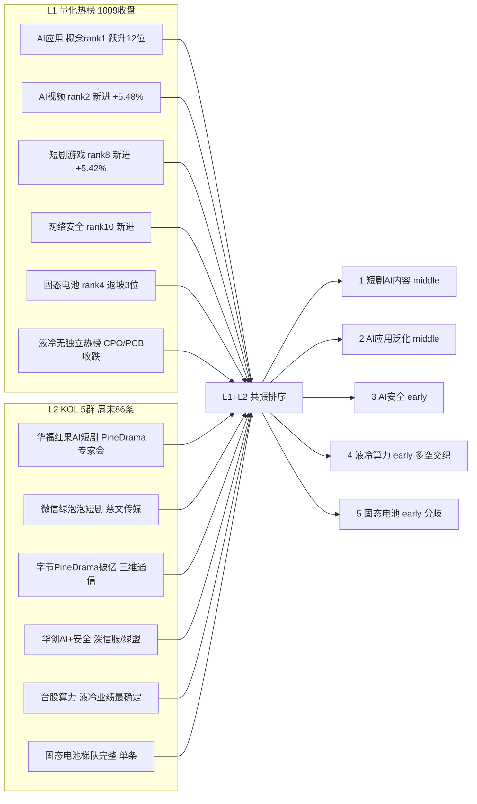

# 2026-10-12(周一) · **群聊情绪双源共振(L1 热榜 + L2 KOL)**

> **数据源新鲜度**: partial(L1=上周五收盘 / L2=周末新鲜)
> **降级状态**: true(WeFlow 永久下线 · 最高等级 L1+L2)
> **置信度**: 0.66
> **情绪基线**: 当日 **R1 = 78**(主升 conf0.85 · 四维 87 极贪 / 五维 73)

## 一句话结论

主升温度延续,R3 情绪 **83** = R1 78 + 5;唯一具赚钱效应的总主线仍是 **AI 内容/短剧传媒**(持 9 板最高标,周末卖方+热榜同步发酵),只做龙一龙二,极贪区不打满。

## 双源共振全景图

## 情绪浓度打分

| 项 | 数值 | 说明 |
|---|---|---|
| 🧭 R1 当日基线 | **78** | 连板情绪型 · 主升 · 仓位上限 70% |
| 📈 共振加成 | **+5** | 5 条 L1+L2,其中短剧/AI 内容为总主线且周末持续发酵 |
| 🌡️ R3 综合 | **83** | 主升贪婪区,clamp≤90 不打满 |
| 🔬 五维加权校验 | 73 | R3 高 10 分(<15 校验线),差来自周末 KOL/政策增量未计入 1009 收盘 |
| ⚠️ 极贪警戒 | 四维 87 | 高标 30 日 +210%,情绪越热越防核按钮,**分数≠加仓指令** |

> 纪律锚点:R3 只给温度。仓位仍以 R1 的 **0.70** 为准;若 9 板高标竞价核按钮或炸板率破 25%,立即降到 0.50 以下只留龙头。

## L1+L2 双源共振 Top5

| # | 主题 | 等级 | 段位 | L1 热榜证据 | L2 KOL 证据 |
|---|---|---|---|---|---|
| 1 | 🎬 **短剧/AI 内容传媒**(总主线核心) | L1+L2 | middle | AI视频r2/短剧r8/传媒r15新进;中文在线+20cm、芒果+20cm、新华传媒、新华文轩、流金科技霸榜 | 华福红果短剧数据+PineDrama专家会;微信绿泡泡(慈文);字节破亿(三维通信) |
| 2 | 🤖 **AI 应用/智能体**(主线泛化) | L1+L2 | middle | AI应用 r1(13→1跃升12位);东方财富/华信永道/艾融/天阳上榜 | 国金AI漫剧;天阳算力租赁;公募改革+6000亿中长期资金 |
| 3 | 🛡️ **AI 安全/网络安全** | L1+L2 | early | 网络安全概念新进 r10;绿盟科技 +20cm | 华创"AI+安全"电话会点名深信服、绿盟 |
| 4 | 💧 **液冷/AI 算力硬件** | L1+L2(弱) | early | L1无独立热榜,CPO r6/PCB r7/存储 r13 当日收跌 | 台股算力营收超预期、液冷业绩最确定、金刚石冷板 |
| 5 | 🔋 **固态电池/锂电** | L1+L2(最浅) | early | 固态r4但退坡3位;天赐材料surge 58→4;钠电/锂电排名暴跌15/11位 | "固态梯队完整"仅深夜单条 |

### 首推方向 · 短剧/AI 内容传媒(四问)

- **大资金意图**:把 AI 内容当成本轮唯一有赚钱效应的总主线抱团;卖方周末密集开专家会推动机构认知扩散,意图是**主线续航**,不是高低切。
- **为什么走强**:持有全场 9 板最高标 + 5 板梯队,宽度(20 强板块占 11 席)与高度共振;周末字节 PineDrama 9 个月破亿(Q2 下载 +460%)、微信官方短剧「绿泡泡」上线,形成连续催化。
- **逻辑够不够硬**:产业数据(下载/时长/出海投流)+ 价格强度(多股 20cm)+ 政策(AI 内容消费)三者齐备,是 5 条里唯一"硬逻辑+强合力"。但高标 30 日涨幅极端、3 板层断层,属主升中段而非初段。
- **人气底座**:中文在线 dc 人气 r3、芒果超媒 r9、新华传媒 dc2/ths4、新华文轩 ths16、龙版/吉视涨停、流金科技飙升 r6——人气=个股潜力,传媒 IP 在 dc 人气/飙升/ths 三表多点开花。

**买入理由(交 D1/R5 裁决,本 Agent 不深挖个股)**:总主线龙头/龙二放量换手,只做计划内核心。
**风险点**:高标核按钮、主线一倒无同级支线接指数(大本营 34 只 30 日仍 -9.33%)、海外软件端夜盘转弱。
**止损条件**:所跟龙头炸板不回封 / 板块封板率塌 / 9 板标天地板即撤。
**可验证假设**:1012 竞价短剧/AI 应用方向高开有封单承接、连板梯队 2 板层继续晋级而非中位断层扩大。

## 单源红线处理(不进 Top5)

| 主题 | 命中源 | 处理 |
|---|---|---|
| 🛢️ 油气/黄金/军工(地缘) | 仅 L2(R4 E001 油轮触雷+布油102+金4200) | L1 黄金仅 r12 动量弱,事件驱动非合力 → **观察**,交 D1+R7 |
| 🛒 内需消费(财政扩内需) | 仅 L2 多群 | L1 无消费热榜 → 剔除 |
| 💊 环磷酰胺涨价/化药 | 仅 L2 点名双成/誉衡 | 创新药 r3 动量 0,单点药品事件 → 主题级观察 |
| 🩸 血制品/麻疹免疫 | 仅 L2 单条 | 海外映射间接 → 剔除 |
| 🌾 粮食/转基因 | 仅 L1(转基因新进r5、金健ths热股r1) | 周末 KOL 无讨论,红线3不标强共振 → 观察 |

## 出货警报(红线4 · 不作正向共振)

| 标的 | 信号 | 判定 |
|---|---|---|
| 🚨 江淮汽车 | dc 人气 r1 + ths r2 双榜霸居,但当日 **-7.97%** | 人气与价格背离,见光/出货 |
| 🚨 大金重工 | dc7/ths7 高位却 **跌停 -10%** | 霸榜出货 |
| 🚨 力勤资源(C力勤) | 双平台 avg16.5 但单日 **-15.9%** | 高位人气股大阴,剔除 |

## 数据源审计

| 源 | 状态 | 抓取口径 | 记录 | 备注 |
|---|---|---|---|---|
| R1 当日基线 | 🟢 ok | 10-12 06:23 | — | status=complete conf0.74 |
| L1 人气四平台 | 🟡 stale | 10-09 收盘 | 319 | 盘前最新,隔周末 |
| L2 五群 KOL | 🟢 ok | 10-11/12 | 86 | 5/5 群;核心 G1 仅 6 条偏机构 |
| R4 消息(只读) | 🟢 ok | 10-12 06:27 | 8 | 交叉用,不越权 |
| WeFlow | 🔴 down | — | 0 | 永久下线 |

## 不确定性 / 反证

1. **L1 隔了一个周末**:热榜/人气是 1009 收盘,周末的短剧/政策催化未在 L1 价格中兑现,Top1 的"强"有一部分是 L2 单边预期,需 1012 竞价验证。
2. **结构瑕疵未解**:3 板层 0 只、非 ST 二板当日 -3.82%,中位接力无人;情绪热但宽度窄(大本营 34 只 30 日 -9.33%),主线一旦退潮缺接盘。
3. **硬件端多空交织**:液冷列 early 仅因 KOL 业绩证据,L1 当日硬件(CPO/PCB/存储)收跌且 R4 E003 记录 FCC 限制/337 调查/OpenAI ARR 低于共识,不应与短剧主线同等进攻权重。
4. **G2/G3 同源转发比例高**,独立信息浓度低于条数所示,故 KOL 权重未上调。

## 与其他 R/D/E 的关系

- **依赖**:R1_style(当日情绪基线,已消费)、attention_signals(L1 个股级底座)、wechat_cli_5groups(L2);只读交叉 R4_news。
- **被消费**:D1 主决策(情绪温度+共振主题)、R2 主线板块(热榜/人气方向校验)、R6 反证(出货警报/单源剔除可作反证素材)、E1 复盘。

## Sub-Agent 元数据

- skill: analyze_sentiment_resonance_v1(WeFlow 下线后 L1+L2 双源版)
- artifact: data/research/20261012/R3_sentiment.json
- 群名匿名化: G1 机构策略群(6条) / G2 题材扩散群 / G3 突发新闻群 / G4 卖方机构群 / G5 盘中快讯群
- model: ark-code-latest
