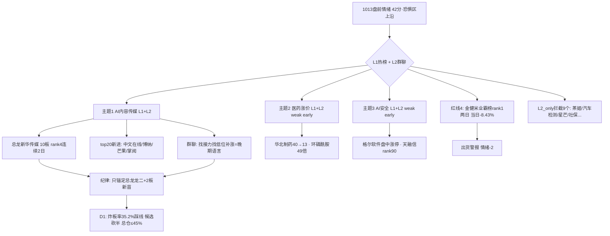

# 2026年10月13日（周二盘前）· 群聊情绪共振

> **数据源新鲜度**: partial（L1+L2 双源齐全，人气管道与东财源缺席）
> **降级状态**: false（WeFlow 永久下线属基线状态，L1+L2 为当前最高共振等级）
> **置信度**: 0.68
> **情绪浓度**: **42 / 100（恐惧区上沿，沿用当日 R1 基线）**

## 一句话结论

🔥 **全场只剩一个声音：AI 短剧/漫剧/传媒** —— 热榜与 5 个群罕见同向，但这是 **10 板高位的晚期共振**，是抱团不是启动；KOL 整体口吻已是"找接力、找低位补涨、提前做心理建设"。

## 详细分析

### 1. 双源共振全景

L1（同花顺热榜 1009→1012 rank diff）与 L2（5 群 437 条 / 有效长文本 199 条）在 **AI 内容传媒** 上形成当日唯一强共振：热榜 top100 里 AI 视频/短剧/传媒概念股占 **12 席以上**，top20 新进 9 只中 4 只（中文在线、博纳、芒果、掌阅）直接属该线；群聊端从题材群到卖方机构群（华福 AI 互联网一天两场 PineDrama 电话会、国金计算机"AI 漫剧=应用数据爆发排头兵"）全天刷屏。

但共振的**性质是晚期（late）**：总龙新华传媒 10 天 10 板、连续两日热榜 rank4，群里讨论的已经不是"要不要做"，而是"接力首选掌阅""唯一低位黄山旅游""小崧股份预期差"——**高位找补涨是退潮前的典型语言**。与 R1 判定的"高标独活、个股血洗、炸板率 35.2%"完全互证。

### 2. 主题共振排序

| 排名 | 主题 | 共振 | 位置 | 热榜证据 | 群聊证据 | 态度 |
|---|---|---|---|---|---|---|
| 1 | AI 内容（短剧/漫剧/AI影视传媒） | L1+L2 | 🔴 **late** | top100 ≥12席，top20新进4只，新华文轩 16→6 | 5群全覆盖，卖方两场电话会 | **只锚定总龙/龙二 + 2板新苗，禁中位接力** |
| 2 | 医药涨价/短缺药 | L1+L2 | 🟢 early | 华北制药 40→13 新进top20 | 环磷酰胺涨49倍、鼠疫用药早盘刷屏 | **观察**，容量未验证不进核心 |
| 3 | AI 安全（逆向/商密/水印） | L1+L2（弱） | 🟢 early | 仅天融信 rank90 边缘 | 格尔软件盘中涨停被实时确认 | **观察**，AI主线外溢一日游概率高 |

**大资金意图（主题1）**：流动性缺失环境下（G1 原话"市场缺少流动性，等待新板块启动"），存量资金把流动性极端抱团到唯一最高标 + AI 内容一条线，同时用电泳式挖掘低位补涨股维持板块温度——意图是**维护高位出货的接力生态**，不是开辟新战场。
**为什么走强**：产业催化是真的（PineDrama 海外 1 亿下载、央视频 AI 短剧上线、DataEye 全年 400 亿市场），但股价已提前 10 个板反映。
**逻辑够不够硬**：产业逻辑硬、交易位置危险。硬逻辑给了总龙不死的理由，但不给中位股安全边际。

### 3. 单源信号（纪律：不进共振主题）

- **L1_only**：风电海工（大金重工 rank5、天顺 rank27）群里零讨论；银行避险（工行/农行/招行进 top100 且当日 +3% 左右）是避险共识非题材；光模块 CPO 全线退榜（中际旭创 14→28、新易盛 58→70、工业富联 -7.17%）——硬件退潮的负向确认。
- **L2_only（9 条被红线 3 拦截）**：霸王茶姬爆单（皇氏集团，3 群 8+ 条但未上热榜）、汽车检测、华为星芒、社保信息化、AI 变压器（大摩 77GW）、逆变器对欧、固态电池碘材料、乳酸涨价、DeepSeek 具身智能——**均为事件点火，群热度未获资金热榜确认，不得冒充共振**。

### 4. 情绪浓度推导

基准直接消费当日 R1 = 42（恐惧区上沿），不自我重算。调整项：主题 1 虽为最高等级共振但 late，高位共振不加分；医药/AI 安全 early 弱共振各 +1；**金健米业连续两日霸榜热榜 rank1 且当日 -8.43%，命中红线 4（霸榜出货警报）-2**；净调整 = 0，**维持 42**。

## 关键证据

- 证据 1：THS 热榜 top20 新进 9 只，4 只为 AI 内容（中文在线 rank10 / 博纳 79→11 / 芒果 rank16 / 掌阅 rank19），新华文轩 rank 16→6 · 来源 tushare.ths_hot
- 证据 2：G4 机构群 华福 AI 互联网当天两场（午间+20:30）PineDrama 海外 AI 短剧测评电话会；国金计算机研报标题"应用数据爆发排头兵：AI 漫剧" · 来源 wechat-cli
- 证据 3：G1 群 14:27"已经提前做了心理建设，龙头不行其他也就 soso"；10:08"市场缺少流动性，等待新板块启动，休息等待" · 来源 wechat-cli
- 证据 4：博纳影业 rank 79→11（+68 名，当日 +10.04%）、欢瑞 rank26、龙版 rank30、果麦 rank88（20cm）、吉视 rank22（+10%） · 来源 tushare.ths_hot
- 证据 5：掉出 top20 的 9 只中 6 只为钠电/固态电池/氟化工、3 只 CPO/存储硬件，资金撤出硬件与 R1 互证 · 来源 tushare.ths_hot
- 证据 6：金健米业 1009/1012 连续两日 rank1，当日 -8.43%，霸榜出货警报 · 来源 tushare.ths_hot

## 数据源审计

| 源 | 状态 | 抓取时间 | 记录数 | 备注 |
|---|---|---|---|---|
| 5 群 wechat-cli（G1-G5 匿名） | 🟢 ok | 10-13 06:01 | 437（长文本199） | 5/5 群全齐 |
| tushare 热股榜 | 🟢 ok | 10-12 22:30 | top100 | 与1009双日diff |
| R1 情绪基线 | 🟢 ok | 10-13 06:20 | 1 | 当日基线42 |
| WeFlow 语义层 | 🔴 down | — | 0 | 2026-08-19 永久下线 |
| attention_signals | 🔴 missing | — | 0 | 当日管道未跑，ths_hot 代替 |
| 东财 dc_hot | 🟡 skipped | — | — | ths 双源已够用，未交叉 |

## 不确定性 / 反证

1. **晚期共振最容易演成"共振即顶"**：KOL+热榜+卖方三方一致看多 AI 短剧，在 10 板高位是典型的情绪充分交换信号。若 1013 竞价总龙核按钮，本报告主题 1 的全部候选语义立即失效——R3 的共振强度不能被 D1 解读成安全边际。
2. **热榜是人气不是资金**：THS hot 值代表散户/围观热度，金健米业、哈药（rank7 但跌停）证明高人气可与出货并存；本报告缺 attention_signals 多平台合力与游资资金确认（属 R7 职责）。
3. G2/G3/G5 存在同一批营销转发号跨群重复推送，199 条长文本的独立信源实际更少，AI 短剧的刷屏浓度有水分，已通过"卖方 G4 独立同向"部分对冲。
4. early 两主题（医药/AI安全）热榜证据薄弱（各仅 1 只边缘/新进），一日游概率高，置信度因此压在 0.68。

## 与其他 R/D/E 的关系

- 依赖: `R1_style.json`（情绪基线42/高位震荡/炸板率35.2%）、`data/raw/20261013/wechat_cli_5groups.jsonl`、tushare.ths_hot
- 被消费: D1 主决策（共振主题仅作情绪侧输入，late 主题须经 R2 主线判定 + R6 反证 + R7 资金确认后方可入执行池）、E1 复盘（霸榜警报与晚期共振的应验追踪）

## Sub-Agent 元数据

- skill: analyze_sentiment_resonance_v1
- artifact: data/research/20261013/R3_sentiment.json
- 生成耗时: 约 8 分钟（含双日热榜 MCP 拉取）
- model: ark-code-latest
