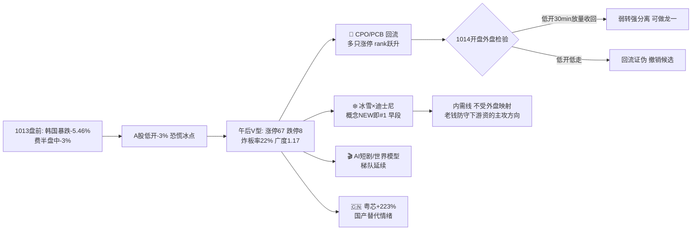

# 2026年10月14日(周三) · **群聊情绪共振**

> **数据源新鲜度**: ok ｜ **降级状态**: degraded(WeFlow永久下线, 双源 L1+L2 为最高等级) ｜ **置信度**: 0.70

## 一句话结论

> **情绪55分,退潮后扩散修复的"老钱防守、游资低位挖苗"格局;冰雪消费是唯一L1+L2早段强共振,硬件链共振但开盘先挨外盘的打。**

## 详细分析

### 🌡️ 情绪温度:55/100(中性区上沿,与R1当日基线55一致)

R1(当日1013收盘口径)给55,R3多源共振只加1分,理由三条:

1. **有共振但无高热**——5个主题达到 L1+L2,但全部是"低位新催化"或"超跌回流",没有一个主题出现热榜霸榜+群聊高潮的过热形态;
2. **老钱在公开喊防守**——核心老钱群15:00原话"高波动调整阶段,不建议高仓位主动进攻,轻仓或空仓等**量能/核心资产/风险偏好**三信号修复",KOL本人晚间只讲波段节奏,零进攻号召;
3. **人气锚是防御脸**——热榜前列金健米业(粮食)、江淮汽车(华为汽车)、哈药股份(创新药)、九阳股份,并非题材龙头;题材人气(粤芯/超声/澳弘/龙版/长白山)排在7-19位,是典型的扩散而非抱团。

**温差结构**:进攻群3个(题材两群+新闻群,全天挖低位新苗)、防守群1个(老钱)、机构群1个(券商单独吹光连接订单)。没有任何一方号召追高,硬件多空在开盘前已公开对决。

### 🏆 L1+L2 双源共振 Top5(WeFlow下线后最高等级)

| # | 主题 | 等级 | 段位 | L1 热榜证据 | L2 群聊证据 |
|---|---|---|---|---|---|
| 1 | ❄️ 冰雪消费(冰雪大世界×迪士尼) | L1+L2 | **early** | 概念榜NEW即#1(18.5万热度);人气榜雪人#3/冰山冷热#10/长白山#19 | 全天三题材群刷屏,7条扩散线路 |
| 2 | 🔌 CPO/PCB/光连接 | L1+L2 | middle | CPO概念5→3/PCB 9→4;澳弘56→10、超声NEW#11均涨停;6只光链股rank跃升 | 开源通信首席双群推PH链+1014专场;Lumentum订单排到2029 |
| 3 | 🎬 AI内容(世界模型/AI短剧/IP) | L1+L2 | middle | 龙版30→9、慈文#13、天娱#8、风语筑#17批量涨停 | 字节世界模型演示5+条长文跨3群;星爷1港元all-in AI短剧 |
| 4 | 🇨🇳 半导体国产替代/存储 | L1+L2 | early(撕裂) | 粤芯NEW#7(+223%)、人气榜#1;兆易59→33 | 韩资逆势净买入奥士康/德明利/中际旭创 |
| 5 | 🤖 人形机器人(特斯拉量产前夜) | L1+L2 | early(L1弱) | 宇树51→26;无板块涨停潮 | 新剑传动"方案定型即将量产"13:37起4条连续发酵 |

### ❄️ 主题1 · 冰雪消费:当前质量最高的共振(early)

- **大资金意图**:1012血洗后资金从高位3板以上撤离(R1:打二板以上篮子-3.11%),需要一个**低位、有新催化、板块效应可扩散**的容器;冰雪大世界125万㎡扩容+时隔16年再牵手迪士尼(冰雪奇缘专区)正好在1013假期数据窗口落地,板块9家涨停且全部低位。
- **为什么走强**:双催化叠加——事件(官宣扩容+迪士尼IP)+季节(冰雪季开篇,每年10-11月固定炒)。人气榜三只涨停(雪人/冰山冷热/长白山)说明散户侧已经点火。
- **逻辑够不够硬**:中等偏上但发散。硬点是迪士尼IP授权(实丰文化持冰雪奇缘授权)与本地基建实锤(龙建股份东北订单60%+);软点是题材扩散到杯壶/照明/食品等杂毛线,且本质是事件驱动,持续性取决于龙头连板高度。**态度:观察梯队,只做龙一龙二,杂毛线一律划掉。**

### 🔌 主题2 · CPO/PCB:1014第一验证点(只做分离确认)

- **大资金意图**:1013白天回流有真实基本面背书(杰普特1.63亿美元北美V客户订单=全年营收53%;致尚科技5亿美元2027备忘录;Lumentum订单排到2029),不是纯情绪。
- **为什么走强**:超跌+订单+三季报(PCB密集超预期),抄底资金从PCB吹响V型反攻号角。
- **逻辑够不够硬**:产业逻辑硬,**时机危险**——隔夜费半盘中-3%、应用材料-6.7%、美光/海力士-3%+,A股硬件1013白天的上涨发生在外盘暴跌之前。**态度:不追。竞价低开后30分钟内放量收回(外崩我不崩)才可做超声电子/澳弘电子龙一;低开低走则回流证伪,相关候选全部撤销。**

### 🎬 主题3-5 速判

- **AI内容(中段)**:概念热度边际回落(AI视频概念榜1→7)但个股梯队完整(龙版/慈文/天娱/风语筑涨停),字节世界模型+10/19南京物理AI大会是日历催化;美股软件股强于硬件(Meta+2.63/英伟达尾盘转涨),弱正向映射。只做最强辨识度龙版/慈文,不挖杂毛。
- **半导体国产替代(early但撕裂)**:粤芯+223%与人气#1证明新股情绪爆棚,长鑫登顶韩资扫货榜;但外盘存储双雄大跌构成负反馈。**态度:看分离,不追新股。**
- **机器人(early,L1弱)**:仅宇树一只热股温升+单一事件(新剑传动问询函),无板块涨停潮,共振质量最低,降级观察。

## 关键证据

- 证据1: ths概念榜1013有6个NEW面孔——冰雪产业#1/染料#2/军工#8/中船系#13/三季报预增#12/光纤#20,**新热点占榜30%=低位扩散的典型形态** · 来源 tushare ths_hot
- 证据2: 澳弘电子热股rank 56→10(涨停)、超声电子NEW#11(涨停)、赛力斯83→6 · 来源 ths_hot两日diff
- 证据3: 老钱群核心发言15:00:"不建议高仓位主动进攻……等待量能恢复、核心资产企稳、风险偏好修复三个信号" · 来源 wechat G1
- 证据4: 冰雪主题横跨3个题材群,7条线路(设备/东北消费/IP潮玩/基建/亮化/装备/杯壶)全天刷屏,19:00-22:22仍在挖龙建股份 · 来源 wechat G4/G5/G2
- 证据5: 官媒标题双向——上证报"显著放量!资金进场了" vs 证券时报"韩国股市暴跌熔断""两大巨头警告美股光通信存储大跌" · 来源 公众号RSS
- 证据6: 大V复盘三篇一致定性:"本轮第二次V"(安静拆主线)/"犹豫的左脚"(盘口逻辑拆解)/"温水煮蛙"(猫笔刀)——左侧反复磨底,不是V转,反弹两天要小心节奏

## 公众号观点(仅作观点证据,不计入共振)

- **复盘大V(情绪关键)**:三篇独立复盘一致=超跌后的左侧下影线,"更像左脚但外围不省心","涨两天要注意节奏,别用主升那一套";
- **产业深度**:调研先知《PCB下半场》——二三线涨价β已跑过半程(15倍+不便宜),AI一线13-18倍是错杀α,交易回到CCL/电子布上游;傅里叶的猫——光器件订单排到2030年,CPO激光器2029前后放量;远川——全球AI债务发行4500亿美元(capex债务化的隐忧);
- **宏观情绪(偏谨慎,不入板块共振)**:黄奇帆被查、宜信暴雷讨论、IMF警告、韩股熔断、Visa获准进入银行卡清算。

## 数据源审计

| 源 | 状态 | 抓取口径 | 记录数 | 备注 |
|---|---|---|---|---|
| tushare ths_hot | 🟢 ok | 1013 22:30批次 vs 1012 | 热股100×2+概念20×2 | 两日rank diff |
| tushare dc_hot | 🟢 ok | 1013人气+飙升 | 200 | 替代缺失的attention管道 |
| 群聊5组 | 🟢 ok | 截至1013深夜 | 483(长文121) | 5/5群,群名已匿名化 |
| 公众号RSS | 🟢 ok | 1013 | 82篇/13号 | 仅观点层,不计分 |
| WeFlow | 🔴 error | — | 0 | 2026-08-19永久下线 |
| attention_signals | 🟡 missing | — | 0 | 当日未产出,dc双榜替代 |
| R1基线 | 🟢 ok | 1013收盘 | sentiment=55 | 当日口径,非前日 |

## 不确定性 / 反证

1. **硬件链是R3最大的双刃**:L1+L2共振真实存在,但群聊和热榜数据截止1013 22:30,**尚未消化隔夜费半暴跌的A股开盘反馈**;若低开低走,主题2的"middle"段位要当场改判"回流证伪",主题4同步降级。
2. **冰雪的持续性未经天梯检验**:板块9家涨停但高度未知,事件驱动题材常见首日集体涨停、次日即分化;若龙一(长白山/中兴商业/实丰文化其一)不能2板,主题1从early滑向"一日游"。
3. **情绪55的脆弱性**:昨日涨停溢价仅+1.13%(R1),说明隔日接力信心未恢复;热榜新面孔多也可能是"无处可去的轮动"而非增量资金,若1014涨停家数跌回50以下,情绪分应下修至45以下。
4. R3无北向实时数据,韩资逆势买入仅新闻口径,韩国5日-13.83%的联动风险无法量化。

## 与其他 R/D/E 的关系

- **依赖**: R1_style.json(情绪基线55/高位震荡/仓位上限55%)、data/raw/20261014 群聊与RSS、tushare双热榜
- **被消费**: D1(主决策,主题排序与硬件分离条件)、R2(主线板块判定——冰雪/CPO/AI内容的龙头归属)、R6(反证——霸榜出货/外盘负反馈)、E1(复盘情绪预判兑现率)
- **边界**: 本件不做板块排序、不出交易建议、不做个股画像;个股仅作热榜/群聊证据透传

## Sub-Agent 元数据

- skill: analyze_sentiment_resonance_v1
- artifact: data/research/20261014/R3_sentiment.json
- model: ark-code-latest
- 生成耗时: 约8分钟(含tushare两日双热榜实时拉取与483条群聊语义抽取)
