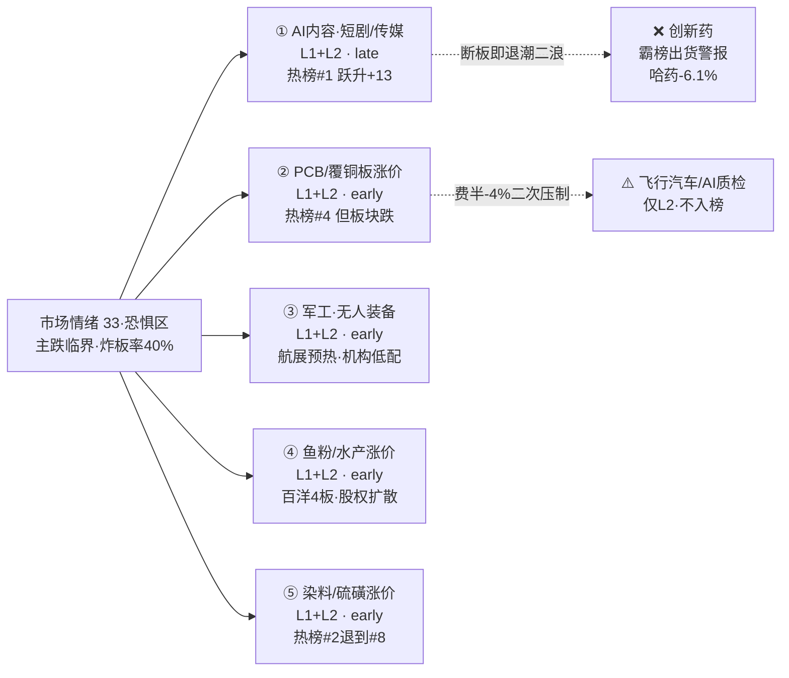

# 2026年10月15日（周四）· 群聊情绪共振

> **数据源新鲜度**: ok（L1=1014收盘 / L2=5群445条 / 公众号86篇）
> **降级状态**: true（WeFlow 永久下线 → 最高等级 L1+L2；attention_signals 缺失）
> **置信度**: 0.62

## 一句话结论

😱 **情绪浓度 33（恐惧区）**：全场只剩"短剧/AI内容"一条高位抱团活口撑双源共振，老钱空仓"等传媒高标断板"，涨价/军工全是 early 分歧——**有抱团、无合力，降维看戏，不追 4 板孤高标。**

## 情绪坐标

| 维度 | 读数 | 说明 |
|---|---|---|
| 🎚️ R1 基线 | **35** | 当日 `R1_style.json`（震荡分化·主跌临界，行情口径 1014 收盘） |
| 📈 共振调整 | **−2** | 内容线强共振 +3（late 不计进攻分）／断板风险 −3／创新药出货 −1／硬件夜跌 −1 |
| 🎯 R3 终值 | **33（恐惧区）** | 五维校验 ≈45.6，gap 12.6＜15，方向一致偏空 |
| 💰 仓位语境 | R1 建议上限 **35%** | 主跌临界给最低防御档 |
| 🔻 段位 | 高位震荡→**主跌临界** | 炸板率 40%、中位数溢价 −1.7%、4 板孤立 |

情绪没有因为热榜里有一条强共振就升温——**1014 是退潮日，唯一的共振是"抱团取暖"而不是"多路合力"**。热榜概念 #1 短剧游戏由 1013 的 #14 一跃登顶（+13），但最高标全挤在 4 板传媒（慈文传媒/新华文轩/新经典），老钱核心群（G1）当天最明确的一句话就是"**等它断板**"。

## 双源共振 Top 5（L1 热榜 × L2 群聊，WeFlow 缺席）

### ① 🎬 AI内容·短剧/传媒/AI互动影游 —— L1+L2 · **late** · 观察不追高

全场唯一活口，双源共振最强，但这是**退潮日 4 板高位抱团孤岛**。

- **大资金意图**：硬件撤退后无处可去的封板资金，在"绿泡泡短剧 + 字节 PineDrama 出海（下载破亿、日活700万）"的产业叙事里抱团取暖；热股榜掌阅科技/新华文轩/慈文传媒/新经典/引力传媒批量涨停。
- **为什么走强**：微信"绿泡泡短剧"9 月底上线 + Q4 发行激励，天威视讯（参股中广电26.17%，河马剧场资质/分账方）逻辑被反复挖；卖方（G4）连开红果 AI 产业链、AI 漫剧电话会。
- **逻辑够不够硬**：产业趋势真，但**节奏在 late**——G1 老钱公开"等传媒高标断板，继续看戏""融资盘可能爆仓"，隔夜纳指 −1.85% 再添情绪压制。
- **态度**：**不追高**。只在低开后放量分离走强、龙一确认时小仓位；4 板高标核按钮/断板即退潮二浪，直接放弃整条线。
- 关联：天威视讯、掌阅科技、新华文轩、慈文传媒、荣信文化、百纳千成。

### ② 🔌 PCB/覆铜板/电子材料涨价链（CPO/PogoPIN）—— L1+L2 · **early** · 拦截为主

涨价与三季报是真催化，但**板块指数当日跌、内部高位算力光模块与低位材料严重分化**。

- **大资金意图**：国巨新一轮 MLCC 涨价（高容 +50%）、松下覆铜板部分涨 200%、电子布涨价，资金做"低位材料涨价 + 业绩预增"；超声电子、宝鼎科技（净利 +537%~614%）、满坤科技涨停。
- **为什么走强**：英伟达 Voronoi 方案全面用 PogoPIN（80 亿颗缺口，电连技术国内唯一合格供应商）；RubinUltra PTFE 导入提前至 2027。
- **逻辑够不够硬**：材料涨价硬，但**隔夜费半 −4.3% 六连跌、CoreWeave −15.3%/戴尔 −11.4% 崩盘**，中际旭创 −5.73、新易盛 −5.84、工业富联 −6.67 已先跌，1015 硬件二次低开不可避免。
- **态度**：**拦截为主**。严禁左侧接算力/光模块飞刀，反抽是减仓点；仅覆铜板/MLCC 有三季报实锤的低位票（超声/宝鼎/双星新材）留观察。

### ③ 🛩️ 军工·无人装备（珠海航展预热）—— L1+L2 · **early** · 观察低位

- **大资金意图**：12 月初珠海航展（3000+ 装备、无人装备为最大看点）+ 军工年初至今跌 30%、机构 H1 低配 2.3%（近 6 年最低），博低位反转。
- **为什么走强**：内蒙一机（无人战车）、建设工业（四足机器狼）、润贝航科（26H1 净利 +45%）、七一二（专网通信底部反转）；航发科技当日涨停。
- **逻辑够不够硬**：低位 + 事件 + 低配，early 属性清晰；但热榜军工 #8→#11（−3）随退潮回落，主跌临界期无合力。
- **态度**：**观察**，作为情绪退潮后可能承接资金的低位方向，不提前开仓。

### ④ 🐟 鱼粉/水产饲料涨价（产品→股权扩散）—— L1+L2 · **early** · 观察高低切

- **大资金意图**：秘鲁第二捕季取消、全球鱼粉供给十年新低、价格同比 +75%，百洋股份四连板打高度，资金沿"产品→股权"挖低位（中水渔业、禾丰股份持大连禾丰鱼粉45%）。
- **逻辑够不够硬**：涨价实锤，但 **L1 板块层缺位（仅百洋个股在榜 #61，非 top20）**，量化共振弱，且是孤高标带动的补涨。
- **态度**：**观察**。炸板率 40% 环境不接力高位，只看龙头断板后低位补涨的分离机会。

### ⑤ 🧪 染料/精细化工 & 硫磺涨价—— L1+L2 · **early** · 观察

- 醋化股份涨停（乙腈两月 +139% 至 22000 元/吨四年新高）、富春染织涨停（前三季净利 +1348%~1519%）、红星发展硫磺（霍尔木兹扰动）+ MLCC 双击。
- 但染料概念热度 **#2→#8（−6）** 明显退潮、板块当日跌，属涨价暗线 early 分歧，非合力主线，交 D1 结合 R7 资金确认。

## 单源红线（不入 Top 5）

| 类型 | 主题 | 判定 |
|---|---|---|
| ⚠️ L2_only | **特斯拉飞行汽车/Roadster**（保隆/瑞玛，10/15 美东晚间发布） | 群聊刷屏但热榜无对应，**事件驱动观察**，等开盘/资金验证 |
| ⚠️ L2_only | **AI 视觉质检/老干妈**（泰禾智能/美亚光电，全网热搜第一） | 非 THS 热榜板块，AI 应用落地分支观察 |
| 🔵 L1_only | 冰雪产业（#1→#2，群聊零提及）、煤炭/高股息（新进，避险脉冲）、粮食（金健米业热股#1） | 群聊无共振，不计正向共振 |

## 🚧 出货警报（红线 4）

- **创新药/哈药股份**：概念榜 #3 但 pct −1.38、哈药热股 #17 跌 **−6.10%**，延续霸榜后价格走弱；群聊零正向讨论。**不作正向共振，继续列出货警报。**
- **传媒 4 板高标**：短剧虽新登顶，但最高标孤立 4 板、老钱公开等其断板——标注断板/派发风险（非霸榜多日，暂不定性出货）。

## 公众号观点（Layer 2b · 仅观点证据，不计共振分）

- **命中内容主线**：财联社早知道（AI 游戏新动作：英伟达新技术/微软新团队）、财联社 VIP 日报（传媒逆势最强、短剧加码）、财闻私享（"4000+ 下跌续缩量，逆势最强持续度最好的还是短剧传媒"）。
- **宏观与情绪（关键）**：证券时报"深夜全线跳水·加息预期升温"；猫笔刀"**人心都跌散了**"；贩财局"主力等鱼死、散户当鱼"+ 韩国日经跳水/私募赎回传闻；安静拆主线"没完没了的隔日单跳"；调研先知"OCP 没有超预期利好"。官媒与大 V 情绪与群聊"空仓看戏"完全同构。

## 数据源审计

| 源 | 状态 | 抓取时间 | 记录数 | 备注 |
|---|---|---|---|---|
| R1_style | 🟢 ok | 06:19 | 1 | 当日完整产物，基线 35 |
| tushare ths_hot | 🟢 ok | 1014 22:30 | 概念20+热股100 | 另拉 1013 做 rank diff |
| 微信群聊 | 🟢 ok | 06:00 | 445 | G1=42/G2=98/G3=122/G4=20/G5=163 |
| 公众号 RSS | 🟢 ok | 06:00 | 86 | 11 feed 有文 |
| WeFlow | 🔴 error | — | — | 永久下线，L1+L2 为最高等级 |
| attention_signals | 🔴 missing | — | — | 多平台人气管道当日未跑 |
| dc_hot / xtick | ⚪ 未用 | — | — | 以 ths 热榜承担 L1 |

## 不确定性 / 反证

1. **唯一活口 vs 老钱等断板**：内容线双源最强却被最资深资金视为"该断未断"的高标——这是本报告最大张力。若 1015 低开后短剧龙一放量分离走强，late 判定可能被盘中证伪（则情绪修复）；若核按钮，则直接坐实主跌。
2. **L1 单一来源**：attention_signals 多平台人气管道缺席，Layer 1 仅 THS 热榜，东财人气/飙升榜未交叉，题材热度的个股底座略薄。
3. **行情口径**：L1 为 1014 收盘，隔夜 CPI/费半夜跌尚未计入热榜，1015 开盘硬件链与内容线都要接受负反馈验证，盘前置信度受限。
4. 五维校验（45.6）高于 R3（33），因五维未含隔夜外盘与 KOL 空仓情绪，若外盘冲击在盘中钝化，实际情绪可能比 33 略高，但不改变降维结论。

## 与其他 R/D/E 的关系

- **依赖**：R1_style（情绪基线 35 / 段位主跌临界）；fetch 群聊 + 公众号 + tushare 热榜。
- **被消费**：D1 主决策（唯一活口 late 不追、硬件拦截、early 方向交 R7 资金裁定）；R6 反证（创新药出货 + 传媒断板风险可作硬否决素材）。

## Sub-Agent 元数据

- skill: analyze_sentiment_resonance_v1
- artifact: data/research/20261015/R3_sentiment.json
- 生成耗时: 约 12 分钟（含实时热榜两日拉取）
- model: ark-code-latest
