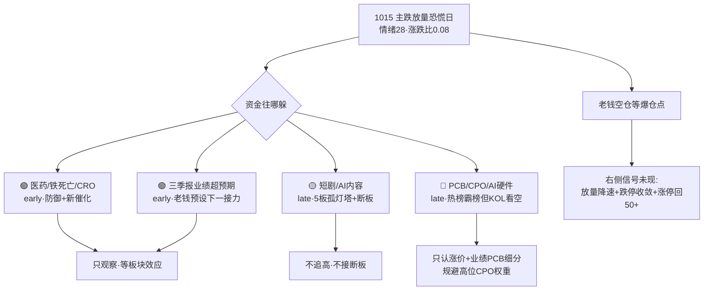

# 2026年10月16日（周五） · 群聊情绪共振

> **数据源新鲜度**: partial（主源全 ok · WeFlow 下线 · attention 管道缺）
> **降级状态**: false（L1+L2 双源完整）
> **置信度**: 0.70　**情绪浓度**: **28 / 100（恐惧区，接近极恐）**
> **行情口径**: 盘前看最新收盘 = 10-15（周四）

## 一句话结论

🧊 **主跌段恐慌日，老钱空仓看戏等爆仓点，游资挖苗散乱无合力；唯一 early 新火是「医药/铁死亡」与「三季报业绩」，但只观察不抢跑。**

## 一、情绪坐标（先认市场，再认个股）

- R1 已坐实 **崩溃退潮型 + 情绪 28**：1015 全市场涨 430 / 跌 5108，涨跌比 0.08，中位 **-3.04%**，跌停 26 家、放量到 1.65 万亿，1014 涨停池次日溢价中位 **-3.14%**（仅 38.9% 收红）——**接力盘实亏**。
- KOL 端与量化完全同构：核心老钱 Jason 全天口径「**还没到临界点 / 继续看戏 / 最近可能还要暴跌 / 暴跌之后爆买**」，夜盘再补「美股科技暴跌，死扛的基本要被打爆」。群友报已空仓，流传「三天收不回 3750 牛市结束」破位论。
- 官媒/ETF 是唯一对冲力量：深夜中国资产拉升、沪深300ETF 成交环比 **+23 倍**、尾盘半小时大资金进场近 500 亿。**这是左侧护盘，不是进攻信号；主跌段第一次反抽多为减仓窗口。**

## 二、L1+L2 双源共振主题（Top4）

| # | 主题 | 共振 | 段位 | 热榜(L1) | KOL(L2) | 态度 |
|---|---|---|---|---|---|---|
| 1 | 创新药/铁死亡/CRO | **L1+L2** | early | top100 占11、top20 占3 | 3群全天刷屏铁死亡 | **观察**（主跌不抢跑） |
| 2 | 三季报业绩超预期 | **L1+L2** | early | 崇达/金禄/富春/湘发展显性上榜 | Jason：接下来就是炒业绩 | **观察**（需依附真业绩） |
| 3 | 短剧/AI内容/传媒 | **L1+L2** | late | top100 占21、top20 占5 | 挖苗最密但总龙断板 | **拦截追高/断板** |
| 4 | PCB/CPO/AI硬件 | **L1+L2** | late | top100 占39（最霸榜） | 颜晓滨/张望坚定看空硬科技 | **硬件β规避·细分个别观察** |

### ① 创新药 / 铁死亡 / CRO　`early · L1+L2`

- **大资金意图**：高位硬件/传媒筹码松动后，资金找「低位 + 新催化 + 防御」的容器，医药三者皆备。热榜 rank_reason 直接写明「AI硬件走弱、医药逆势走强、资金轮动」。
- **为什么走强**：全球首个铁死亡抗癌药临床数据出炉（新细胞死亡通路成药性首次验证）；AI4S 扩容 CRO 需求。华北制药 rank 41→**5**、百花医药 r22 涨停、联亚药业（次新CRO）新进 r17 单日 +401% 临停。
- **逻辑够不够硬**：中。铁死亡是真催化但 A 股多为边缘映射（莱美/尖峰/德展），业绩兑现远；CRO 有产业逻辑（昭衍新药 r61、万邦医药 r68）。
- **候选（仅入观察池，非买入）**：300006 莱美药业（赛道首创·r71）、600721 百花医药、603127 昭衍新药、尖峰集团（KOL 高频点名·小市值·未上热榜）。
- **风险点 / 可验证假设**：纯主题无业绩，主跌段新苗次日溢价为负。**假设**：1016 医药板块能逆势维持 3+ 涨停且次日有溢价，才算 early 成立。

### ② 三季报业绩超预期　`early · L1+L2（元主题）`

- **大资金意图**：加息 + AI 资本开支怀疑压垮叙事估值后，资金向真实盈利与回购避险，**业绩是主跌段最硬的安全垫**。
- **为什么走强**：崇达技术三季报 +89.7%~118%（r34 涨停）、金禄电子 +192%~218%（r70·20cm）、富春染织 +1347%~1519%（r54）、湖南发展重组后 +290%~353%（r74）；官媒《三大行业集中报喜》《业绩预喜股逆市走强》。
- **逻辑够不够硬**：较硬，有真实预告与回购（300502 十亿回购），但需逐票防伪、防利好出尽。
- **态度**：这是 Jason「暴跌后爆买」的方向，但当前仅预告期、无批量板块效应——**观察，等业绩线集体涨停 + 次日溢价转正**。

### ③ 短剧 / AI内容 / 传媒　`late · L1+L2`

- **大资金意图**：余温资金在唯一有赚钱记忆的内容线抱团，同时大面积挖低位补涨票（天威视讯/凯撒文化/华策影视/实益达）维持热度——**高位派发前的续命**。
- **为什么（表面）强**：红果短剧日均 125 分钟超抖音、深圳短剧出海补贴、字节 AI 影游跑通。慈文传媒 **5 连板**是全场情绪灯塔之一。
- **逻辑够不够硬**：中偏弱。**总龙新华传媒已断板**（热榜 49→86）、龙版传媒 rank2→14 且 **-9.45%**、博纳 -8.24、芒果 -4.41，板块半数大跌。Jason 明说「AI传媒结束」。
- **态度**：**拦截追高、不接断板**。慈文 5 板独木难支，断板即退潮二浪确认。

### ④ PCB / CPO / AI硬件　`late · L1+L2（热与方向背离）`

- **大资金意图**：全球资金撤离「靠借钱 + AI 叙事」的算力链（贩财局排序：算力租赁 CoreWeave-16% > 集成商 > 存储 > 芯片 > 云巨头）。A 股仅在**有涨价 + 业绩**的 PCB 环节局部抱团，板块整体杀估值中段。
- **热榜假象**：人气最霸榜（top100 占39），超声电子新科榜首（12→1）、澳弘电子 r2，但 CPO 权重股价仍在跌——中际旭创 r18 -5.19%、新易盛 r52 -7.49%、工业富联 -3.89%、长鑫科技 -5.24%。**人气上升 ≠ 赚钱**。
- **KOL 方向**：颜晓滨「硬科技不建议、筹码结构会继续阴跌、半年后再看」；张望「光模块到 PCB 供应链安全杀估值，退潮都信了」。
- **态度**：**硬件 β 规避**；仅认可覆铜板涨价 + 三季报的 PCB 细分（澳弘电子、崇达技术），且须等主跌段位解除。

## 三、热榜 rank 信号（L1 · 双日 diff）

- **排名急升（新晋热度）**：欢瑞世纪 86→16（短剧）、澳洋健康 93→24（医疗）、百洋股份 61→15（鱼粉）、华北制药 41→5、皇台酒业 63→23（白酒防御）、兆易创新 74→36（超跌反弹，价仍跌）。
- **新进 top20**：仅 **联亚药业**（r17·次新 CRO·+401% 临停）——医药是唯一冲进前排的新面孔。
- **⚠️ 出货警报（价热背离/高标崩跌）**：
  - 金健米业：1014 **榜首** → 1015 r10 且 **-9.01%**
  - 龙版传媒：r2 → r14 且 **-9.45%**；东百集团：r6 → 跌停 -10.01%（终止收购光芯片）
  - 新华传媒：前总龙 **断板**（49→86）；醋化股份：r32涨停 → r94 跌停
  - 无单一股连续 2 日霸榜 top1（榜首一日易主），但**旧榜首一日内暴跌**本身即高标快速退潮信号。

## 四、公众号观点（Layer 2b · 仅作观点证据，不计入共振分）

- **宏观与情绪（关键）**：深夜中国资产拉升、沪深300ETF 成交 +23 倍、最后半小时近 500 亿进场；潘功胜/蓝佛安发声、何立峰会见达利欧；券商「短期扰动不改产业升级」。
- **外部风险**：韩股熔断、韩国紧急救市（5日约 -19%）；美科技股重挫、PPI 超预期加息至 6% 警告；霍尔木兹两艘船遇袭。
- **产业**：AI 制药被《明日主题前瞻》头题；PCB 覆铜板涨价 + 业绩；白酒归来茅台重回 1300；Anthropic Q3 收入 168 亿（同比20倍）现金流转正——可能缓和 AI 烧钱悲观，但主跌段难改。

## 五、数据源审计

| 源 | 状态 | 抓取时间 | 记录数 | 备注 |
|---|---|---|---|---|
| 同花顺热股榜（双日） | 🟢 ok | 10-15 22:33 | 200 | rank-diff 主源 |
| 五群 KOL（匿名 G1-G5） | 🟢 ok | 10-16 06:02 | 358 | G1=65 G2=113 G3=7 G4=76 G5=97 |
| 公众号取阅 RSS | 🟢 ok | 10-16 06:01 | 87 | 15 feeds / 核心 9 |
| R1_style 基线 | 🟢 ok | 10-16 06:27 | 1 | 情绪基线 28（当日，非前日） |
| WeFlow | 🔴 error | — | 0 | 2026-08-19 永久下线 |
| attention_signals | 🟡 stale | — | 0 | 当日未生成，ths+公众号兜底 |
| 东财人气榜/xtick | ⚪ 未调用 | — | — | 主源已充分，非必需 |

## 六、不确定性 / 反证

1. **夜美股低开翻红 + ETF 天量护盘**可能带来 1016 权重式技术反抽，弱化低开烈度——但反抽不改主跌段位，反成减仓窗口。
2. 医药/业绩的 early 判定基于「主跌日高切低」一日证据，**样本仅一天**，若 1016 医药不能维持涨停与溢价，early 证伪。
3. 热榜是 22:33 收盘后口径，情绪极端日次日人气可能快速反转；联亚药业 +401% 为次新投机，不代表板块宽度。
4. ths 单一热榜（东财人气/attention 管道缺）对「多平台合力」刻画不完整，故置信度留 0.70。

## 七、与其他 R/D/E 的关系

- **依赖**: R1_style（情绪基线/段位）、data/raw 五群 KOL + 公众号 RSS、tushare ths_hot 双日
- **被消费**: D1 主决策（情绪分/共振主题/出货警报）、R2 主线（医药/业绩 early 线索待三源共振确认）、E1 复盘（情绪验证）
- **纪律提示（给 D1）**：段位=主跌，**降维**：early 主题只进观察池不开新仓；late 主题全部拦截追高；等右侧三信号（放量降速 + 跌停收敛 + 涨停回 50+）。

## Sub-Agent 元数据

- skill: analyze_sentiment_resonance_v1（L1+L2 双源 · WeFlow 下线版）
- artifact: data/research/20261016/R3_sentiment.json
- 生成耗时: 约 8 分钟
- model: ark-code-latest
