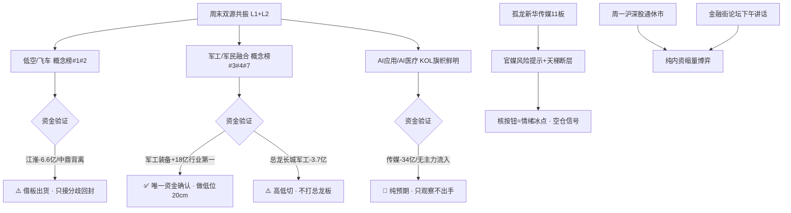

# 2026年10月19日(周一) · 群聊情绪共振

> **数据源新鲜度**: partial(热榜为1016收盘口径)
> **降级状态**: true(WeFlow永久下线 · 双源L1+L2)
> **置信度**: 0.72

## 一句话结论

情绪 **41/100(主跌段虚火)**:卖方在群里为低空/军工集体亢奋,但热榜前排已被主力借板出货,周一纯内资缩量日只接分歧、不追一致。

## 详细分析

周末五个投研群127条消息呈现典型的**温差市**:题材卖方群亢奋(飞车电话会、军工策略刷屏),老钱KOL群谨慎(牛熊分界、硬科技半年后再看、等论坛托底),而量化层(R7)显示全市场主力净流出 **341亿**、净流出3030家 > 净流入2186家。情绪的"热"在嘴上和榜上,资金的"冷"在盘口里。

三层证据指向同一个结构:

1. **L1热榜**:同花顺概念热度前四被飞行汽车(#1,+4.01%)、低空经济(#2)、兵装重组(#3,+5.9%)、军工(#4)包揽;飙升榜28只中 **11只新上榜股有100%集中在低空汽零与军工两条线**——周末催化已在榜单上兑现完毕,预期差基本消失。
2. **L2 KOL**:长城机械"飞车复制22年机器人疯狂"、中信军工"未来两月独立行情"在三个群反复转发,卖方一致度极高;风向标KOL则明确切换到 **AI应用/AI医疗**("风起云涌、硬需求拐点"),对硬科技"半年后再关注"。
3. **资金反证(R7)**:热榜人气#1江淮汽车主力净流出6.6亿为全市场第一,军工总龙长城军工封板却被出货3.7亿,中鼎股份游资封板+主力派发——**榜越热,钱越跑**,这是模式六霸榜出货的教科书形态。

周一还有两个情绪约束:① 重阳节翌日**沪深股通休市**,纯内资博弈,量能天然低于周五1.56万亿,不能用缩量本身做空头判断,但也意味着没有外资增量来承接一致高开;② 金融街论坛一行一局一会三主席下午讲话,老钱群明示"下午盯盘",政策托底预期是当天最大的内生变量,预期落空则成为减仓窗口。

### 推理深度三问(共振主题)

**主题一 · 低空经济/飞行汽车(eVTOL)**

- **大资金意图**:借Roadster事件与周末电话会的一致性,在首板次日高开派发。人气龙一江淮主力-6.6亿(全市场第一)、5日-7.7亿,前期-8.6%大阴后反抽板,是典型借板出货;中鼎等汽零票"游资封板、主力出货"背离。
- **为什么走强**:特斯拉Roadster展示冷气反推飞行能力 + 央媒低空产业化调研 + 券商密集电话会,周五23/16/17家首板抢跑。事件是真事件,但已成为明牌。
- **逻辑够不够硬**:产业逻辑硬(马斯克+低空空域改革),但短线位置尴尬——板块年龄仅1天(early),接力位置middle偏late。44.55%炸板率环境下首板次日溢价已是-1.64%,高开追涨赔率极差。**态度:不进一致高开,仅观察开盘30分钟分歧后的回封龙一**。

**主题二 · 军工/军民融合/商业航天**

- **大资金意图**:三条共振线中唯一有真金白银确认的方向——军工装备主力净流入+18亿(行业第一)、军民融合+16亿、大飞机+13亿;但资金在做**高低切**,出货总龙长城军工(-3.7亿),打华力创通(龙虎榜净买1.07亿+机构净买0.36亿)、金盾股份等20cm低位新军。
- **为什么走强**:日美"利剑27"军演10月19日开幕(近6万人八国参与,群内称"热搜第一")+ 我国六海军演 + 珠海航展11月临近 + 中信"底部反弹独立行情",催化日历密集。
- **逻辑够不够硬**:地缘催化+资金确认+板块4天4板年龄适中,硬度三主题中第一;瑕疵是周末同样被充分传播,且下周中船特气595亿解禁压制局部筹码。**态度:降级小仓试错只给低位(华力创通/金盾/晟楠),总龙长城军工不打板,高开过多同样等分歧**。

**主题三 · AI应用/AI医疗**

- **大资金意图**:尚无资金行为,纯政策(国常会"人工智能+")+KOL预期+外盘杀硬件倒逼的"应用>硬件"切换叙事。传媒/游戏/影视周五合计净流出超50亿,资金正从高位应用撤向国改高股息。
- **为什么走强**:风向标KOL明牌"AI应用一旦开涨风起云涌,最看好AI医疗硬需求拐点";Meta开放权重模型、OpenAI主攻AI大脑提供外生催化。
- **逻辑够不够硬**:方向叙事符合风格切换,但榜温钱冷(AI应用概念榜#13但-0.53%),主跌段纯预期主题不给仓位。**态度:观察,等首板+主力净流入双确认后再升级**。

### 首推观察票思维链 · 华力创通(300045)

- **买入理由**:军工线是当日唯一"热榜+KOL+资金"三验方向;该股为飙升榜新进(rank14,0天首次上榜),大飞机概念资金领涨股,龙虎榜游资净买1.07亿**且机构净买0.36亿**——在全市场主力-341亿的日子里,游资+机构合力是稀缺信号;卫星导航/军工通信踩中军演+航展双催化。
- **风险点**:① 周一一致性高开后可能被获利盘砸;② 20cm标的波动大,主跌段炸板率44.55%;③ 军演开幕日"利好兑现"回落;④ 若孤龙新华传媒核按钮带崩情绪,题材股泥沙俱下。
- **止损条件**:低开低走跌破上周五涨停实体一半(-8%附近)无条件离场;买入当日不回封即认错,隔日不达预期不讲故事直接走(纪律第九条)。
- **可验证假设**:竞价高开3-6%且有换手承接(非一字无量)、开盘30分钟板块内有2只以上20cm跟随、主力资金维持净流入——三条同时满足才成立;一字无换手或高开>8%放弃追入。

> 注:R3不输出买入指令,以上为情绪共振视角的观察票四要素,最终准入以D1纪律闸门(盈亏比/禁止清单/开仓资格)为准。主跌段单票上限10%、总仓上限30%。

## 热榜信号透传(L1)

| 信号类型 | 标的 | 异动 | 主题 | R3判定 |
|---|---|---|---|---|
| 🚀 排名飙升 | 江淮汽车 | 49→1(+48) | 飞车/华为汽车 | ⚠️ 霸榜出货,不接力 |
| 🚀 排名飙升 | 新华传媒 | 38→2(+36) | 传媒/AI语料·11板 | 🔴 孤龙警报,官媒提示风险 |
| 🚀 排名飙升 | 金健米业 | 35→6(+29) | 粮食/农业 | ⚪ L1_only,KOL无共振,剔除 |
| 🆕 新进榜 | 华力创通/金盾/航天晨光/新兴装备 | rank14-58 | 军工 | ✅ 与资金流入同向 |
| 🆕 新进榜 | 天汽模/保隆/英搏尔/文灿/铭科/旭升 | rank18-65 | 低空汽零 | ⚠️ 主题对但等分歧 |
| 📉 旧主线退潮 | 中际旭创(在榜197天)/亨通(196)/长电(187) | 最新排名滑至90-100 | CPO/半导体硬件 | 🔴 人气长尾衰减,负向共振 |
| 💰 资金背离 | 长城军工 | 人气#5,主力-3.7亿 | 军工总龙 | ⚠️ 封板出货,降级观察 |

概念热度top8:飞行汽车96989🔥 > 低空经济57109 > 兵装重组26157 > 军工25534 > 创新药24181 > 冰雪产业13799 > 商业航天12576 > CPO 12087(价跌-1.21%=榜热钱撤)。

## 公众号观点(仅观点证据,不计共振打分)

- **宏观与情绪**:复盘大V"最后20分钟又托了一下"——周五午后滑坠无利空,疑似官军连续两日尾盘买宽基ETF(周四约500亿、周五约160亿,沪深300ETF约120亿+上证50ETF约40亿),定性为"点刹降波动,不是认定底线";"下周看法"判下降趋势左侧博弈,"最有价值的是恐慌而非阴跌",下周有望见一个低点。
- **主题命中**:飞车(技术同源商业航天隐现A股公司)、AI应用(Meta开放权重/求是"算力高铁"/密集回购)、AI硬件(DRAM涨价/PCB百亿调研,个股基本面与板块资金流出背离)、创新药(出口管制双向风险)、传媒孤龙(官媒"11连板牛股累积巨大交易风险"紧急提示)。
- **海外噪音**:法国80万人抗议、霍尔木兹伊朗发声、Anthropic估值预期2万亿→1.5万亿、美股科技巨头业绩周。

## 关键证据

- 证据1: 同花顺概念榜飞行汽车#1(热度96989)/低空#2/兵装#3/军工#4,新上榜11只100%集中在低空+军工 · 来源 L1多平台人气管道(1016收盘)
- 证据2: 五群127条,卖方三群齐刷"飞车复制22年机器人"+中信军工独立行情,风向标KOL切AI应用/AI医疗,老钱判"牛熊分界" · 来源 L2 wechat-cli五群
- 证据3: 人气#1江淮主力-6.6亿(全市场第一)、军工总龙-3.7亿被出货,军工装备行业资金+18亿第一、华力创通游资+机构合力 · 来源 R7资金面交叉
- 证据4: 孤龙新华传媒11板+官媒风险提示+5-10板断层;官军疑似两日夜盘买ETF点刹 · 来源 公众号RSS + R1
- 证据5: 周一沪深股通休市(纯内资缩量)+金融街论坛三主席下午讲话 · 来源 L2新闻群

## 数据源审计

| 源 | 状态 | 抓取时间 | 记录数 | 备注 |
|---|---|---|---|---|
| R1风格基线 | 🟢 ok | 10-19 06:26 | 1 | 情绪基线42·主跌conf0.85 |
| 多平台人气热榜 | 🟡 stale | 10-19 06:04 | 320行 | 榜单口径1016收盘,盘前最新 |
| KOL五群 | 🟢 ok | 10-19 06:02 | 127条 | 5/5群正常,群名已匿名化 |
| 公众号取阅RSS | 🟢 ok | 10-19 06:02 | 51篇 | 11/15 feed有文章 |
| R7资金面 | 🟢 ok | 10-19 06:23 | 1 | severity2,北向仅成交额口径 |
| WeFlow语义层 | 🔴 error | — | 0 | 永久下线,L1+L2为最高等级 |
| 北向资金 | ⚪ closed | — | — | 1019沪深股通休市 |
| XTick直连 | ⚪ 未调用 | — | — | R7已覆盖1016口径,盘前无增量 |

## 不确定性 / 反证

- **热榜滞后一天**:1019为周一,盘前只有1016收盘榜,周末发酵的真实排名变化要到周一晚才可见;本报告以"新上榜集群+资金反证"代替当日rank diff,可能低估周日舆情边际变化。
- **一致性也可能是对的**:若周一飞车/军工在分歧后真回封走出主升(参考22年机器人首日),R3的"只接分歧"会错过早盘买点——但主跌段纪律优先,宁可错过不可做错。
- **AI应用是最大变数**:若金融街论坛政策超预期+AI应用首板启动,该主题可能从early直接加速,当前"只观察"结论依赖"资金未确认"这一前提,盘中证伪即修正。
- **自我批判**:情绪41与R1的42几乎相同,R3增量主要在结构(谁在共振、谁在出货)而非总量;若D1只取一个数字,本份R3的价值在distribution_alert三只出货票与军工高低切的资金证据。

## 与其他 R/D/E 的关系

- 依赖: R1风格/情绪基线(42)、R7资金面(出货与高低切反证)、data/raw/20261019 群聊与RSS、20261016 attention_signals
- 被消费: D1主决策(情绪浓度/共振主题/出货警报过滤execution_pool)、R2主线板块(热榜主题交叉)、P1竞价校准(分歧回封验证)、E1复盘(一致性预期兑现检验)

## Sub-Agent 元数据

- skill: analyze_sentiment_resonance_v1
- artifact: data/research/20261019/R3_sentiment.json
- 生成耗时: 约12分钟(含双源抽取与R7交叉)
- model: ark-code-latest
