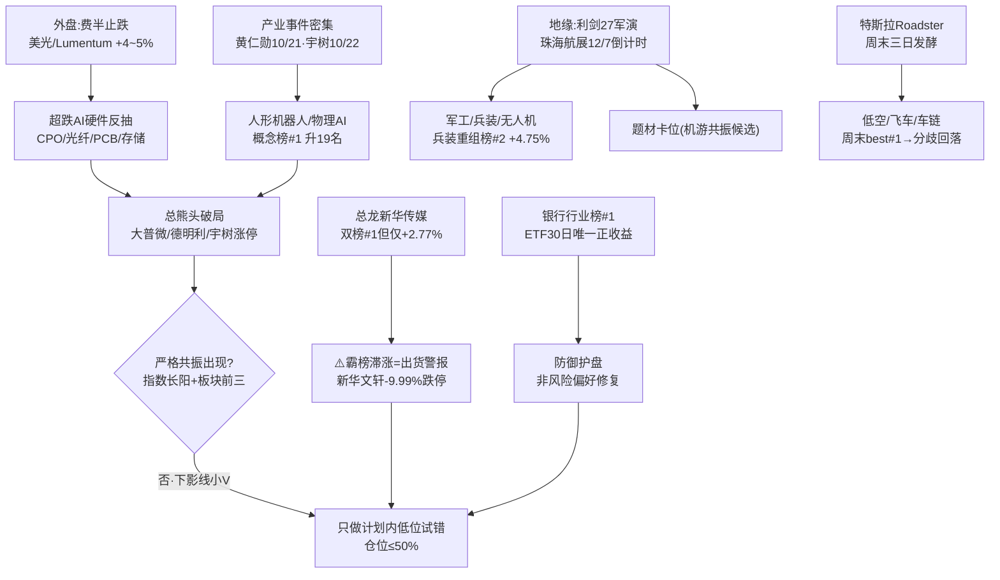

# 2026年10月20日（周二）· 群聊情绪共振

> **数据源新鲜度**: ok（L1=1019 收盘新榜 · L2=1019 盘后至 1020 凌晨）
> **降级状态**: true（WeFlow 永久下线，最高共振等级 L1+L2；北向休市）
> **置信度**: 0.66 ｜ **行情口径**: 20261019 周一收盘 + 1019 夜美股

## 🎯 一句话结论

**情绪浓度 49/100（中性偏弱，R1 基线 45 + 双源共振净 +4）**：主跌后缩量止跌段，资金在「机器人/物理AI + 超跌AI硬件」做反抽破局、军工低空做题材卡位，但**严格共振未出现**，总龙新华传媒霸榜滞涨已亮出货警报——**只做计划内低位试错，不追高、不接总龙**。

---

## 📊 一、当日情绪坐标（消费 R1，不自算风格）

| 维度 | 读数 | 含义 |
|---|:--:|---|
| R1 风格 | `震荡分化型` | 主跌后第四个交易日，缩量止跌 |
| 情绪周期 | `high_chop`(0.72) | 高位震荡/止跌试盘，非主升 |
| R1 情绪基线 | **45** | 中性偏弱（R3 以此为锚，非前一日） |
| R3 共振调整 | **+4** | 4 条 L1+L2 主题 +7，高度不足/出货警报 -3 |
| R3 情绪浓度 | **49** | 未跨 50 中性线 |
| 仓位锚（R1） | `≤50%` | 半仓以内，主线龙一 + 硬件反抽试错 |
| 涨停/跌停/炸板率 | `46 / 22 / 31.3%` | 分歧区（≥25%），高度仅 3 板 |
| 广度 | 涨2275/跌3129 | 指数红盘靠权重护盘，个股仍还债 |

**关键张力**：1019 夜费半终结八连跌（美光 +4.33/Lumentum +5.02/康宁 +3.87），叠加 Nscale-Anthropic 约 450 亿美元算力大单，给 1020 硬件反抽添了一把火；但外资买方路演偏空（电力缺口 14GW、2028 资本开支可见性不足、存储/激光器宏观不利），**机构与游资对 AI 硬件是「反抽」还是「反转」存在明显温差**。

---

## 🔀 二、情绪资金传导图

---

## 🏆 三、L1+L2 双源共振 Top 5 主题

> 等级口径：WeFlow 下线后 **L1+L2 即最高**；单源（仅热榜或仅群聊）一律不进 top5，降入观察池。

### ① 🤖 人形机器人 / 物理AI / 具身智能 ｜ `L1+L2` ｜ **early**

- **L1 热榜**：人形机器人概念榜 **#1（升19名，+1.46%，热度137470）**；机器人概念 #5（NEW）、减速器 #11（NEW，+1.88%）；宇树科技 dc 人气 **#2（+16.15%，surge rank40→2）**；步科股份飙升榜 #1、海天瑞声 #2。
- **L2 KOL/公众号**：国联民生汽车「Optimus 周产数百台→年底周产千台→远期周产2万 + OpenAI 入局」；全国首个物理AI与世界模型大会（南京 10/19-22，PAIWorld 14B）；黄仁勋 GTC 柏林 10/21、宇树生态大会 10/22；工信部定调具身智能；马斯克称价值重心转向机器人。
- **大资金意图**：借费半止跌 + 产业事件窗口，在主跌后拉「跌幅最深、筹码最干净」的总熊头（宇树 1100→404 跌63%）做破局标杆，GJD 宽基 ETF 托底 + 龙头破局，复刻 7 月救市路径；对手盘是高位套牢的算力硬件割肉盘。
- **为什么走强**：位置=30日超跌极低位；催化=硬时间锚（10/21、10/22 两场大会）+ 真实量产数据；筹码=总熊头跌透抛压轻。三维共振。
- **逻辑够不够硬**：中高。多源（热榜+卖方深度+官媒+产业数据）共振，但宇树单日 +16% 已抢跑，且指数未长阳、严格共振未现；**证伪路径**=大会利好兑现高开低走 / 宇树带不动低位首板助攻。

### ② 💡 CPO / 光纤 / PCB / 存储（AI硬件超跌反抽）｜ `L1+L2` ｜ **early**

- **L1 热榜**：PCB 概念 #3（升6）、CPO #4（升4）、存储 #10、光纤 #14（NEW）；元件行业 #2、通信设备 #9（NEW）；**亨通光电 dc 人气 #1（+10%，60万手封板，surge rank25→1，197天持续在榜）**；澳弘电子 surge delta60、德明利 delta55、大普微 +20cm。
- **L2 KOL/公众号**：Meta 光通信专家纪要（1.6T EML:硅光 57:41，中际/新易盛/Coherent 主供）；InP 磷化铟衬底缺口；高盛 PCB 三连推（生益 Q3 净利 +212~252%）；韩世奇推粤芯硅光；光纤短缺或延续至 2028。
- **大资金意图**：通信/芯片 30 日 -19.5/-21.5% 全场被杀最透，资金做**下降通道里的超跌反抽**，拿外盘费半止跌当点火器；对手盘是外资买方（明确看空存储/激光器、2027 资本开支见顶）。
- **为什么走强**：位置=极端超跌；催化=费半八连跌终结 + 450 亿美元大单 + 美光 1021 研讨会；筹码=总熊头（大普微 918→257 跌72%）拉抬轻松。
- **逻辑够不够硬**：中。有真实订单/业绩（生益、光模块排产到2027），但**1015-16 两次反抽均次日埋人**，外资路演反证扎实；**这是计划内试错不是反转**，证伪=美股科技夜盘回吐 / A股硬件高开低走。

### ③ 🪖 军工 / 兵装重组 / 无人装备 ｜ `L1+L2` ｜ **middle**

- **L1 热榜**：兵装重组概念 #2（+4.75%，热度94778）、军工 #7、国产航母 #19（NEW）；长城军工人气 #8（+5.01%）、甘化科工 #12（+10.03%，surge delta31）；周末 persistent 长城军工三日 best5、金盾 best12、北方导航首进榜。
- **L2 KOL/公众号**：利剑27 日美军演（6万人/25式导弹）、黄海 47 天实弹、日本 5 年防卫费 70-80 万亿日元、珠海航展 12/7（3000件装备首设无人专区）、无人机出口管制 11/18 放松；流沙河明确定性为「AI硬件、创新药之后第三个机游共振候选」。
- **大资金意图**：地缘事件有明确时间轴（军演→航展），资金提前 1-2 月做机游共振卡位；反腐出清 + 军贸订单是中期逻辑，对手盘是不信题材持续性的量化。
- **为什么走强**：位置=板块长期低位；催化=硬时间锚（12/7 航展）+ 密集事件；筹码=兵装重组先头部队已封板。
- **逻辑够不够硬**：中。事件真实但兑现靠情绪，板块无涨停潮、高度断层；证伪=航展前利好出尽 / 军演结束无新增冲突。

### ④ 🚁 低空经济 / 飞行汽车 / 汽车链 ｜ `L1+L2` ｜ **middle（偏 late）**

- **L1 热榜**：飞行汽车 #6（**从1016的#1回落5名**）、低空 #8、汽车零部件 #10；万丰奥威人气 #5（+9.99%，周末三日 best#1）；江淮汽车 #9（**-1.34% 滞涨**）；宗申动力/东安动力/保隆科技在榜。
- **L2 KOL/公众号**：特斯拉 Roadster 飞行演示 + 儿童车供应链（山东威达）；流沙河列潜在主线第二；R1 涨停代理（新能源车17/比亚迪12/汽零10）确认车链为双主线之一。
- **大资金意图**：特斯拉链题材轮动的资金迁徙，周末已打成明牌（连续三日人气霸榜），1019 进入一致→分歧的接力段。
- **为什么走强**：位置=汽零低 10x PE；催化=Roadster 热度；但周末一致性过满、1019 概念排名不升反降、龙一江淮滞涨。
- **逻辑够不够硬**：中偏弱。复盘派明确「上周五飞车很强但**不是严格共振**」；证伪=万丰封板次日无溢价 / 板块无 4 板空间板。**只给分歧回封与低位补涨首板**。

### ⑤ 🎬 AI短剧 / AI传媒（应用端）｜ `L1+L2` ｜ **late（出货警报）**

- **L1 热榜**：AI应用 #13、文化传媒行业 #4（-1.21%）；**新华传媒 ths热股 #1 + dc人气 #3（双平台 avg2 霸榜）但仅 +2.77%**；新华文轩 #4 但 **-9.99% 跌停**；慈文传媒 #6（+9.97%）、掌阅科技 surge delta42。
- **L2 KOL/公众号**：华福「红果AI短剧黏性」；央视启动多语种短剧漫剧 AI 平台 + Seedance 新剧；财闻私享明确「AI短剧等前期热门集体重挫」。
- **大资金意图**：总龙 11 连板后高位借人气/催化**派发**，资金向低位应用（慈文/掌阅）扩散；这是退潮段的补涨结构。
- **为什么走强/弱**：总龙封不住、龙二跌停 = 板块从主升末段转分歧退潮，仅低位首板有脉冲。
- **逻辑够不够硬**：低（纯情绪 + 催化，退潮风险最大）。**红线4：霸榜第一 + 价格背离 = 出货警报，不作正向追高**。

---

## 📈 四、首推人气票思维链（交 R2/R5 核验，非买入指令）

### 亨通光电（600487）— 光纤+CPO 反抽人气 #1

- **买入理由**：① dc 人气 #1 + ths热股 #5（双平台 avg3），60 万手封板、surge rank25→1，是 1019 硬件反抽识别度最高的破局票；② 光纤现货报价倍数攀升、数据中心短缺或延续至 2028，产业订单硬，且 CPO/光纤双概念叠加密集研报催化。
- **风险点**：① 短期=30日通信板块 -19.5% 下降通道里的反抽，前两次反抽次日埋人；② 中期=外资买方看空激光器/存储、2027 资本开支见顶，持续性未验证。
- **止损条件**：次日（10/20）高开超 +5% 不追；若介入后跌破 1019 涨停启动位（约 `45.7` 元，-9% 区域）或开盘 30 分钟内封单撤尽翻绿，无条件止损；硬件板块若高开低走同步离场。
- **可验证假设**：24-72h 内 ① CPO/光纤板块涨停家数扩张至 5+ 且亨通站稳涨停价；② 美股光通信（Lumentum/康宁）夜盘续涨；③ 板块出一进二空间板。三者满足≥2 为证真，否则证伪。

### 宇树科技-W（688836）— 机器人/物理AI 人气 #2（高风偏）

- **买入理由**：① 总熊头跌透（1100→404，-63%）后 1019 +16.15%、dc人气#2/surge delta38，机器人概念榜登顶 #1 的情绪锚；② 10/22 自家世界物理AI大会 + OpenAI入局 + Optimus 量产数据，事件与板块双共振。
- **风险点**：① 科创板高价股（495.92元）单日 +16% 已抢跑，波动剧烈、非主板风偏；② 商业化为远期（OpenAI 2027 才演示样机），纯估值情绪驱动。
- **止损条件**：仅作情绪风向标观察或极小试仓；跌破 1019 大阳线半分位（约 `460` 元）或机器人板块首板助攻团熄灭即离场；不参与高开追价。
- **可验证假设**：10/21-10/22 黄仁勋演讲/宇树大会释放超预期产品信息 + 机器人板块减速器/执行器低位首板 ≥3 只助攻，则证真；大会利好落地即冲高回落则证伪。

### 万丰奥威（002085）— 低空/飞车 周末发酵 best#1

- **买入理由**：① 周末三日 dc 人气连续 best#1（1016-1018），1019 封板 +9.99%、人气#5，低空整机识别度最高；② 特斯拉 Roadster 飞行演示 + 珠海航展/低空政策时间轴。
- **风险点**：① 短期=周末一致性过满，1019 eVTOL 概念榜已从 #1 回落至 #6，龙一江淮滞涨，接力进入分歧段；② 板块无 4 板空间板、高度断层。
- **止损条件**：只做分歧换手后的回封，不接高开秒板；介入后跌破 1019 涨停价（约 `9.9` 元）或低空板块无新首板助攻即止损。
- **可验证假设**：次日万丰换手后回封封单稳定 + 低空/汽零板块出连板梯队（≥2 只二板）为证真；高开低走/江淮续跌则证伪。

> ⚠️ 总龙**新华传媒（600825）**与断板高标**新华文轩（601811）**：双榜霸榜但滞涨/跌停，**红线4出货警报，不列入买入思维链，只作情绪退潮观测标的**。

---

## 🚫 五、单源观察池（不进 Top5，交 D1 结合 R7 裁定）

| 主题 | 等级 | 核心证据 | R3 态度 |
|---|:--:|---|:--:|
| 银行/金融护盘 | L1_only | 银行行业榜#1（升9）、ETF 30日唯一正收益、农行工行在榜 | 观察（防御锚，非进攻） |
| AI医疗/DRG-DIP | L2_only | 老钱群「AI医疗启动」+ 万达信息10/29调研；DRG榜#18 NEW但个股未上热榜 | 观察（待 L1 确认） |
| UCO/生物柴油 | L2_only | 传放开 UCO 出口配额（山高环能），无热榜佐证 | 观察（传闻待公告） |
| 体彩进影院/社保卡 | L2_only | 两部门政策（新北洋/东港/中体），无板块效应 | 观察 |
| 量子科技/AI网安 | L2_only | Claude 量子突破 + 天衍（神州信息/格尔软件） | 观察（一日游风险） |
| Token出海/国产算租 | L2_only | 亿田-燧原十万卡、吉宏/首都在线；算租概念#17 NEW | 边缘观察 |

---

## 📰 六、公众号观点（仅观点层，不计入共振打分）

- **真正的共振**（复盘派）：指数越来越接近企稳、本周企稳概率大，但止跌初期几乎不可能无分歧直接逆转；**严格共振=指数长阳+板块当日前三，1019 不算共振**，下影线只可观察。
- **重要节点**（复盘派）：美股崩 + 周五冲高回落双夹击下 1019 未崩反走出韧性小V，符合「下跌+情绪崩溃+利空不跌」的做多信号，进入短线拐点左侧，态度转积极；「止跌看科技，反弹看非科」。
- **先救总熊头**（贩财局）：大普微/德明利/宇树三只超跌70%总熊头涨停，复刻 7 月「宽基ETF托底+龙头破局」救市标准操作。
- **方向**（流沙河）：潜在主线 军工 ＞ 飞行汽车 ＞ APEC；漫剧/创新药后段维持活跃。
- **高盛PCB更新**（傅里叶的猫）：生益 Q3 超预期 65%、AI 覆铜板进入业绩兑现期。
- **外资买方路演**（调研先知）：情绪低迷、电力缺口 14GW、2028 开支可见性不足、存储/激光器宏观不利——**与游资反抽观点对立的关键反证**。
- **宏观与情绪**：散户层仍流行「类比21年11月新能源见顶→今年7月AI硬件见顶」的熊市叙事，与机构反抽观点形成情绪温差。

---

## 🔍 七、关键证据

- **证据1**：人形机器人概念榜 rank 20→1（升19名）登顶、热度137470，机器人概念/减速器双双 NEW 进榜 · 来源 tushare ths_hot 1019
- **证据2**：亨通光电 dc 人气 #1、60万手封板、surge rank25→1、197天持续在榜 · 来源 attention_signals + dc_hot
- **证据3**：新华传媒双榜 #1/avg2 但仅 +2.77%、新华文轩 -9.99% 跌停 · 霸榜出货警报 · 来源 ths_hot/dc_hot
- **证据4**：1019夜费半终结八连跌，美光 +4.33、Lumentum +5.02、Nscale-Anthropic 450亿美元算力大单 · 来源 群聊+R1外盘
- **证据5**：5群536条 KOL 中军工（利剑27/航展）与机器人（Optimus/物理AI大会）为转发密度最高两条叙事线
- **证据6**：周末三日（1016-1018）人气连续在榜=低空/飞车（万丰/江淮/中信海直 best1-3），1019 概念排名回落=明牌分歧

## 🧾 数据源审计

| 源 | 日期 | 状态 | 备注 |
|---|---|:--:|---|
| tushare/ths_hot | 2026-10-19 | 🟢 | 543 条 · 概念/行业/热股 · 对1016两日rank-diff |
| tushare/dc_hot | 2026-10-19 | 🟢 | 772 条 · 东财人气榜 |
| attention 多平台管道 | 2026-10-19 | 🟢 | persistent 1844 / surge 28 / cross_platform 53 |
| attention 周末发酵 | 2026-10-18 | 🟢 | weekend_persistent 26（1016-1018三日） |
| wechat_cli 五群（匿名） | 2026-10-20 | 🟢 | 536 条 · 5焦点群（G1-G5匿名） |
| wechat_official_rss | 2026-10-20 | 🟢 | 94 篇 · 15个feed（14有文）· 观点层不计共振 |
| R1_style 基线 | 2026-10-20 | 🟢 | sentiment 45 / 震荡分化 / high_chop |
| WeFlow analytics | — | 🔴 | DOWN 永久下线（ngrok 404）· L3空缺 |
| 沪深股通（北向） | 2026-10-19 | 🟡 | 重阳节翌日休市 · 无北向/竞价，留P1校准 |
| XTick /doc/hot | — | 🟡 | 未调用 · tushare+attention 双源已满足L1 |

## ⚠️ 不确定性 / 反证

1. **反抽 vs 反转未决**：R3 给硬件/机器人 early，但 1015-16 两次反抽均次日埋人，外资买方路演扎实看空存储/激光器；若 1020 高开后成交不能重回 1.6 万亿+、涨停不扩至 60+，反抽即结束（R1 已列最高优先级风险）。
2. **严格共振缺席**：复盘派与 R1 都确认 1019 不是严格共振（指数仅微红、广度3129只下跌），所有主题定性为试错而非主升，情绪 49 未跨中性线即反映此保留。
3. **总龙退潮连坐风险**：新华传媒/新华文轩若核按钮扩散，会连坐机器人/车链低位首板情绪。
4. **L3 语义层永久缺失**：无法用 WeFlow 群聊语义热度独立校验，L2 仅靠 5 群+94篇公众号，存在样本与转发水军噪声（军工长文多群重复转发，已按语义去重但仍可能高估）。
5. **周末管道口径**：weekend_persistent 含 1016-1018 自然日榜单，1019 当日 per_day 为空（收盘后未回填），以 attention_signals 1019 正式榜为准，两者交叉使用。

## 🔗 与其他 R/D/E 的关系

- **依赖**：`R1_style.json`（情绪基线45/风格/情绪周期）、`attention_signals.json` + `attention_weekend.json`（个股人气底座）、`wechat_cli_5groups.jsonl` + `wechat_official_rss.jsonl`（L2）、tushare ths_hot/dc_hot（L1）
- **被消费**：D1 主决策（情绪浓度/共振主题/出货警报）、R2 主线（机器人/军工/低空板块情绪佐证）、R5 个股画像、P1 竞价校准（北向缺失补盲）、E1 复盘（首推票 T+N 回填）

## Sub-Agent 元数据

- skill: analyze_sentiment_resonance_v1（WeFlow 下线后 L1+L2 双源口径）
- artifact: data/research/20261020/R3_sentiment.json
- 生成耗时: 约 46 分钟（含 L1 两日diff / attention / 5群536条 / 94篇RSS 全量语义抽取）
- model: ark-code-latest
