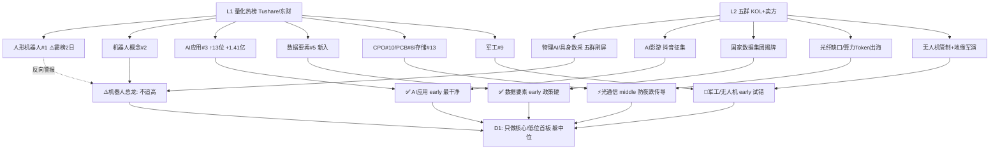

# 2026年10月21日（周三） · 群聊情绪共振

> **数据源新鲜度**: 🟡 partial（热榜=T-1收盘榜，群聊=当日盘前）
> **降级状态**: ⚠️ degraded=true（WeFlow 永久下线，双源 L1+L2）
> **置信度**: 0.72 ｜ **情绪浓度**: **60/100（中性偏暖·高位震荡）**

## 一句话结论

> 📌 **物理AI霸屏五群+热榜机器人双第1，但"霸榜=出货警报"已触发；真正干净的新共振是 AI 应用(rank13→3+资金1.41亿)与数据要素(国家数据集团揭牌)；隔夜美股半导体夜跌，竞价防科技低开，只做核心不碰中位扩散。**

## 一、双源共振全景（L1 热榜 × L2 群聊）

## 二、Top5 共振主题（全部 L1+L2 双源确认）

| 排名 | 主题 | 共振 | 阶段 | 大资金意图 | 代表个股（非推荐·待R2认定） |
|---|---|---|---|---|---|
| 1 | 🤖 物理AI/具身数采（机器人大脑） | L1+L2 | middle | 机器人母体高位，资金从"壳"切向"大脑+数据采集"新叙事续命 | 凡拓数创、索辰科技、奥比中光、福莱新材、联创电子 |
| 2 | 🎬 AI应用/AI互动影游 | L1+L2 | **early** | rank13→3且主力净流入1.41亿，高低切找新容器 | 欢瑞世纪、凯撒文化、昆仑万维、蓝色光标 |
| 3 | 🗄️ 数据要素（国家数据集团） | L1+L2 | **early** | 副总理揭牌新央企，政策资金做主题卡位 | 群聊未点名，留空待R2映射 |
| 4 | 🔦 光通信/算力（空芯光纤·Token出海） | L1+L2 | middle | 退潮簇反抽+缺口叙事，资金抱团亨通等大容量 | 亨通光电、协创数据、润建股份 |
| 5 | ✈️ 军工/无人机 | L1+L2 | early | 事件密集（管制优化+航展+军演），试错型建仓 | 利君股份、新光光电 |

### 主题1 · 物理AI/具身数采 —— 最热但最需要纪律

- **大资金意图**：机器人概念热榜第2、凡拓数创20cm连板、宇树科技人气#2却连夜发风险提示——母体"人形机器人"霸榜第1连续2日，**触发红线4出货警报**。资金借 GTC 柏林（黄仁勋演讲=Physical AI）造新词"物理AI"，把战场从硬件壳切到**数据采集/机器人大脑**（凡拓=动作捕捉、福莱新材=触觉传感、联创电子=RGB-D、思看=3D扫描）。
- **为什么走强**：卖方五群齐推（国金"GPT-6是具身大脑里程碑"、东吴"跟踪正被盘面追认"、招商机械），属"机构叙事+游资打板"合力；北证50单日+4%放大小票风偏。
- **逻辑够不够硬**：催化真实（GTC/国标6项/OpenAI招聘），但已发酵2-3日、总龙高位，**高位震荡期只能低吸核心或做低位首板，追中位扩散股=接盘**。
- 🚫 禁止清单：不追凡拓连板、不碰名字蹭"物理AI"的尾盘红包股、宇树映射股防见光死。

### 主题2 · AI应用/AI互动影游 —— 本批最干净的共振

- **大资金意图**：AI应用 rank 13→3 且概念主力净流入1.41亿，是唯一"热榜加速+资金确认"双确认方向；KOL夜间明示"AI应用出5-10倍股"。
- **为什么走强**：抖音短剧版权中心征集互动剧/影游（真人+AI），《不问凡尘》3周30万份验证付费闭环，平台从"给概念"转到"给分发"。
- **逻辑够不够硬**：处于 early，硬伤是征集为周末旧闻、周一一致性可能过高。**等分歧再上，不打一致性首板**；九阳股份12天7板只是情绪高标，不追。

### 主题3 · 数据要素 —— 政策最硬、个股最散

- 国家数据集团10月20日雄安揭牌（丁薛祥出席），两大报齐发声，数据要素#5新入热榜、雄安#11同在榜。
- KOL **未点名个股**，本报告不编造龙头，留 R2 按 dc_concept lead_stock 映射；警惕"数据+雄安"拼盘股冲高回落。

### 主题4 · 光通信/算力 —— 叙事强，但今晨有逆风

- 央视：高速光模块订单排到2027年底、单片价值10年60倍；财联社预估2026光纤缺口1.8亿芯公里；协创数据374.9亿算力大单、润建股份Token出海进入1-10。
- ⚠️ **隔夜美股半导体集体回落（美光/英伟达/AMD/英特尔盘初下跌），韩股-3.73%**，该方向30日属深度退潮簇，今日竞价防低开传导，**反抽性质，只做最强（亨通）不做杂毛**。

### 主题5 · 军工/无人机 —— 计划内试错仓

- 无人机出口管制优化11/18实施+珠海航展临近+日美利剑27军演+美舰闯南沙；军工#9在榜。
- 板块无高标、梯队弱，定为试错仓；注意兵装重组（旧线rank2）已跌出热榜，勿混。

## 三、被剔除的 L2-only 单源主题（红线：不进共振）

| 主题 | 群聊证据 | 剔除理由 |
|---|---|---|
| 🥩 内需/大消费 | 牛肉连涨16周、发改委扩内需、日出东方热泵、欢乐家/海欣食品 | 热榜top20无消费板块，仅L2 |
| 💊 医药 | 广生堂乙肝、振东制药生发、AI病理 | 创新药#6在榜但群聊只有个股事件无板块效应 |
| 🍎 苹果链 | iPhone Duo发售、10/28发布会、奥拓电子 | L1无对应词条 |
| 🔋 换电/固态 | 华为乾崑×宁德99秒换电、宁王400亿回购 | 固态电池#20新入但共振弱，观察 |

## 四、公众号观点（仅作情绪证据，不计共振分）

**宏观与情绪（关键）**：
- 🔻 证券时报头版级：**深夜美股半导体集体大跌**、韩国股市开盘跳水 → 今晨科技链情绪逆风。
- 🔸 上证报：尾盘大资金入市、科创50尾盘急拉、百亿私募数量创新高；复盘类大V（安静拆主线）转多《要积极一些了》——**有承接但信心不足**，与R1"买卖双弱、买方略占优"一致。
- 💰 央行政策利率换锚+连续操作（每日上限1万亿）→ 流动性呵护，托底情绪。

## 五、情绪浓度打分

| 项 | 值 | 说明 |
|---|---|---|
| R1 基线 | 58 | 震荡分化型，炸板率34.9%，高位震荡 |
| 共振加成 | +4 | 5个L1+L2主题；物理AI五群+卖方密集 |
| 风险扣分 | -2 | 霸榜警报+炸板率+美股半导体夜跌+韩股崩盘 |
| **R3 终值** | **60** | 中性偏暖 |
| 5维度交叉校验 | 56（gap=4<15） | 涨停54/跌停6偏暖、炸板率与连板高度4偏弱 |

## 六、数据源审计

| 源 | 状态 | 数据日期 | 记录数 | 备注 |
|---|---|---|---|---|
| R1 风格 | 🟢 ok | 10-21 | 1 | 情绪基线58，当日盘前 |
| Tushare热榜/东财人气 | 🟢 ok | 10-20收盘榜 | 400 | 盘前无当日榜，T-1为最新 |
| 热榜rank信号 | 🟢 ok | 10-20 | 20 | AI应用跨源确认、机器人霸榜警报 |
| 五群群聊 | 🟢 ok | 10-20 | 537 | 群名已匿名化 |
| 公众号RSS | 🟢 ok | 10-20晚 | 86 | 12个订阅号 |
| WeFlow | 🔴 down | — | 0 | 永久下线，weflow_degraded=true |

## 七、不确定性 / 反证

1. **物理AI可能是"机器人高位的续命叙事"**：五群刷屏+红包文密度过高（邦彦技术等同文被转发3次以上），往往是扩散末端特征；若凡拓数创开盘核按钮，整条数采分支当日证伪。
2. **热榜为T-1数据**：无法捕捉今晨竞价变化，美股半导体夜跌的实际冲击须等 P1 竞价校准。
3. **卖方一致看多物理AI = 拥挤信号**：国金/东吴/招商/华源同日推送，历史上卖方集中喊单后1-2日常出现分歧。
4. 情绪浓度60 与 R1 的58、5维法56三处一致，但**炸板率34.9%已过35%警戒线边缘**，若今日早盘炸板继续放大，D1 应主动把候选砍半。

## 八、与其他 R/D/E 的关系

- **依赖**：R1_style.json（情绪基线58/风格/炸板率）、attention_pipeline + hotlist_signals（L1）、五群jsonl+公众号rss（L2/L2b）
- **被消费**：R2（主线候选的人气底座/霸榜剔除）、R5（热股深挖名单）、D1（情绪浓度→仓位、共振主题→执行池）、P1（竞价对照美股半导体传导）
- **特别提示D1**：高位震荡+霸榜警报，执行池只放物理AI**核心/低位首板**与AI应用分歧机会，数据要素等R2给龙头，中位物理AI扩散股全部拦截。

## Sub-Agent 元数据

- skill: analyze_sentiment_resonance_v1（WeFlow下线后双源版）
- artifact: data/research/20261021/R3_sentiment.json
- model: ark-code-latest
- 群聊处理: 537条原始 → 去噪/去重/LLM语义抽取（非关键词匹配）
