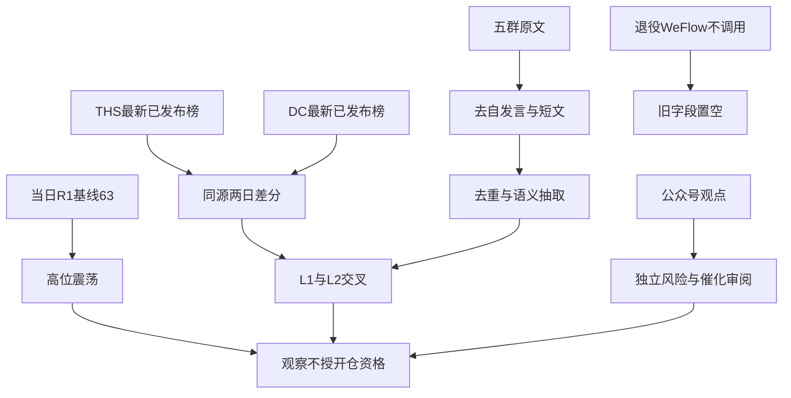

# 2026年10月22日 · 群聊情绪共振

> ⚠️ **数据源时间错位**：研究交易日为 **2026-10-22**；最新已发布热榜为 **2026-10-21**，比较基期为 **2026-10-20**。当日 R1 基线有效，但不冒充当日盘中行情。
> **数据源新鲜度**：partial · **降级状态**：true

## 🧭 一句话结论
**观察：情绪63分、高位震荡，五条双源热度成立；不以热榜和群转发授予开仓资格。**

## 📊 详细分析

市场在为局部题材的弹性与传播付出注意力，而非已经进入指数普涨。采用的是当日 R1 的 **63分**，不是上一日 R1。R1为降级产物，主线仍需R2认定。热度不是实际净买入，也不自动等于次日接力。

阶段定位维持 **情绪=震荡，周期=高位震荡**。R1炸板率27.54%，XTick按20/(50+20)重算28.57%，均未触发35%候选减半阈值；两源相差来自炸板计数20对19，不能混用XTick的zbl字段。50%是继承风险预算上限，不是目标仓位，也不是调仓指令。

五群均有采集记录，但同稿跨群重复不是多名独立KOL背书。只对合格长文做语义归类；目标KOL群没有合格长观点，短句和引用回复不拿来制造其本人明日方向。正文只展示匿名群别，JSON同样匿名化。

本次不选股，不给龙头身份证，不产生执行候选。热度引用股票只是定位传播的证据；板型、龙头纪律、盈亏比、禁止清单四项未审，故全部停在 **观察**，不进入执行池。没有价格和交易模板，不编造止损价、RR或主线封板率。主线=待R2认定，持续性=未核验，板块封板率=未核验，下一交易时段预期=分歧（情绪假设，不是交易指令）。

## 🔀 双源共振路径

## 🧩 双源共振主题（展示次序非板块强弱排名）

| 主题 | 等级 | 态度 | 确认边界 |
|---|---|---|---|
| 数据要素 | L1+L2 | 观察 | 央企成立叙事与在榜，非订单确认 |
| AI短剧 | L1+L2 | 观察 | 产业传播与热榜，保留平台规则反证 |
| 物理AI与具身智能 | L1+L2 | 观察 | 仿真数据与机器人扩散，不认定龙头 |
| AI算力基础设施 | L1+L2 | 观察 | 海外需求转发与在榜，不等于国内利润兑现 |
| 海峡两岸 | L1+L2 | 观察 | 区域题材情绪，非长期业绩逻辑 |

### 数据要素 · 观察

语义映射：国家数据集团成立把数据资源开发、流通和AI训练数据串联；不把央企成立直接等同上市公司订单。

- 热榜证据：太极股份（002368.SZ），DC最新Top20第 `5`。
- 热榜证据：海量数据（603138.SH），DC最新Top20第 `16`。
- 热榜证据：南威软件（603636.SH），DC最新Top20第 `7`。
- 热榜证据：深桑达A（000032.SZ），THS `前期Top100外 → 79`。
- 群观点：核心资讯群C、盘中资讯群E、题材研讨群B；同稿重复不叠加独立源。
- **大资金意图**: 政策事件吸引短线试错，热榜出现太极、海量、南威前排；净流入与持续合力尚未验证。
- **为什么走强**: 制度供给叙事与前排涨停共同抬升关注，但各股订单受益程度不一。
- **逻辑够不够硬**: 双源可确认热度；国家集团成立不是收入确认，若次日榜单集体退出前20或核心不能承接则热度证伪。

### AI短剧 · 观察

语义映射：微短剧出海、互动影游与AI内容降本归入同一内容产业主题；AI音乐只作相邻扩散，不另算一条共振。

- 热榜证据：粤传媒（002181.SZ），THS `40 → 21`。
- 热榜证据：慈文传媒（002343.SZ），THS `14 → 20`。
- 热榜证据：605577.SH（605577.SH），THS `56 → 83`。
- 热榜证据：000892.SZ（000892.SZ），THS `前期Top100外 → 84`。
- 群观点：核心资讯群C、盘中资讯群E、题材研讨群B；同稿重复不叠加独立源。
- **大资金意图**: 存量资金寻找内容新业态的高弹性接力，仍需成交与封单确认，不能据热榜断言机构增仓。
- **为什么走强**: 用户规模和内容生产效率叙事叠加粤传媒热榜跃升，属于传播与交易相互强化。
- **逻辑够不够硬**: 双源热度成立，群内利润率说法未独立核实；红果下线金币功能构成监管和留存反证。

### 物理AI与具身智能 · 观察

语义映射：世界模型、空间仿真、机器人训练数据及电关节是物理AI上下游；不同环节不等于同等商业兑现。

- 热榜证据：凡拓数创（301313.SZ），THS `31 → 34`。
- 热榜证据：大业股份（603278.SH），THS `42 → 23`。
- 热榜证据：利亚德（300296.SZ），DC最新Top20第 `10`。
- 群观点：核心资讯群C、盘中资讯群E、题材研讨群B；同稿重复不叠加独立源。
- **大资金意图**: 资金可能从本体扩散到仿真与数据底座，属假设；高位接力分歧大于低位启动确定性。
- **为什么走强**: 世界模型与机器人催化提供叙事，凡拓与大业在榜；凡拓THS排名反而退后，不能写全面加速。
- **逻辑够不够硬**: 两源能确认讨论，不能确认龙头资格；大业风险提示、业务早期和高位接力回撤是明确反证。

### AI算力基础设施 · 观察

语义映射：超微服务器需求、算力租赁和Token业务同属算力基础设施；AI电力属关联分支，不能用三变在榜证明全部变压器公司共振。

- 热榜证据：利通电子（603629.SH），THS `前期Top100外 → 11`。
- 热榜证据：润建股份（002929.SZ），THS `前期Top100外 → 18`。
- 群观点：核心资讯群C、盘中资讯群E、题材研讨群B；同稿重复不叠加独立源。
- **大资金意图**: 资金可能围绕海外业绩预期修复算力链风险偏好；群里看多与利润率担忧并存。
- **为什么走强**: 超微营收指引上修的群转发与利通、润建高热度互证，但未核验原始海外财报。
- **逻辑够不够硬**: 双源成立、产业硬度待R4/R5核验；润建机构快进快出公众号标题与毛利率持续性质疑构成反证。

### 海峡两岸 · 观察

语义映射：纪念活动情绪映射海峡两岸和福建区域，不外推军工或资源板块。

- 热榜证据：平潭发展（000592.SZ），THS `81 → 7`。
- 热榜证据：福建水泥（600802.SH），THS `前期Top100外 → 41`。
- 热榜证据：603696.SH（603696.SH），THS `前期Top100外 → 70`。
- 群观点：核心资讯群C、盘中资讯群E、题材研讨群B；同稿重复不叠加独立源。
- **大资金意图**: 短线资金可能利用时间窗口在区域题材轮动，缺独立订单证据，非机构配置结论。
- **为什么走强**: 平潭排名显著上升、福建水泥在榜，群转发将涨停与纪念活动联系；这是情绪映射不是因果证明。
- **逻辑够不够硬**: 热度双源、基本面硬度低；纪念窗口后衰减或板块次日无助攻即证伪，不能当中长期产业逻辑。

## 🗣️ KOL明日方向与补充观察

匿名群转发的下一时段方向集中在数据、内容、物理AI与算力。机构交流群另有MPO/光纤订单的署名研报转发，能够解释连接器链讨论，但本报告不据此接管R2排序。目标KOL本人没有满足长文门槛的可归属观点，留空其个人方向，而不是把普通成员观点冠给他。

**降级：寒潮取暖**。九阳本期第2、前期第1，发酵并不早；不因冰雪、热泵、液冷标签共现就把所有相关股合并为取暖共振。**观察：AI电力**。群内出现变压器长文，三变在DC第42；只有有限交叉，不把伊戈尔等所有被点名票视为已经量化共振。**观察：AI音乐**。只有群观点证据，不能凭短剧热榜替物产金轮补出个股共振。

## ⚠️ 热榜信号透传

两平台最新榜首都是宁德时代，当期跌幅 **-12.03%**。其THS排名52→1是负向围观可能，不是资金认可的充分证据。THS资金净额为正、DC为负，保留原始口径分歧，不合并计算。前期两平台榜首为九阳，并没有连续两日同票Top1；因此连续霸榜警报为空，不写成“已确认出货”，更不产生hard_reject。完整量价、长上影、龙虎榜和负面公告联合核验未做，交给R6独立反证。

| 股票 | THS前期→最新 | 信号含义 |
|---|---|---|
| 云南锗业 | 82→6 | 排名上升≥10，仅热度 |
| 平潭发展 | 81→7 | 排名上升≥10，仅热度 |
| 雪人集团 | 26→5 | 排名上升≥10，仅热度 |
| 华瓷股份 | 57→13 | 排名上升≥10，仅热度 |
| 百洋股份 | 55→16 | 排名上升≥10，仅热度 |
| 粤传媒 | 40→21 | 排名上升≥10，仅热度 |
| 大业股份 | 42→23 | 排名上升≥10，仅热度 |
| 凡拓数创 | 31→34 | 未满足上升≥10，不标加速 |

## 📰 公众号观点（不计分、不升级共振）

### 数据要素

- 财联社早知道（2026-10-21）：《【明日主题前瞻】国家数据集团成立，分析师称2026年数据要素产业有望加速》。仅标题/摘要观点证据。
- 财联社早知道（2026-10-21）：《【VIP日报】数据要素逆势走强 栏目追踪行业动态 提及板块核心公司涨停》。仅标题/摘要观点证据。
- 证券时报（2026-10-21）：《603138，秒涨停！这一概念股，全线爆发》。仅标题/摘要观点证据。
- 财闻私享（2026-10-21）：《晚间 A股值得关注的资讯》。仅标题/摘要观点证据。

### AI短剧

- 证券时报（2026-10-21）：《红果短剧公告：下线此功能→》。仅标题/摘要观点证据。
- 上海证券报（2026-10-21）：《“防止用户沉迷”，红果短剧或将下线金币功能》。仅标题/摘要观点证据。
- 财闻私享（2026-10-21）：《晚间 A股值得关注的资讯》。仅标题/摘要观点证据。

### 物理AI与具身智能

- 财联社早知道（2026-10-21）：《【VIP日报】数据要素逆势走强 栏目追踪行业动态 提及板块核心公司涨停》。仅标题/摘要观点证据。
- 证券时报（2026-10-21）：《4连板！603278，紧急提示风险》。仅标题/摘要观点证据。
- 证券时报（2026-10-21）：《3分钟！300296，20%涨停，超165万手买单封板》。仅标题/摘要观点证据。
- 上海证券报（2026-10-21）：《“功夫传奇”，最长续航8小时！宇树科技，上新》。仅标题/摘要观点证据。
- 上海证券报（2026-10-21）：《午后异动！300296，“20cm”涨停，封单超90万手》。仅标题/摘要观点证据。

### AI算力基础设施

- 证券时报（2026-10-21）：《3连涨停！002929，2亿美元订单引爆股价，2家机构“快进快出”》。仅标题/摘要观点证据。

### 海峡两岸

- 财闻私享（2026-10-21）：《晚间 A股值得关注的资讯》。仅标题/摘要观点证据。

### 宏观与情绪

- 猫笔刀（2026-10-21）：《-12%，跌太狠了》。
- 安静拆主线（2026-10-21）：《赚钱效应先于指数复苏》。
- 财闻私享（2026-10-21）：《晚间 A股值得关注的资讯》。
- 上海证券报（2026-10-21）：《最后10分钟，放量进场！》。
- 证券时报（2026-10-21）：《A股缩量再调整！多只个股，逆市爆发》。
- 上海证券报（2026-10-22）：《俄方：准备11月中旬重启俄美乌三方会谈》。
- 上海证券报（2026-10-21）：《押注杠杆ETF，韩国散户巨亏逾6万亿韩元》。

缩量再调整与“赚钱效应先于指数复苏”描述的是结构分化；尾盘放量不自动证成全面修复。俄乌谈判与海外科技反弹只是观点环境，不能将未经核验的海外数字升格为已审计事实。

## 🔎 关键证据

- 当日R1：63分、high_chop；基线路径 `data/research/20261022/R1_style.json`。
- 热榜：本次现场MCP请求取得10-21与10-20的THS/DC各100条；本日查询均为空。证据投影 `data/research/20261022/R3_live_evidence.json`。
- 数据主题：五群原文第47、178、349行，同一政策转发不能计三个独立源；第114行为关联观点。
- 风险反证：公众号第8、13、47行分别为大业风险提示与短剧平台功能下线标题；不可删掉只保留正向叙事。

## 数据源审计

| 源 | 日期 | 状态 | 记录数 | 备注 |
|---|---|:--:|---:|---|
| 当日R1 | 2026-10-22 | 🟡 | 1 | 当日产物有效，继承其degraded；63分，高位震荡 |
| THS两日热榜 | 2026-10-22 | 🟢 | 200 | 最新已发布交易日10-21对10-20，完整Top100；非10-22盘中 |
| DC两日热榜 | 2026-10-22 | 🟢 | 200 | 每期100条；证据文件保留Top20投影，不用于完整全榜diff |
| 当日热榜 | 2026-10-22 | 🟡 | 0 | 两次请求10-22均为空，尚未发布 |
| XTick情绪 | 2026-10-22 | 🟢 | 1 | 10-21涨停50跌停5炸板20；炸板率重算28.57% |
| THS资金 | 2026-10-22 | 🟢 | 1 | 只查宁德，净额正；不能外推主题 |
| DC资金 | 2026-10-22 | 🟢 | 1 | 只查宁德，净额负；两源口径分歧 |
| 五群文本 | 2026-10-22 | 🟢 | 548 | 五群均有记录；群名和成员名匿名化 |
| 公众号RSS | 2026-10-22 | 🟢 | 87 | 只列观点，不计共振或情绪分 |
| attention管道 | 2026-10-22 | 🔴 | 0 | 当日缺失；未借前日产物补齐 |
| WeFlow | 2026-10-22 | 🔴 | 0 | 已永久下线，未调用；字段置空 |
| fetch manifest | 2026-10-22 | 🟢 | 1 | 继承全局severity=2，不将退役WeFlow当作待修复主源 |
| MCP健康 | 2026-10-22 | 🟢 | 1 | 健康快照不替代本次实际热榜请求 |

群文本：原始548条，过滤后长文142条，去空白精确去重74条；最终五主题选取19条溯源证据，不代表19个独立观点。精确去重仍不能消除近义改写，故不据条数加分。

## 🧯 不确定性 / 反证

- attention_signals.json当日缺失；已现场核对，不能透传persistent/surge/跨平台合力完整管道。
- R1当日产物为degraded，按用户指定采用其63分而不换前一日或默认50。
- 20261022两平台热榜实时请求均为空；盘前改用20261021对20261020，显式保留观测日期。
- 目标KOL群没有符合>=60字的可用长观点；其余群转发不冒充目标KOL本人观点。
- 群转发重复传播不能当独立观点；作者和部分海外财报内容尚未独立核验。
- 资金源仅校验榜首风险，THS与DC净额异号且统计口径不同，不用于确认主题资金流。
- 五维法缺杠杆外资与各项归一化标尺，完整score_5d与差值留空。

情绪分保持 `63 + 0 = 63`。置信度按 `0.65 × 0.7 × 0.8 = 0.364`，代表双源传播判断、不是交易成功概率。五维校验缺必需标尺与杠杆外资，完整分数与差值均留空，不用中性填值冒充验证。

## 🔗 与其他 R/D/E 的关系

- 依赖：当日R1、当日raw文本、现场两日热榜与XTick；缺失attention已标红，不借前日文件。
- 被消费：R2核验主线及核心地位，R4核事件，R5核画像及RR，R6保留独立反证硬否决权，D1决定计划内执行，E1复盘传播兑现。
- 本报告不进execution，不授hard_reject；没有首推票，逐票四段买入思维链不适用。热度引用不是候选清单。

## Sub-Agent 元数据

- skill: analyze_sentiment_resonance_v1
- artifact: data/research/20261022/R3_sentiment.json
- model: gpt-6.1-sol
- method: llm_v1_dual_source_semantic
- schema: Pydantic v2本次本地契约校验；项目无现成R3 Pydantic类，不冒称项目模型通过。
- status: degraded（数据降级，不是三源共振）
