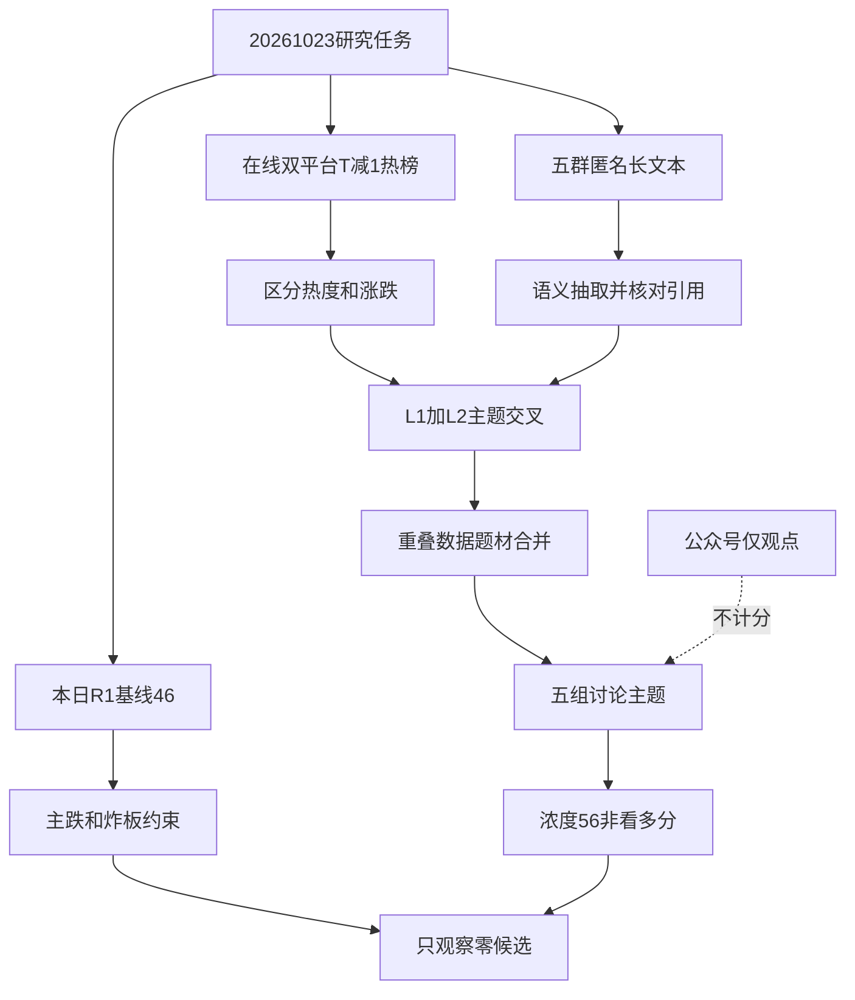

# 2026年10月23日 · 群聊情绪共振

> ⚠️ **数据源时间错位**：研究归属 2026-10-23，量化数据截至 2026-10-22，比较日为 2026-10-21；文本为当日抓取的前夜窗口。不是 23 日盘中信号。
> 数据源新鲜度：partial · 降级：true · 置信度：0.364。
> 本次早于生产窗口，即时任务已执行，但不能冒充 07:30—07:55 生产版；届时需要刷新。

## 🧭 一句话结论
**观察：主跌未变，讨论浓度56；五组双源主题不是五条可交易主线，候选为零。**

## 📊 详细分析

先认市场：当日 `R1_style.json` 的情绪基线是 `46`，其统计截止日为 2026-10-22。虽然上游状态是 degraded，本次遵用户要求仍直接消费本日46分，不替换为前日R1，也不因非complete回退中性50。R1显示涨停33、跌停48、炸板23，炸板率41.07%，最高5板，阶段为**主跌**。这比任何题材热度标签优先。

再认讨论：热榜与群内长文的语义交叉，得到人形机器人、基础油、网络安全、军工、AI应用五组主题。机器人数据采集与数据要素的重叠文案归并到同一主题，不重复加分。公众号只作观点附录，WeFlow永久下线，不制造第三层共振。以下序号只表示证据展示优先次序，不是R2板块强弱排序。

情绪浓度按 `46 + min(15, 5×2) = 56` 计算；增加的10分表示**议题覆盖和讨论集中度**，不表示风险偏好改善或胜率提高。多数相关概念当日下跌，因此浓度上升可以与亏钱扩散并存。五维加权分因杠杆外资及统一归一化规则不足保留为空，不编造分差。置信度按 `0.65×0.7×0.8=0.364`，是资料质量自评，不是统计概率。

最后认资格：主线尚未被R2确认，持续性与板块封板率未知，不填假数字；次日研究预期为**分歧**。情绪=主跌，炸板率超过35%的候选减半规则继续有效，本次更严格地只做主题观察，交易候选从0到0。热榜票只是证据锚，不是股票观察池顶部或首推票；无板型、龙头资格、RR和禁止清单验证的股票不进执行池。没有逐票推荐，因此不杜撰买入价、止损和每票思维链。

## 🔎 双源共振主题

| 序号 | 主题 | L1事实 | L2观点 | 态度 |
|---|---|---|---|---|
| 1 | 人形机器人 | 概念热度4→1，但跌1.79% | 电关节、工业数采、具身训练 | 观察 |
| 2 | 基础油 | 博汇东财人气57、涨20.00% | III类供给扰动与转产 | 观察 |
| 3 | 网络安全 | 概念热度16、跌3.50% | 漏洞、身份认证、数币 | 观察 |
| 4 | 军工 | 概念热度12→6、跌2.44% | 装备事件转发 | 观察 |
| 5 | AI应用 | 概念热度6→9、跌3.61% | AI营销、虚拟细胞、代理购物 | 观察 |

### 1. 人形机器人 · L1+L2 · 观察

- **大资金意图**: 可能是主跌中的题材局部回流；热榜不能证明机构增仓，资金意图待R7验证。
- **为什么走强**: 数采与执行器两条叙事相接；个别热股逆势上涨，但概念整体仍下跌，不能称板块全面走强。
- **逻辑够不够硬**: 两层证据成立；数采时长和万亿空间来自转发，多个群不等于独立原始源。机器人与数据要素合并，避免双计。

证据：data/raw/20261023/wechat_cli_5groups.jsonl:128（群组B）；data/raw/20261023/wechat_cli_5groups.jsonl:186（群组B）；data/raw/20261023/wechat_cli_5groups.jsonl:195（群组B）；data/raw/20261023/wechat_cli_5groups.jsonl:364（群组E）。

公众号观点（不加分）：财联社早知道《【明日主题前瞻】英伟达升级Isaac机器人平台，推出人形机器人参考框架与仿真工具》；证券时报《宇树科技王兴兴：物理AI已有被击穿的苗头！》；上海证券报《王兴兴、王坚、曾文军，谈物理AI》。

### 2. 基础油 · L1+L2 · 观察

- **大资金意图**: 可能交易供给扰动的价格弹性，不等于已确认利润兑现。
- **为什么走强**: 博汇涨幅与人气记录印证题材已交易；海外供给收缩是群内解释，未独立认证。
- **逻辑够不够硬**: 群内将90万吨总基础油产能等同III类及年化利润的说法不可靠；不同文案重复转发不能扩增源数。

证据：data/raw/20261023/wechat_cli_5groups.jsonl:225（群组C）；data/raw/20261023/wechat_cli_5groups.jsonl:284（群组C）。

公众号观点（不加分）：证券时报《原油，突然暴涨！中东，传来大消息！》。

### 3. 网络安全 · L1+L2 · 观察

- **大资金意图**: 可能进行事件预期交易，未取得净买入证据，不写成资金已进入。
- **为什么走强**: 漏洞与可信身份叙事相接，但概念跌3.50%，这里是讨论共振而非赚钱效应。
- **逻辑够不够硬**: 漏洞、数币与监管日历需R4核验；不把营销式三重催化当三个独立量化源。

证据：data/raw/20261023/wechat_cli_5groups.jsonl:115（群组B）；data/raw/20261023/wechat_cli_5groups.jsonl:266（群组C）。

公众号观点（不加分）：财联社早知道《【明日主题前瞻】英伟达升级Isaac机器人平台，推出人形机器人参考框架与仿真工具》；证券时报《数字人民币，重大升级！》。

### 4. 军工 · L1+L2 · 观察

- **大资金意图**: 事件避险/题材轮动是假设，不能由群转发直接推断机构配置。
- **为什么走强**: 装备事件叙事与个股人气改善同时出现，但概念仍跌2.44%，只确认讨论热度。
- **逻辑够不够硬**: 仅一个群文观点加热榜；军事活动消息及订单映射均未核验，低于多群数采证据强度。

证据：data/raw/20261023/wechat_cli_5groups.jsonl:242（群组C）。

### 5. AI应用 · L1+L2 · 观察

- **大资金意图**: 可能尝试从硬件扩散到应用的叙事切换；目前无独立资金支持。
- **为什么走强**: AI营销、虚拟细胞与代理购物都在讨论应用兑现，但概念排名回落且跌3.61%，没有整体转强。
- **逻辑够不够硬**: 宽主题仅计一次；下载量、购物入口与具体公司收入不是同一件事，公众号不参与量化加分。

证据：data/raw/20261023/wechat_cli_5groups.jsonl:177（群组B）；data/raw/20261023/wechat_cli_5groups.jsonl:329（群组E）；data/raw/20261023/wechat_cli_5groups.jsonl:374（群组E）。

公众号观点（不加分）：上海证券报《AI玩具，瞄准互动陪伴》；远川研究所《大厂抢滩AI短剧》。

## 💬 匿名群观点与次日方向

| 匿名源 | 原始记录数 | 语义结论与边界 |
|---|---:|---|
| 群组A | 104 | AI杠杆风险与条件性反弹判断并存；未认证为指定KOL本人观点 |
| 群组B | 93 | 数采、关节、应用及基础油转发集中；多篇重复不能当独立源 |
| 群组C | 105 | 基础油、安全身份和军工事件；产能及监管叙事待核验 |
| 群组D | 3 | 单家公司算力收入及现金流观点；不外推全行业 |
| 群组E | 131 | 工业数采、AI制药及代理购物；产业叙事不等于订单兑现 |

完整原始记录为436条；仅对长文进行语义抽取，过滤自发言、系统消息、纯图片、链接及噪声。保留15条代表性语义摘要，每条附原文件行号。48条初筛候选曾含链接和活动函，不能当48条有效KOL结论。群名随原始manifest识别，避免旧代码中的群改名差异导致漏读；输出只使用群组A—E。

群组A的“23日或可动手”是**拐头之后**的条件性成员判断，不能改写为市场已修复。本次不验证其技术论证，不据此改主跌阶段或增加候选。

## 🚦 热榜信号与反向警报

宁德时代连续两日同花顺热股第1，标**霸榜出货警报代理**，不参与正向共振。该标签不是已证实卖出，更不是R6的hard_reject。资金交叉有冲突：同花顺净额为正、东财为负，两个供应商的分类口径不同，不能拼成统一净额。成交激增、长上影与龙虎榜未完成联合核验，完整L4尚未成立；R6保留唯一硬否决权。

中际旭创热度25→5且跌8.76%，新易盛54→7且跌12.28%；CPO概念9→4但跌4.23%。这是**跌中人气升温**，不进正向共振，不能据排名上升推断主动资金净买入。没有具体CPO长文佐证，泛AI风险文本不硬套成CPO双源。

JSON仅透传21只显式核对子集的精确diff：8条上升至少10名，5条跨入top20；不是全市场完整信号数。“新进top20”不是“首次进入全榜”。两平台名次分别比较，不拿平台变化拼动量。未进入top5的创新药等不硬补独立新主题；与AI应用已重叠的虚拟细胞观点不双计。

## 📰 公众号观点

共90篇、12个账号有文章，只审阅标题和摘要，不假称阅读全文，不计入L1+L2或情绪浓度。

板块层面：机器人平台、物理AI讨论支持主题有传播；《大厂抢滩AI短剧》支持应用议题，但不证明相关A股营收。《尾盘异动！002185，直线涨停！封单超200万手》是新闻标题，热榜实际涨幅为9.12%，不把标题当收盘封板证明。

宏观与情绪：猫笔刀《整个世界都绿了》、安静拆主线《被干哭了》、盘口逻辑拆解《挺难绷的》仅能说明标题情绪偏谨慎；傅里叶的猫《美股AI链暴跌背后的Capex陷阱》讨论投入与兑现分歧。贩财局文中“等待市场自己走出来”保留为观点，但其基金赎回解释未独立核验。证券时报《不实！AI龙头股未出现网传连锁强平现象》与群内“爆仓”叙事冲突，故不采信未经核验的连锁强平故事。

## 🔗 关键证据

- 本日R1基线46及主跌，来源 `data/research/20261023/R1_style.json`；不是22日路径。
- 机器人热度4→1与概念下跌并存，来源在线 `tushare.ths_hot` 双日概念榜。
- 工业数采晚间仍有转发，来源匿名群文本第186、195行；不是WeFlow词频。
- 基础油群文第225、284行与博汇东财人气记录交叉；III类产能与利润不能据转发认证。
- XTick在线返回涨停33、跌停55、炸板22，与R1跌停48、炸板23口径有差，不合并。其内嵌日期已用工具转换确认为2026-10-22；原始zbl=8不当统一炸板率。

## 数据源审计

| 源 | 日期 | 状态 | 备注 |
|---|---|:--:|---|
| 当日R1 | 2026-10-23 | 🟡 | degraded，消费46，继承阶段限制 |
| 同花顺热股 | 2026-10-22 / 2026-10-21 | 🟢 | 在线双日各100条；子集精确diff |
| 同花顺概念 | 2026-10-22 / 2026-10-21 | 🟢 | 在线双日各20条；机器人合并数据主题 |
| 东财人气榜 | 2026-10-22 / 2026-10-21 | 🟢 | 在线双日各100条；不混平台名次 |
| 23日同花顺热股 | 2026-10-23 | 🟡 | 在线查询为空，未伪造当日新榜 |
| 匿名五群 | 2026-10-23 | 🟢 | 436条原始记录，5群均可读；前夜窗口 |
| 公众号RSS | 2026-10-23 | 🟢 | 90篇、12账号有文章；观点权重为0 |
| attention_signals | 2026-10-23 | 🔴 | 必读文件缺失；在线热榜仅部分替代 |
| attention_weekend | 2026-10-23 | 🟡 | 周五不适用；缺失不伪造周末数据 |
| hotlist_signals预聚合 | 2026-10-23 | 🟡 | 文件缺失；JSON内嵌21只子集diff |
| XTick情绪 | 2026-10-22 | 🟡 | ISO日期重试可用，统计口径不同 |
| THS/DC/XTick单票资金 | 2026-10-22 | 🟡 | 各1条；跨供应商方向冲突，非全市场资金覆盖 |
| manifest / mcp_health | 2026-10-23 | 🟢 | 已读；全局severity=2，在线成功不抹去上游缺口 |
| WeFlow | 2026-10-23 | 🔴 | 永久退场、未调用、全部旧字段为空；不阻塞双源 |

## ⚠️ 不确定性 / 反证

attention管道缺失使persistent与surge多日特征不足；没有用缓存热榜冒充在线查询。群聊与公众号按skill消费本日抓取文件，与行情的实时在线核验分开披露。群内转发可能源于同一券商或营销材料，不因群数增加而机械提升独立性。基础油总产能偷换III类、天量空间与利润年化都是必须阻断的叙事捷径。

五组主题证据成立不代表五条主线成立。若R2没有确认主线、R7没有资金支持、R5没有板型/龙头/盈亏比与禁止清单验证，D1不得把热度票自动转交易候选。若后续热榜回落、转发停止或事件被证伪，主题应降级；主跌未解除前保持观察。这里不输出任何R6硬否决结论。

## 🤝 与其他 R/D/E 的关系

- 依赖：本日R1、manifest、mcp_health、匿名五群文本、公众号RSS及在线热榜。
- R2：消费主题证据而非执行候选，自己完成主线/模板/龙头认定。
- R4：核验漏洞、监管、军事活动、海外基础油与订单事件。
- R5/R7：消费R2确认对象；本报告不替代画像与资金验真。
- R6：独占hard_reject；霸榜警报不可被误读为硬否决。
- D1/E1：消费浓度、阶段约束和降级原因；窗口前结果需刷新后才具生产时点新鲜度。

## Sub-Agent 元数据

- skill: analyze_sentiment_resonance_v1
- artifact: data/research/20261023/R3_sentiment.json
- method: llm_v1_dual_layer_semantic_with_live_hotlist_crosscheck
- model: gpt-6.1-sol
- 运行区间：本日即时盘前，早于07:30生产窗口；不虚报精确耗时。
- 校验：本次内联Pydantic核心信封、双源、评分和日期不变量；仓库未找到R3生产Pydantic类，schema定义缺口已披露。
