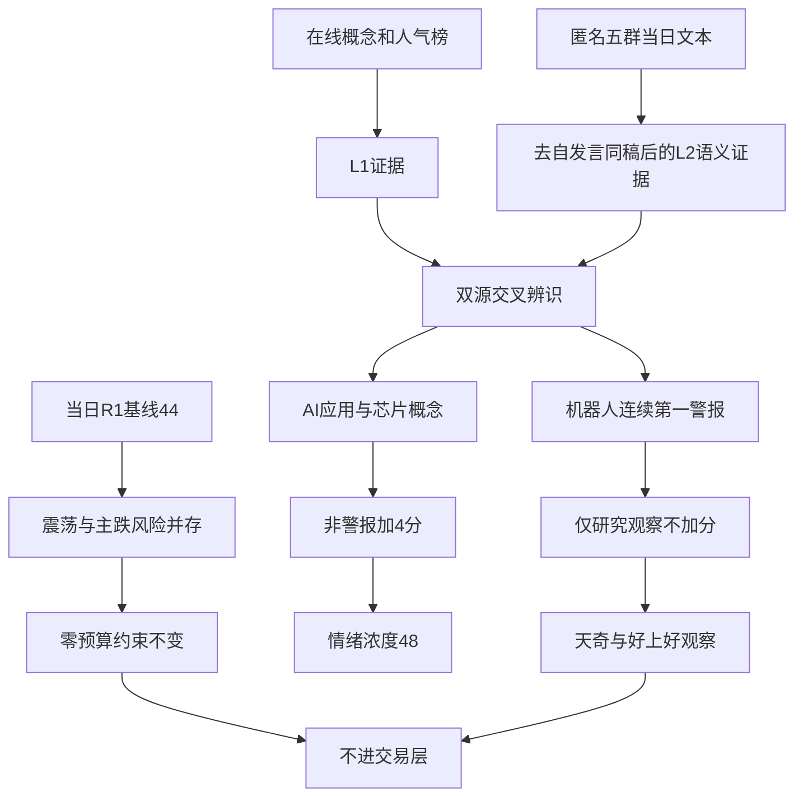

# 2026年10月23日 · 群聊情绪共振

> ⚠️ **intraday_recovery · 盘中生产恢复补跑**。本报告不是晨间预测重建，不得用盘中事实证明早晨预测正确。
> **实际生成时间**见顶部 generated_at；来源时点保留在 JSON。在线热榜为午间可得批次，不是报告生成时的逐笔行情。
> **数据新鲜度：partial；分析已完成，数据覆盖不完整；置信度：0.364。**

## 🎯 一句话结论
**观察，不进：情绪浓度48；应用与国产替代双源交叉，机器人霸榜警报单列，零预算不变。**

## 🧭 先认市场，再谈对象

市场在奖励什么？可见的是**局部修复、部分应用场景及国产替代事件的辨识度**，不是科技整体重新主升。午间同花顺概念前列的机器人、CPO、PCB、存储仍分别下跌，热度不能解释成净买或赚钱效应。超级品牌涨0.12%、漂亮100涨0.45%仅属相对韧性，不能据此静态贴“防守/进攻”标签。

现在处在哪一段？**情绪=震荡/主跌风险未解除**。当日R1暂定 high_chop，保留 main_down 分支，未确认可交易主线。R3不覆盖其周期标签，也不以稍后情绪修复提高预算。XTick稍晚快照33涨停、16跌停、10炸板；统一复算炸板率为23.26%，不是供应商原始zbl=9.09。mhigh=6与R1早先3板存在时点/口径差，不假定梯队已经同口径核实。

谁有地位？R3只能确认**被点名且有人气**：天奇股份、好上好留在研究观察层；龙头认定、板型、流通市值、RR和禁止清单未核，不能把二者命名为龙头。机器人族连续两日概念榜第一，只输出拥挤/出货警报，不借“机器人概念”父级名另加正分。

今天做什么、不做什么？完成两条非警报双源主题的语义辨识、两只研究观察对象的证伪条件，向R2/R5传递研究线索。**不授予开仓资格，不新增交易候选，不改变R1的0%预算，不读取账户，不将意图写成成交。**北向未核就null，仅为可选参考，未因此关闭研究。

## 🧮 当日基线与可复算分数

| 项目 | 数值/处理 | 因果解释 |
|---|---:|---|
| 当日R1基线 | 44 | 取20261023盘中恢复版；上游degraded但分析completed，不读前日R1、不退化50 |
| 非警报L1+L2主题 | 2 | AI应用、芯片概念；同源转载不重复计数 |
| 共振调整 | +4 | 沿用现有实现每条双源+2，不是新增RR或交易门槛 |
| R3情绪浓度 | **48** | clip(44+2×2,0,100)，不是胜率、涨幅预期或开仓许可 |
| 机器人族加分 | 0 | 连续top1反向警报，父子概念合并处理 |
| 公众号加分 | 0 | 观点背景，不作量化共振 |
| 五维交叉分/差值 | 未知/null | 杠杆、可信净买与标准化分项不足，不补中性分 |
| 置信度 | 0.364 | 0.65×0.7×0.8；两层独立证据，非每个群都算一个独立源 |

R1盘中曾出现38.71%炸板，已触发当日≥35%的候选减半纪律。本次研究观察顶部容量由4减至2，实际保留2只；“4”是容量而不是虚构的4只合格票。最新23.26%不抹去当日日内高炸板事实，研究候选减半也不等于清空。

## 🔎 双源主题：只排共振证据，不作R2板块排序

以下序号是R3证据展示顺序，**不是板块投资排序**。所有主题研究身份为research_only，execution_eligible=false。持续性和封板率没有同口径证据就未知，不凑1/3/5日数字。

### 1．AI应用 · L1+L2 · 观察

| 标准主题 | 证据 | 时点/含义 |
|---|---|---|
| AI应用 | 同花顺概念9→8，跌3.65% | 前日收尾对当日午间批次；排名提升非涨势 |
| 观点语义 | AI购物入口转向库存与履约；AI医疗从论文映射临床 | 题材群/核心群/信息群同稿合并，科研不等于收入 |
| 主线资格 | 未确认 | 持续性=未知；封板率=未知；下一交易日预期=分歧 |

- **大资金意图**: 参与者试图在硬件风险释放时寻找应用落地与消费韧性，实际净买未验证，不能替大资金发言。
- **为什么走强**: 这里只是讨论热度相对靠前；板块仍跌3.65%，因此不能写成整体走强。购物与临床是两个场景，不凭一个名字连板外推。
- **逻辑够不够硬**: 有榜单与当日长文两个层次，但海外产品到A股收入存在跳跃。商业化数据及R2梯队未补齐，态度保持观察。

三江购物等名字属于观点覆盖，不具备本次同口径个股热榜及门禁的完整证据，不冒充首推；AI诊断不硬套成整个创新药共振。

### 2．芯片概念 · L1+L2 · 观察

| 标准主题 | 证据 | 时点/含义 |
|---|---|---|
| 芯片概念 | 同花顺概念19→17，跌4.29% | 热度与行情方向相反 |
| 自主可控观点 | FCC组件限制被解读为国产替代催化 | 信息群合格长文点名好上好，事件获利链待核 |
| 反证观点 | 海外半导体ETF大跌及支撑风险 | 研判群条件式风险意见，不转成R3技术分析 |
| 主线资格 | 未确认 | 持续性=未知；封板率=未知；下一交易日预期=分歧 |

- **大资金意图**: 可能博弈限制事件造成的国产替代预期，同时承受海外风险传导；没有主力净流向证明“资金已切入”。
- **为什么走强**: 好上好东财人气78、涨10.01%显示局部辨识度，芯片板块却跌4.29%，局部强不是板块全面强。
- **逻辑够不够硬**: 组件限制报道与上市公司订单增量不是同一件事。需要原始监管/公司披露验证，公司获益链没闭合就不授予交易权限。

存储芯片热榜第5、跌4.26%，保留为该主题风险背景；不因同一条半导体意见再拆一条存储正向主题，避免重复加分。

## 🚨 警报主题与单源覆盖

| 对象 | 本次实证 | 明确态度 |
|---|---|---|
| 人形机器人/机器人概念 | 概念连续两日第1；当前分别跌3.39%/3.36%；工业与家居数采讨论继续 | **观察**，机器人族正向加分为0；不是已经证实派发，更不是R6硬否决 |
| 华天科技 | 东财连续两日人气第1；当前涨4.44% | **降级**为拥挤警报；不把榜首当正向共振 |
| 液冷服务器 | 当日合格长文谈预制AI工厂管路/快接头 | **观察**，L2_only；不硬套成CPO或算力租赁 |
| 化工涨价/基础油 | 价差和产能叙事在群内传播 | **观察**，同主题当前榜单/原始产能未核，夸张利润不采信 |
| 券商修复 | 仅当日短句提及 | **观察**，不足60字不进长文共振；不宣布切主线 |
| CPO、PCB | 概念排名2/4但跌5.08%/5.27% | **降级**，本次L2未形成同题正向验证，L1_only不进共振榜 |

- **大资金意图**: 机器人重复转发体现参与者寻找具身数据新分支，但不足以证明机构增仓；需要区分产业叙事与拥挤筹码。
- **为什么走强**: 目前是局部票与讨论升温，机器人概念整体仍负收益，不能称板块走强。
- **逻辑够不够硬**: 招聘、合作、数据小时数多为转述，部分数字跨稿不一致。连续top1触发警报，但L4所需成交、上影、流出及负面交叉未齐，未认定已出货。

## 🧪 两只顶部研究观察对象：不等于交易候选

| 个股 | 板型 | 龙头认定 | RR | 禁止清单 | 身份 |
|---|---|---|---|---|---|
| 天奇股份 002009.SZ | 未核首板/二板/回封 | 未认定，未执行认定，已验证条数0 | 未知，取价/止损/目标均null | 已证实命中为空但不等于全通过；市值、14项门禁未核 | 观察，research_only |
| 好上好 001298.SZ | 未核封单与板型 | 未认定，未执行认定，已验证条数0 | 未知，取价/止损/目标均null | 同上，另有全局零预算约束 | 观察，research_only |

两票均execution_eligible=false；机会分类为“计划内试错待R2/D1确认”，不擅自称今日核心或主线补涨。20亿流通市值硬线和20—50亿逐票风险没有放宽，只是本单元未核，不能猜测通过。RR=预期赚幅/允许亏幅，不新增统一门槛；价格点缺失就研究观察，而非全局清池。

### 天奇股份：工业数采辨识度 · 观察

- **大资金意图**: 参与者押注工业场景与数据训练交付，从招聘传闻扩展到工厂场景；实际订单和机构流入未验证。
- **为什么走强**: 东财人气53、涨7.50%与当日长文点名相交，但群内早先“涨停”不等于午间仍封板。
- **逻辑够不够硬**: 产业连接尚需原始公告核验，机器人族又处连续霸榜警报，仅保留研究身份。

- **买入理由**: 这里是待验证的研究假设，不是买入指令。其一，工业具身数据与场景交付具有可研究的产业连接；其二，当日长文点名与东财人气53交叉，非只有名字。

- **风险点**: 其一，涨7.50%不等于涨停承接，且机器人概念整体下跌；其二，合作、客户和数据规模的转述未核成收入，可能被重复传播放大。

- **止损条件**: 不伪造价格止损。若原始披露否认业务连接，或下一交易日THS、DC两源均退出top100，撤销该票人气研究假设；真实买卖点与价格止损仍交R5/D1核验。

- **可验证假设**: 下一交易日至少一源保持top100，且取得原始公开文件确认相关业务连接；任一未满足则降级。现阶段RR未知、零预算，不进。

### 好上好：国产替代事件辨识度 · 观察

- **大资金意图**: 参与者将组件限制映射为国产芯片渠道/应用机会；是否新增订单未核，不能据此宣称机构建仓。
- **为什么走强**: 当日合格长文点名；东财人气78、涨10.01%，但板块跌4.29%且未核封单，属于局部证据。
- **逻辑够不够硬**: 监管事件到渠道利润的传导仍缺原始验证，研究资格成立不代表交易资格成立。

- **买入理由**: 这里只陈述待证研究理由。其一，国产芯片渠道与终端应用可能受自主化需求影响；其二，FCC限制主题长文与人气78、涨10.01%交叉，形成可核验的对象。

- **风险点**: 其一，单票涨停幅度不能代替封板质量、板型或龙头地位；其二，限制也可能伤害终端需求，获利链条并非天然单向。

- **止损条件**: 若原始公开文件否认相关业务连接，或下一交易日两平台均退出top100，撤销该票人气研究假设；没有取价/目标/止损证据，不给虚构价格止损。

- **可验证假设**: 下一交易日至少一平台仍在top100，并取得原始公开文件验证该业务连接；任一缺失则降级。零预算与逐票门禁仍独立生效。

## 🗣️ 匿名KOL观点与下一交易日方向

五群均已在线查询：研判群G1共30条、题材群G2共17条、核心群G3共20条、机构群G4当日0条、信息群G5共50条，合计117条。严格过滤后38条合格长文，按同稿文本去重为19条；**跨群转发不是多位独立研究者的合力证明**。本地晨间436条也已读取作背景，但没有代替当前L2。

研判群的半导体风险长文保留为反证；当日“筑底成功”“修复中”等短句不足60字不计分。题材/核心/信息群的购物、具身数据、国产替代与液冷长文采用语义关系归类，而非关键词子串匹配。

**下一交易日方向=未确认。**没有足够合格长文证明一致看修复或一致续跌。今日是周五，后续验证应按下一交易日，不把自然日“明天”当周六交易。信息群中用户/Agent自身发布的两条午间研究已排除，禁止把自己的结论回流成外部共振。

## 📰 公众号观点：与量化共振分开

晨间RSS归档90篇，本报告选列13篇标题/摘要观点，不声称读完全文，也不声称已刷新盘中公众号。

| 分组 | 来源与标题 | 使用边界 |
|---|---|---|
| 机器人观点 | 财联社早知道：Isaac机器人平台；上海证券报：物理AI讨论 | 产业背景，不能解除霸榜警报 |
| 科技风险与辟谣 | 证券时报：“易中天”、东山精密最新发声；不实！AI龙头未出现网传连锁强平 | 辟谣与经营正常不等于价格反转 |
| 芯片情绪 | 证券时报：002185直线涨停 | 明确为前日文章，不能拿来证明当日封板 |
| 宏观与情绪 | 股痴流沙河《冰冰》、猫笔刀《整个世界都绿了》、安静拆主线《被干哭了》、盘口逻辑拆解《挺难绷的》 | 标题呈现前日悲观氛围，不编造正文观点 |
| 宏观与情绪 | 傅里叶的猫《美股AI链暴跌背后的Capex陷阱》；上海证券报《现金流转负，Meta仍坚持加码AI》 | 资本支出与回报风险背景，不进入情绪分 |
| 消费与海外 | 证券时报：消费是增长第一拉动力；上海证券报：一国降息100基点 | 未核具体政策传导，不作为当日交易主线 |

## 🔐 不确定性 / 反证

热榜最新可得为午间批次，不等于报告生成时的实时盘口。THS股票批次99条而非满100；前日历史在产物中仅保留已核前25名投影，完整diff以DC100对100为主，不混源排名。前日热榜缺某主题只说明top20外，不能宣称刚诞生。

R1的44是已完成分析但覆盖不足的上游温度，不把degraded偷偷改为complete。当前XTick改善并不自动解除周期风险；没有主力/龙虎榜交叉，拥挤警报不能被写成“确认派发”。R6硬否决权未触碰，空命中也不声称全票通过。

attention_signals缺失，因此persistent、surge、多平台合力缺口明确保留，不用本次两张榜臆造多日管道结果。北向缺可信同口径净买就null；没有用额度余额或总成交替代，没有因北向缺口触发全局失效。

## 数据源审计

| 源 | 日期 | 状态 | 备注 |
|---|---|:--:|---|
| 当日R1 | 2026-10-23 | 🟡 | 盘中恢复版44分，degraded；分析completed |
| 同花顺概念双日在线 | 2026-10-23 | 🟢 | 当前20/前日20；Y为空后N返回真实盘中批次 |
| 同花顺热股在线 | 2026-10-23 | 🟡 | 当前99；历史前25投影用于已核子集，不推断未覆盖代码 |
| 东财人气双日在线 | 2026-10-23 | 🟢 | 100对100，平台内diff；当前批次价格非买点 |
| XTick情绪 | 2026-10-23 | 🟢 | 33涨停/16跌停/10炸板，复算23.26% |
| XTick板块 | 2026-10-23 | 🟡 | 大量成分返回，行情时点未确证，不进入方向判断 |
| 主力资金/龙虎榜交叉 | 2026-10-23 | 🔴 | 本次未核，不能从热度推出净买或确认出货 |
| 五群在线文本（匿名） | 2026-10-23 | 🟢 | 117条；4群有消息，机构群可达但0文本 |
| 五群晨间归档（匿名） | 2026-10-23 | 🟡 | 436条，内容主要前日，仅背景 |
| 公众号RSS | 2026-10-23 | 🟡 | 归档90篇；文章主要前日，选列13篇，仅观点不计分 |
| attention_signals | 2026-10-23 | 🔴 | 文件缺失，persistent/surge未做 |
| WeFlow | 2026-10-23 | 🔴 | 已永久下线，未调用；字段为空 |
| 五维情绪交叉 | 2026-10-23 | 🟡 | 缺杠杆/可信净买及分项，不填假分数 |

## 🔗 与其他R/D/E的关系

依赖：data/research/20261023/R1_style.json，以及当日在线L1/L2与晨间只读背景。
传递：R2消费双源主题和独立观察对象，R5可对真实对象画像；R4做原始事件核验；R6只读本次上游做独立反证；D1必须保留零预算、干运行和逐票门禁；E1不得把盘中补跑当晨间预测。
本报告只写R3研究JSON和人读MD，不写raw、plans、execution、runtime或模拟账户，不外发。

## Sub-Agent 元数据

- skill: analyze_sentiment_resonance_v1
- artifact: data/research/20261023/R3_sentiment.json
- model: gpt-6.1-sol
- run mode: intraday_recovery
- run ID: 环境CHZL_RESEARCH_RUN_ID不可得，JSON为null
- 原件保护：沿用用户声明的production-recovery-before备份，不扩大写目录
- 校验：Pydantic核心契约、双源等级、当日R1时间/哈希血缘、JSON/MD分数计数一致、匿名化及写作锚点均在落盘后核验
