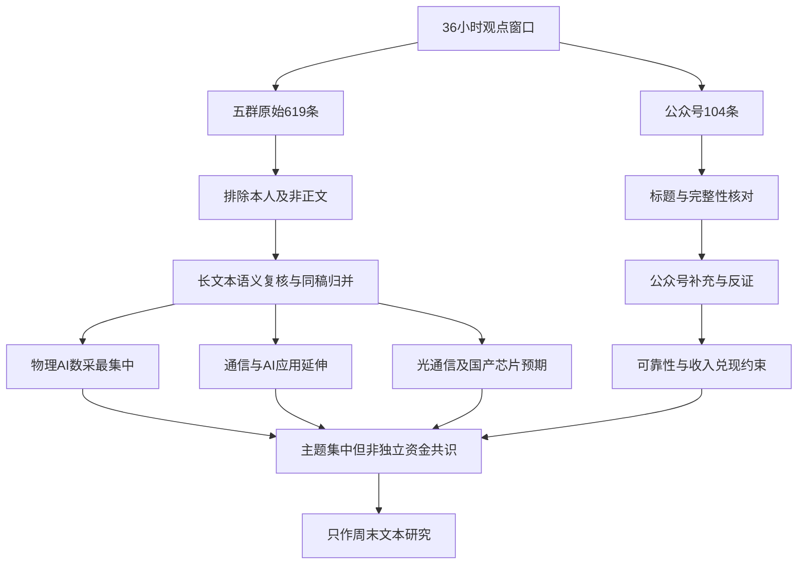

# 2026年10月24日 · 周末轻量群聊情绪研究

> **数据源新鲜度**：🟢 `ok`；**文本完整性**：🟡 `degraded=true`；**研究置信度**：`0.325`，不是市场情绪分数。  
> **研究边界**：只使用群聊与公众号两类观点源，讨论主题与一致性预期，不认定实际行情、资金行为或产业事实已经兑现。  
> **跨日窗口说明**：本篇以周六为报告日期，覆盖 **2026-10-23 06:02—2026-10-24 18:00**，并非从周五收盘开始。精确边界保留于 frontmatter；跨日是本次授权窗口，不是假冒周六单日数据。

## 🧭 一句话结论

**物理AI数采最集中，通信与AI应用延伸；修复乐观伴随反复担忧，同稿扩散不等于独立共识。**

## 🔍 详细分析

**第一，主题集中，情绪并非全体一致。** 具身智能讨论的共同语义已从“机器人会不会放量”收敛到“数据是瓶颈，谁能提供可用的真实数据”：第一视角、手持数采、触觉、家庭、工厂与物流场景均在同一叙事链上。`G149/G190/G428/G552`分别从数据质量、设备、家庭入口与产业演进表达这个判断；但`G122`等营销式文案重复较多，不能用出现次数直接放大可信度。

**第二，周五的情绪修复和周六的发酵要分开。** `G001`呈现海外科技风险担忧，`G083`仍强调反复；群5的短对话从`G444/G446`的亏损与怀疑，变为`G554/G560—G567`的信心与庆祝。短对话仅作语境旁证，不进入长文本统计。周六`G253/G397/G614`是同一段物理AI观点的跨群复述，`G248/G392/G610`也是同一条通信转述；这证明延续传播，不能证明周六新增多个独立判断。

**第三，扩散方向有层次。** 物理AI是最清楚的集中对象；AI-RAN/基站把AI叙事延伸到通信基础设施；光通信上游以“订单景气向材料传导”构建推演；AI应用在音乐、金融工具、购物与医疗等场景寻找收入闭环；国产芯片则同时承载外部限制下的替代预期与业绩验证。下文顺序是**文本叙事清晰度**，不是板块强弱、资金排序或投资优先级。

**第四，公众号是补充观点和反证，而非第二个量化层。** `P101`《机器人的 ChatGPT 时刻何时到来？》同意数据瓶颈，却强调可靠性、数据可用率和长期议价能力；`P060`提示机器人相关收入占比与题材热度未必匹配。`P100`既描述情绪舒缓，也提醒激进冲动。因而本篇判断是**主题集中度高，方向性情绪仍有分歧；周末新增独立论据有限**，不输出0—100市场情绪分。

## 🧪 样本、筛选与引用方法

| 层次 | 实读与处理 | 不能由此推出什么 |
|---|---|---|
| 群聊原始样本 | 完整读取`619`条；周五`568`条、周六`51`条 | 消息数不是有效观点数，也不是参与资金规模 |
| 结构筛选 | 排除本人发言`13`条、非正文/系统等`280`条、短于60字符正文`210`条；得到`116`条长文本候选 | 长度只是阅读入口，不按关键词决定主题 |
| 语义复核 | 再剔除`G199`纯转链、`G381`个人自媒体宣传、`G580/G583`红包系统内容，保留`112`条；正文精确去重后`60`条 | 60条是精确文本去重数，不是60位独立作者，也不是60项独立事实 |
| 公众号 | 完整读取文件内`104`条记录；周五`81`篇、周六`23`篇；唯一链接`104`个 | 不等于104篇完整正文，也不等于104个独立信源 |
| 公众号完整性 | `18`条正文仅等于标题；`P001/P009/P070/P095/P096/P102`约4000字，部分明显在句中结束，疑似上游长度上限 | 仅标题不能补写全文，长文尾部缺失不能靠想象恢复 |
| 镜像去重 | `wechat_official_20.jsonl`与`wechat_official_rss.jsonl`字节完全相同，仅计`104`篇一次 | 不计为208篇，不叠加一个“独立源” |

**筛选纪律**：本人发言及其被引述内容不作为外部观点证据，尤其排除`G471/G472/G612/G613`，防止把自身生成的研究回流成市场共识。图片、视频、无法展开的链接/文件不还原正文；可读链接标题仅作“传播标签”，不证明链接中的事情为真。短对话若引用，明确作为语境旁证，不纳入112条语义长文统计。相同正文先合并，近似改写和同一底层新闻再做语义归并。

**引用规则**：`Gnnn`是`data/raw/20261024/wechat_cli_5groups.jsonl`的原始物理行号；`Pnnn`是`data/raw/20261024/wechat_official_20.jsonl`的原始物理行号。群聊无正式标题时，使用匿名群编号＋语义标题＋日期；公众号用文章标题＋日期定位，不披露群名、个人昵称或联系方式。

| 匿名群 | 原始行范围 | 原始记录数 | 角色说明 |
|---|---|---:|---|
| 群1 | `G001—G096` | 96 | 市场讨论样本，不据群名推断真实资金身份 |
| 群2 | `G097—G259` | 163 | 题材讨论样本 |
| 群3 | `G260—G407` | 148 | 题材讨论样本，与群2、群5存在明显转发重叠 |
| 群4 | `G408—G419` | 12 | 机构交流类样本，含链接与活动通知 |
| 群5 | `G420—G619` | 200 | 盘中交流与题材讨论样本 |

## 🧩 Top主题与一致性预期

> 下列五项均为**文本主题**；未进入机读`resonance_top_themes`，不标`L1+L2`。其中具体公司名称如出现在来源标题里，只是定位文本，不是首推票或观察池。

| 主题 | 已观察到的一致性预期 | 一致性边界 | 核心证据 |
|---|---|---|---|
| 物理AI/具身智能数据采集 | 高质量真实交互数据是瓶颈，设备与场景可能比单一本体更早形成服务需求 | **样本内最集中**；可用数据、收入和毛利兑现存在反证 | `G149/G190/G428/G552`；`P101` |
| AI-RAN与通信基础设施 | 基站可能由通信节点延伸为AI计算/感知节点，带来能源与射频升级想象 | 多群转述，但SpaceX租站址与AI-RAN不是同一订单链 | `G152/G153/G161/G248`；`P016/P023` |
| 光通信及上游材料 | 需求景气有望从高速光互连向磷化铟、铌酸锂等上游传导 | 上游紧缺主要仍是群聊推断，不可当作已验证供需事实 | `G228/G372/G543`；`P083/P012` |
| AI应用商业化 | 音乐、金融工具、购物及医疗场景被用来寻找变现入口 | 子场景分散，尚无统一应用收入拐点共识 | `G097/G124/G414/G419`；`P020/P026/P053` |
| 国产芯片与自主可控 | 外部限制可能强化国产链需求，业绩和订单成为验证抓手 | 风险规避与替代受益两种解释并存，不等于半导体全面被看好 | `G001/G087/G363/G427`；`P063/P074/P099` |

### ① 物理AI：数采需求集中，场景资产重估的外推最需警惕

**语义链**：模型要泛化 → 需要真实动作、力觉及跨本体可用数据 → 数采硬件/采标服务/场景入口被反复讨论。`G149`区分普通第一视角视频和可训练的Ego/UMI数据，`G428`将家庭空间数据映射为训练入口，`G552`将工业过程数据纳入更大范围的物理AI。不是把“数据”两个字出现的文章全归成同一主题。

- **大资金意图**: **真实意图未知。** 只可推测叙事提供了“从本体转向数据与卖铲环节”的研究理由，无法从转发文案识别机构配置、对手盘或持仓。
- **为什么走强**: 本文的“走强”仅指讨论聚焦：从宏观机器人叙事细化到Ego/UMI、家庭/工业/物流和触觉设备，因果链更具体；不是对周六价格走势的判断。证据为`G149/G190/G428/G552`（均2026-10-23），以及`G253`（2026-10-24）的延续讨论。
- **逻辑够不够硬**: **数据瓶颈的观点相对集中，具体上市公司兑现并不够硬。** `P101`《机器人的 ChatGPT 时刻何时到来？》（2026-10-23）指出录制时长不等于训练可用时长，且第一视角视频若改善效率，遥操作工厂的长期议价可能弱于预期。可证伪问题是有没有客户验收、可用率、复购与实际收入，而非宣布训练场或合作就算兑现。

**传播去重锚**：`G122/G135/G145/G282/G290/G296/G436`为同一家庭数据文案；`G187/G233/G348/G374/G519/G547`为同一训练中心文案。分别只代表一个论据簇。`G253/G397/G614`也只代表一段周六观点。

### ② AI-RAN与基站：通信、计算与卫星叙事同时出现，但不能混成确定订单

**语义链**：`G152/G153`谈AI-RAN在无线侧复用GPU及能源配套；`G161`谈射频器件；`G248`则转述SpaceX寻求站址使用权。三者共同提升基站作为物理基础设施的关注，但后者是网络覆盖叙事，不天然等于前者的设备采购。

- **大资金意图**: **真实意图未知。** “海外基础设施升级映射国内供应链”只是群聊构造的投资叙事，没有账户级证据说明资金已经按此配置。
- **为什么走强**: 讨论获得“AI-RAN＋站址资源＋通信规划”的多重标签，便于把通信、电源和射频连接起来；2026-10-24仍出现`G248/G392/G610`同稿传播，说明议题延续而非独立事实增多。
- **逻辑够不够硬**: **网络升级方向有文字锚，供应商受益链尚不硬。** `P016`《全球市值“股王”，盘中易位！》（2026-10-23）的站址讨论、`P023`《国家信息化“十五五”规划》印发（2026-10-23）分别是海外报道和长期规划，不能拼成短期国内合同；需要分清谈判、签约、建设与供货各阶段。`G152/G204/G313/G358`为同稿，不能算四项确认。

### ③ 光通信上游：经营叙事较具体，材料“供不应求”仍是二次推演

**语义链**：群聊先转述光模块企业经营说明，再把高速互连需求推到材料端。`G228/G372/G543`正文完全相同，表达需求向上游传导的乐观判断，不能据此认定特定材料已经短缺。

- **大资金意图**: **真实意图未知。** 可以识别“从下游订单寻找上游弹性”的文字思路，无法证明机构在上游吸筹或撤离下游。
- **为什么走强**: `P083`《罕见！CPO龙头午间公告：大额回购》（2026-10-23）转述多家公司订单、交付与产能情况，为群聊提供较具体的叙事起点；`P012`《光通信龙头出手！300394，拟最高回购1.5亿元，全部注销！》（2026-10-24）延续信心表达。这里仅记录观点传播，不把回购计划等同执行完毕。
- **逻辑够不够硬**: **经营表述比纯概念具体，材料外推仍待核实。** 下游需求增加不自动证明上游单价、供需缺口或利润率同步提升；技术替代、客户认证、产能释放、议价分配均可打断传导。公众号与群聊若都来自同一经营说明，只算一个底层事件。

### ④ AI应用：变现场景在扩散，收入闭环尚未统一

**语义链**：`G097`把购物智能体映射到履约场景，`G124`把研究结果映射到医疗服务，`G414`讨论金融AI产品与财务表现，`G419`是短剧平台专家交流通知；音乐讨论见`G386/G609`，但两条短文本是传播语境，不进入长文本统计。它们共享“应用触达用户”方向，却不能合并成同一商业模型。

- **大资金意图**: **真实意图未知。** 能推测的是叙事希望从模型能力转向用户、付费与工作流，不能由此认定真实资金已从硬件切向软件。
- **为什么走强**: 应用故事更易联系可见用户行为，机构交流样本`G414/G419`也不只谈硬件；`P053`《聚合智 新生力丨2026年国泰海通金融科技文化节主题论坛暨上海苏河湾大会高端对话成功举行》（2026-10-24）提供金融智能体落地的观点文本。不同场景分散，仍不宜称应用全面共振。
- **逻辑够不够硬**: **有落地叙述，缺统一收入验证。** 播放量不等于付费，论文结果不等于临床商业化，活动通知不等于新增订单。`P020`《确认！多家A股公司，参与DeepSeek新一轮千亿级融资》（2026-10-23）中的融资协同也不自动转化为应用利润；`P026`《国办发文：减缓人工智能应用就业替代影响》（2026-10-23）提示应用扩展同时有治理约束。所引产业与技术说法仅为来源观点，本篇未独立核实。

### ⑤ 国产芯片：外部风险与国产替代预期并存

**语义链**：`G001`从海外科技风险表达担忧；`G427`把组件层限制解释为国产链替代机会；`G087`和`G363`以业绩、订单叙事支撑预期。风险受压和自主化受益可以同时成立，不能把后一种观点覆盖前一种。

- **大资金意图**: **真实意图未知。** `P099`《解药》（2026-10-23）提供“国产芯片相对外部AI风险”的解释框架，但它是作者观点，不是已验证的机构动机。
- **为什么走强**: 主题同时得到外部限制叙事和业绩验证叙事支撑，讨论抓手较明确；但群1`G044`（2026-10-23，短文本语境）仍对硬件谨慎，样本没有形成“所有半导体都好”的一致预期。
- **逻辑够不够硬**: **可验证线索存在，结论不能泛化。** `P063`《寒武纪，营收和利润双双翻倍》（2026-10-23）同时提及增长、现金流和后续交付观察；`P074`《美光、长鑫现技术路线分歧？业内专家研判》（2026-10-23）显示技术路线存在争论。需要区分不同环节及产品，不能把限制消息直接等同新增订单或盈利。

## 📰 公众号观点（单列，不计量化共振）

### 与主题对应的观点

| 编号、日期与原标题 | 观点归纳 | 本篇处理 |
|---|---|---|
| `P001` · 2026-10-23 ·《【VIP日报】机器人板块持续爆发 VIP策划专题解读 提及产业多家核心公司大涨》 | 强调物理AI与数据、量产想象 | 属产品回顾与成功案例展示，存在选择偏差；文件内正文疑似截断 |
| `P101` · 2026-10-23 ·《机器人的 ChatGPT 时刻何时到来？》 | 数据瓶颈与可靠性鸿沟并存，第一视角路线可能改变成本与议价 | 物理AI的核心补充和反证，不把调研数字当已核实事实 |
| `P060` · 2026-10-23 ·《6天涨近四成，603728提示风险》 | 文中转述机器人相关业务占比较低、当年影响有限 | 反证题材热度不能替代收入贡献；不是个股评价 |
| `P065` · 2026-10-23 ·《人形机器人，新增6项国家标准》 | 规范、能力验证与场景部署是后续关键 | 长周期制度观点，不等同订单兑现 |
| `P083` · 2026-10-23 ·《罕见！CPO龙头午间公告：大额回购》 | 多家公司经营与订单表述积极 | 光通信主题的文本锚；不重复计群聊转述 |
| `P053` · 2026-10-24 · 金融科技论坛报道（完整标题见主题④） | 金融AI从问答走向协作执行，强调审计和治理 | 应用场景观点，不把活动宣传当盈利拐点 |
| `P099` · 2026-10-23 ·《解药》 | 国产自主化被视为外部冲击下的相对方向 | 个体观点，与`G001`的风险担忧并列而非相互抵消 |

### 宏观与情绪：修复乐观不是无条件乐观

| 编号、日期与原标题 | 对情绪判断的意义 | 必须保留的边界 |
|---|---|---|
| `P100` · 2026-10-23 ·《肾结石都震碎了》 | 描写波动后的舒缓，同时提醒追加风险冲动 | 私人体验不代表全市场；其主动约束冲动与群聊庆祝形成张力 |
| `P071` · 2026-10-23 ·《“日光”！“比例配售”！今日A股最热》 | 基金发行、自购与经理观点提供信心叙事 | 募集、认购、成立、建仓不是同一动作；不推出当日资金去向 |
| `P057` · 2026-10-24 ·《市场一夜不平静：金价跌破4000美元，油价大涨》 | 外部风险、通胀与风险偏好仍被讨论 | 本篇不转录行情数值，也不以标题认定当前价格 |
| `P004` · 2026-10-24 ·《重磅会议来袭！美联储，加息大消息！》 | 未来政策路径仍是情绪约束 | 仅记录文章的关注点，未另行查验政策与日程 |
| `P102` · 2026-10-23 ·《透过前三季度数据预判2027年宏观对策》 | 指向供需不均、内需修复偏缓，与纯乐观叙事相冲突 | 文件内长文疑似截断；只归纳已见段落 |
| `P051` · 2026-10-24 ·《任泽平公众号被禁止关注》 | 说明宏观叙事发布者本身也成为讨论对象 | 不推断平台处置原因，不把这一标题解读为看多/看空的证据 |

## 🧠 情绪浓度与传播结构

| 观察维度 | 文本口径判断 | 可复核依据 |
|---|---|---|
| 主题集中度 | **高，集中在物理AI数采** | 同时出现Ego/UMI、家庭、工业、物流、触觉等同一因果链；`G149/G190/G428/G552` |
| 一致性预期 | **“数据重要”较一致，“谁能赚钱”不一致** | `G552`强调稀缺与产业前景，`P101`强调质量、可靠性与议价变化 |
| 方向性情绪 | **修复后的乐观与反复担忧并存** | `G083`、群5庆祝语境、`P100/P102`相互制衡 |
| 周末增量 | **延续发酵，有明显同稿复述** | `G253/G397/G614`及`G248/G392/G610`分别为同稿簇 |
| 渠道独立性 | **不足以做多源事实确认** | 多群同正文，公众号与群聊还可能引用同一券商/新闻/经营说明 |
| 市场量化情绪 | **不提供** | `sentiment_score=null`；没有当日热榜，不挪用周五榜，不套用交易日基准 |

图中箭头是**分析归纳关系**，不是已经发生的资金传导或价格因果。

## 📌 关键证据

- **E1 · 核心语义**：群2`G149`（2026-10-23，语义标题“可训练Ego/UMI数据区别于普通视频”）与群5`G552`（2026-10-23，语义标题“物理AI数据瓶颈与产业验证”）相互补充；不将其自述的机构标签当真实性认证。
- **E2 · 虚假独立共识风险**：群2`G122`、群3`G282`、群5`G436`（2026-10-23，语义标题“家庭机器人数据入口”）正文相同；重复传播只能证明扩散，不证明三次研究确认。
- **E3 · 周末延续而非新论据**：群2`G253`、群3`G397`、群5`G614`（2026-10-24，语义标题“物理AI卖数据与采集设备”）同稿；通信对应`G248/G392/G610`同稿。
- **E4 · 明确反证**：公众号`P101`《机器人的 ChatGPT 时刻何时到来？》（2026-10-23）区分能力演示与持续可靠运行；`P060`《6天涨近四成，603728提示风险》（2026-10-23）区分题材关联与收入贡献。
- **E5 · 情绪不单向**：群1`G083`（2026-10-23，语义标题“修复仍可能反复”）、公众号`P100`《肾结石都震碎了》（2026-10-23）与`P102`宏观分析共同约束纯乐观结论。短文本`G407`（2026-10-24，链接标题“周评 | 恐慌杀跌已被遏制！但别乐观”）仅作风险叙事仍在传播的旁证，不还原未读链接内容。

## 数据源审计

| 源 | 日期 | 状态 | 记录数/覆盖与备注 |
|---|---|:--:|---|
| `manifest.json` | 2026-10-24 | 🟢 | `lookback_hours=36`，`global_severity=0`；生成边界见frontmatter，不把新闻扩展窗口套到观点源 |
| `wechat_cli_5groups.jsonl` | 2026-10-23—2026-10-24 | 🟢 | `619`条，5群均ok；实得消息范围2026-10-23 06:59至2026-10-24 17:58；112条长文本经语义复核，精确去重60条 |
| `wechat_official_20.jsonl` | 2026-10-23—2026-10-24 | 🟡 | `104`条，实得文章范围2026-10-23 06:51至2026-10-24 17:46；18条仅标题，6篇疑似上游截断 |
| `wechat_official_rss.jsonl` | 2026-10-24 | 🟢 | 与上行文件字节相同，仅作镜像一致性核对；15订阅抓取成功，10订阅有文章、5订阅为空，不重复计数 |
| `attention_weekend.json`（仅元数据核对） | 2026-10-24 | 🟡 | 当日四类榜均0条，`not_available`；不提供观点之外的热度确认；不因休市降级 |
| `attention_signals` / Tushare / XTick常规热榜与情绪 | 2026-10-24 | 🟡 | 本次周末范围不调用、不使用；manifest的普通榜解析日为2026-10-23，不能替代周六热度 |
| WeFlow | 2026-10-24 | 🟡 | 已停用，不调用、不恢复，不伪造第三层共振 |
| R1及其他研究artifact | 2026-10-24 | 🟡 | 未使用，不导入交易日情绪分、交易周期结论或交易参数 |
| 新闻/公告扩展文件 | 2026-10-24 | 🟡 | 本篇未读未用；部分扩展可能覆盖72小时，不属于本篇36小时观点样本 |

**审计解释**：正文表中的日期列仅含日期；消息与文章的精确覆盖范围另列说明。两类源的独立抓取时间字段不可得，故`captured_at=null`；不把manifest的生成时刻冒充逐源抓取时刻。`degraded=true`仅因公众号文本完整性受限，不因为星期六、当日榜为空或已停用源。`input_freshness=ok`描述时间新鲜度，不承诺正文完整。

## ⚠️ 不确定性 / 反证

1. **同群/跨群不是独立源**：同一作者、同一文案、同一底层新闻可覆盖多个群；本篇不以群数、发言次数或公众号转载数生成共振等级。没有可比较的上一窗口去重主题基线，不宣称热度环比增幅。
2. **样本偏向不能外推全市场**：五个关注群并非随机抽样；群4仅12条且多为链接。无法从群聊反推全市场参与比例，更无法识别大资金真实意图。
3. **时间偏差**：绝大多数样本来自周五；周六样本较少且重复明显，周末尚未结束。不能把周五修复叙事写成周六新增行情，不能把文章复述的旧事件全部视为窗口内新发生。
4. **商业化反证**：数据有价值不等于所有场景资产都能收费；原始视频、可训练样本、客户付费验收三者不同。`P101`指出的路线变化和议价风险，直接挑战“采集小时越多越值钱”的简单叙事。
5. **观点真实性与事实验证分开**：本篇核实的是“这些文本确实在样本里”，不是文中模型能力、合同、财报、政策、新闻和机构身份的真实性。没有读公告原件或研发原始材料，不出事实核验结论，也不据此给投资指令。
6. **公众号覆盖有限**：18条只有标题，若将其当完整研判会制造信息；6篇长文疑似截断，未读尾部不作归纳。反证已见于可读文本，不据缺失尾部猜测作者最终结论。

## 🔗 与其他 R/D/E 的关系

- **依赖**：仅本次manifest、群聊与公众号原始观点；`attention_weekend.json`只核实当日为空的元数据，不参与主题和情绪结论。
- **可供下游参考**：R2/R4可据本篇寻找叙事和待核线索；R6应保留重复传播、可靠性、收入占比与技术路线反证。它们仍需各自独立核验。
- **禁止直接消费为交易指令**：本篇没有个股首推、执行池、观察池顶部或交易参数，不生成任何机读研究JSON，不修改预案。每票交易思维链条款在本次不适用。

## 🛠️ Sub-Agent 元数据与自检

- skill：`analyze_sentiment_resonance_v1`；遵循`render_kg_md_v1`及`canghai_writing_contract_v1`的人读结构；周末授权覆盖通用交易日量化步骤。
- artifact：仅`chzl_kg/投研交易/群聊情绪/20261024.md`；不写`data/research`、配置、skill或cron。
- model：`gpt-6.1-sol`。
- 置信度公式：`0.65 × 1.0 × 0.5 = 0.325`，按契约夹取范围后不变；因转发来源未完全追溯，保守只给一个观点证据层的一致度因子。此数不是市场情绪浓度或未来收益概率。
- 耗时：未单独计时，不虚填。
- 写入方式：同目录`.tmp`验证后原子替换；若目标已存在先读原文并备份为`.md.bak`。
- 自检项：frontmatter必填项、周末标记、文件名与日期、五主题各三问、13节点Mermaid、公众号单列、匿名引用、源审计与反证齐备；无首推票故四段交易思维链不适用；最终程序校验结果见任务回执。
