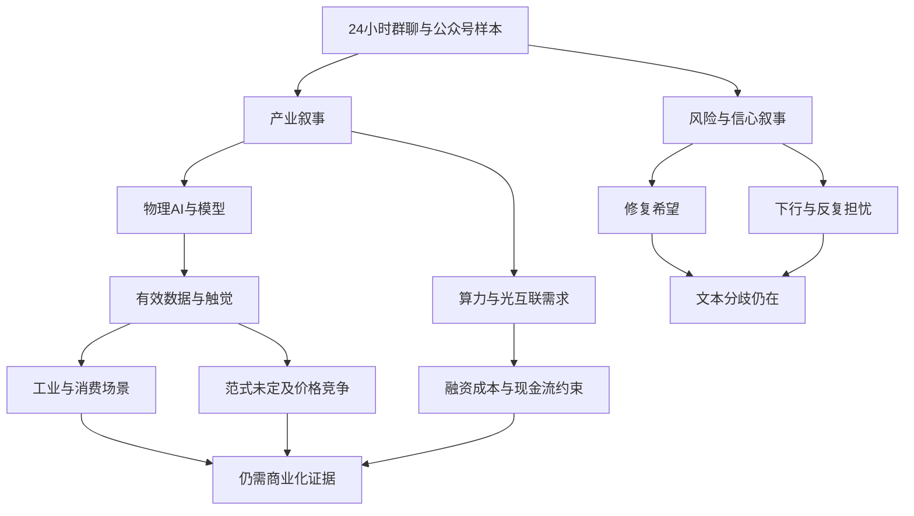

# 2026年10月25日 · 周末轻量群聊情绪

> **范围**：群聊与公众号观点的文本观察，不是全市场情绪测量。日期为周日报告日，不是交易日。
> **新鲜度**：窗口内文本新鲜；完整性仅限已采集来源。**降级：否**。周日新榜 `not_available` 属正常非交易日状态，不因此降级。
> **证据边界**：下文事件、业绩、产品及行情相关说法均为输入作者的陈述，未在本报告中独立核实；不作事实背书。

## 🧭 一句话结论

**物理AI与数采最集中，但“修复希望”与“流动性反思”并存，尚非一致乐观。**

## 📐 窗口与方法

- 实际按 manifest 的 `lookback_hours=24` 和群聊 `since` 审阅，起点为 **2026-10-24 18:01 CST**；批次生成于 **2026-10-25 18:00 CST**。二者并非精确等长终点：manifest 生成字段早于其群聊 since 所对应的满24小时终点约一分钟，保留原始边界，不改写输入。
- 群聊实际消息时间为 **2026-10-24 20:36—2026-10-25 16:48**；公众号实际发布时间为 **2026-10-24 18:05—2026-10-25 17:36**。窗口后新消息没有覆盖；文章回述的10月23日等旧事件不被当成周日新增事件。
- `wechat_official_20.jsonl` 与 RSS 文件**逐字节相同**，均为41篇，唯一文章链接41个，合并后仍是41篇，不是82篇。加群聊53条，共审阅94条源记录；兼容副本另核对41条但不重复计证。
- 逐条按语义审阅正文、可见链接标题与回复上下文，不靠关键词频次排名。短文本若能回答明确语义问题则保留为弱证据；系统提示、图片占位、不可见文件、无内容标题不推测正文。没有可靠用户身份映射，不宣称完成“用户自发言”剔除。
- 引用编号 `G01—G53` 对应群聊文件行号；`A01—A41` 对应公众号文件及RSS的相同行号。群仅用匿名代号，不公开发言者身份、会议密码及联系方式。
- **情绪浓度仅定性**：产业叙事集中在物理AI及数采；宏观风险态度分裂。既没有市场情绪分数，也没有热榜量化共振、资金净流入或全市场一致度。本次不读取WeFlow、不调市场接口、不扩展为交易报告。

## 🗣️ 窗口内KOL在聊什么

| 匿名来源 | 实际条数 | 语义观察 | 解释边界 |
|---|---:|---|---|
| 策略讨论群A | 12 | 指数修复后仍可能再探、量化回撤与信心压力；另有风险反思文章传播 | 观点多为标题或少量回复，不能代表所有成员立场 |
| 题材讨论群B | 5 | 牛磺酸抗衰研究疑问、台湾光复相关话题及名称联想 | 未形成产业收入或可确认的政策受益链 |
| 核心交流群C | 3 | 社交平台播放量预期 | 对象不明，不能归入短剧或某个产品 |
| 机构交流群D | 23 | 物理AI模型、训练数据、工业场景、数采瓶颈；另有光互联与短剧专题 | 卖方活动密度高，但活动重复提醒不是独立新增观点 |
| 新闻交流群E | 10 | 物理AI订单标题、台湾光复话题、对象不明的传播量说法 | 图片/文件占位多；和C群同文不是独立证实 |

**一致性在产业话题，不在市场方向。** D群持续围绕“模型—数据—应用”组织讨论，E群出现数采相关标题，公众号也从触觉数据、无人配送、摄影机器人等场景展开。同一主题的材料较丰富，却不等于独立源已验证了同一条订单或商业化结论。

**分歧有两层。** 策略上，群内既有下行周期担忧，也有悲观演绎充分、修复仍需反复的说法；产业上，数采被讲成关键瓶颈，但专家文章同时指出有效数据不足、训练范式未定、客户自采和降价压力。把这些反证删掉，会误写成单边乐观。

## 🧩 发酵主题与三问

> 以下依文本叙事组织，不是板块强弱排序。每项“为什么走强”仅解释讨论为何聚集；没有证据证明周日价格已走强。所有“大资金意图”均为**未验证推论**。

### 主题一 · 物理AI、具身数据与模型能力：讨论核心最清楚

**证据**：G21提出模型、数据、应用三场专题；G24—G26传播物理AI和Kimi解读；G30围绕工业端口与模型闭环展开；G34与G42是同场模型交流的重复提醒；G37谈真机数据商业化；G39—G40强调数据不足及仿真、真机融合。A38以触觉数据作深入讨论，A40汇总周末密集电话会；A28、A30则从无人配送与摄影场景说明落地路径。E群G52仅是相关订单预期标题，证据强度低于可见正文。

- **大资金意图**: **未验证推论**：卖方可能正尝试把AI叙事从算力硬件延伸到训练数据、工业端口和应用兑现，以寻找更易解释的增量价值。电话会与研报传播只证明研究供给活跃，不证明机构实际增配或真实资金流向。
- **为什么走强**: 仅指**文本关注聚集**。模型能力、训练数据短缺与现实场景相互连接，使数采设备、触觉、仿真及工业应用能共享同一叙事框架；A40使用强烈产业类比进一步放大表达。原文包含此前行情回顾，但本报告不以此判定周日价格走势，也不推演后续价格。
- **逻辑够不够硬**: “训练需要有效数据”是可理解的产业命题，具体需求规模、客户预算、收入确认和利润归属仍待核验。A38明确保留训练范式与数据有效性验证两项前置条件，并谈到价格竞争、客户自采与部分需求放缓；A17转述的商业化节奏谨慎观点又与A40的“时刻已近”式表达形成张力。**讨论证据充分，商业兑现证据尚不足。**

### 主题二 · 市场信心与修复路径：从恐惧转向讨论修复，但无单一共识

**证据**：G04—G06是调整、量化压力与筑底风险的标题转发；G08—G09认为修复后仍可能再探；G28与G36分别传播下行周期担忧和悲观较为极致的策略标题。A04总结基金经理对拥挤交易和流动性的反思；A25含道歉、信心恢复等观点；A40开头从失落转向修复希望；A41讨论跟随名人叙事的风险。

- **大资金意图**: **未验证推论**：机构沟通可能正在把焦点从单纯产业景气转回流动性、估值与风险约束。不同作者可能是在解释波动或管理预期，不能从解释文本反推出统一的机构行动。
- **为什么走强**: 仅指**修复话题重新进入讨论**。此前波动回顾和风险反思为“是否过度悲观”提供语境；但群内同时保留反复探底与下行判断，因此不是文本层面的一致乐观，更不是行情确认。原始指数位置预测不在此复述，以免被误读为操作点位。
- **逻辑够不够硬**: 可确认的是“存在分歧”，不是“底部已形成”。G08—G09属于同一段讨论，不能当成两位独立预测者；G28/G36只看到标题，缺少完整论证。A04/A25是媒体归纳与受访者观点，不等于全体机构的概率判断。未来若修复论述未获得独立经营与流动性证据，其可信度仍受限。

### 主题三 · AI算力与光互联：需求叙事和融资回报矛盾并行

**证据**：G29/G43为同一通信研究线索从链接到长文的传播；长文将订单、业绩与并购解释为景气验证。A06报道相关并购叙事，A10归纳科技企业经营表态，A33转述算力产能预订与推理成本问题。A39则把算力需求与融资成本、资本开支和普通股回报明确分开。

- **大资金意图**: **未验证推论**：研究者可能正试图从泛AI情绪转向合同质量、现金流和供给瓶颈，以辨别价值链中谁能保留经济收益。没有资金流与交易数据，不可写成资金已经从某一环节流向另一环节。
- **为什么走强**: 仅指**景气论证在文本中被强化**。群内长文引用多类公司事件，公众号补充需求与经营描述；与此同时，A39追问需求扩张是否反而扩大融资缺口，说明热度增加并不等于回报质量改善。
- **逻辑够不够硬**: 具体订单与财报若核实会比泛概念更有约束力，但此处只读转述，没有逐份核实原始公告或海外原始披露。G43和A06可能共享同一并购事实；A33与A39也不是彼此矛盾的简单多空——需求紧张可以与融资压力同时存在。不能把转述中的精确数字包装成本报告审计后的事实。

### 主题四 · AI应用与短剧：有专题安排，发酵范围仍有限

**证据**：G21将AI应用与模型、数据并列，G27讨论短剧入口和流量池；A33转述企业应用普及仍受成本与组织能力约束；A40罗列AI短剧、内容工具与安全事件。G18/G46的播放量对象不明，明确不计入本主题证据。

- **大资金意图**: **未验证推论**：研究活动可能试图寻找模型能力降低应用门槛后的收入场景，但平台入口变化不等于资金已下注，也不等于应用利润已释放。
- **为什么走强**: 仅指**应用与流量话题获得讨论理由**：短剧平台竞争和模型能力叙事让商业化问题更具体。可见材料主要来自一条群内专题和一篇综合资讯，不能称为广泛扩散，更没有周日价格走强的证明。
- **逻辑够不够硬**: 尚缺用户留存、付费、获客成本、内容成本及可持续盈利的直接证据。G27中的行业数字属于会议宣传背景，不作实测；A40夹杂传闻与汇编信息，也不能自动升级为硬事件。

## 🔍 边缘话题：保留，不强行扩成主线

| 线索 | 对应证据 | 为什么未纳入重点主题 |
|---|---|---|
| 台湾光复与历史纪念 | G15、G16、G49；A23、A40 | 同标题转发和名称联想不提供企业现金流受益链，不作题材映射 |
| 牛磺酸与抗衰 | G13—G14 | 一次提问及论文标题，尚无可见完整研究证据，不能推成健康消费趋势 |
| 不明对象播放量 | G18、G46 | 同文跨群，未给作品名称；不能猜成短剧或某品牌 |
| 低空、电力、消费、指数规则 | A01、A14、A24、A27、A32、A36、A40等 | 主要是公众号报道，缺少窗口内群聊持续讨论；只作信息背景 |

## 📰 公众号观点：把产业热度与宏观风险分开

| 视角 | 代表证据 | 有据归纳 |
|---|---|---|
| 产业扩展 | 调研先知A38；财闻私享A40；上海证券报A28/A30 | 具身数据讨论从硬件扩至数据质量、触觉、多模态与可运行场景 |
| 商业化反证 | 调研先知A38；证券时报A17 | 文章本身包含训练范式、成本与规模化节奏约束，不支持“数据需求无限且利润确定” |
| 景气与回报分离 | 傅里叶的猫A39；上海证券报A33 | 即使接受作者的需求乐观假设，也仍须面对前置资本开支、融资与推理成本问题 |
| 宏观与情绪 | 证券时报A04；上海证券报A25；财闻私享A40 | 风险反思与修复希望同时存在，不把媒体采访误当机构统一结论 |
| 其他风险表达 | 猫笔刀A37；贩财局A41 | 前者谈黄金与美元利率、地缘因素的拉扯，后者强调个人与名人的资金约束差异；不复述任何个人交易或资产细节 |

**独立性提醒**：41篇来自8个公众号，其中两家综合财经媒体占35篇；这是来源结构的集中，不是全市场话语权占比。多个账号复述同一指数规则、同一外部声明或新华社报道时，只形成传播覆盖，不构成多个独立事实源。G12转发贩财局与A41可能是同一内容链路，不加算一次独立认可。

## 🕸️ 文本叙事图

图中箭头表示论述关联，不表示真实资金流、价格传导或未来收益。

## 🧾 逐条群聊语义证据账

`正文`、`标题`、`短述`表示可见信息层级；`排除`表示不能据此判断产业或方向。每条均读过，不把没有正文的材料补写成纪要。

| ID | 匿名群 | 可见语义与处理 |
|---|---|---|
| G01 | A | 排除：入群系统消息 |
| G02 | A | 排除：隐私系统提示 |
| G03 | A | 排除：不可见链接/文件 |
| G04 | A | 标题：调整后的应对观点；不转述操作措辞 |
| G05 | A | 标题：量化净值压力，属风险情绪素材 |
| G06 | A | 标题：筑底失败可能损害信心，非本报告结论 |
| G07 | A | 排除：仅显示外部聊天记录名称，无正文 |
| G08 | A | 短述及回复：修复后再探的判断，未验证 |
| G09 | A | 短述：上一条位置判断的补充，不独立计证 |
| G10 | A | 排除：表情认可，不推演方向强度 |
| G11 | A | 排除：表情占位 |
| G12 | A | 排除为方向证据：只有公众号分享标题，可能对应A41 |
| G13 | B | 短述：询问牛磺酸与抗衰关系，未形成明确观点 |
| G14 | B | 标题：论文机制解释，仅保留研究线索 |
| G15 | B | 标题：台湾光复相关表达，不映射产业 |
| G16 | B | 短述：名称联想，无可见业务逻辑 |
| G17 | B | 排除：不可见链接/文件 |
| G18 | C | 短述：播放量预期，对象不明，悬置 |
| G19 | C | 排除：图片占位 |
| G20 | C | 排除：不可见链接/文件 |
| G21 | D | 正文：模型、数据、AI应用三场专题；会议安排不等于会后结论 |
| G22 | D | 排除：图片占位 |
| G23 | D | 排除：图片占位 |
| G24 | D | 标题：物理AI专题 |
| G25 | D | 短述：本体、数据、产业链的研究框架 |
| G26 | D | 标题：Kimi模型解读，与G21研究线索相关 |
| G27 | D | 正文：短剧平台入口竞争与流量池专题，宣传口径未核实 |
| G28 | D | 标题：下行周期担忧，未见完整论证 |
| G29 | D | 标题：光互联景气，与G43同一研究线索 |
| G30 | D | 正文：工业物理AI闭环与场景叙事，原文历史涨幅不作周日行情 |
| G31 | D | 标题：工业端口深度，与G30同一研究链路 |
| G32 | D | 标题：流程工业模型深度，与G30同一研究链路 |
| G33 | D | 排除：图片占位 |
| G34 | D | 正文：模型能力、多模态和数据核心竞争力的会议预告 |
| G35 | D | 排除为方向证据：参会入口提醒，无实质观点 |
| G36 | D | 标题：悲观演绎较为极致，未见完整论证 |
| G37 | D | 正文：机器人平台与真机数据商业化的交流预告，数字未核实 |
| G38 | D | 排除：图片占位 |
| G39 | D | 正文：数据不足、仿真与真机融合、采集设备需求，去除原文推荐内容 |
| G40 | D | 标题：数采专题，与G39同一线索 |
| G41 | D | 排除：图片占位 |
| G42 | D | 正文重复：G34同场会议提醒，不独立加权 |
| G43 | D | 正文：MPO及光无源器件的订单、业绩、并购景气论证，待原始披露核验 |
| G44 | E | 排除：图片占位 |
| G45 | E | 排除：直播分享，无可见具体观点 |
| G46 | E | 短述重复：G18同文跨群且对象不明 |
| G47 | E | 排除：图片占位 |
| G48 | E | 排除：不可见链接/文件 |
| G49 | E | 标题：与G15同一表达，不视为独立事件 |
| G50 | E | 排除：不可见链接/文件 |
| G51 | E | 排除：只有含混标题，无法可靠映射 |
| G52 | E | 标题：物理AI与订单预期，标题所带日期为10月22日，不当作周日新订单 |
| G53 | E | 排除：图片占位 |

## 📚 逐篇公众号语义证据账

下表标题为缩写或概括，**非逐字引用**。这些是作者发布内容的归类，不是本报告对外部事件的真实性鉴证。两个公众号文件行号相同；同稿来源和相同事件不因跨号传播而增加独立证据。

| ID | 账号 | 主题与语义判断 |
|---|---|---|
| A01 | 财联社早知道 | 飞行汽车：适航、交付、空域和运营经济性；含旧采访回述，不当新进展 |
| A02 | 证券时报 | 水电资产整合报道；属于公司事件，不转化为群聊情绪 |
| A03 | 证券时报 | 重大重组筹划报道；尚处筹划，不能等同完成 |
| A04 | 证券时报 | 基金经理反思拥挤与流动性；同时保留长期产业信心，非一致看空 |
| A05 | 证券时报 | 石化业绩高增叙事；同比幅度不能直接代表持续增长 |
| A06 | 证券时报 | 光通信并购进展；与G43可能共享同一原始事件 |
| A07 | 证券时报 | 国资会议与改革政策表达；宏观背景，不作明确产业兑现 |
| A08 | 证券时报 | 物理AI生态报道及历史行情回顾；不作周日价格证明 |
| A09 | 证券时报 | 机车纪录的人文与工程报道；不强行映射股票主题 |
| A10 | 证券时报 | 科技企业经营表态汇总；景气表述仍需原始披露核验 |
| A11 | 证券时报 | 海外风格指数分类报道；与A24共享事件，非即时市场情绪指标 |
| A12 | 证券时报 | 股东变动叙事；不提取个人资产及持股细节，也不反推当前资金意图 |
| A13 | 证券时报 | 俄乌谈判表态分歧；地缘背景，不等于重建进程确定 |
| A14 | 证券时报 | 境内指数规则报道；与A27同事件，不重复计证 |
| A15 | 证券时报 | 中东冲突及安全警告的报道；风险背景 |
| A16 | 证券时报 | 电子元器件业绩预期与异动风险并列；预告不是最终业绩 |
| A17 | 证券时报 | 机器人阶段性弹性与长期兑现分歧；保留商业化节奏反证，不复述基金配置 |
| A18 | 证券时报 | 对外投资限制回应；与A31同一声明链路 |
| A19 | 证券时报 | 员工激励终止及经营压力；不扩展交易细节 |
| A20 | 证券时报 | 伊朗军事立场转述；不据此推断后续行动 |
| A21 | 证券时报 | 公司对热点概念的澄清与风险提示；提示概念热度可能偏离主营 |
| A22 | 证券时报 | 卫星通信性能恢复的转述；未形成群聊对应持续主题 |
| A23 | 上海证券报 | 台湾光复与卫星影像；纪念报道不当作新增产业政策 |
| A24 | 上海证券报 | 海外风格指数方法变化；与A11同事件，生效安排属作者陈述 |
| A25 | 上海证券报 | 私募道歉与市场信心恢复讨论；保留流动性反思，不披露配置细节 |
| A26 | 上海证券报 | 机车纪录简讯；与A09共同转引新华社，不算独立验证 |
| A27 | 上海证券报 | 境内指数规则变化；与A14共同转引上交所 |
| A28 | 上海证券报 | 无人配送：融资、运营、数据与合规成本，提供场景化产业叙事 |
| A29 | 上海证券报 | 法国示威及文化场所影响；社会风险背景，不扩成A股主题 |
| A30 | 上海证券报 | 摄影机器人：具体需求与硬件、AI闭环；交付计划不等于已交付 |
| A31 | 上海证券报 | 对外投资限制回应；与A18共同转述同一官方声明 |
| A32 | 上海证券报 | 区域电力市场转正式运行；制度背景，群聊未见相应持续讨论 |
| A33 | 上海证券报 | 算力预订与应用成本并存；公司访谈转述非本报告核验 |
| A34 | 上海证券报 | 涉嫌市场操纵的监管报道；指控不等于最终裁定 |
| A35 | 上海证券报 | 个人飞行器工坊与供应链便利；人文创业故事不当订单证据 |
| A36 | 上海证券报 | 消费稀缺性、渠道变革与需求之辩；保留改革短期代价，不扩为消费一致景气 |
| A37 | 猫笔刀 | 黄金、美元利率与地缘因素的拉扯；标题并非A股指数，忽略个人交易段落 |
| A38 | 调研先知 | 具身触觉数据深挖；既谈机会，也谈范式、有效性、客户自采、降价及需求放缓 |
| A39 | 傅里叶的猫 | 算力需求与信用、融资及股东回报的错位；是观点分析，不作原始财务审计 |
| A40 | 财闻私享 | 修复愿望与物理AI数采集中的资讯汇编；夹杂传闻和其他话题，不逐项当硬催化 |
| A41 | 贩财局 | 跟随名人叙事与资金约束不匹配的风险表达；文章内重复段落只算一篇，不复述资产细节 |

## 数据源审计

| 源 | 日期 | 状态 | 实际数量与时效 | 备注 |
|---|---|:--:|---|---|
| manifest | 2026-10-25 | 🟢 ok | 1个JSON；声明24小时 | 原文件生成字段无时区；按本地CST理解，不假造逐源抓取时刻 |
| wechat_cli_5groups | 2026-10-25 | 🟢 ok | 53条，5群；10月24日晚—25日下午 | 实际分组12/5/3/23/10，与manifest一致；53条不等于53条有效观点 |
| wechat_official_20 | 2026-10-25 | 🟢 ok | 41篇，8账号；10月24日晚—25日下午 | JSONL逐行可解析，唯一链接41个 |
| wechat_official_rss | 2026-10-25 | 🟢 ok | 41篇，与兼容文件字节相同 | 不能双计；正文可见，工具显示截行的长文另补读 |
| RSS订阅覆盖 | 2026-10-25 | 🟢 ok | manifest记载15订阅请求成功、8有文、7空 | 15个请求成功是manifest声明，无法仅凭41篇文章重建每个空订阅的请求日志；7空不等于故障 |
| 周日新榜 | 2026-10-25 | 🟡 not_available | manifest周日四类新榜均0 | 正常非交易日缺项，本次不调用、不用周五或周六榜替充，不因此degraded |
| WeFlow | 2026-10-25 | 🟢 not_used | 0次调用 | 按本次授权范围排除，不读取旧快照 |
| 财联社快讯与公告原始池 | 2026-10-25 | 🟢 out_of_scope | 本报告0条读取 | 由其他报告负责；A01只是公众号文章，不是快讯池 |

8个实际有文账号及篇数：财联社早知道1、证券时报21、上海证券报14、猫笔刀1、调研先知1、傅里叶的猫1、财闻私享1、贩财局1。正文逐条处理区共53个G编号、41个A编号，均可按源文件行号回查。

## ⚠️ 不确定性 / 反证

1. **样本与推广偏差**：机构群活动预告集中；重复提醒、同一报告链接与长文不是不同机构的独立结论。文本传播不能证明真实配置。
2. **时效不等于事件新鲜度**：本轮只有24小时增量，不覆盖周五收盘以来的全部讨论；近期发布的文章也会回溯旧政策、历史财报或之前的行情。会议预告不等于会议已经举行，本报告截止后的活动更不能当作已获纪要。
3. **不可见内容的缺口**：图片、外部文件和含混分享未解码，不能判断其中是否存在重要反对意见；群聊标题也可能与完整正文的语气不同。采集状态ok不等于信息完全可读。
4. **最重要产业反证**：A38自己提出数据有效性和训练范式未定，且客户自采、价格竞争会改变价值分配。A17与A40对具身商业化阶段的表达存在张力，不能只留乐观的一侧。
5. **最重要市场反证**：A39提醒需求增长不等于股东回报；G28/G36并存说明“悲观已尽”没有在样本内达成共识。没有价格、成交、资金证据，任何市场方向结论都超出本报告。
6. **来源核验边界**：精确财务数字、产品能力、未来日程、政策与海外消息均保留为作者转述。本报告只验证文件、条数、窗口、引用定位及文本之间的关系，没有补做外部事实审计。

## 🔗 与其他研究的关系

- 依赖仅为本次manifest、群聊及公众号两份同源文件；不读取R1情绪分、不生成R3机读JSON，不修改任何raw数据。
- 本报告只能作为“参与者在讨论什么、存在何种分歧”的背景材料；不承担选股、方向排名或交易决策职责。
- 本次用户周末轻量授权优先于旧skill中打分、热榜交叉、个股推荐与交易思维链的要求；因此这些部分不适用，而不是漏执行。

## Sub-Agent 元数据

- skill：analyze_sentiment_resonance_v1；已读取落盘纪律、人读渲染及写作契约。
- 输出：仅本Markdown及其同路径临时文件；目标原先不存在，因此无需生成旧稿备份。若提交时发现目标已存在，先读回并备份再替换。
- 模式：weekend / weekend_light；模型：gpt-6.1-sol。
- 置信度：null；本次没有适用的量化校准或上游JSON，不制造数值置信度和市场情绪评分。
