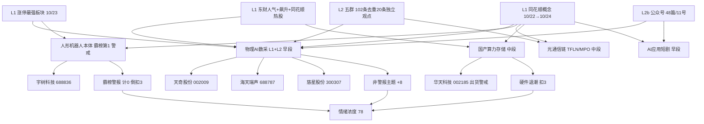

# 2026年10月26日 · **群聊情绪共振**

> **数据源新鲜度**: partial（L1 截至 10/23 收盘 + 10/24 周末快照；L2 截至 10/25 夜）
> **降级状态**: true（WeFlow 永久下线 · 周日榜单空 · 周六快照复刻）
> **置信度**: 0.68

## 🎯 一句话结论

**情绪 78（修复性贪婪）：物理AI数采升为新主线，机器人霸榜只记警报，硬件退潮不追。**

## 🧭 先认市场，再谈对象

**市场在为什么付钱？** 为“卖铲子”的钱付：10/23 三个 20cm（海天瑞声、慈星股份、凡拓数创）与三个 10cm（天奇股份、福莱新材、华数传媒）全部落在**具身智能数据采集**这一条分支上，而不是机器人本体。概念榜也从“人形机器人”父级（#1）向“数据要素/MLOps”子级扩散。R1 已判风格=连板情绪型、主线=泛 AI 生态，R3 的增量结论是：**泛 AI 内部正在从硬件本体切向数据与材料两个下游分支**。

**现在处在哪一段？** 从 10/22 冰点（涨停 33/跌停 48/炸板率 41%）翻上来的**修复第一日**。温度是主升（溢价 +3.38%、高度 6 板、炸板率 12.77%），但结构是“一根阳线”：20 日创业板仍 -18.62%、4–5 板真空。R3 给温度，不替 R1 改周期标签。

**谁有地位？** 体量地位在机器人（43 家涨停）；新增仓位地位在数采（首次进榜 + 涨停密集）；光模块本体是指数稳定器（周五午间集体公告护盘），材料端是喊单位。**中位与杂毛明确划掉**：星光股份被 3 群强推但当日 -7.78%、统一股份纯名字炒作、大业股份公告自认“机器人腱绳仅送样未量产”。

**今天做什么、不做什么？** 做两件事：给出可复算的情绪温度与五条双源主题的证据链；标出两条红线警报（机器人霸榜、华天科技两日登顶后涨幅衰减）。**不做**：板块排序（R2）、个股画像（R5）、开仓授权，不预测指数点位。

## 🧮 当日基线与可复算分数

| 项目 | 数值/处理 | 因果解释 |
|---|---:|---|
| 当日 R1 基线 | 77 | 取 20261026 当次 R1（status=complete，resolved_trade_date=20261023）；不读前日 R1 |
| 非警报 L1+L2 主题 | 4 | 数采、光通信链、国产算力存储、AI应用；同源转载不重复计数 |
| 共振调整 | +8 | 沿用现有实现：每条双源 +2，上限 8 |
| 周末发酵 | +2 | 25 只跨日连续在榜；10/24 为周五快照复刻，已打折 |
| 机器人霸榜扣分 | −3 | 红线4：人形机器人概念连续 2 个交易日第 1 |
| 个股出货扣分 | −2 | 华天科技跨平台两日 #1，涨幅由 +9.12% 衰减到 +4.12% |
| 硬件退潮扣分 | −3 | CPO 4→6→10、存储芯片 5→9→12 连续两日下滑 |
| 一致度扣分 | −1 | 5 家卖方同向（国金/财通/华福/国联民生/华创），周一无预期差 |
| **R3 情绪浓度** | **78** | 77+8+2−3−2−3−1；是情绪温度，不是胜率或开仓许可 |
| 五维交叉分/差值 | 68.4 / +9.6 | 差 < 15 阈值，双法一致；定性=修复性贪婪 |

## 🔎 双源共振主题（证据顺序，不是板块排序）

五条主题的共振等级、证据、早中晚段如下。**序号只代表 R3 证据链强弱，不构成 R2 板块排序；所有主题研究身份为 research_only，不授予开仓资格。**

### 1️⃣ 物理AI·具身智能数采 · L1+L2 · early · 计 +2

| 维度 | 证据 | 含义 |
|---|---|---|
| L1 个股 | 天奇股份首次进榜 #31、海天瑞声 #55、慈星股份 #60、华数传媒 #90、福莱新材 89→42 | 多为“首次进榜”，是新建仓不是接力 |
| L1 涨停 | 海天瑞声 +20.00、慈星股份 +20.00、凡拓数创 +20.00、福莱新材 +10.01、天奇股份 +9.98、华数传媒 +9.99 | 分支内 6 只涨停，密度全市场最高 |
| L1 概念 | 数据要素 #11→#15、MLOps 新进 #5、AI语料 #17 | 子级概念被资金点亮 |
| L2 观点 | 8 条独立观点（A3/A4/A5/A8/A13/A16/A17/A18），跨群同文计 1 条 | 卖方与游资口径罕见一致 |
| 段位 | early（第二阶段起点） | 从本体切向数据，首进榜为主 |

- **大资金意图**：买“卖铲子”。机器人模型缺数据是硬约束，数采设备与数据资产是必经收费站；分支内 6 只涨停且多为首次进榜，说明资金在新建仓，不是在给老票接力。
- **为什么走强**：三重催化叠加——特斯拉 Optimus 量产线早期生产（10/22 财报会）、宇树王兴兴物理AI表态、智元开源首个真实场景 Physical Agent 数据集；卖方完全同向（国金/财通/华福/国联民生/华创周末集体开电话会）。
- **逻辑够不够硬**：硬在需求真实、软在收入没兑现。专家纪要显示帕西尼数采年收入仅 2000–3000 万、天机人形臂累计 8000 条，与股价弹性严重不匹配；这是主题投资不是业绩投资。**盘中已有反证：星光股份被 3 群强推，当日收 −7.78%。**

### 2️⃣ 人形机器人（本体/硬件） · L1+L2 · late · 计 0（霸榜警报）

| 维度 | 证据 | 含义 |
|---|---|---|
| L1 概念 | 人形机器人 10/22 #1(−1.79%)、10/23 #1(+4.46%)、10/24 #1（快照复刻） | 连续 2 个交易日霸榜第 1，触红线4 |
| L1 涨停 | 人形机器人涨停 9→26 家；机器人概念 14→43 家，全市场第一 | 板块效应真实，但已人尽皆知 |
| L2 观点 | 1 条（国金机械“O链与T链共振”，本体首推恒立液压/宇树/上纬新材/锋龙） | 只有卖方推，游资口径已转向数据 |
| 段位 | late（高温拥挤，计分 0） | 只作温度证据，不作正向共振 |

- **大资金意图**：容量最大、高度最高（宇树 +20%），但热榜连续两日第一意味着没有信息差；增量资金在换手到数据分支。
- **为什么走强**：Optimus 量产线消息 + 周五光模块集体护盘打开风险偏好，机器人是最顺的反弹兑现方向。
- **逻辑够不够硬**：产业趋势硬、当期业绩软。大业股份当日公告“机器人腱绳仅客户送样、未量产、未产生收益”仍涨停；襄阳轴承精密轴承相关收入仅 13.14 万元。**纯情绪定价，按红线4不计正向共振。**

### 3️⃣ 光通信链（本体→上游材料 TFLN/MPO） · L1+L2 · middle · 计 +2

| 维度 | 证据 | 含义 |
|---|---|---|
| L1 概念 | CPO #4(−4.23%)→#6(+2.0%)→#10 | 排名连续两日下滑，热度在退 |
| L1 个股 | 中际旭创 东财#8/同花顺#12、新易盛 #14→#16、亨通光电 #19 | 有存在感但没有地位 |
| L1 短板 | 10/23 涨停最强板块前 20 无 CPO/光模块 | 涨停家数为 0，无板块效应 |
| L2 观点 | 2 条：TFLN 强Call（磷化铟/铌酸锂）、开源通信 MPO&DFAU 深度 | 材料端被喊单，本体被护盘 |
| 段位 | middle（本体已高位，材料端 early） | 分歧主题 |

- **大资金意图**：本体是护盘工具与指数锚，材料端是资金寻找的下一个低位弹性位。周五午间四大光模块公司集体公告“订单饱满、无砍单、无价格崩盘”，本质是窗口指导下的预期管理。
- **为什么走强**：1.6T 放量被上市公司公告确认；开源通信给出可核对的一手数字——仕佳光子 Q3 营收同比 +116%、致尚科技 +171.8%、杰普特北美订单 1.63 亿美元≈2025 年营收 53.5%。
- **逻辑够不够硬**：材料逻辑硬，但证据链断在中间环节：磷化铟/铌酸锂的 A 股标的没有被群聊与卖方点名到具体公司，CPO 概念排名连续下滑且涨停家数为 0。**周一材料端若不出涨停，视为喊单失败。**

### 4️⃣ 国产算力·存储半导体 · L1+L2 · middle · 计 +2

| 维度 | 证据 | 含义 |
|---|---|---|
| L1 概念 | 存储芯片 #5(−3.34%)→#9→#12；芯片概念 19→12→16；MLCC 新进 #14 | 排名连续下滑，资金在流出硬件 |
| L1 个股 | 华天科技 同花顺#1/东财#4；长鑫科技 24→#5(+7.93%)；兆易创新 72→34；粤芯半导 +20.01% | 大市值票被被动买入 |
| L1 涨停 | 芯片概念 17 家、数据要素 16 家、AIDC 13 家 | 有扩散但不如数采 |
| L2 观点 | 2 条：粤芯业绩预告点评（硅光+车规模拟）、小吕说AI“Q4 最确定是国产算力” | 业绩口径支撑 |
| 段位 | middle（超跌修复仓，非新增主线） | 龙头已现高位换手 |

- **大资金意图**：半导体是“超跌 + 涨价叙事”的修复仓，不是新增主线；存储概念排名连续两日下滑说明资金正在流出硬件去追数据分支。
- **为什么走强**：三条独立催化——野村称存储短缺持续至 2028、英伟达停产传闻推动显卡一日一价（RTX5090 从 1.5 万炒到 6 万）、粤芯 Q3 营收创新高。
- **逻辑够不够硬**：最硬的是业绩（粤芯 Q3 营收 10.8–11.4 亿、同比 +58~65%），最软的是股价结构——**龙头华天科技两日跨平台登顶但涨幅从 +9.12% 衰减到 +4.12%，10/24 已跌出人气榜前 20，属高位换手，不追。**

### 5️⃣ AI应用·AI短剧/内容 · L1+L2 · early · 计 +2

| 维度 | 证据 | 含义 |
|---|---|---|
| L1 概念 | AI应用 #9(−3.61%)→#4→#4；人工智能 12→3→3；AI语料 新进 #17 | 排名单日跳升 5 位后站稳 |
| L1 个股 | 慈文传媒 同花顺#4/东财#14(+10.00%)、天娱数科 东财#3(+10.00%)、新华传媒 同花顺#2 | 传媒端有辨识度 |
| L1 涨停 | AI应用 21 家、人工智能 29 家 | 广度不如机器人，弹性在传媒 |
| L2 观点 | 1 条（华创计算机“反弹，AI应用关注哪些细分”） | 单薄，是本题最大短板 |
| 段位 | early（非硬科技的筹码洼地） | 易一日游 |

- **大资金意图**：买“更轻的东西”。复盘博主原话是“止跌靠科技、反弹靠非科”，指的不是传统硬科技而是更轻的应用与内容；短剧/传媒是最低位的载体。
- **为什么走强**：首部 AI 院线电影上映、字节 AI 短剧内部整合（小云雀并入即梦）、Seedance2.5 4K 定向 20 家工作室试用，三个可验证的内容侧催化。
- **逻辑够不够硬**：软。慈文传媒《开标之战》归属收入约 50 万元，业绩完全无法验证；只有 1 条 L2 观点支撑。**这是本轮最可能一日游的主题，只作情绪宽度证据。**

## 🚨 红线警报与降级为观察的主题

| 对象 | 警报/降级理由 | 处理 | 下一步验证 |
|---|---|---|---|
| 人形机器人（概念） | 连续 2 个交易日概念榜第 1（10/24 为快照复刻） | 红线4：不计正向共振，倒扣 3 | 周一板块涨停家数能否守住 20 家以上 |
| 华天科技 002185 | 10/22 东财#1(+9.12%)、10/23 同花顺#1(+4.12%)，涨幅衰减；10/24 跌出前 20 | 个股出货警戒，倒扣 2 | 周一能否重新放量创热榜新高 |
| 金融科技/券商 | L1 仅周末快照（互联网金融 10/24 新进 #5、东财 42→11→#4），L2 仅 1 条 | 降为观察，不进共振榜 | 券商是否放量、东财能否守住前 10 |
| 网络安全 | 概念 #16→#16→#9 抬升，但 L2 零条群聊观点 | L1_only，按红线不进榜 | 是否出现群聊/卖方点名 |
| 创新药 | 概念 7→7→6 稳定在榜，L2 零条，10/22 概念 −3.13% | L1_only，不进榜 | 板块涨停家数能否 >5 |
| 丝杠/特高压 | 仅公众号单源（财联社前瞻、长城/平安证券） | L2_only，不进榜 | 江苏雷利/双林股份能否进热榜 |
| 星光股份 002076 | 3 群强推但当日 −7.78% | 剔除，列入反证 | 已证伪，不再跟踪 |
| 大业股份/襄阳轴承 | 公司自认机器人业务未量产/收入 13.14 万 | 杂毛剔除，不作候选 | 已识别，不参与 |

## 🎫 共振首推票（研究口径，非开仓授权）：天奇股份 002009

- **买入理由**：它是数采分支里唯一同时满足“L1 首次进热榜 + 涨停 + L2 卖方点名（工业数采）+ 有可核实的产能事实（数采实训中心近 2 万小时多模态数据、36 个一级场景 163 个细分场景）”的票。分支内涨停 6 只，但只有它和东方精工同时被游资语言与卖方语言覆盖。
- **风险点**：一是数采主题整体是“需求真实、收入未兑现”，Q3 订单若低于预期会杀估值；二是 10/23 涨停当日成交 10.25 亿元，若周一放不出量则是隔日兑现盘；三是分支内部有更纯正的 20cm 标的（海天瑞声、慈星股份），资金可能绕开它。
- **止损条件**：收盘价 17.30 元，若跌破 16.44（−5%）且当日分支内涨停家数少于 3 家，视为“数采分支证伪”，逻辑失效即出，不做题材内换股补仓。
- **可验证假设**：①周一数采分支涨停家数 ≥3 家（延续）；②天奇股份能再次进入东财人气榜前 50（热度延续）；③卖方电话会纪要中出现具体订单金额而非仅“场景卡位”。三条中两条不成立，主题降级为分歧。

> 说明：以上为 R3 情绪共振的研究口径记录，**不构成开仓资格**。龙头认定、板型、流通市值、RR 与禁止清单由 R2/R5/D1 依据 `src/research/{board_pattern,dragon_switch,core_judge,risk_reward,forbidden_filter}.py` 独立裁定。

## 🛰️ 热榜信号明细

**排名动量（≥+10，10/23 对前次）**：埃斯顿 91→12(+79)、慈文传媒 66→14(+52)、福莱新材 89→42(+47)、宇树科技 40→1(+39)、兆易创新 72→34(+38)、东方财富 42→11(+31)、利亚德 37→10(+27)、*ST闻泰 59→35(+24)、长鑫科技 24→5(+19)、华瓷股份 43→25(+18)

**概念榜三日轨迹**：人形机器人 1-1-1（霸榜）｜机器人概念 3-2-2｜人工智能 12-3-3｜AI应用 9-4-4｜MLOps —-5-8｜CPO 4-6-10（退）｜存储芯片 5-9-12（退）｜数据要素 11-15-15｜网络安全 16-16-9｜创新药 7-7-6｜互联网金融 —-—-5

**周末持续在榜（25 只）**：华天科技、宇树科技（3 日，best_rank 1）、天娱数科、利亚德、埃斯顿（2 日，best_rank 1-3）；宁德时代、冰山冷热、九阳股份、大业股份、海洋王、三峡新材、新华传媒、襄阳轴承、兆威机电（3 日）。**20261025 周日四平台 0 行，周末发酵只能算到 10/24。**

## 📰 公众号观点（观点层，不计共振分）

- **数采/物理AI（4 篇）**：调研先知《机器人数采专家交流》给出可核对的一手数字（天机力控双臂累计超 1 万台、帕西尼数采收入 2000–3000 万、数采手套 5 万/双、数采毛利 50–60%）；财闻私享称“数采=算力、数采设备=光模块”；安静拆主线把“物理ai/机器人数据采集”列为活跃题材第一；盘口逻辑拆解称“泛物理AI是周五反弹最强方向，数据采集负责高度”。
- **光通信（1 篇）**：猫笔刀还原 V 反真实触发点——午间中际旭创/新易盛/天孚/光迅集体公告护盘，国家队买量并不大且不占主导。这是本次反弹最重要的单条事实。
- **半导体（1 篇）**：野村称存储短缺持续至 2028、板块估值被严重低估；显卡一日一价；2026 中国芯大会 11/1–11/4。
- **AI短剧（2 篇）**：字节 AI 短剧内部整合、Seedance2.5 4K 定向试用、S 级 AI 剧上卫视；首部 AI 院线电影 10/23 上映。
- **宏观与情绪（5 篇）**：上交所 10/26 起实施上证系列指数编制修订（单样本权重≤15%、ST 更快剔除）；标普新规将影响 3750 亿美元被动资金；GC 会促服务消费与生育友好；私募基金经理道歉、跟大佬抄作业类情绪文。

## 💬 群聊情绪明细（群名匿名）

| 匿名群 | 条数 | 基调 | 独立观点 | 备注 |
|---|---:|---|---:|---|
| 群A（游资/复盘主群） | 9 | 谨慎 | 1 | 9 条全为链接转发，唯一原创是“认可 3850 附近、再二次探底” |
| 群B（题材基本面群） | 20 | 亢奋 | 7 | 全部指向数采/物理AI；与群C、群E 大量同文 |
| 群C（核心持仓群） | 19 | 亢奋+理性 | 4 | 数采硬件清单 + O链T链；夹带 2 条“别急着喊反转” |
| 群D（机构风向标群） | 28 | 极力看多 | 5 | 8 条为电话会邀请/研报链接，按规则标宣传不计观点 |
| 群E（一手新闻群） | 26 | 亢奋 | 3 | 独立增量只有尚品宅配数据集登顶与粤芯业绩点评 |

**提取口径**：102 条 → 剔除图片 25、链接 29、系统 1、纯表情 1 → 可读文本 46 条 → 同一作者同文跨群合并 → **独立观点 20 条（14 条正文可读、4 条仅标题、1 条宣传、1 条短句）**。物理AI数采占 8 条，是唯一形成“多来源、同方向、不同落脚点”的主题。

## 🧾 数据源审计

| 源 | 状态 | 抓取日期 | 记录数 | 备注 |
|---|---|---:|---:|---|
| 当日 R1 基线 | ✅ ok | 2026-10-26 | 1 | 核心完整、外围降级；sentiment 77 |
| 同花顺概念榜（双日+周末） | ✅ ok | 2026-10-26 | 60 | 10/24 涨跌幅与 10/23 逐项相同 → 快照复刻 |
| 涨停最强板块 | ✅ ok | 2026-10-26 | 40 | 10/22、10/23 各 20 行 |
| 个股热度榜（四源） | ✅ ok | 2026-10-26 | 219 | 回落至 10/23，degraded=[] |
| 周末人气榜（自然日） | ⚠️ partial | 2026-10-25 | 300 | 周日 0 行 |
| 五群群聊 | ✅ ok | 2026-10-26 | 102 | 5/5 群成功；可读 46 条 |
| 公众号 RSS | ⚠️ partial | 2026-10-26 | 48 | 15 源中 4 源 0 条 |
| WeFlow | ❌ error | — | 0 | 2026-08-19 永久下线 |
| XTick | ➖ not_used | — | 0 | L1 三源已覆盖，未调用 |

## ⚠️ 不确定性 / 反证

1. **“修复第一日”是否成立，R3 无法验证**：78 分的温度全部来自周五午后两小时，周一的隔日承接、炸板率、4–5 板补位都还没发生。R1 已给出证伪条件（炸板率回 35% 以上 / 涨停跌破 50 家 / 溢价转负），R3 不重复判定。
2. **霸榜警报可能是过度机械**：人形机器人概念连续两日第一，但价格没有背离（概念由 −1.79% 转 +4.46%，涨停家数 9→26），更像“高温拥挤”而不是“法证出货”。按红线4 必须不计正向共振并倒扣 3 分——这会系统性低估最强主线，D1 需要把这一条当作“温度计读数”而非“卖出信号”。
3. **卖方一致度是反向指标**：国金、财通、华福、国联民生、华创 5 家周末同向喊物理AI，题材群与机构群同文重复。一致度高意味着周一没有预期差，高开即是兑现窗口。历史类比：上周日同样“强Call 物理AI”的博主自报周收益 48%，本周改喊 TFLN——喊单轮换本身就是拥挤信号。
4. **KOL 点名与资金背离已出现**：星光股份被 3 个群同时强推，10/23 收 −7.78%；华数传媒“数据采集国家队”只有链接标题，正文不可读。这提示 L2 的“强推”不能直接当买盘。
5. **L1 的时间口径会骗人**：10/24 概念榜单与 10/23 逐项相同，周日全空。把“周末发酵”当增量是本次最容易犯的错，已按快照复刻打折处理。
6. **数据缺口**：WeFlow 永久缺失（最高等级 L1+L2）；QMT 停机无法交叉账户资金；北向数据 2024 年后口径变更，外资维度只能靠 R1 的代理口径。
7. **R3 的能力边界**：本报告不判断哪只票能涨停、不给目标价、不做板块排序。情绪温度 78 表示“今天市场愿意为题材付钱”，不代表任何个股的盈亏比合格。

## 🔗 与其他 R/D/E 的关系

- **依赖（上游）**：`data/research/20261026/R1_style.json`（情绪基线 77、风格=连板情绪型、市场宽度与连板结构）、`data/research/20261023/attention_signals.json`（个股热度四源）、`data/research/20261025/attention_weekend.json`（周末持续在榜）、`data/raw/20261026/wechat_cli_5groups.jsonl`（L2 群聊）、`data/raw/20261026/wechat_official_rss.jsonl`（L2b 公众号）、Tushare `ths_hot` / `limit_cpt_list`（L1 在线双日）。
- **被消费（下游）**：
  - **D1（canghai-plan）**：取 `sentiment_score=78`、`resonance_top_themes[].early_or_late`、`hotlist_signals.distribution_alert`（两条警报）、`watch_themes`（四条降级）。建议 D1 把“数采=early”“机器人=late 且霸榜”“光通信材料=需涨停验证”三条写进预案的题材分层，而不是把 78 分直接换成仓位。
  - **R2（主线板块）**：数采的 L1+L2 双源证据可直接用于候选龙头筛选；但 R3 不作板块排序，主线认定权在 R2。
  - **R5（个股画像）**：天奇股份、海天瑞声、慈星股份、福莱新材为 R3 命中的研究候选，画像与估值横切由 R5 完成。
  - **R6（反证）**：可重点攻击“数采收入未兑现”“卖方一致度高”“星光股份式喊单背离”三点。
  - **E1（复盘）**：本文件是 10/26 情绪的盘前锚，收盘后需用真实封板率、溢价、板块晋级率回溯 78 分是否偏离。

## 🤖 Sub-Agent 元数据

- skill: analyze_sentiment_resonance_v1
- artifact: `data/research/20261026/R3_sentiment.json`
- trade_date: 20261026（L1 有效口径 20261023 收盘 + 20261024 周末快照；L2 口径 2026-10-25）
- groups: 5/5（匿名 群A–群E）
- 独立观点: 20（可读 14）
- 生成耗时: 约 6 分钟
- model: deepseek-v4.1-flash
- 最高共振等级: L1+L2（WeFlow 永久下线）
