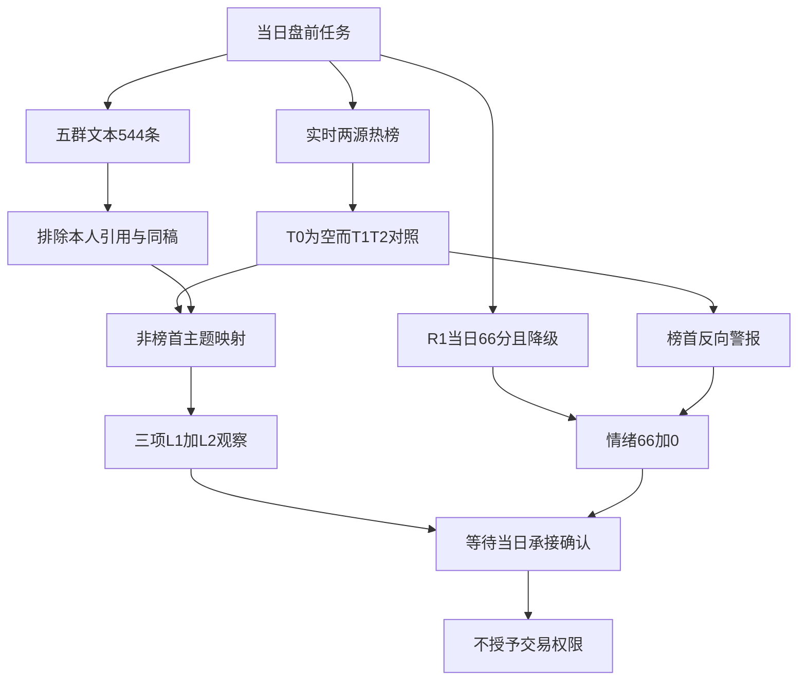

# 2026年10月27日 · 群聊情绪共振

> ⚠️ **数据源时间错位**：任务归属为 **2026-10-27**；热榜、A股量化基线及群聊实际归属 **2026-10-26**，排名比较日为 **2026-10-23**。今晨生成的 attention 文件仍是 T-1，不是当日观测。本件只作盘前降级研究上下文，不作为执行池主输入。
> **情绪=震荡 / 高位震荡；态度=观察；降级=true；置信度=0.364。**

## 一句话结论

**观察：66分不加码；机器人多空分化，零售与油气有昨日日榜交叉，均未获今日承接确认。**

## 🧭 详细分析

市场正在为什么付钱？本R3能确认的是已收盘人气偏向机器人，并出现零售、油气个股；不能从热榜直接推定大资金加仓。阶段继承当日R1的高位震荡，不把66分当普涨或上涨概率。谁有地位由R2确认，本R3不输出总龙、补涨龙或执行票；今日只做观察，不因题材传播越过交易门禁。

当日R1在本次盘前生成，国内样本截至前一收盘，观测窗口有效，但其状态本来就是degraded。公式为 `clip(当日R1 66 + 共振调整0, 0, 100) = 66`。本次采用保守零加分政策：榜单属于T-1，机器人多空并存且榜首警报，尚未获得当日开盘确认。这不是声称“没有共振”，也不是已经校准的收益预测模型。五维反向校验因杠杆外资中位及完整同口径因子标度缺失，不填默认值、不计算假分差。

5群本地544条均被实时CLI补查验证，尾页均空；G1并非没有方向观点，反而有很明确的机器人风险判断。本文不复用R1“eligible_text_count=0”的长文本筛选结果。所有短观点保留上下文，已排除11条本人内容和1条引用本人内容；177条图片占位未OCR，不能把不可读当作安静。当前本机查询没有凌晨新增记录，不等于远端已完成同步。

attention当日目标文件不存在，manifest指向 `data/research/20261026/attention_signals.json`。后者虽然今晨生成，内部trade_date及150条today榜单记录均为前一交易日；仅作T-1背景。实时MCP与SDK同源补取用于核验，不额外增加独立源票数；公众号只补观点，绝不参与共振等级和情绪加分。

## 🔎 双源主题证据（非R2板块排序）

| 母题 | 双源证据 | 多空与限制 | 态度 |
|---|---|---|---|
| 机器人：具身智能与触觉数采 | 东财福莱42→15、万向27→2、多伦30→6；G2/G3触觉转向短观点 | G1盘后转谨慎；宇树榜首排除正证据；触觉不另凑第二条主线 | 🟡 观察 |
| 商贸零售 | 上海九百东财24→11、东百同花顺60→19；G5对标及新消费短观点 | 新华百货仅+0.64%，口头补涨不等于兑现；本人地产观点剔除 | 🟡 观察 |
| 油气开采 | 中国石油新进东财查询榜、第8、+4.94%；G2/G3与G5油气短观点 | G2/G3同作者只计一条；山东墨龙同花顺39→84且收跌3.03%；隔夜延续未确认 | 🟡 观察 |

三项均为 `L1+L2`，不是强共振、不是开仓资格。上述排序只是证据呈现次序，无板块评分，不替代R2。主线持续性、封板率及明日加速/分歧/退潮缺独立证据，本R3不填数。

### 机器人（具身智能与触觉数采）

- **大资金意图**: 未知。可验证的是机器人相关热股占据高位与触觉叙事扩散；不能从人气直接推定机构加仓。
- **为什么走强**: 已收盘榜单与触觉数采讨论同向，但G1盘后明确转谨慎；“热度走强”不等于所有成员价格上涨，利亚德当天-7.38%为反证。
- **逻辑够不够硬**: 足以确认被讨论与被定价的同一母题，不足以确认持续主升或订单兑现；同稿去重后仍保留多空双方，今日开盘承接缺失。

### 商贸零售

- **大资金意图**: 未知；榜单只能证明注意力向部分零售股转移，不能直接证明避险或主力抢筹。
- **为什么走强**: 上海九百与东百人气排名前移且收涨，G5有自主对标及新消费短观点；新华百货仅小涨，补涨话术不等于兑现。
- **逻辑够不够硬**: L1+L2传播成立，政策及具体催化尚待R4核验；剔除me的地产与核心股观点，不凭用户观点构造外部共识。

### 油气开采

- **大资金意图**: 未知；油价与资金避险均未由本R3实测，只能记录地缘事件下的讨论倾向。
- **为什么走强**: 中国石油已收盘人气进入前十与两名作者油气方向表达同向；G2/G3同作者重复只计一次。
- **逻辑够不够硬**: 仅有事件敏感的双源舆情共振，非新主线认定；公众号晚间称原油下挫是反证观点，未经本R3报价复核，不能宣称隔夜油价延续。

## 🗣️ KOL方向与关键证据

| 匿名源 | 带日期短原文 | 解释与证据句柄 |
|---|---|---|
| G1 | 2026-10-26：“不要追高”；“休息一个月” | 短风险观点有效；原始行18、38，不转化成系统左侧交易建议 |
| G1 | 2026-10-26：“空间及持续估计有限”；“机器人这波炒了差不多了” | 原始行20、42；是作者看法，不是已证实出货 |
| G2 | 2026-10-26：“人形机器人数据采集从视觉数据走向触觉数据” | 原始行169；与G3/G5同叙事不能倍增加分 |
| G3 | 2026-10-26：“具身数采走出持续性” | 原始行197；“持续性”是引述观点，不是R3认定主线持续天数 |
| G4 | 2026-10-26：“大脑要行、真机先行” | 原始行346，卖方本体方向；纯会议邀请行331/339不计确认 |
| G5 | 2026-10-26：“上海九百对标”；“新华百货 小盘 新华补涨” | 原始行422、459；保留短句，均不是本人消息 |
| G2/G5 | 2026-10-26：“美伊悬而未决”；“航运 石油 新能源” | 原始行116、481，共享地缘底层事件，不扩成三条共振主线 |

证据句柄为 `Gx:local_raw_line:N`，指向 `data/raw/20261027/wechat_cli_5groups.jsonl`，不是微信原生message_id。全部群名匿名化G1—G5，无真实群名映射落盘。

### 去重与宣传分层

同作者同文跨群只算一个表达簇；换转发者也不自动生成独立信源。华远训练场同稿与改写、触觉数采同稿、短剧增长推介、百达长推介均按底层叙事合并。G4有实质方向的卖方稿单列卖方观点，纯邀请、纯宣传及电话推广不作为共振证据。链接仅证明传播，图片未读不假设正文。`SKY-001`、计算病理和本人地产方向全部从外部共识排除，不把自己的研究回流成验证。

WorkBuddy/微信短剧、脑机/基因编辑/核聚变、港口罢工均停在单源或精准映射不足的研究观察层，不进入双源主题；不借其他AI概念热股强行补足L1。

## ⚠️ 热榜四层与榜首警报

实时查询当日两榜均为空，所以比较的是前两次已完成交易日，不是今昨盘中。两源排名分别计算，不将“合并取较高rank”误作同一个平台统计。前日同花顺仅99条、缺rank98，掉榜/新进榜只代表所查询窗口变化，不声称全量市场退出或进入。

宇树东财连续两次交易日第1，禁止正向加分。MCP日线给出的成交额为此前5日均额的 **2.121倍**；上影占日内振幅 **50.20%**，上影/实体 **1.365**。本次警报按“金额倍数≥2，且上影/振幅≥40%、上影/实体≥1”作显式操作化阈值，未冒称仓库已存在这些数值参数；价格形态仅限L4风险核验，不做个股技术画像。

反证必须同时保留：收盘仍涨 **7.6923%**，东财主力净额 **+9035.6万元**，不符合“主力转负”；单日龙虎榜总净额 **-2.596亿元**，但不是机构/知名游资席位独立净卖出认定。三日龙虎榜窗口与单日不可相加。两家媒体转述宇树同一风险提示公告只计一个底层事件。结论是 **观察 / 出货风险警报**，不是认定出货；唯一硬否决权仍归R6，本件不写hard_reject。

利亚德同花顺88→44，但东财10→66且日收跌7.38%，这是“热度/平台差异不等于赚钱效应”的直接反证，不能只挑有利榜单。

## 📰 公众号观点（不计共振或情绪分）

机器人：两媒体转述宇树风险提示，另有上纬商业化与量产风险；都是风险语境，不增加量化源数。

宏观与情绪：猫笔刀将科技承压与银行能源偏好并置，其资金描述仅为作者观点，R3未据此确认实际资金。安静拆主线认为反弹持续性一般、舆情高潮容易兑现；盘口逻辑拆解强调分歧后需要修复，两号同一执业作者，不作两个独立确认。傅里叶的猫讨论美股指数与广度分离，不移作A股市场数据。贩财局“休息一天”仅是个人休息表达，不能单凭它推市场冰点。

## 🧩 证据链

## 数据源审计

| 源 | 日期 | 状态 | 记录/观测与限制 |
|---|---|:--:|---|
| 当日R1_style | 2026-10-27生成 / 2026-10-26观测 | 🟡 | 66分，degraded；未使用前日R1 |
| Tushare同花顺热股 | 2026-10-26 / 2026-10-23 | 🟡 | 实时MCP与SDK核验100/99；当日0条；前日缺rank98 |
| Tushare东财人气榜 | 2026-10-26 / 2026-10-23 | 🟢 | 实时100/100；当日0条，不是API失联 |
| XTick情绪 | 2026-10-26 | 🟢 | 涨停59、跌停27、炸板23、高度4；统一自身分母炸板28.05% |
| R1市场基准口径 | 2026-10-26 | 🟡 | 涨停55、跌停26、炸板23、高度4；炸板29.49%，不与XTick混拼 |
| Tushare日线/东财资金/龙虎榜 | 2026-10-26及此前5日 | 🟢 | 榜首警报实测；缺机构/游资席位明细，不作席位认定 |
| attention当日文件 | 2026-10-27 | 🔴 | 不存在，不回填、不搬名 |
| attention由manifest引用 | 2026-10-26 | 🟡 | 今晨生成仍为T-1；150条today记录归属前日；surge32、跨平台48 |
| wechat-cli本地与实时覆盖 | 2026-10-26 | 🟡 | 544条，5/5群尾页空，远端同步未知，图片未读 |
| 公众号RSS | 2026-10-26至2026-10-27 | 🟢 | 81篇；最晚发布日期2026-10-27，不计共振和分数 |
| manifest / mcp_health | 2026-10-27 | 🟡 | severity2；源状态以本次实查为准 |
| WeFlow | 不适用 | 🔴 | 永久下线，本次未调用、不读旧快照；兼容字段为空 |

### 五群覆盖明细

| 匿名群 | 条数 | 观测首日—末日 | 图片未读 | 本人排除 | 引用本人排除 | 实时尾页 |
|---|---:|---|---:|---:|---:|---|
| G1 | 53 | 2026-10-26—2026-10-26 | 9 | 2 | 1 | 0条 |
| G2 | 138 | 2026-10-26—2026-10-26 | 49 | 0 | 0 | 0条 |
| G3 | 130 | 2026-10-26—2026-10-26 | 49 | 1 | 0 | 0条 |
| G4 | 27 | 2026-10-26—2026-10-26 | 7 | 0 | 0 | 0条 |
| G5 | 196 | 2026-10-26—2026-10-26 | 63 | 8 | 0 | 0条 |

查询起点为2026-10-26，截止为本次2026-10-27采集时点；机器JSON保留精确边界与各群首末观测。记录中2026-10-27没有新增，不用文件mtime或末条消息推断远端同步情况，不比较不等长窗口热度。原始总量、去重后文本候选和独立方向观点是不同量，不能互相替代。

## 🧪 不确定性 / 反证

数据降级是实质性的：当日人气管道缺失、热榜尚未发布、R1本身降级、177条图片占位未OCR、远端微信同步未验、五维标度与杠杆外资因子缺失。三项主题是T-1语义交叉，不是T0资金合力。油气隔夜走向以及机器人高位承接都可能推翻昨日人气叙事。炸板率当前未达35%硬阈值；若后续达到，下游必须显式震荡/主跌并减半候选，本R3候选原本为0。

置信度 `clamp(0.65 × 0.70 × 0.80, 0.05, 0.95) = 0.364`，其中0.70体现部分源与窗口降级，0.80仅承认量化人气/去重文本两个证据层；它不是上涨概率，也不等于主题集中度。

## 🚫 个股四段链适用范围

本次没有首推票、执行票或观察池顶部个股，以下四段链均 **不适用**：

- **买入理由**：不适用；榜单个股只作为主题证据，不是买入推荐。
- **风险点**：不适用个股画像；仅保留榜首L4警报与主题反证。
- **止损条件**：不适用；未授予开仓资格，不编止损价。
- **可验证假设**：不适用逐票交易假设；主题层等待当日非榜首热度/价格与独立观点能否继续同向。

## 🔗 与其他 R/D/E 的关系

依赖：当日R1、当日manifest与health、前日归属attention、5群文本、公众号补充和本次实时热榜/XTick。R2确认市场主线和地位，R4核验催化真实性，R5做真实候选画像，R6独立处理硬否决；D1消费时必须保留本件降级、跨日及非交易授权标记，E1核验后续兑现。

## 🧾 Sub-Agent 元数据

- skill：analyze_sentiment_resonance_v1 + hotlist_rank_signal_v1
- artifact：data/research/20261027/R3_sentiment.json
- method：llm_v1；未运行Python规则版R3，Python仅负责检索、计数、排名算术、校验和落盘。
- model：gpt-6.1-sol
- schema缺口：仓库未找到R3专用正式Pydantic模型/校验器；使用本profile临时目录任务级强类型模型与跨字段断言，不冒充官方全链路验收。
- 校验结果：见data/research/20261027/R3_validation_result.json。
- 生成耗时：403秒（自首轮工具检查计）。
