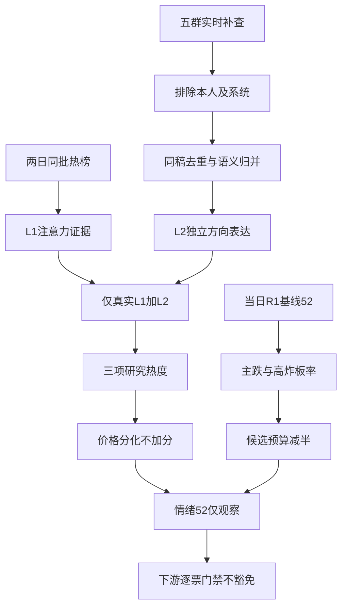

# 2026年10月28日 · 群聊情绪共振

> ⚠️ **数据源时间错位**：本文件是2026-10-28盘前研究；市场数据来自2026-10-27收盘，与2026-10-26同批榜单比较，不是当日盘中。仅研究背景，不作执行池主输入。
> **数据源新鲜度**：partial · **降级状态**：true · **置信度**：0.364

## 🧭 一句话结论
**观察：情绪=主跌，52分沿用降级R1；数采、传媒和零售有双源热度，但不授予新仓。**

## 📊 详细分析

先认市场：R1的四维函数得到52，并未直接扣除跌停数量和广度恶化。收盘上涨606家、下跌4922家，中位数-2.9749%，说明局部热股不能代表市场中性。炸板率`28/(41+28)=40.579710%`触发候选预算减半，阶段只描述温度，不替下游选择固定打法。

再认表达：五群实时补查327条，原始文件271条缺少的G1已补56条。群聊可见数采入口的扩散，也有“这行情太难做了”和盘后防守判断；G1盘中“收盘翻红”的预测被实际收盘否定。不能挑乐观语句代表全体，也不能把查询后无记录当远端没有消息。

再认共振：以下三项仅按热度证据展示，不是R2主线排序。L1与L2匹配成立，并不必然同向看多；传媒跌停热议尤其说明排名上升也可能源于亏损关注。榜单平台不是资金账户，数采推广稿也不是新增订单，故`resonance_adjustment=0`。

最后认计划：本次不推荐任何股票，候选股票数0，研究主题数3不等于股票预算。板型、龙头认定、RR和禁止清单均未逐票验证，无法给执行权限。主线资格、资金确认和个股画像分别留给R2、R7、R5；R6的硬否决不被覆盖。

| 量纲 | 本次值 | 正确含义 |
|---|---:|---|
| 市场情绪分 | **52** | 当日降级R1基线52 + 共振调整0，不等于市场中性 |
| 情绪阶段 | **主跌** | 亏钱扩散与高炸板率的温度判断 |
| 研究证据置信度 | **0.364** | `0.65 × 0.7 × 0.8`，不是涨跌概率 |
| 主题热度 | 三项定性共振 | 不用关键词频次打分，不与情绪分混算 |
| 候选预算 | 原预算 × **0.5** | 不借机扩大原预算，股票推荐仍为0 |
| 五维交叉校验 | 未计算 | 缺杠杆外资，不填中位数，不虚报分差 |

## 🔍 双源主题与推理三问

### 1. 人形机器人/物理AI数采 · 观察

**等级**：L1+L2 · **阶段**：middle。真实题材热度共振，内部强弱分化，不代表市场正反馈全面改善。

- 观点证据：G2 raw:29 2026-10-27： 惯性捕捉是当前人机数采的主力，imu是核心，也是物理ai数采&本体的交点
- 观点证据：G3 raw:164 2026-10-27： 数采的终局是【本体采集】
- L1证据：襄阳轴承6→2；福莱新材49→27；大洋电机29→11；襄阳轴承3→1；大洋电机84→3；福莱新材15→66。
- 语义映射：IMU姿态采集、触觉手套、RGB深度相机均是机器人训练数据入口；并入物理AI数采，不拆成三条独立主线。L1以明确机器人概念及相关叙事股作注意力锚，不把标签等于业务收入。
- 独立性审计：IMU、触觉、视觉是不同技术链论点，但原文始发机构与底层事件未完全可溯，不宣布三家独立事实源；跨群同稿仅一份。
- **大资金意图**: 只能提出资金在缩量市场寻找具身数据增量叙事的假设；热榜不是净流入，资金确认交R7。
- **为什么走强**: THS相关热股排名上升与群聊数采入口论点相符，但宇树收跌、福莱跨平台降温提示注意力与价格不同步；未取得筹码及板型，不推定全面走强。
- **逻辑够不够硬**: 热度层双源成立，交易逻辑不够硬。样品、战略合作和类比光模块不是订单规模；若前排不扩散、数采订单不能验证，降级主题。
- 公众号旁证：RSS:75 返场：机器人淘汰品种出现亏钱效应，预期分歧；RSS:85 晚间资讯：物理AI经历大分歧，前排仍多涨停。仅观点与反证，不增加层数或分数。

### 2. AI短剧/传媒 · 降级

**等级**：L1+L2 · **阶段**：late。传播及回流预期共振，价格正反馈不一致，不作为情绪加分。

- 观点证据：G5 raw:231 2026-10-27： 老师们前置一下传媒
- 观点证据：G2 raw:3 2026-10-27： 腾讯绿泡泡短剧小程序月活跃用户规模达1.43亿。
- L1证据：粤传媒97→12，收涨6.56%；慈文传媒17→7，但收跌10%；粤传媒当日18；慈文传媒当日44。
- 语义映射：短剧平台流量扩容和AI视频生产降本归并到内容分发链；普通传媒点名只作方向旁证，不自动验证每家公司的短剧收入。
- 独立性审计：绿泡泡流量数据跨G2/G3/G5重复仅一个底层事件；G5传媒短句是独立方向表达；G4卖方业务推介单列有利益偏向，公众号不增加共振层数。
- **大资金意图**: 假设旧题材在机器人分歧时寻求回流；没有净买入或封单证据，不断言主力返场。
- **为什么走强**: 粤传媒注意力跃升且价格上涨，对照慈文跌停说明同题材并非普涨；平台增速是催化叙事，不是所有映射股的业绩。
- **逻辑够不够硬**: 双源只确认有人讨论和上榜，不够硬到开仓。需内容收入及次日承接验证；慈文高热下跌是直接反证，不能把热度跃升机械加分。
- 公众号旁证：RSS:1 腾讯绿泡泡短剧增速的主题前瞻；RSS:75 返场：预期AI漫剧回流，但属作者交易判断。仅观点与反证，不增加层数或分数。

### 3. 商贸零售/消费 · 观察

**等级**：L1+L2 · **阶段**：late。L1明显、L2仅一条短句的弱双源；不等于确认可交易主线。

- 观点证据：G5 raw:222 2026-10-27： 中百集团 对标上海九百
- L1证据：上海九百21→14，收涨10%；上海九百11→4；当日国芳10、新华百货12、百大14、广百15、茂业16。
- 语义映射：对标上海九百明确指向同业零售补涨；不因THS表面标签物业管理/参股券商错映金融主线。
- 独立性审计：仅一份可确认的群聊短观点，无持续群体共识证明；公众号报道只补反证，不伪装第二份KOL支持。
- **大资金意图**: 可检验假设是缩量下的低位消费轮动；板块榜中位置靠前不能直接证明大资金做多意图。
- **为什么走强**: 上海九百热榜双平台上移，零售同行在DC前列；G5用同业对标寻找补涨，但没有板型及资金证据。
- **逻辑够不够硬**: 研究层弱双源成立，交易层不足。L2只有一条短观点、高位监管与扩散失败均可证伪；不把中百点名转成推荐。
- 公众号旁证：RSS:19 零售尾盘异动报道；RSS:39 上海九百监管工作函及异动风险报道。仅观点与反证，不增加层数或分数。

## 🧾 关键证据与热榜差分

榜单分别取两日22:30批次。THS逐条更新时间有秒级差异，是同一次夜间批次，不强称所有行秒点完全相同。THS两日100名完整计算；DC各返回100条，本次仅持久化7组核对配对，不声称完成全DC差分。

| 证据锚点（非推荐） | THS前日→昨日 | 含义 |
|---|---|---|
| 福莱新材 | 49→27 | 数采相关注意力上升，DC却15→66，存在平台分歧 |
| 大洋电机 | 29→11 | 上升18位，不直接等于资金净买入 |
| 粤传媒 | 97→12 | 上升85位；与其他传媒股票表现分裂 |
| 慈文传媒 | 17→7 | 上升10位但跌10%，是亏损热议反例 |
| 上海九百 | 21→14 | 新进THS前20，零售关联来自业务语义而非表面标签 |

THS动量上升至少10位共16项，新进前20共7项。两日THS第一分别为宇树科技、海洋王；DC第一分别为宇树科技、襄阳轴承，均不满足“同平台连续两日第一”。因此该窄规则的distribution_alert为空，不等于已排除其他出货行为；若命中霸榜第一只作警报，绝不当正向共振。

XTick实时重试取得2026-10-27：涨停42、跌停23、炸板30。同源计数相除为41.666667%，与R1的41、22、28及40.579710%不同，ST和样本排除口径未完全核实。保留差异，不拼接分子分母，不把XTick的`zbl=6.78`直接当本次炸板率。

## 🗣️ 群聊审计与独立性

| 群标签 | 原始文件条数 | 实时补查条数 | 观察日期 | 判读边界 |
|---|---:|---:|---|---|
| G1 | 0 | 56 | 2026-10-27 | 原抓取超时，本次恢复；休息、防守与筑底观点并存 |
| G2 | 78 | 78 | 2026-10-27 | 数采带票推介较多，不把推介当订单 |
| G3 | 87 | 87 | 2026-10-27 | 重复转发与悲观表达并存，图片未读 |
| G4 | 22 | 22 | 2026-10-27 | 卖方有内容观点与会议邀请分开；撤回系统消息不作观点 |
| G5 | 84 | 84 | 2026-10-27 | 短句保留上下文；本人两条全部排除 |

五群全窗条数327，尾页检查均0；逐自然日查询与全窗消息多重集合一致（先统一匿名化，避免系统消息显示群名导致假差异）。2026-10-28本机记录截至查询截止为0，不据此宣称群聊沉默。查询起点、截止、逐群最早和最晚分钟精度时间均记录在JSON的coverage_audit，不能用文件mtime替代。

结构分类：97条图片、18条文件/不可展示、40条链接标题、7条系统消息、2条本人内容、3条会议邀请、11条显式卖方实质观点、149条其他可读文本。这是内容形式审计，不是149份独立投资观点。合计327。推广利益偏向单列；纯链接不推断转发者认同，不把不可读图片算沉默。

可读文本及标题203项，Unicode/空白归一后149簇，重复出现54次。随后人工语义归并：苏州固锝IMU多群六次、飞利信训练场同业务多种改写、绿泡泡同流量事件均合并；170/175为同团队大模型稿，180/183/184为会议推广。始发作者不明时不宣称独立事实来源。

本人排除按sender=me及研究回流特征核验，raw:256、raw:260不进入观点及评分；未检出额外被引本人记录。匿名作者别名不可能穷尽，故不声称绝对无自引。只保留匿名群标签与证据行号，JSON和MD均不披露真实群名。

## 📰 公众号观点

公众号86篇、86个独立URL，文内发表时间覆盖2026-10-27至2026-10-28；RSS单篇没有独立抓取时间，不拿发文时点冒充captured_at。部分正文被截断；两篇图片型复盘仅见免责声明，不据标题复原图表。

| 文章/账号 | 可见观点 | 本次使用 |
|---|---|---|
| 财联社早知道 · 明日主题前瞻 | 短剧流量、机器人及Robotaxi叙事 | 主题补充，不调分 |
| 股痴流沙河 · 返场 | 机器人淘汰品种亏钱，预期分歧；漫剧与冰雪或返场 | 同时保留风险与回流假说，不当确定结果 |
| 猫笔刀 · 大哥下午没出现 | 缩量、尾盘承接弱与情绪踩踏 | 情绪观点，国家队解释未作事实认证 |
| 安静拆主线 · 200万砸个跌停 | 反弹弹性弱、缩量导致脆弱承接 | 反证，不猜次日拐点 |
| 盘口逻辑拆解 · 又又又要新低 | 高开低走、极端交易难度 | 降低对主题热度的乐观解释 |
| 上海证券报 · 监管工作函报道 | 零售高位核心异动与估值风险 | 不豁免高位风险 |

### 宏观与情绪

证券时报的议息会议文章强调利率与通胀不确定性，上海证券报强调科技中期产业价值。两者描述不同时间尺度，不可硬凑成今日科技主线。ETF募集与回购报道并不自动证明今日承接；国外盘中文章也不是本次缺失的最新美股收盘。R1的52分仍按既有收盘口径沿用，不用这些文章修复缺项或加分。

## 数据源审计

| 源 | 日期 | 状态 | 记录数/覆盖 | 备注 |
|---|---|:--:|---|---|
| 当日R1_style | 2026-10-28 | 🟡 | 基线52；实际收盘2026-10-27 | status=degraded仍有效，不改用50或前日R1 |
| raw manifest | 2026-10-28 | 🟢 | 1份；global_severity=2 | G1超时已由本次补查修复，raw保持不变 |
| mcp_health | 2026-10-28 | 🟡 | 原抓取健康记录 | 不将旧探测当本次MCP成功证据 |
| wechat_cli_5groups | 2026-10-28 | 🟡 | raw271，live327 | 五群尾页和分日通过，远端同步未验证，图片未读 |
| RSS公众号 | 2026-10-28 | 🟡 | 86篇，15源14有文 | 文本截断与图片复盘缺正文；单篇抓取时间未知 |
| Tushare THS | 2026-10-27 | 🟢 | 2026-10-26/27各100名 | 同一夜间批次，完整THS差分 |
| Tushare DC | 2026-10-27 | 🟡 | 两日各返回100；持久化7对 | 只对持久化样本宣称配对核对 |
| XTick emotion | 2026-10-27 | 🟡 | 42/23/30 | 首次日期格式报错，ISO日期重试成功；口径有差异 |
| attention_signals | 2026-10-28 | 🔴 | 当日缺失 | manifest回落2026-10-27，未冒充当日 |
| hotlist_signals raw预聚合 | 2026-10-28 | 🟡 | 未作为本次输入 | 用实时THS两日差分，不依赖旧规则入口 |
| WeFlow | 2026-10-28 | 🔴 | 永久下线 | 本次0调用、0快照读取、兼容字段空 |

## ⚠️ 不确定性 / 反证

1. 热榜只量注意力，不能推导大资金下注。慈文下跌热议与福莱跨平台分化足以否定“热度越高越能买”。
2. 零售L2只有一条同业对标短句，是弱双源；机器人样品和战略合作不等于放量营收。港口罢工不同规模口径归同事件，不是两个独立源。
3. 市场统计仍有源间口径差异；R1四维分数可保留，但不可因此把主跌改判中性。缺杠杆外资，五维分数与分差为空。
4. 本机覆盖通过不等于远端微信全量同步；图片型情绪及缺失attention可能改变主题强弱。本次结果status=degraded，不宣称数据完整验收。
5. 若后续广度改善、炸板率下降并出现真实承接，需用新证据重估；不凭“冰点”二字预设次日强修复。

## 🔒 与其他 R/D/E 的关系

- 依赖：当日R1_style、当日manifest/群聊/RSS、实时THS/DC/XTick；未用前一日R1、未运行旧研究入口。
- R2：自行核主线资格与龙头地位。这里的主题序号只展示共振证据，不是板块优先级。
- R5/R7：分别补画像及真实资金验证，不能把文中证据股转成推荐。
- D1：研究观察不构成开仓权限；炸板触发候选预算乘0.5，逐票四项依据缺失即不进execution。止损距小于5%或RR小于2只能观察，禁止清单独立生效。
- R6：唯一hard_reject来源；本次不创建、过滤或干预硬否决。
- E1：对次日主题承接与观点兑现复核；不把本机记录数当全市场情绪样本量。
- 首推票与观察池顶部股票为空，因此逐票四段思维链不适用；不是省略已有首推票。

## 🧪 实际校验与范围

已在内存调用Pydantic严格模型：核心信封、嵌套主题、基线、权限、计数、共振空兼容字段与置信度公式。schema_origin=inline_skill_contract，repo_model_absent=true。扩展审计字段只校验JSON类型，不宣称生产集成schema存在，也不以校验替代真实性审计。

## Sub-Agent 元数据

- skill：analyze_sentiment_resonance_v1
- artifact：data/research/20261028/R3_sentiment.json
- evidence：data/research/20261028/R3_evidence.json
- model：gpt-6.1-sol
- 生成耗时：441秒（自本次实时补查开始计，不含此前读文件与热榜调用）
