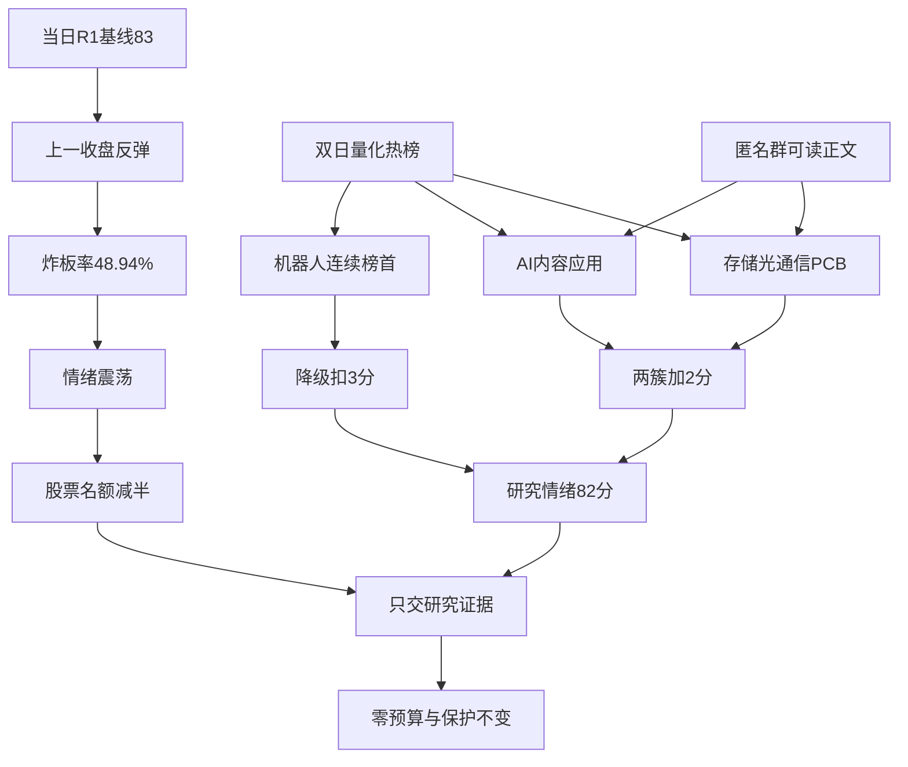

# 2026年10月29日 · **群聊情绪共振**

> ⚠️ **数据源时间错位**：业务日为 **2026-10-29**；市场量化是 **2026-10-28** 收盘及夜间热榜，双日比较为 **2026-10-27→2026-10-28**；群聊覆盖前一日晨间至本次真实查询截止。不是今日已开盘数据，也不是事后回放。
> **数据源新鲜度**：partial · **降级状态**：true

## 🧭 一句话结论
观察：情绪=震荡；硬件业绩与AI内容有双源证据，机器人霸榜降级，零预算与保护不变。

## 📊 详细分析

市场正在为科技反弹、业绩兑现和物理AI叙事付出注意力，但注意力不等于承接。**当日R1基线83，R3研究情绪分82**；高分源于前一收盘反弹，不能解释为持续主升。R1涨停72、炸板69，同口径炸板率 **48.94%**，阶段仍为**高位震荡**；当日交易尚未开始。XTick的73家涨停、69家炸板对应风险方向一致，计数口径不混用，接口字段zbl不充当炸板率。

本次只确认**4条正向L1+L2主题**，是证据完整度展示，不是交易主线排序：存储芯片、光通信/CPO、PCB、AI应用。前三项同属AI硬件需求簇，不能机械加三次分；AI视频、世界模型内容和互动影游合并应用簇，也不能把同一新品事件拆成多条独立共识。R2负责主线名、持续性、封板率、明日预期及主模板；R3不伪造这些字段。

**机器人证据很多，态度仍是降级。** 人形机器人连续两天同花顺概念第1，按红线单列拥挤/出货风险代理；机器人概念第2、减速器从17升4不能绕过母题警报继续加分。这不是已证实出货，更不是R6 hard_reject；R3不行使硬否决权。

**不进交易候选，研究不停止。** 炸板门槛下股票观察名额由4减半为2，本次不伪造逐票板型、龙头认定、RR或禁止清单结果，因此发出股票研究候选0、交易候选0。热榜中的个股只是人气证据，不是观察池顶部或首推票。R2/R4继续研究真实对象、R5补画像，现有零预算、不交易决定、授权保护独立生效，不撤单、不清池。

## 🧮 情绪分与置信度

| 项目 | 数值 | 依据 |
|---|---:|---|
| 当日R1基线 | 83 | 20261029命名空间；状态degraded，量化可复核 |
| 双源调整 | +2 | AI硬件簇+1、AI内容应用簇+1 |
| 霸榜风险扣分 | -3 | 人形机器人连续概念榜首 |
| R3情绪分 | **82/100** | 透明启发式研究量尺，不是回测模型或开仓阈值 |
| 数据质量置信度 | **0.364** | 0.65×0.70×0.80；缺口不靠高分掩盖 |

5维交叉校验缺杠杆外资有效项，score_5d与差值均缺失；不补默认50。公众号、链接标题、会议、自身发言不参与加分。

## 🔀 双源证据与风险传导

## 🔎 双源主题证据（非R2板块排序）

### 存储芯片 · L1+L2 · **观察**

量化：存储芯片 4→3，+3.97%。前20缺席是截尾，不可推定原名次。

- 群02 · 2026-10-28：“下午存储持续走强，马斯克点名的机器人内存值得关注” · `群02:p0:i116` · direct_text
- 群02 · 2026-10-28：“普冉股份，重视利基存储业绩弹性” · `群02:p0:i131` · investment_thesis
- 群02 · 2026-10-28：“SK海力士三季报大超预期” · `群02:p0:i172` · sell_side_or_news_relay

- **大资金意图**: 跨源出现对涨价与盈利弹性的交易讨论，可能是风险偏好修复中向可验证业绩寻找承接；不由人气推断具体机构净买入。
- **为什么走强**: 内存需求、利基存储供给收缩与存储涨价语义对应存储芯片；封测热股仅作交叉人气证据，不等于纯存储龙头。
- **逻辑够不够硬**: 热榜4→3、板块+3.97%与正文一致；海外财报和估值推算未核原始财报，不能把群中5倍PE当事实。

公众号补充：证券时报：利好突袭！深夜，存储巨头暴涨！；上海证券报：HBM将持续涨价，或撬动DRAM全局。不计共振或情绪分。

### 共封装光学(CPO) · L1+L2 · **观察**

量化：共封装光学(CPO) 3→5，+4.02%。前20缺席是截尾，不可推定原名次。

- 群04 · 2026-10-28：“MPO&DFAU的强通胀拐点已至” · `群04:p0:i9` · sell_side_view
- 群05 · 2026-10-28：“光通信加出海” · `群05:p0:i97` · direct_text

- **大资金意图**: 群聊短句与卖方价格观点指向业绩/价格验证，热股仍有人气；不是资金已切换成新主线的证明。
- **为什么走强**: MPO/DFAU属于光互联器件涨价讨论，与CPO共享AI光通信需求但不是同一技术；记为光通信上位共振，不声称MPO就是CPO。
- **逻辑够不够硬**: 概念3→5虽价格+4.02%但相对人气退位；一条卖方短句不足以证明价格拐点，若订单/盈利不能验证则降级。

公众号补充：上海证券报：尾盘，“光”集体拉升。不计共振或情绪分。

### PCB概念 · L1+L2 · **观察**

量化：PCB概念 5→6，+3.93%。前20缺席是截尾，不可推定原名次。

- 群05 · 2026-10-28：“已拿批量订单” · `群05:p0:i110` · unverified_research_claim
- 群05 · 2026-10-28：“AI硬件方向Q3能出业绩的板块，有业绩就会反弹更强势” · `群05:p0:i111` · direct_text

- **大资金意图**: 正文直接偏向已披露业绩的硬件反弹，可能体现兑现优先，不能将社群批量订单口述直接升为公告。
- **为什么走强**: 覆铜板/PCB三季报和批量订单讨论映射PCB概念，与存储和CPO并列记录但计分归入同一AI硬件簇。
- **逻辑够不够硬**: 概念5→6、+3.93%，金安国纪两平台前十；同作者两条只算一个观点簇，业绩利好已被交易和新增产能压力是反证。

公众号补充：上海证券报：PCB龙头，60亿元加码高端产能。不计共振或情绪分。

### AI应用 · L1+L2 · **观察**

量化：AI应用 7→12，+1.51%；短剧游戏 前20未见→15，+2.91%；AI视频 前20未见→19，+2.76%。前20缺席是截尾，不可推定原名次。

- 群03 · 2026-10-28：“AI开始生成“可以进去玩的世界”” · `群03:p0:i84` · investment_thesis
- 群03 · 2026-10-28：“AI长内容：如何看互动影游” · `群03:p0:i156` · sell_side_view
- 群04 · 2026-10-28：“互动影游有望成为AI应用新主线” · `群04:p0:i42` · sell_side_view

- **大资金意图**: 内容工具与交互产品是参与者讨论的变现方向；世界模型降低门槛属于假设，不等于资金已从硬件流入应用。
- **为什么走强**: 世界模型/AI视频的内容生产与互动影游合并为AI应用；不把同一Genie4消息拆成三条独立主题，不把工业物理AI一并加分。
- **逻辑够不够硬**: AI应用7→12、+1.51%，短剧游戏新进15、AI视频新进19；多文本仍共享同一模型催化，收入和用户留存若不兑现则不进。

公众号补充：证券时报：评分超《黑神话：悟空》！又一国产3A大作明天上线！。不计共振或情绪分。

## ⚠️ 警报与单源观察

| 对象 | 态度 | 证据与边界 |
|---|---|---|
| 人形机器人及同叙事支线 | **降级** | 概念连续第1；工业物理AI、灵巧手正文虽支持产业叙事，母题仍不加分；不是确认出货，不生成hard_reject |
| 数字人民币 | **观察** | 高校发薪话题反复传播；无对应概念前20确认，不把全国推广推测当政策 |
| 金刚石散热 | **观察** | 凌晨两份卖方口述同属50万片招标事件；未见原公告，不按两份独立订单计数 |
| 谐音字、新股无限涨幅叙事 | **不进** | 群聊FOMO与位置表述不是龙头资格、基本面或风险收益比证据 |

- **大资金意图**: 机器人叙事可能在由本体向感知和数据采集扩散，但同音字补涨同时存在，不能推断为纯机构配置。
- **为什么走强**: 减速器人气17→4与物理AI推广相互强化；这描述注意力与观点，不验证传闻订单。
- **逻辑够不够硬**: 连续榜首是拥挤代理，不是实际派发证据；需要量价、个股资金及负面事件共同核验，交R6裁决，本报告不升级硬否决。

## 🗣️ KOL方向摘要

- **群01**：直接短句偏向筑底反弹，夹杂个股同音字博弈和调研邀请；邀请不计支持。 有效期：1-3天观点；筑底表述本身为1-2周预期。

- **群02**：物理AI从本体向触觉、数据采集扩散，另有存储和数字人民币；推广密集，跨群广播不增独立源。 有效期：1-3天。

- **群03**：互动影游/世界模型是晚间内容观点，凌晨出现两份金刚石散热招标口述；后者同一底层事件并非两个已核订单。 有效期：1-3天。

- **群04**：工业物理AI、灵巧手和光互联涨价为可读卖方观点；会议邀请、图片及自报收益不算独立利好。 有效期：1-3天。

- **群05**：PCB业绩反弹、新股弹性和机器人支线讨论活跃；排除本人端侧AI、世界模型与模型发布预期，避免自循环。 有效期：1-3天。

## 📰 公众号观点

主题观点已逐项列于上文，以下单列宏观与情绪，全部不计分：

- 证券时报 · 2026-10-28：重大信号！首批主动ETF卖爆了！。
- 上海证券报 · 2026-10-28：A股放量反弹，增量资金来自何处。
- 上海证券报 · 2026-10-28：两家头部险企三季度投资收益“大回撤”。
- 上海证券报 · 2026-10-28：黄金类ETF缩水180亿元，基金经理集体发声。
- 股痴流沙河 · 2026-10-28：有变。
- 猫笔刀 · 2026-10-28：隔壁猛啊。
- 安静拆主线 · 2026-10-28：题材行情起来。
- 盘口逻辑拆解 · 2026-10-28：越来越像了。
- 傅里叶的猫 · 2026-10-28：物理AI和机器人在炒什么。
- 贩财局 · 2026-10-28：复盘观点：前一轮恐慌、海外科技反弹与风险偏好修复。

增量ETF建仓属于报道中的预期，不是本次已核到账资金；盘口叙事、保险收益回撤与黄金ETF流出并存，不从少量文章推市场一致乐观。来源全文中的业绩、报价和日期断言由R4/R5核实，本次不作事实背书。

## 🔑 关键证据

- 群02 · 2026-10-28：“下午存储持续走强，马斯克点名的机器人内存值得关注” · `群02:p0:i116`。
- 群04 · 2026-10-28：“MPO&DFAU的强通胀拐点已至” · `群04:p0:i9`。
- 群05 · 2026-10-28：“已拿批量订单” · `群05:p0:i110`。
- 群03 · 2026-10-28：“AI开始生成“可以进去玩的世界”” · `群03:p0:i84`。
- 群04 · 2026-10-28：“工业是物理AI最具确定性场景” · `群04:p0:i25`。

五群实时补查共 **638条**；初始抓取文件614条，本次补齐群05的截断尾部。本机覆盖核验成功不等于远端已全部同步。可读正文出现293次，精确唯一正文180份，其差额仅代表精确重复，不能当独立观点。分类明细：readable_text=293、unreadable=225、system=8、meeting_or_promotion=5、title_only=102、self_excluded=5。图片、文件及不可读内容未臆测；本人及被引用的本人正文已排除。

## 数据源审计

| 源 | 日期 | 状态 | 记录数与边界 |
|---|---|:--:|---|
| 当日R1 | 2026-10-29 | 🟡 | 1份；基线83，上一收盘观察，degraded |
| Tushare同花顺/东财热榜 | 2026-10-28 | 🟢 | 27/28各100热股、100人气、100飙升、20概念；29四榜空返回 |
| Tushare行业/概念资金 | 2026-10-28 | 🟢 | 同花顺90、东财1043条；仅作方向旁证，不加独立事实源数 |
| XTick HTTP | 2026-10-28 | 🟢 | 紧凑日期失败、ISO日期重试；73条涨停板，情绪接口成功以审计JSON为准 |
| attention_signals | 2026-10-29 | 🟡 | 当日命名空间现建；市场观测28日，53只两平台交集；持续性只核两日 |
| 五群本机查询 | 2026-10-29 | 🟡 | 638条；分日集合与全窗一致；图片和远端同步缺口 |
| 公众号RSS | 2026-10-29 | 🟢 | 95篇、15路抓取；文章日期28日，2路无文正常降级 |
| manifest/mcp_health | 2026-10-29 | 🟡 | 上游severity=2；历史健康探测不冒充本次API健康 |
| WeFlow | 2026-10-29 | 🔴 | 永久下线，未调用，兼容字段置空 |
| hithink补充 | 2026-10-29 | 🟡 | 未调用，不替代主源 |
| weekend_attention | 2026-10-29 | 🟡 | 周四盘前不适用 |

### 匿名群覆盖与可读性

统一窗口：2026-10-28晨间起至2026-10-29本次查询截止；精确时间和句柄在机读审计。以下首末记录不替代查询边界。

| 群 | 总条数 | 28日/29日 | 本机观察首末日期 | 分页与分日集合 | 缺口 |
|---|---:|---|---|---|---|
| 群01 | 15 | 15/0 | 2026-10-28—2026-10-28 | 一致；页未满 | 图片/正文缺失及同步不明，不判沉默 |
| 群02 | 180 | 179/1 | 2026-10-28—2026-10-29 | 一致；页未满 | 图片/正文缺失及同步不明，不判沉默 |
| 群03 | 172 | 169/3 | 2026-10-28—2026-10-29 | 一致；页未满 | 图片/正文缺失及同步不明，不判沉默 |
| 群04 | 47 | 45/2 | 2026-10-28—2026-10-29 | 一致；页未满 | 图片/正文缺失及同步不明，不判沉默 |
| 群05 | 224 | 223/1 | 2026-10-28—2026-10-29 | 一致；页未满 | 图片/正文缺失及同步不明，不判沉默 |

## 🧱 不确定性 / 反证

1. 本次不是“今日强主升”的验证：热榜、价格、广度均来自上一收盘，今天开盘承接与T+1反馈还没有发生；不能从凌晨群少说话推出市场冰点。
2. L1与L2分别是注意力测量和参与者观点，不代表两份独立公司事实。推广同稿、同一作者跨群、同一新品或招标事件均合并，未核原始来源的说法保持观点身份。
3. 机器人拥挤与硬件/内容回流并存；AI应用人气7→12、CPO3→5、PCB5→6说明相对排序未同步加速，价格反弹不能覆盖这一反证。
4. 五群在本机可读不等于全消息可理解；图片未读，分钟级记录不提高到秒精度。远端同步和90日持续人气仍有缺口，因此状态degraded，不宣称全源完整验收。
5. 股票四项门禁及首推四段思维链本次不适用：没有股票候选、首推或执行对象，不用人气榜暗示龙头，不为补模板编造止损价/RR。

## 🔗 与其他 R/D/E 的关系

- 依赖：当日 `R1_style.json`、本次 `R3_evidence.json`、`R3_source_audit.json`、现建 `attention_signals.json` 及公众号RSS。
- 被消费：R2/R4/R5研究补证、R6反证、D1决策、E1复盘。单源与拥挤项显式降级；R6硬否决原样向下游传递，R3不得覆盖。
- 不输出主线持续性/封板率的虚值；这些由R2同源计算。研究观察不创造买权，现有预算和保护不变。

## Sub-Agent 元数据
- skill: analyze_sentiment_resonance_v1
- artifact: data/research/20261029/R3_sentiment.json
- 生成耗时：约329秒（本次实时取证启动至JSON生成，不含此前上下文读取及最终校验）
- model: gpt-6.1-sol
- method: llm_v1；语义阅读与事件归并，不以关键词次数打分
- 真实启动与生成时间：精确ISO时间仅保存在frontmatter与JSON；本次为真实盘前执行，不是回放
- 资源：5000万token仅连续任务观察目标，无每日重置；usage_unknown，不填0、不保证低于目标
- 交付：08:30仅观察目标；本产物早于目标生成，不替整条流水线宣称交付完成
