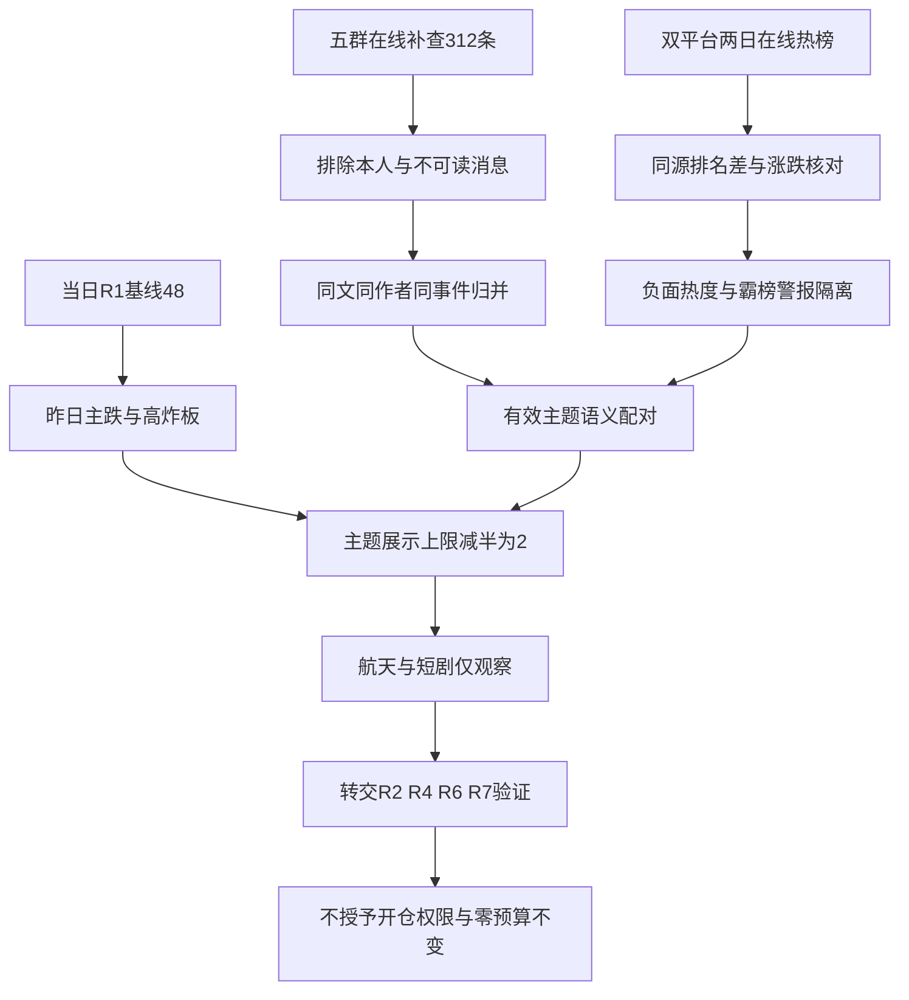

# 2026年10月30日 · 群聊情绪共振

> **数据源新鲜度：partial｜降级：true｜置信度：0.364**
> **情绪=主跌。市场情绪分48，沿用10月30日当日R1，不是10月29日R1。**
> 本文为真实盘前研究，不是回放。量化观察日为10月29日，排名比较日为10月28日；今日尚未开盘，不能把昨日局部强股写成今日已确认主线。

## 🎯 一句话结论

**观察航天与短剧的局部双源交叉；情绪仍为主跌，不进，零交易预算不变。**

## 🧭 先认市场，再解释人气

| 必答问题 | 本次判断 | 对下游的含义 |
|---|---|---|
| 市场为什么付钱？ | 少数航天、短剧、名字博弈股抗跌，银行相对强；科技人气中包含大量下跌围观 | **热度不等于赚钱效应，更不是资金流入证明** |
| 现在处在哪一段？ | 当日R1记录的昨日阶段为主跌：39涨停、41跌停、25炸板 | 不能从一次前日反弹外推连续主升，也不预设固定低吸打法 |
| 谁有地位？ | 本阶段只确认传播和榜单交叉，不授予总龙、龙二或龙三地位 | 龙头认定、板型、逐票资格交R2/R5；样本票不进入候选池 |
| 今天做与不做什么？ | 观察两条主题，保留全部来源与反证；不进、不追负面热度、不突破零预算 | 不下单、不撤单、不清池，不改变既有授权与保护 |

**当日R1情绪48，不因两条叙事机械加分。** 采用的计算是`48 + 0 = 48`：两条入选主题的概念当日分别下跌，跨群传播也多发生在昨日盘中，尚无同向广度与资金验证。炸板率和市场广度已体现在R1，不重复扣分；公众号不参与调整。独立五维校验缺杠杆外资等输入，`score_5d`与差值均缺失，不塞默认50。

**炸板率=25÷(39+25)=39.0625%，情绪=主跌。** XTick另源为39涨停、42跌停、26炸板，按自身分子分母重算40%，不混用，也不使用接口原始`zbl=8.22`冒充炸板率。R1的上涨781家、下跌4728家和中位数-2.599%，说明广泛亏钱而非全面扩散。主题展示上限从5减至2；股票研究候选与交易候选均为0，来源覆盖和反证不减半。

## 🔗 双源共振主题：仅表示观察优先级，不是板块交易排序

| 主题 | L1量化热度 | L2有效文本 | 态度与边界 |
|---|---|---|---|
| 商业航天 | 概念热度7→1；中国卫星东财第3、同花顺第14，涨10%；上海沪工东财37→9，涨10% | 两篇不同券商方向正文与一名参与者的短观点；同稿广播只算一篇 | **观察，L1+L2，middle**；概念整体-2.21%，不认定全面走强 |
| 短剧游戏 | 概念热度15→13；文投控股东财19→11，涨10.19%；慈文传媒涨2.99% | 短剧互动道具、内容变现和转型讨论；同作者重复评论归并 | **观察，L1+L2，middle**；概念整体-2.0%，不是已确认接力行情 |

**可交易主线=未确认；持续性=缺失，未强填1/3/5日；板块封板率=缺失；今日预期=分歧待验证。** R3不把全市场封板率60.94%冒充任一主题封板率，主线确认仍归R2。下述热股只作量化样本，不是首推票、观察池顶部票或交易候选。

### 🚀 商业航天：有局部正反馈，但“全板块上涨”不成立

- **大资金意图**: 太空算力、卫星应用与发射预期可能承接局部抗跌注意力，这是研究假设而非机构买入事实；本阶段没有用群聊声量证明资金来源。
- **为什么走强**: 中国卫星和上海沪工的涨幅、东财热度提供局部确认；群4关于卫星应用大会的正文、太空算力报告及群2的追涨短句在语义上相配。但概念整体下跌2.21%，只能说局部强股与叙事相互强化。
- **逻辑够不够硬**: 两篇不同券商正文及一位参与者短观点支持“传播交叉”，不支持源头经营数字、首飞日程已经核真。两篇报告共享SpaceX等背景事件，不能算两次独立事件兑现；航天飞机图片没有可靠可读证据，不作硬催化。

| 可回查证据 | 匿名来源 | 证据性质 |
|---|---|---|
| “板块正迎来新一轮催化” | 群4，2026-10-29，`G4:4` | 抽出方向正文，剥离会议邀请；事件时间交R4核验 |
| “太空算力正由概念探索迈向技术验证” | 群4、群2、群5，2026-10-29，`G4:6/G2:50/G5:83/G5:97` | 同一券商稿四次传播，只算一篇 |
| “中国航天牛逼 下午买不到了” | 群2、群3、群5，2026-10-29，`G2:46/G3:43/G5:100` | 同一作者三群广播，只算一条追涨表达 |

**反证与验证**：下一交易时段若仅个别票维持人气、主题整体仍负反馈，就不能将此升级为持续主线。需由R2补板块广度、持续性与封板率，R7补独立资金证据；R3不据当前榜单授予开仓权。

### 🎬 短剧游戏：叙事有落点，收益兑现还没有证据闭环

- **大资金意图**: 可能试探互动付费、AI内容制作效率与转型预期；没有证据证明资金从硬件系统性迁入传媒，不能把几份推介稿写成产业资本布局。
- **为什么走强**: 文投控股的涨幅和东财排名改善配合群5短剧互动讨论，构成局部交叉。反面是慈文同花顺21→36、掌阅跌3.71%，概念仍跌2.0%；因而不是全板块加速。
- **逻辑够不够硬**: `G5:41`短句与`G5:52/53/75`链接标题和直接评论能证明主题传播，不能证明对应公司的新增订单或利润。北京文化同稿三次不计新增独立背书；3A游戏发售也不与短剧产品事件混作一件事。

| 可回查证据 | 匿名来源 | 审阅结论 |
|---|---|---|
| “欢瑞世纪 捷成股份 抖音内测短剧互动道具” | 群5，2026-10-29，`G5:41` | 短句保留，但只是题材映射 |
| “重磅…抖音内测短剧互动道具” | 群5，2026-10-29，`G5:52` | 链接标题，仅证明传播，不冒充全文 |
| “小崧股份的这个转型真的要重视” | 群5，2026-10-29，`G5:53/75` | 同一作者同一转型论点归并，不重复计源 |

**反证与验证**：若短剧头部热股继续走弱、题材文字持续增加却没有更多正向价格反馈，属于传播热而非接力确认。产品上线与商业化进度交R4/R5核验；公众号提到即梦短剧工作室，只作L2b补充，既不抬级也不加分。

## 🚫 不进正向共振的热度与未入选覆盖

| 对象 | 明确态度 | 证据与剔除理由 |
|---|---|---|
| 襄阳轴承 | **拦截正向加分** | 同花顺两日第一；成交额为此前5日均值3.055倍，开盘19.37、收盘18.75，未守住开盘高点。THS净额-25935.62万元，DC主力净额+8136.15万元，统计方向冲突：触发霸榜警报，但不宣称已证实机构出货 |
| CPO | **拦截正向加分** | 天孚同花顺87→2，却跌19.77%；新易盛30→15，却跌11.06%。这是价格负反馈下的围观，群1“爆杀/杀估值”也为负向表达 |
| 人形机器人 | **降级** | 群4晚间仍推灵巧手、稀缺标签，群2有物理AI催化清单；概念跌4.09%，部分轴承上涨不代表全链条转强。襄阳霸榜警报不作机器人的正向分数；主题展示减半后不入top |
| 冰雪产业 | **观察** | 冰山东财50→5且涨10.03%，但雪人仅涨0.93%、概念跌1.17%；同一作者短句和政策标题归一个传播簇，强度不足以挤进两条主题 |
| 存储/PCB | **降级** | 电子特气、材料推广存在；概念分别跌5.28%、5.36%，佰维跌15.79%、华天跌6.82%。产业观点不能覆盖当日负反馈 |
| IP经济、国产3A游戏 | **降级** | 多群国产IP替代稿归一底层事件，直接点名对象没有此次榜单闭环；国芳标签不能硬套同一受益逻辑 |
| 数字人民币、海南自贸、AI反腐 | **观察，单源不进top** | 有短句、政策解读或推介文；本次热榜缺可靠直接配对，不为填足五条造共振 |
| 银行/高股息 | **观察，单源不进top** | 工商上涨2.57%，高股息概念涨0.28%；群聊主要是券商下跌讨论，公众号的银行观点不能替代群聊L2。保留动态风格研究，不贴永久防御标签 |
| 羊/洋/阳名字博弈 | **拦截主线升级** | 三羊马与低位羊表达存在，纯名字逻辑不当硬产业催化；与航天、机器人重叠票不重复生成主线 |

**警报不是R6硬否决。** 这里的“拦截”仅限制R3正向计分/主题入选，不越权替代R6。襄阳开盘等于最高价，不能误写成长上影；THS和DC资金分类不同，也不能选择有利的一边证明统一的资金意图。

## 🗣️ 五群观点摘要与独立性

| 匿名群 | 方向摘要 | 反证及限制 |
|---|---|---|
| 群1 | 主体是休息、下跌亏损和杀估值，盘中也有反弹愿望 | “下午大涨”是愿望，不是次日方向已获资金确认；杠杆业务招揽不计有效观点 |
| 群2 | 物理AI、航天、数字人民币等并行传播 | 同一作者多群广播较多，不能按出现次数认定共识 |
| 群3 | 食品补涨、物理AI、名字博弈混杂 | 有短观点，但午后最后记录较早，不推断其后无人讨论 |
| 群4 | 卖方对航天和机器人结构性偏多，晚间继续讲稀缺标签 | 邀请函剥离；同一分析师早晚观点不算两个独立源；“唯一直供”未核验 |
| 群5 | 短剧产品、转型和太空算力传播较密集 | 宣传稿与同作者重复评论较多，独立性低于原始消息数 |

**覆盖312条，不等于312条观点。** 排除6条本人内容后，可读普通正文172条，空白归一精确去重后142个正文；仍包含寒暄、宣传及同事件改写，142不是独立观点数。28条链接标题单列，97条非本人图片、4条表情、4条不支持内容、1条视频不进入正文语义评分。本人及其被引用意见不参与共振，所有回复引用被剥离以防自循环。

**图片缺口经过实测，而非直接跳过。** 五群执行`--type image --media`共返回98条，含一条本人图片；每群多条记录都指向同一dat路径，逐群抽检5个文件均不可解码。当前没有可信的逐消息图像映射，OCR引擎也未安装；不猜图意，不据此说群聊安静，更不把图中的未知内容用另一个模型补写。

## 📰 公众号观点：独立展示，不计共振或情绪分

| 分组 | 已读观点及意义 | 限制 |
|---|---|---|
| 航天 | 证券时报的中国卫星逆市表现、两家媒体的发射服务中标候选报道 | 同一底层事件跨媒体不算独立事件兑现；资金数字未转为R3自证 |
| 短剧 | 财联社早知道：即梦短剧工作室上线、AI短剧扩容预期 | 是产品叙事补充，不证明上市公司利润兑现，不替群聊L2 |
| 宏观与情绪 | 猫笔刀《慢慢折磨》谈红利与科技风格挤压、分段买入和持续折磨 | 作者行为不是本系统指令；其广度口径不同，不替换R1统计 |
| 宏观与情绪 | 《又回去了》强调弱震荡与等待；《想起来有些后怕》强调右侧信号未确认和高位风险 | 两个内容源可能共享复盘方法，不能硬算资金独立验证 |
| 产业反证 | 《科技又跌懵了：资金正在向哪里转移？》认为利润向硬件端迁移 | 中期产业论点与短期价格大跌可以同时成立，不能据此宣布止跌 |

本次RSS共83篇、15个订阅源可达、13个有窗口内文章。两份涨停/联动复盘正文主要为免责声明，核心信息可能在未读图表中，因此不从标题恢复板块结论。两个空订阅不判故障，15个订阅也不等于15个独立观点。

## 🧪 人气底座与排名审计

当日必读路径`data/research/20261030/attention_signals.json`缺失。抓取清单实际指向`data/research/20261029/attention_signals.json`，于10月30日生成但内部行情日期仍是10月29日。本次明确读取并审阅了该底座的persistent、surge和cross_platform，又在线获取两日完整榜验证，不把它改名伪装今日热榜。

- **持续人气字段降级**：底座1910项是历史对象累计，不是当前1910只持续在榜股。实现中的`days_on_list`按平台记录累加，`last_rank`还取了排序后较差名次，不能当连续交易日或最后时点；这些字段不参与加分。
- **跳升重新算**：同花顺与东财分别按同源两日排名比较，不能用跨平台较优排名差制造加速。未在昨日top100中出现的票标榜外，不虚填101名。
- **合力不重复计源**：双平台在榜表示传播面，不等于两个资金独立证据源，更不等于买盘。

| 同源统计口径 | 数量 | 解释 |
|---|---:|---|
| 最新在榜平台记录 | 200 | 两个平台各100条，不是200只独立股票 |
| 排名改善至少10位 | 30 | 包含跌价围观，必须对照涨跌幅 |
| 排名下降至少10位 | 46 | 不自动判机构卖出 |
| 新进top20 | 21 | 平台记录口径，含从昨日榜外进入 |
| 新入top100 / 掉出top100 | 87 / 87 | 两平台记录合计，非87只独立票 |
| 霸榜警报对象 | 1 | 只限制正向计分，不代表已证实出货 |

## 🔄 证据到结论的门禁

## 数据源审计

| 源 | 日期 | 状态 | 条数/覆盖 | 备注 |
|---|---|:--:|---|---|
| 当日R1 | 2026-10-30 | 🟡 | 1份 | 仅用当日文件，评分48；上游自身degraded |
| Tushare同花顺热股 | 2026-10-29、2026-10-28 | 🟢 | 各100条 | MCP在线取证，确定性SDK同源再次获取保存；T0请求为空 |
| Tushare东财人气 | 2026-10-29、2026-10-28 | 🟢 | 各100条 | 同源diff，不混平台名次；T0请求为空 |
| 同花顺概念榜 | 2026-10-29、2026-10-28 | 🟢 | 各20条 | 排名是注意力，不等于涨幅排名 |
| 东财飙升榜 | 2026-10-29 | 🟢 | 100条 | 已获取，未与人气名次混算 |
| THS/DC资金及霸榜日线 | 2026-10-29及之前 | 🟡 | 资金各2条、日线8条 | 限霸榜警报核验；资金方向冲突，不扩展为个股画像 |
| XTick情绪 | 2026-10-29 | 🟢 | 1份 | 在线MCP；40%与R1的39.06%分源列示 |
| 交易日历 | 2026-10-30 | 🟢 | 3个交易日 | 确认今日开市，前序为29日、28日 |
| 群1 | 2026-10-29至2026-10-30 | 🟡 | 84条；观测首末均为29日 | 5群统一窗口，尾页空；远端同步未核验 |
| 群2 | 2026-10-29至2026-10-30 | 🟡 | 57条；观测首末均为29日 | 尾页空，图片未读，不能判安静 |
| 群3 | 2026-10-29至2026-10-30 | 🟡 | 47条；观测首末均为29日 | 最后记录在午后，不能推断晚间无消息 |
| 群4 | 2026-10-29至2026-10-30 | 🟡 | 13条；观测首末均为29日 | 含晚间机器人观点；宣传与会议单列 |
| 群5 | 2026-10-29至2026-10-30 | 🟡 | 111条；观测首末均为29日 | 同文与同作者跨群去重 |
| 群聊媒体 | 2026-10-29 | 🔴 | 图像类型98条，含本人1条 | 五群返回路径异常归一，逐群抽检不可解码；视频未读 |
| 当日attention必读路径 | 2026-10-30 | 🔴 | 0份 | 未找到，不伪造；研究内显式标缺口 |
| attention显式T-1底座 | 2026-10-29 | 🟡 | 1910历史项、23跳升、59跨平台项 | 生成于今日；累计口径有缺陷，不当连续人气统计 |
| 公众号RSS | 2026-10-29至2026-10-30 | 🟢 | 83篇，15源可达 | 仅L2b，不加分、不抬共振等级 |
| manifest/mcp_health | 2026-10-30 | 🟡 | 原抓取严重度2 | 实际调用结果优先，不沿用WeFlow存活假设 |
| WeFlow | 2026-10-30 | 🔴 | 0 | 永久下线，本次未调用、未读历史快照；兼容字段全部空 |

统一群聊查询从29日清晨至30日清晨，精确边界、抓取时刻、首末记录、分日计数与分页结果保存在JSON。五群尾页核查均为空，表明本机查询未截断；没有做逐自然日独立重查，也未证明远端同步完整。30日尚无返回消息只表示本机未见，不能比较不足一天与完整昨日的消息量，更不能直接推断情绪降温。

## ⚠️ 不确定性 / 反证

1. **悲观群聊与市场下跌同向，不构成额外扣分样本。** R1已经计入广度和炸板，再减分会双算同一市场冲击；当前48是继承分，不是独立测得的社会情绪指数。
2. **局部题材与整体下跌共存。** 航天、短剧概念都跌，观察的是少数样本的价格与传播交叉；没有承诺持续1/3/5日，也没有“所有钱都去这两条线”的断言。
3. **源头硬事件待核。** 群聊财报数字、供应商唯一性、会议信息与产品新闻须交R4/R5；转载同文和同事件不会增加确认度。
4. **数据质量不等于方向胜率。** 置信度按`0.65×0.7×0.8=0.364`计算，0.7反映缺路径/不可读图片/同步未知，0.8反映两类有效证据，不是成功率。
5. **本次状态partial，不伪报完整验收。** 已完成当前可用证据的研究与交付；WeFlow退休不阻断，其他缺口仍保留。仓库未发现权威R3 Pydantic模型，因此使用本次显式字段及业务不变量校验，不能宣称已通过不存在的全局模型。

## 🤝 与其他 R/D/E 的关系

- 依赖：当日`R1_style.json`、当日抓取manifest、五群与RSS；人气底座实际归属29日并单列审计。
- R2：两条只是情绪维度观察，不替主线排序；补板块持续性、封板率、龙头地位与模板。
- R4/R5：核验源头事件、供应链和实际受益；R3没有首推票，所以股票四段买入/止损思维链不适用，不为形式编造价格或盈亏比。
- R6：保留霸榜、负面热度、来源依赖和图像缺口；R6仍是唯一硬否决来源。
- R7：检验实际资金是否支持局部轮动，不能把人气上升直接写成净买入。
- D1/E1：消费机读产物；有效零预算、不交易决定、保护和逐票门禁独立生效。新观察不自动改变授权，盘后可核验主题是否从传播转向正向市场反馈。

## Sub-Agent 元数据

- skill: analyze_sentiment_resonance_v1
- artifact: data/research/20261030/R3_sentiment.json
- evidence: data/research/20261030/R3_evidence_20261030.json
- schema: data/research/20261030/R3_schema_20261030.json
- model: gpt-6.1-sol
- 生成耗时: 706 秒（自首个本阶段取证命令起）
- method: llm_v1；当前会话直接语义研究，确定性脚本仅采集、计算和校验
- 时序：真实盘前；非回放，未调用第二模型或同技能CLI会话
- 用量：usage_unknown，不当0；5000万仅连续努力目标，不保证低于目标
- 交付目标：08:30仅观察目标；不改变预算、不触发撤单或清池
