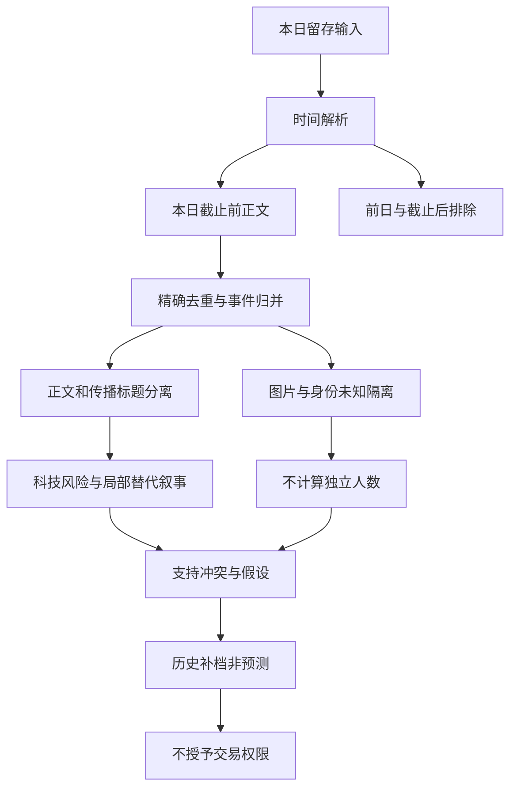

# 2026年10月31日 · 周末群聊情绪历史补档

> ⚠️ 本文是事后补档，非事前预测，非当日18:00冻结报告。真实生成时间见frontmatter。仅恢复讨论与证据结构，不使用11月1日、11月2日信息解释本日，不检验后来股价。
> 数据质量：partial；定量市场情绪分、独立KOL人数、资金行为确认均为未知；新热榜：not_available。

## 🎯 一句话结论

**留存讨论偏谨慎，科技风险与杠杆警惕最鲜明；创新药是局部替代叙事，尚非跨群共识。**

## 🧭 先认市场，再解释文本

| 问题 | 本次边界内的回答 |
|---|---|
| 市场在为什么付钱？ | 留存文字讨论海外科技风险、ETF托底与医药替代；没有本日新增市场成交证据，不能回答资金已经选择哪条主线 |
| 处在哪一段？ | 文本风险意识偏强，但不能据聊天判定真实市场为主跌、冰点或主升；本次不移植此前交易日报分数 |
| 谁有地位？ | 不认定总龙或板块名次；消息中的公司仅是原文对象，不形成个股候选 |
| 本次做与不做什么？ | 观察叙事和冲突；不生成交易候选、价格、预算、胜率或买卖建议，不改任何交易权限 |

## 🕰️ 采集窗口与历史可用性

分析目标窗口为中国时区本日00:00—18:00。清单声明群聊回看自10月30日06:00开始，不能把整个338条文件算成周六样本。逐条解析时间后，314条属于前日，24条属于本日窗口，截止后0条，时间未知0条。全文件实际最早为10月30日06:50，最晚为10月31日17:23；本日实际记录区间为00:06—17:23，末条后是否完整同步未知。

清单生成时间为本日18:00:05，已经晚于目标截止；它不是逐源抓取时间，也不是当时冻结输入的证明。更重要的是，公众号清单声明112篇，而当前RSS实际只有58条，内容最晚到11月1日12:43。当前文件显然不能靠目录名被认定为本日18:00版本。此次仅使用发布时间位于目标窗口的29条，另外29条晚于截止并全部排除；其中无论本日晚间还是次日内容，都不反向补入。即使29条的标示发布时间符合，正文是否在截止前已被采到、后来是否更新，仍为unknown。

新闻留存2477条中，本日窗口内455条，2022条为此前时间。窗口内实际只覆盖00:01—08:59，缺少09:00—18:00事实对照；不将无午后新闻理解为午后无事件。文件名虽为news_cls，原始记录同时含新浪转述及财联社摘要，应称本地混合新闻留存，不能把不同转述包装成独立一手核实。

## 🗣️ 全量群聊审阅与证据性质

对全部24条窗口内原始消息做空白归一精确去重，得到21种文本/占位内容。保留原始行号作证据，重复不删回查关系；正文中的回复引用只作上下文，不再次计算观点。文本去重不是身份去重，更不是独立事件去重。

| 匿名群 | 本日原始条数 / 文件该群总条数 | 审阅结果 |
|---|---:|---|
| G1 | 12 / 90 | 海外科技冲击、继续休息、杠杆风险与结构性分化；也有玩笑、表情和ETF链接 |
| G2 | 1 / 77 | 一条风险提醒文章标题，与另外两群同题传播归并 |
| G3 | 2 / 59 | 风险提醒标题与“美股暴跌是利好”标题并存；两者正文均未展开 |
| G4 | 1 / 5 | 一条市场收益分配疑问标题，不能据此推定具体方向 |
| G5 | 8 / 107 | 消费政策标题、创新药短论、回复、图片与不支持内容混合 |
| 合计 | 24 / 338 | 五群均有本日留存，不等于五群全时段完整覆盖 |

| 类型 | 原始消息数 / 24 | 精确去重种数 / 21 | 处理 |
|---|---:|---:|---|
| 有方向的正文候选 | 6 / 24 | 6 / 21 | 行80、84、86、87、88、333；仅描述其表达，不把6条当6名KOL |
| 链接标题 | 9 / 24 | 7 / 21 | 行79、85、90、167、225、226、231、331、332；标题只证明传播 |
| 简短回复 | 2 / 24 | 2 / 21 | 行82、335；不把引用的原话再算新支持 |
| 玩笑 | 1 / 24 | 1 / 21 | 行89；不作指数目标或预测 |
| 表情 | 2 / 24 | 2 / 21 | 行81、83；不推测情绪方向 |
| 图片 | 2 / 24 | 2 / 21 | 行334、338；未使用视觉或OCR，图意未知 |
| 无法展示的链接/文件 | 2 / 24 | 1 / 21 | 行336、337；内容未知，不当沉默 |

原始行均指data/raw/20261031/wechat_cli_5groups.jsonl。G1的12条占窗口原始消息24条的50%，这是**样本来源集中度**，不是恐慌比例、全市场情绪分或独立人数。文件只有chat/status/message，没有is_self或可靠身份映射；已剥离回复引用，不把本人可能参与的未核明文本认作独立外部KOL。本人排除无法完全认证，故保留身份缺口，独立KOL人数及其观点占比均不计算。

## 🔍 周末讨论主题与跨来源支持/冲突

以下顺序是解释结构，不是R2板块排序；无L1量化热榜，不产生L1+L2共振主题。

### 科技风险与杠杆警惕：风险语言最清晰，但不是全体一致

- **大资金意图**: 未知。群聊中的“慎用杠杆”和ETF标题说明参与者在讨论流动性与托底，不证明机构已经撤离或加仓。
- **为什么走强**: 此处指风险叙事更突出，不指股价走强。G1行80“继续休息”、行86“慎用杠杆”、行87“硬科技还没跌透”，在语义上分别对应回避、杠杆约束和科技估值风险；不能将它们机械累计成情绪分。
- **逻辑够不够硬**: RSS行21、51和新闻行26、127、328、369留存有海外科技融资、现金流压力报道，构成背景对照，但许多内容共享同一财报/海外报道链，不是多次独立风险兑现。G3行226仅标题“美股暴跌是利好”提供反向解释线索，尚无可读论证，不能把转发者视为赞同。

**共识风险**：风险提醒标题在行167、225、331跨三群出现，只算同一标题传播簇；G1的目标点位闲聊、行89玩笑都不作为预测。公众号行56的踩踏解释和行58的ETF政策动机推测属于作者解释，其中因果与政策意图未被本次证实，不照单转成事实。

### 创新药与结构性分化：局部另找解释，不是确认风格切换

- **大资金意图**: 未知。G5行333将创新药视为科技之外的替代叙事，行335只是“好”的回复，不能当第二名独立看多者。
- **为什么走强**: 只确认题材进入讨论。行333“牛市光模块，熊市药模块”借行业盈利想象做风格对照；G1行84“牛市是结构性，熊市也是结构性”提示不能把所有板块同涨同跌化。
- **逻辑够不够硬**: RSS行23、新闻行45均谈三季度外资持股偏向创新药及红利，底层同为历史股东披露；新闻行60提到药企新品。它们能解释讨论背景，但不能把季度持股倒算为本周末实时买盘，也不能验证原文利润预测。图片不可读，产业数字和A股映射仍未知。

**可检验假设**：如该叙事确有扩散，后续同长度、同群覆盖的样本应出现至少两个可回溯不同原稿的非宣传正文，并明确区分订单/产品事件与估值想象；若仍只有同一句话与附图，则“扩散”假设不成立。这里只提出验证设计，不使用后来记录回答。

### ETF托底与消费政策：政策期待和信心不足可以并存

- **大资金意图**: 不能由ETF标题判断最终出资人或政策目标。G1行90是标题传播，新闻行21、48可作此前ETF流向报道的事实对照，不是本日资金测量。
- **为什么走强**: 此处是讨论出现，不是政策主题已强。G5行332传播消费基础设施指导意见，RSS行20、45讨论PMI回落与新动能扩张，形成“总量压力—结构机会”的双面背景。
- **逻辑够不够硬**: 政策标题未展开，不能把它与后来会议安排拼接；PMI文章也共享一次统计发布。RSS行58对托底效果的质疑与ETF入场报道构成解释层冲突，不意味着其中任一方已被市场验证。

**可检验假设**：未来若要确认政策预期能改善信心，需要正式文件、适用对象及执行路径，而不只是重复标题。本日没有足够证据确认政策对群聊风险表述的净影响。

## 📰 公众号观点与宏观情绪：29条全文留存均已审阅

RSS与wechat_official_20兼容副本字节相同，绝不合并成58个独立支持；29条为空白归一后的29种留存文本，同题改写继续按事件归并，不当29个独立观点。

| 留存行号 | 覆盖内容 | 分析用途与剔除边界 |
|---|---|---|
| 21、51、56 | 海外科技风险、AI支出回报与踩踏解释 | 背景/作者观点；不把转载数量当群聊热度，文章内重复段落不重复计源 |
| 20、45、58 | PMI与新动能、ETF托底争议 | 宏观与信心分歧；不确认政策动机，不移植交易日情绪分 |
| 23、24、25、42、48 | 外资/社保持股、银行券商业绩与资管观点 | 季度回顾，不是周末实时资金；资管“多看少动”为其观点，不是本报告指令 |
| 22、50、43 | 苹果与千问、数据标注部署 | 前两篇同一合作事件；可读但本日群聊未有可靠同向正文，不能造AI应用共振 |
| 13、14、15、44 | 氢能方案、登月、锆矿、氦气供应 | 产业事实/报道背景，不因新闻丰富就列群聊热门；氦气稿自身强调影响可控 |
| 16、47、49、52 | 重组、保壳、财务合规风险 | 同一重组两篇归一事件；保留风险，不生成股票机会或画像 |
| 18、19、26、40、41、46 | 地缘、贵金属、纪检、IPO及政治风险 | 全量审阅后列为宏观/风险背景，不强行映射群聊题材 |

以上条目是留存报道所述而非本次联网核真。新闻同事件改写、汇总与分条广播归入一条背景证据链；其455条窗口记录经精确去重为454种文本，仍不是454件独立事实。未用新闻数量参与情绪集中度或共振计分。

## 🧪 可检验假设与反证设计

| 假设 | 未来应观察什么 | 什么会推翻它 |
|---|---|---|
| 风险意识是当前样本主导语气 | 同长度且五群可比覆盖中，出现带明确依据的避险正文，而非仅风险标题 | 来源恢复后，其他群有大量相反正文；则当前判断主要是样本偏向 |
| 创新药是局部替代叙事 | 不同底层原稿补出产品、收入或研发节点依据 | 只重复原短句、未知图片或历史持股，则不能升级共识 |
| 托底新闻尚未消除谨慎 | 明确区分政策工具落地与作者解释，检验正文态度变化 | 不依赖本报告未知图片的完整正文证明当日已广泛转向积极 |

## 🔄 证据到结论

## 数据源审计

| 源 | 日期 | 状态 | 有效分母与窗口 / 限制 |
|---|---|:--:|---|
| manifest | 2026-10-31 | 🟡 | 1份；18:00之后生成，公众号声明112篇与当前58条不一致 |
| wechat_cli_5groups | 2026-10-31 | 🟡 | 24/338条符合本日00:00—18:00；21种内容；五群窗口原始数12/1/2/1/8 |
| wechat_official_rss | 2026-10-31 | 🟡 | 29/58条符合发布时间窗口，29条晚于截止排除；逐条采集可用时点未知 |
| wechat_official_20 | 2026-10-31 | 🟡 | 58条，与RSS完全相同，新增独立证据0条 |
| news_cls本地混合留存 | 2026-10-31 | 🟡 | 455/2477条符合本日窗口，454种文本；实际仅到08:59，不能验证午后事件 |
| 新热榜 / attention | 2026-10-31 | 🔴 | not_available；未读取研究JSON，不以清单历史回落榜冒充新榜 |
| WeFlow / 三刀 / mptext | 2026-10-31 | 🔴 | 未调用，不使用退役来源或历史快照补共振 |

## ⚠️ 不确定性 / 反证

- 情绪集中度仅定性：风险讨论明显、板块替代分散；未计算关键词占比、市场分或独立人数。G1样本集中、本人身份无法完全排除，均限制外推。
- “全量”仅指本日窗口内全部留存消息与可读文章/新闻文本；不等于微信群历史全量，不等于链接全文或附图已读。未联网核分页，完整采集覆盖无法认证。
- 10月31日公众号文件含次日条目，不能声称当日18:00已见这些29条正文；文中全部结论仅为按标示发布时间过滤后的历史重建，历史采集可用性单列未知。
- 无新热榜、无本日交易量化基准，resonance_top_themes不在本次生成；资金意图、真实市场阶段、封板率、连续排名及出货警报检查结果均未知，不填默认值。

## 🤝 与其他 R/D/E 的关系及元数据

- 本次依赖：仅上述目标日留存输入；此前20261030人读R3只用于理解审计边界，不搬用其分数、榜单或主题作为本日证据。
- 消费边界：可供R2/R4/R6回查历史讨论；不是正式流水线完整R3单元，不恢复JSON/summary，不作为可执行信号。
- 输出仅本文件。无首推票，逐票板型/龙头/RR/禁止清单及买入理由/止损条件不适用，不以交易模板强迫生成建议。
- skill：analyze_sentiment_resonance_v1；model：gpt-6.1-sol；update_type：周末历史缺报补档。
- 校验范围：落盘前对本补档frontmatter进行Pydantic校验；不声称已验证不存在的研究JSON或交易契约。
