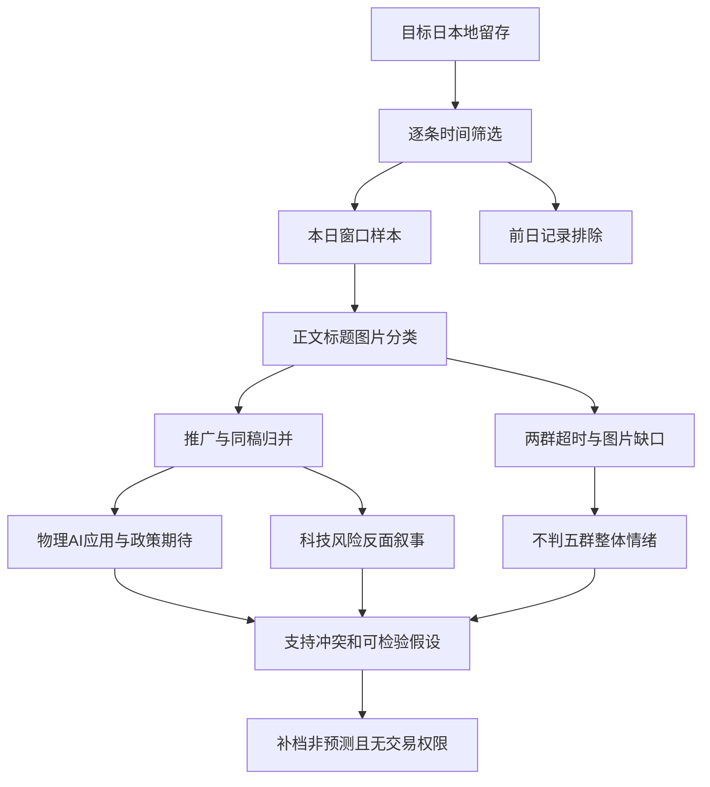

# 2026年11月1日 · 周末群聊情绪历史补档

> ⚠️ 本文是事后补档，非事前预测，非当日18:00冻结报告。真实生成时间见frontmatter。只恢复目标日留存的讨论结构，不读取11月2日市场结果，也不以后验涨跌挑主题。
> 数据质量：partial；新热榜：not_available；市场情绪分与独立KOL人数未知。两群抓取失败，不以记录少判断降温。

## 🎯 一句话结论

**可见样本转向物理AI推广与政策期待，但来源高度集中，风险叙事并未消失，不能判定共识转暖。**

## 🧭 先认市场，再解释文本

| 问题 | 本次回答 |
|---|---|
| 市场在为什么付钱？ | 本日仅有机器人/法律AI推广、政策期待与风险文章；没有新增交易反馈，未知 |
| 处在哪一段？ | 不从卖方热情推定主升，不从避险文章推定市场冰点；真实市场阶段未知 |
| 谁有地位？ | 不对公司或板块授予龙头地位。推介稿中的“唯一”“龙头”只是原作者标签，不是R3认证 |
| 本次做与不做什么？ | 观察可核文本与缺口；不生成买卖建议、价格、预算、胜率或候选池；不改既有交易授权 |

## 🕰️ 先核窗口：日期合格与当时可用是两件事

目标窗口为中国时区本日00:00—18:00。清单声明24小时回看，自10月31日18:01:42开始，生成于本日18:00:39，已经晚于目标截止。群聊文件20条中，1条属于10月31日19:44，被排除；19条属于本日窗口，截止后0条，时间未知0条。窗口内实际有记录的区间为10:07—17:12，无法据此证明凌晨及晚间已完整同步。

五群中G1、G2清单明确超时，G3成功返回0条，G4成功返回16条（其中1条为前日），G5成功返回4条。G3只能写“本次留存返回0”，不能写“全天无讨论”；G1/G2则是缺测，不是沉默。清单全局severity=0与局部两群超时并存，本报告按局部实际证据降级，不让总状态掩盖缺口。

RSS文件40条中，本日发布时间符合窗口25条，前日15条作为非本日新增排除，截止后0条；25条经空白归一精确去重为24种文本。实际本日发布时间区间07:25—17:34。update_time是来源标示发布时间/更新时间，不是本系统逐条captured_at；没有截止时冻结副本，无法证明这些正文当时已采集可用，所有本日结论均为历史重建而非冻结回放。

新闻536条中，185条属于本日00:00—18:00，351条为前日排除。本日实际记录止于08:58，缺少09:00—18:00；因此下午会议报道只能由本日RSS留存支持，不能谎称本地新闻已独立确认。文件名news_cls包含新浪转述和财联社摘要，不是185条独立一手确认。

## 🗣️ 全量群聊记录：推广和观点必须分开

全部19条窗口内留存消息均已阅读全文或识别其不可读类型，空白归一精确去重仍为19种。下表行号均指data/raw/20261101/wechat_cli_5groups.jsonl；正文引用剥离个人标识、联系方式、会议号及真实群名。

| 类型 | 条数 / 本日19条 | 原始行号与语义处理 |
|---|---:|---|
| 卖方推广正文 | 3 / 19 | 3、8、10；行3是会议邀请附研究主张，行10与其同一推广链；行8另一个卖方稿，不合成三名独立看多者 |
| 未核实政策时间联想 | 1 / 19 | 19；缺上下文，不能确认图片内容或把象征性日期解释当官方意图 |
| 链接标题 | 7 / 19 | 4、5、11、13、15、16、17；不推断全文，11与13属同场物理AI交流会传播 |
| 图片 | 8 / 19 | 2、6、7、9、12、14、18、20；未调用视觉/OCR，图意未知 |

| 匿名群 | 本日记录 / 全文件该群记录 | 清单健康与解释 |
|---|---:|---|
| G1 | 0 / 0 | 🔴 超时，不是没有观点 |
| G2 | 0 / 0 | 🔴 超时，不是没有观点 |
| G3 | 0 / 0 | 🟡 成功返回0，远端同步和时段覆盖未知 |
| G4 | 15 / 16 | 🟡 机器人、物理AI与法律AI传播密集，另有多条图片 |
| G5 | 4 / 4 | 🟡 避险文章标题、政策期待短句和图片并存 |
| 合计 | 19 / 20 | 仅两群有本日可见记录，不能代表五群整体态度 |

G4的15条占本日19条原始消息的78.95%，是**样本来源集中度**而不是物理AI支持率。19条中8条图片不可读；4条有正文的记录也不等于4名独立KOL，其中3条是卖方推广或邀约语境。原文件没有is_self或可靠本人身份映射，无法完全认证本人排除；不把这些记录认作已核明的独立外部KOL，不计算人数或群体意见比例。

相较周六补档的24条窗口消息，周日本日为19条，但周六五群有留存、周日两群超时，成功样本结构不同，**不能从24变19推出降温或从G4集中传播推出全市场转暖**。比较只说明本次留存内容换了重心，不是无缺测的两日情绪序列。

## 🔍 主要讨论主题、支持与冲突

无新热榜，不形成L1+L2，不将下面主题当板块排名或交易主线。

### 物理AI与机器人：最鲜明的推介主题，独立性弱于传播密度

- **大资金意图**: 未知。卖方稿强调从零件走向大脑、模型与数据，能说明其推介框架变化，不能说明资金已从传统算力迁入机器人。
- **为什么走强**: 此处仅指讨论传播突出。G4行8“这一轮的本质……是大脑的进化”，行3、10把物流场景、模型与本体联系起来，行11、13、15继续传播交流标题；同一场会议的正文、链接和图片不能当多次独立观点。
- **逻辑够不够硬**: 新闻行173留存有海外科技公司与中国企业开发机器人原型的报道，行49有地方机器人产业场景报道，可以支持“产业有活动”，但前者仍是知情人士报道且未设上市时间，不能验证稿中的供应链“唯一直供”标签或利润想象。推广稿不与新闻自动相乘成强共识。

**共识风险**：本日卖方文字中的“这次不一样”“全面开花”是高确信措辞，而本次证据没有订单、客户确认或利润核查。传播层面集中在G4，两条核心正文链不等于两名真实独立KOL，更不代表五群均认可。即使新闻事实成立，也不能自动证明稿中点名公司的受益路径。

**可检验假设**：如本轮叙事确有独立扩散，应出现不同原始作者、不同底层事件的可读正文，且将模型进展落实为明确场景、交付或收入；若补足其他群后仍主要是同场会议转发，则维持“推广集中”，不升级共识。

### 法律AI与应用落地：存在明确研究主题，但多条入口同源

- **大资金意图**: 未知。G4行3在邀请中提出法律AI与B端落地，行4、5是配套链接，只能说明卖方将其作为专题组织。
- **为什么走强**: 讨论来自会议安排与应用叙事；行3把法律AI、物流物理AI、计算机三季报交流列于同一推广串，不能将三场安排视为三次独立产业确认。晚间会议虽然在截止前被提及，但会议内容/结论不在可用窗口，不推测其结果。
- **逻辑够不够硬**: 目前是单一推广链。公众号本日太空算力文章只能支持另一种AI场景探索，不能冒充法律AI的客户验证；没有本日新热榜与独立正文配对，不能生成应用题材共振。

**可检验假设**：需要后续原始产品材料、可核客户使用或收费模式来区分“落地”与宣传；如只有反复会议入口，则研究话题成立、商业兑现未知。

### 资本市场工具会议期待：时点清晰，效果与动机未知

- **大资金意图**: 未知。G5行19谈“特意选明天……开会”的联想，既无完整上下文，也非官方表态，不能推定监管择时或政策力度。
- **为什么走强**: 本日下午RSS行4、19均报道金融管理部门拟于次日研究支持资本市场工具与优化回购增持再贷款；这能解释政策期待的背景，但不是会议已召开或工具已经放量。
- **逻辑够不够硬**: 两篇文章是同一待举行事件的报道簇，不能算两个独立政策。RSS行6回购增持报道、行22季度国资持股是另一时间口径，支持“信心维护被讨论”，不证明会议必然改变后续市场。新闻留存只到早间，未覆盖下午，不称三源已确认。

**可检验假设**：应以正式会议信息、工具条款与实施进度检验，而非象征性日期叙事。本文只记录截至本日发布材料中的“计划”，不使用11月2日结果作回答。

### 科技拥挤与杠杆风险：反面叙事仍在，不能被推介声量覆盖

- **大资金意图**: 未知。G5行17仅转发风险文章标题；RSS行40提出光通信/半导体拥挤和被动减仓的作者解释，未核实实际卖出主体，不把作者推断变成派发事实。
- **为什么走强**: 此处是风险话题延续。RSS行39讨论爆仓小作文、行11强调风险过滤、行37讨论AI资本开支和信用约束，说明公众号层并非一致乐观。但爆仓故事是传闻/经验评论，不是可验证爆仓名单或规模。
- **逻辑够不够硬**: 行17与RSS行40是同篇文章的链接和正文，**不能算独立跨源支持**。新闻行39、48、51也有情绪超调、国内科技基础与中长期利好的相反解释；它们属于机构观点，不是市场回暖证据。RSS行37的指数点位表述与其他报道量纲不一致，不抽取其点位作为定量依据。

**共识风险**：卖方推广看模型/场景，风险作者看融资/筹码，二者讨论对象和时间尺度不同，可以同时成立，不能强行二选一。缺图片、缺两群使任何“全面转暖”或“一致绝望”结论都不成立。

## 📰 公众号观点：全量留存审阅与同源归并

RSS与兼容副本40条字节相同，兼容文件新增独立证据0条。本日25条发布时间合格，经精确去重24种文本；行2与18为相同内容。行3与20虽有轻微截断/标点差异，仍归同一文件事件，不当两个独立政策信号。部分长正文止于段落中途，已读全量留存不等于已读原文全文。

| RSS行号 | 主题与用途 | 不能推出什么 |
|---|---|---|
| 4、19 | 次日金融工具会议计划 | 不是已兑现政策，不算两个独立事件，不反向写进周六 |
| 6、22、5 | 回购增持、季度国资持股、分红安排 | 不是本周日实时资金流，不证明风险偏好已反转 |
| 11、37、39、40 | 风险过滤、AI资本开支与信用、爆仓评论、科技拥挤解释 | 作者推论不等于资金事实；不能由单篇文章认定出货 |
| 25、7 | 太空算力平台、汽车交付与全球化 | 是产业报道，本日群聊没有相应完整独立讨论，不能制造航天/汽车热门 |
| 2、18、3、20 | 全会文件及说明 | 同文/同事件归并，保留政策背景；不硬映射为可交易题材 |
| 8、21、26、10 | 财务合规、重组与股东变动、集中持股风险 | 不由新闻标题对公司下事实定罪，不反选涨跌对象；未生成个股画像 |
| 9、12、13、23、24、27 | 新规、地震、国际局势、银行经营宣传、澄清声明、安全风险 | 补充信息环境，不参与群聊热度计算；经营宣传不作独立情绪证据 |

本日新闻185条窗口记录经精确去重仍为185种文本，多个报道/摘要仍共享事件，不能当185个独立信源。已通读本日窗口内全部留存文本作支持/冲突审阅；未将前日351条加入周日热度分母，也未将公众号的25条转为25条群聊观点。

## 🧪 可检验假设与反证

| 假设 | 未来检验设计 | 证伪路径 |
|---|---|---|
| 物理AI有从技术叙事到场景的研究转向 | 核查不同原稿中是否出现可回溯交付/收入依据，而不只“唯一”标签 | 同稿会议传播或客户无法确认，则仅是推介热 |
| 政策期待改善信心 | 检查正式工具条款和执行，与同窗口匿名正文方向分别核对 | 只有日期联想或无新增执行，不能认定信心改善 |
| 风险叙事与结构机会并存 | 补足缺测群后，以相同长度窗口分类直接观点、推广和标题 | 若缺测恢复后方向完全不同，则当前印象主要是样本偏差 |

这些是假设而非预测结果。后续验证需另获授权，不在本次联网补抓或检验后来股价。

## 🔄 证据约束图

## 数据源审计

| 源 | 日期 | 状态 | 有效分母与窗口 / 缺口 |
|---|---|:--:|---|
| manifest | 2026-11-01 | 🟡 | 1份，18:00之后生成；全局severity=0不能覆盖两群超时 |
| wechat_cli_5groups | 2026-11-01 | 🟡 | 19/20条符合00:00—18:00；实际10:07—17:12；两群超时，一群返回0，两群有记录 |
| wechat_official_rss | 2026-11-01 | 🟡 | 25/40条符合本日发布时间，24种精确去重文本；15条前日排除；当时采集可用未知 |
| wechat_official_20 | 2026-11-01 | 🟡 | 与RSS40条完全相同，不作第二源 |
| news_cls本地混合留存 | 2026-11-01 | 🟡 | 185/536条属于本日，实际止于08:58；351条前日排除；午后事实对照缺失 |
| 新热榜 / attention | 2026-11-01 | 🔴 | not_available；未读研究JSON，清单回落至交易日的榜不能充当新榜 |
| WeFlow / 三刀 / mptext | 2026-11-01 | 🔴 | 未调用，不用退役源填补 |

## ⚠️ 不确定性 / 反证

- 主源不全，degraded=true；不把两群超时、八条未读图片或标题未展开判成安静。公众号不足不阻塞有效群聊研究，但也不替它制造量化共振。
- 来源集中度78.95%描述15/19条的群别分布，不是主题占比、真实人数或市场分；独立KOL人数、情绪浓度数值、五维情绪校验、排名差和出货警报检查结果均未知。
- 尚未建立可靠本人身份排除映射；只记录匿名留存表达，回复不重复计分，原作者与转发者、同场会议不同入口不当独立支持。
- 所有“报道支持”仅在本地留存层成立，未联网核真。没有逐条采集时间、同步日志或截止冻结副本，不宣称当日18:00已见全部正文。
- 星期日推广内容更集中与周六风险语气偏强，是不同可见样本的对照；不声称情绪已连续修复，更不援引11月2日的事件结果。

## 🤝 与其他 R/D/E 的关系及元数据

- 本次输入仅目标日上述文件；周六样本计数只作显式异质性对照，不作为周日本日新增观点。
- 本文件供历史回查，不能直接替代正式R3流水线JSON或进入执行池；R2/R4可另行核验主题与事件，R6不应从这里的未知结果推导阴性。
- 未写研究JSON/summary、raw、计划、交易、复盘、配置、skills或cron。无首推票，逐票板型/龙头/RR及买入理由/止损条件不适用，不强行生成交易建议。
- skill：analyze_sentiment_resonance_v1；model：gpt-6.1-sol；update_type：周末历史缺报补档。
- 校验范围：落盘前对本补档frontmatter进行Pydantic校验；不声称通过完整日常R3量化验收。
