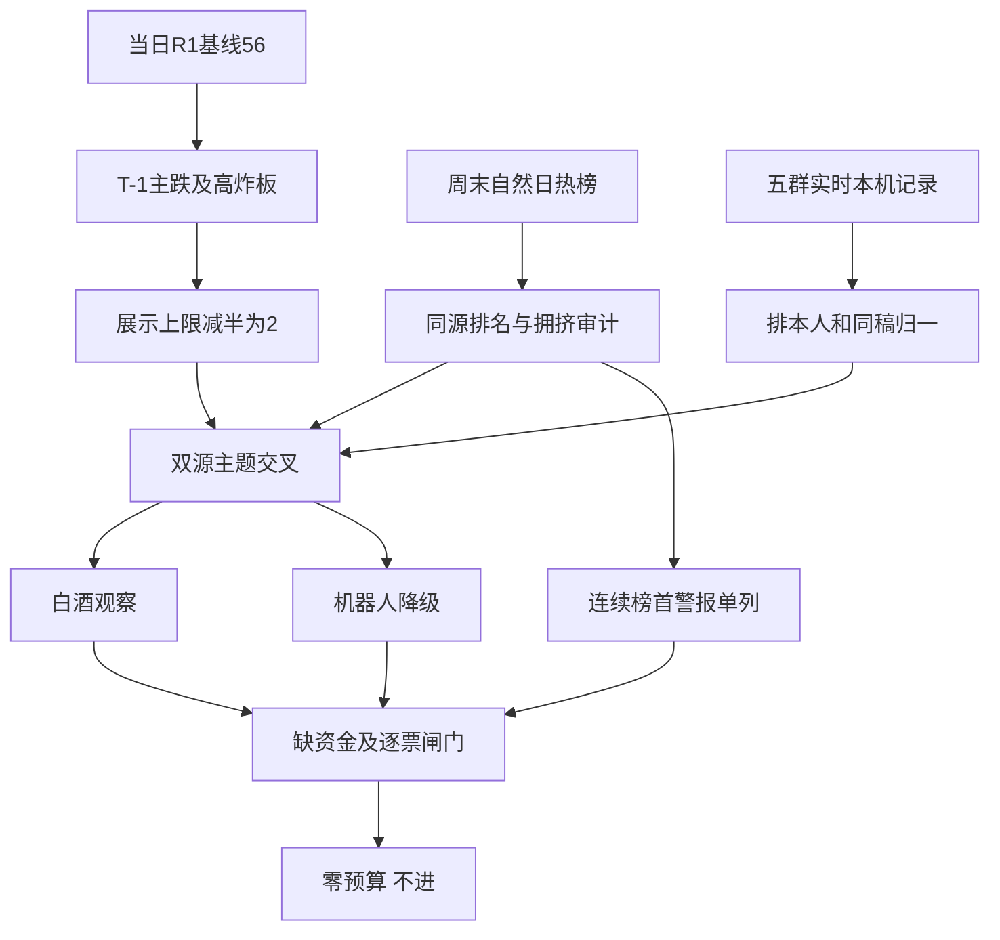

# 2026年11月2日 · 群聊情绪共振

> **数据源新鲜度**: partial　**降级状态**: true　**置信度**: 0.364

## 一句话结论
情绪=主跌；56分不等于可买，白酒观察、机器人降级，零交易预算不变。

## 🧭 详细分析

先认市场：读取的是**20261102当日R1**，并非昨日R1。其市场统计对应最近完整交易日2026-10-30：涨停47、跌停82、炸板31，炸板率`31/(47+31)=39.74%`，全市场中位跌幅`3.13%`，昨日涨停池平均收盘反馈`-0.68%`。原始周期预计算曾被状态机改为主升，当日R1已按跌停与亏钱效应重新判为补跌；R3沿用其**情绪=主跌**，不覆盖R1。56分是家数/高度规则分，不代表今日已修复。

再认双源：防御叙事与白酒局部正反馈相交，物理AI/机器人则是卖方观点密集而板块价格仍弱。**共振仅指主题传播与热榜共同出现，不表示资金确认。**不将银行、消费、券商焊接成固定攻守标签，不把同一篇推介跨群视为新增独立来源。今日可交易主线未获本阶段确认。

最后定边界：炸板率超过35%，将常规top5展示上限减半并向下取整为2，其他主题保留在覆盖/剔除表，不删掉风险和取证。**R3不推首票，研究与执行个股池均为空**；这不是因零预算而停止研究，而是本阶段没有完成逐票龙头、板型、盈亏比与禁止清单核定。所有热榜名字仅作观察样本，不授予开仓资格。R6仍是唯一硬否决来源。

本次为**迟交的实时生成，不是冻结回放**。实际生成时点见frontmatter，群聊查询截止见证据文件，包含11月2日开盘后信息；量化价格仍截至10月30日，周末榜截至11月1日。不能将开盘后宣传中的“一字涨停”追认为本阶段事前预测，也不能据启动迟交倒推来源污染。没有今日真实市场统计，今日修复未知。

| 判断层 | 结果 | 明确态度 |
|---|---|---|
| 当日R1规则分 | `56`，共振调整`0`，R3=`56` | 降级解释，不把未验证观点机械加减分 |
| 情绪阶段 | 主跌，T-1五阶段细分为补跌 | 不进 |
| 主线 | 未确认可交易主线 | 持续性=未知，封板率=未知，下一交易时段预期=分歧 |
| 交易授权 | 有效预算`0` | 不进；不撤单、不清池、不更改既有持仓规则 |
| 五维反向校验 | 缺完整杠杆/外资及分量标准化 | 不出总分，不填50或虚构分差 |

## 🔍 双源主题（次序为共振证据展示，非R2板块排序）

### 1. 白酒概念 · L1+L2 · 观察

白酒概念交易日热度`18→3`，周末自然日`3→4`；T-1行业涨幅`5.27%`和概念涨幅`1.17%`是不同指数口径，不混成一个收益。茅台东财人气周五/周六/周日为`9→1→5`，周日排名已回落。群1的消费防御会议摘要构成L2方向表达，但不能证明全体参会者真实仓位或白酒收入改善。银行/红利作为同一防御论点旁证，单独保留，不强行并成主线。

- **大资金意图**: 可能偏向流动性收缩中的消费配置与避险，但R3没有资金流证据证明主动增配；国家队为唯一增量只是纪要中的主张。
- **为什么走强**: T-1白酒局部收红与排名抬升成立，周末注意力延续；没有新增交易价格，不把周末排名变动解释成两天上涨。
- **逻辑够不够硬**: 有热榜和消费方向文本交叉，但核心L2是一份转述纪要；同一纪要还警告红利补跌。持续性与封板率未知，下一交易时段预期为分歧，研究态度观察，不授买权。

### 2. 人形机器人 · L1+L2 · 降级

人形机器人周末概念名次`4→3`，T-1却下跌`4.20%`，机器人概念下跌`3.86%`。群4两家不同署名券商正文分别讨论“大脑进化”和“仓储物流先落地”；另一份转述稿讨论模型、数据和量产。它们是可区分的观点来源，不是独立核实过的产业事实。爱仕达同作者两稿跨群跨日归为一个推介论点，不计新增合力；襄阳轴承连续榜首的信用剔除。

- **大资金意图**: 可能博弈物理AI场景入口与数据缺口，但本阶段只能确认观点集中，不能确认机构净买入或筹码锁定。
- **为什么走强**: 走强的是周末注意力及个别热股；概念整体仍跌，不能以埃斯顿局部排名上升替代全板块赚钱效应。
- **逻辑够不够硬**: 双源传播交叉成立，量产、发布、唯一供应商、未来订单等断言尚待R4/R5核实。持续性=未知、封板率=未知、下一交易时段预期=分歧，故降级，不作主升确认。

## 🧩 共振与交易资格分流图

## 🗣️ KOL方向与两日变化

周六群1有“硬科技还没跌透”“慎用杠杆”；周日增加“结构性熊市也会有反弹”与支持市场工具会议期待，**偏向从恐慌等待转为有条件盼修复，而非已转入主升**。群4机器人观点明显偏多，和群1谨慎并不矛盾：产业长期乐观不能等同隔日资金确定流入。群2/群3同作者广播高度重叠；群5存在创新药防御短观点，不能因为短于60字就丢弃。

周一新增政策反弹表达、半导体设备扩产稿、民爆重组映射及名字反弹短句，均保留证据。没有用部分周一消息数和完整周末比较“升温/降温”。群1今日本机记录为0也不证明远端安静；图片不可读的群日不能判沉默。

## 📎 关键证据

- 群1 · 2026-10-31：“硬科技还没跌透” · `群1:8`，负面方向原句，回复上下文保留于本机证据。
- 群1 · 2026-11-01：“资金向红利、消费等防御板块切换”且“警惕杠杆踩踏与红利补跌风险” · `群1:22`，同一纪要同时保留支持与反证。
- 群4 · 2026-11-01：“这一轮的本质……大脑的进化” · `群4:8/23`，同稿两次，另有周一再发，合计一个观点源。
- 群4 · 2026-11-01：“井松智能：物理AI场景龙头，FMR已产生收入” · `群4:10`，仅记录券商观点，不替它认定龙头或核实收入。
- 群5 · 2026-10-31：“牛市光模块，熊市药模块” · `群5:2`，直接短观点；回复“好”不增加独立来源。
- 同花顺在线复核：襄阳轴承10月29/30均第1；周日概念榜人形机器人第3、白酒第4；今日概念榜返回空。
- XTick在线独立口径：涨停49、跌停86、炸板31、最高5板，单独计算炸板率`38.75%`；不与Tushare拼分母，亦不使用字段zbl作为炸板率。

## 🚦 热榜信号与覆盖/剔除

襄阳轴承连续三个交易日同花顺热股第1，触发**霸榜出货警报**，不计正向共振；商业航天跨周末概念连续第一及东方海洋周末连续第一亦单列拥挤。警报是注意力集中代理，**没有证明真实卖方、持仓结构或出货行为**，不作为R6硬否决。东财新易盛高热同时T-1大跌14.19%，是“热度不等于赚钱”的反证。

| 覆盖主题 | 证据与缺口 | 态度 |
|---|---|---|
| 银行/高股息 | 周末高股息10→6，银行T-1+0.77%；群1有配置叙事但无实时资金确认 | 观察，防御旁证 |
| 创新药/CRO | 创新药周末均第2，有群5直接短观点；独立表达薄，top展示减半后不纳入 | 观察，未停止研究 |
| 商业航天 | 概念连续第一，T-1-4.0%，周一缝制设备稿跨群同文 | 拦截正向信用 |
| 半导体/存储/PCB/CPO | 设备扩产论点与外部风险、T-1下跌交织，不等于同一资金方向 | 降级 |
| 民爆/资产重组 | 高争周日热股第2，周一保利/凯龙映射重复；所谓一字来自群员表述 | 观察，交R4查原公告，不追认盘前命中 |
| 脑机/卫星导航/法律AI | 纪要、会议及RSS有表达，直接热榜配对不足 | 观察，单源不进top |
| 羊/阳/地名、日历与底部反转 | 名字与低位口号不能认定主线/龙头 | 拦截 |

热榜是全量证据透传，非候选清单；R3未授予任何首推/观察池顶部个股资格，因此逐票四段思维链不适用，不编造止损价或RR。R2/R5若转为研究候选，必须补板型、龙头认定、RR、禁止项；RR未评或低于2、止损距小于5%不得进execution。

## 📰 公众号观点

公众号仅作补充观点，**不计L1+L2共振等级与情绪分**。47篇RSS标题/摘要已读取并在JSON逐条存证；其中财联社月回顾标题把消费防御、AI和机器人并列，属于回顾性叙述，不能制造新确认。

宏观与情绪栏目保留：猫笔刀“今天下午传来重要消息”、安静拆主线“周复盘：明天，重要会议”、贩财局“周末爆仓小作文……”、证金事“远离A股震中”，以及证券时报/上海证券报关于支持资本市场工具、回购增持的标题。会议多家转载只表示同一事件传播，不是多个独立政策事实；标题不足以推断全文立场。脑科学专项、太空算力与重组标题交R4核催化，不强凑新主线。

## 数据源审计

| 源 | 日期 | 状态 | 记录数/覆盖与限制 |
|---|---|:--:|---|
| R1_style 当日 | 2026-11-02 | 🟡 | 1份；生成日期当日，量化观察日2026-10-30，status=degraded，未改写 |
| ths_hot/dc_hot完整取证 | 2026-11-02 | 🟡 | 同日证据文件，交易日双源完整榜重算；本会话仅定点与周末概念在线复核 |
| 今日ths_hot概念 | 2026-11-02 | 🟡 | 0条；不能当开盘后市场已修复 |
| attention_signals | 2026-11-02 | 🟡 | 当日路径绑定2026-10-30，不冒充T0；聚合持续性不当独立日数 |
| attention_weekend | 2026-11-02 | 🟢 | 25条跨日记录含周五；周六/日另看，非25只周末新增 |
| XTick情绪MCP | 2026-11-02 | 🟢 | 1份，观察日2026-10-30，涨跌停范围不同，分母独立 |
| moneyflow_ths/moneyflow_dc | 2026-11-02 | 🔴 | 本次未补齐；不宣称已获大资金方向确认 |
| 五群本机实时历史 | 2026-11-02 | 🟢 | 143条；全窗与逐日多重集合一致，5群尾页均空；远端同步仍未知 |
| 原定时群聊产物 | 2026-11-02 | 🟡 | 67条，起点11月1日，漏掉周六；不作全周末覆盖 |
| 公众号RSS | 2026-11-02 | 🟡 | 47篇，17订阅源、6源空；标题摘要，未全文复抓 |
| 群图片正文 | 2026-11-02 | 🔴 | 34条图片接口记录映射6路径均解码失败；路径映射不可信，不用图猜观点 |
| WeFlow | 2026-11-02 | 🔴 | 永久下线，本会话未调用，不消费旧快照 |

| 匿名群 | 周六 | 周日 | 周一至截止 | 全窗 | 分页与逐日核对 |
|---|---:|---:|---:|---:|---|
| 群1 | 15 | 28 | 0 | 43 | 尾页空/多重集合一致 |
| 群2 | 1 | 10 | 14 | 25 | 尾页空/多重集合一致 |
| 群3 | 2 | 3 | 21 | 26 | 尾页空/多重集合一致 |
| 群4 | 2 | 23 | 1 | 26 | 尾页空/多重集合一致 |
| 群5 | 8 | 5 | 10 | 23 | 尾页空/多重集合一致 |

查询完整边界、各群首末观测与真实抓取时间保存在JSON；消息最后出现时间不是查询截止。证据句柄为匿名群+数组索引，并非微信原生ID。

## ⚠️ 不确定性 / 反证

主源图片不可读、当前市场量化缺失、R1降级及资金五维不齐，因此**status=partial**，不是完整通过数据验收。白酒也可能仅是单日防御，机器人也可能高热继续下跌；两者的可验证路径都是随后实际广度、板块封板率和接力反馈，而不是更多转载。若恢复同日量化，先核交易日、同源分母和观察截止，再讨论是否修复；不把一次修复外推持续主升。

群聊状态从悲观转向政策期待只是参与者表达，会议未落实的效果不能提前确认。卖方观点里的模型型号、量产节点、唯一供应、营收与数采报价未经独立核验；不能以多个转发者替代多个事实源。部分热榜代码与名称疑有不一致，保留原始标识，未自动修复，更不把这些标识升级为推荐。

## 🔗 与其他 R/D/E 的关系

- 依赖：当日R1_style、attention_signals、attention_weekend、R3当日完整热榜证据；raw manifest/health、RSS为只读补充。
- 消费：R2作主题证据、R4核事件、R5核真实候选、R6审反证、D1/E1消费。R3不替代R2排名、R5画像或R6硬否决。
- 授权：不改变有效零交易预算、不交易决定、现有持仓管理与保护，不强杀、不撤单、不清池。

## Sub-Agent 元数据

- skill: analyze_sentiment_resonance_v1
- method: llm_v1（本会话语义分析；普通程序仅取证、去重、算数与验证）
- artifact: data/research/20261102/R3_sentiment.json
- evidence: data/research/20261102/R3_delivery_evidence.json
- model: gpt-6.1-sol
- 生成耗时: 594秒（从本次首个取证命令起）
- 时效：迟交实时研究，非冻结回放；真实生成时间见frontmatter，不冒充08:30已交付。
- 资源：usage未完整计量，不当0，不保证低于连续任务努力目标。
