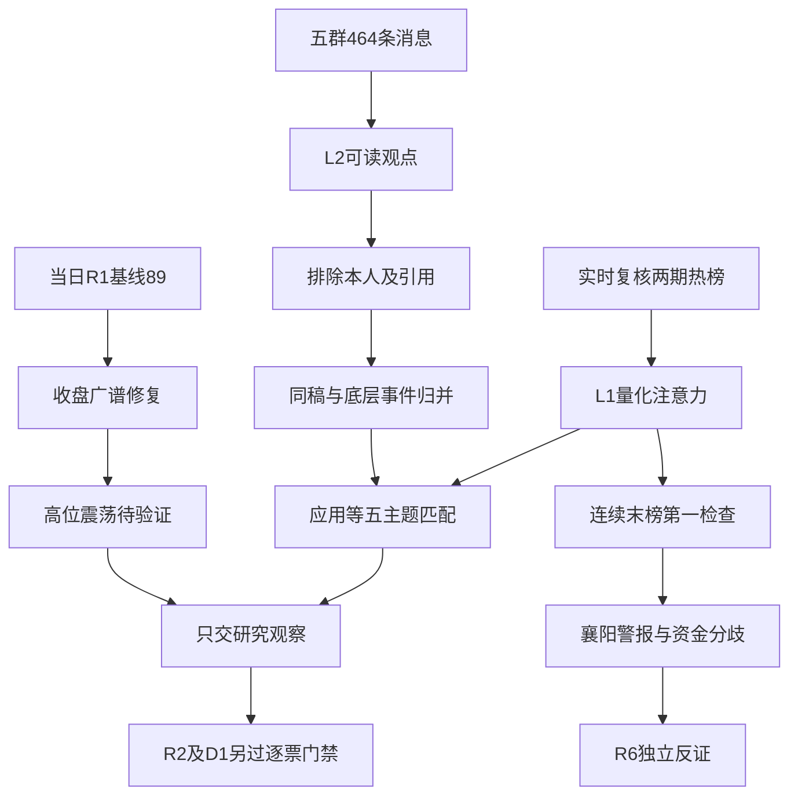

# 2026年11月3日 · 群聊情绪共振

> ⚠️ **数据源时间错位**：文件使用日为2026-11-03，国内行情及热榜观察日为2026-11-02，排名比较日为2026-10-30。读取当日 R1，未使用昨日 R1。当前为真实盘前取证，不是冻结回放。
> **数据源新鲜度**：partial · **降级状态**：true · **置信度**：0.364。生成时间见 frontmatter；群聊取证截止06:27。

## 一句话结论

**观察：89分是修复热度，不是主升确认；应用内容领衔双源叙事，连续霸榜警报1项。**

## 📊 详细分析：先认市场，再认叙事

市场在为什么付钱？当日 R1 观察到上涨4681家、下跌818家，中位涨幅2.02%，非ST涨停125家、跌停8家；炸板率是同口径 `28/(125+28)=18.30%`。这是广谱修复，不是“群里安静所以市场冰点”。前一交易日的主跌判断不无限继承。

现在在哪一段？**情绪=震荡，阶段=高位震荡中的修复延续待验证**。昨日涨停样本开盘至收盘平均仅+0.13%，说明开盘后接力兑现仍弱。XTick另口径131涨停、10跌停、31未封，重算19.14%；其原字段8.16定义未核，不能与非ST主源拼接。当前炸板率未达35%，不触发本日候选减半；若同口径后续达到35%，须改标震荡/主跌并由下游减半。

谁有地位？本阶段只确认热榜辨识度和语义主题，不代替 R2 认定龙头。AI视频、AI应用、短剧合并成一个母主题，避免把同一轮应用修复写成三条独立主线。`attention_signals` 的持续在榜、跳升和跨平台信息已读，但持续在榜天数不等于连续第一，多平台也不等于大资金买入。

今天做什么、不做什么？**进**：将真实主题证据交 R2/R4/R5；**观察**：修复延续和核心地位；**降级**：航天个股兑现与资金口径冲突；**不进**：仅凭热度进入执行池；**拦截**：把额度、转发、亲属关系或未经核验的模型能力当成已落地收入。所有映射股票仅研究观察，逐票门禁和真实账户限制不变。

情绪分采用 `89 + 0 = 89`。R1虽标degraded，但当日基准、观测时点及有效窗均已核验；本次未为重叠概念、同稿传播和已计入的修复重复加分。五维交叉分为缺失，差值未知，不用默认50或缺项0补齐。置信度 `0.65×0.7×0.8=0.364` 是资料完整度与交叉把握，不是交易胜率，也不是仓位预算。

## 🧭 双源证据路径

## 🔎 双源主题：证据优先级，不是板块投资排序

| 主题 | L1观察 | L2性质 | 态度 |
|---|---|---|---|
| AI应用（含视频/短剧） | 视频#1 +8.77%；应用#2 +5.46%；短剧#4 +8.30% | 应用降本短句、内容/营销/Token事件；推广去重 | 观察 |
| 人形机器人 | #3，+2.06%；宇树两榜#5/#10 | 脑进化、政策预期、数采；不同署名团队 | 观察 |
| 互联网金融 | #11，+4.85%；东方财富东财24→2 | 金融IT与稳市工具解读 | 观察 |
| 白酒概念 | #9，+3.81%；热榜3→9 | 茅台拉升短句、消费点名 | 观察 |
| 商业航天 | #5，+2.38%；上海沪工-1.42% | 揽月与千帆两类转述 | 降级 |

### 1. AI应用 · L1+L2 · 观察

- **大资金意图**: 市场为内容应用修复付钱，非所有AI硬件。AI视频+8.77%、短剧+8.30%，但新华传媒-6.66%、慈文-2.60%，老强票热度与兑现分离。 这是交易行为的待验证解释，非机构真实持仓结论。
- **为什么走强**: 内容生成/互动影游/短剧及Token叙事语义相关，合并为一个母主题，三个概念不算三次独立共振。 量化来自已完成末榜，群聊来自独立的表达层，不能反过来证明作者已持仓。
- **逻辑够不够硬**: 应用端成本下降与内容分发想象解释热度；Pika亲属关联不是公司持股，借壳宣传含过期上线日期，低成本模型不自动等于上市公司利润。 **持续性=未知，板块封板率=未知，今日预期=修复分歧待验证**；R3不补造R2主线结论。
- 核心引文：匿名群2，2026-11-02：“GPU价格暴降，重视AI应用层：易点天下 蓝色光标 福石控股 合合信息 泛微网络” · `data/raw/20261103/wechat_cli_5groups.jsonl:79`。

### 2. 人形机器人 · L1+L2 · 观察

- **大资金意图**: 新一代大脑与物理AI数采预期吸引讨论；概念+2.06%仍弱于应用修复，大业股份-9.99%，不能把整条产业链当作普遍赚钱。 这是交易行为的待验证解释，非机构真实持仓结论。
- **为什么走强**: 数采、触觉、本体、物理AI通过训练和执行链映射人形机器人；长城/东吴为不同署名观点，单稿跨群去重。 量化来自已完成末榜，群聊来自独立的表达层，不能反过来证明作者已持仓。
- **逻辑够不够硬**: 两卖方团队提供不同论述但未核订单和政策正文；宇树两榜5/10只代表辨识度，非龙头硬认定。 **持续性=未知，板块封板率=未知，今日预期=修复分歧待验证**；R3不补造R2主线结论。
- 核心引文：匿名群2，2026-11-02：“这周智元机器人的一场线下交流把数采拆成了三层，爱仕达横跨EGO、UMI、真机数据，信息量比表面上大得多。

事件：据本周智元机器人线下交流信息，具身智能数采分为三层：EG” · `data/raw/20261103/wechat_cli_5groups.jsonl:58`。

### 3. 互联网金融 · L1+L2 · 观察

- **大资金意图**: 政策托底预期增强风险资产交易需求；东方财富东财24→2、银之杰20.02%，概念+4.85%，说明传统金融也能动态转攻。 这是交易行为的待验证解释，非机构真实持仓结论。
- **为什么走强**: 稳市工具的风险偏好与金融IT应用传导映射互联网金融；传闻会议纪要不作官方证据。 量化来自已完成末榜，群聊来自独立的表达层，不能反过来证明作者已持仓。
- **逻辑够不够硬**: 直接短句/金融IT推广存在，政策报道属补充；未核实际新增资金与手续费，不能把额度当成交。 **持续性=未知，板块封板率=未知，今日预期=修复分歧待验证**；R3不补造R2主线结论。
- 核心引文：匿名群5，2026-11-02：“御银股份002177 互联网金融 数字货币 辨识度” · `data/raw/20261103/wechat_cli_5groups.jsonl:332`。

### 4. 白酒概念 · L1+L2 · 观察

- **大资金意图**: 白酒+3.81%、茅台+3.38%、皇台+10.01%，但热榜3→9，量价修复与注意力相对回落并存。 这是交易行为的待验证解释，非机构真实持仓结论。
- **为什么走强**: 群内茅台拉升/白酒点名与白酒概念精确同类，消费和生肖标签不再拆成独立主题。 量化来自已完成末榜，群聊来自独立的表达层，不能反过来证明作者已持仓。
- **逻辑够不够硬**: 只有短句及推广，公众号同时提出非基本面改善的跷跷板反证；不能由反弹直接确认为持续主升。 **持续性=未知，板块封板率=未知，今日预期=修复分歧待验证**；R3不补造R2主线结论。
- 核心引文：匿名群1，2026-11-02：“毛台奋力拉升，初步扭转大盘下跌预期” · `data/raw/20261103/wechat_cli_5groups.jsonl:2`。

### 5. 商业航天 · L1+L2 · 降级

- **大资金意图**: 概念+2.38%但榜1→5，上海沪工-1.42%；题材仍传播，个股兑现不支持一概看多。 这是交易行为的待验证解释，非机构真实持仓结论。
- **为什么走强**: 载人登月、星座发射、卫星导航是上下位相关但不同底层事件；各自只计一条事件，不将导航协议当运载订单。 量化来自已完成末榜，群聊来自独立的表达层，不能反过来证明作者已持仓。
- **逻辑够不够硬**: 揽月与千帆均为转述，具体发射时点未认证；研究保留、不凭补涨故事赋予买权。 **持续性=未知，板块封板率=未知，今日预期=修复分歧待验证**；R3不补造R2主线结论。
- 核心引文：匿名群2，2026-11-02：“🔥🔥【揽月着陆器开启无人登月“大考”！商业航天+机器人缝制双轮驱动，关注上工申贝！】

☀️ 事件：11月1日，载人航天工程公布登月“彩排计划”，揽月着陆器将开展无人飞行” · `data/raw/20261103/wechat_cli_5groups.jsonl:59`。

## 🧩 逐群观点与传播审计

| 匿名来源 | 表达及反证 |
|---|---|
| 匿名群1 | 直接短句偏乐观（11月好做），同时有对托底受益分配的质疑；不是一致看多，也非真实游资持仓认证。 |
| 匿名群2 | 应用短剧、物理AI、消费/生肖叠加与流感/医疗展示推广；多为作者广播，重复文不能当独立共识。 |
| 匿名群3 | 与群2高度同稿；半导体设备看多文与政策托底乐观独立列示，不拿存储热榜冒充设备确认。 |
| 匿名群4 | 机器人脑进化与液冷业绩两篇可读卖方观点；多条传媒AI会议邀请只作传播，不能推断已召开或与会者赞同。 |
| 匿名群5 | 短剧/Token与金融IT、航天、流感和人工血小板等叙事；已排除本人一条，所有引用仅抽直接文本防自产研究循环。 |

不能把匿名群2/3/5的同步广播当三位KOL独立确认。Pika同稿及改稿合并一簇；中设IP借壳文即使换转发者仍是一稿；长城机器人票池更新仍属同一团队；流感依据相同底层周报；人工血小板多个传播者仍只是一次展示。群中“涨得多的是亏损股”“11月很好做”的短句被保留，但自报收益不作真实性认证。

可读非媒体候选266条，经空白/Unicode精确归一后176个正文；这包含短句、表情与推广，**不是176个独立观点**。正文语义审阅保留19个研究簇，簇数也不是新增独立资金来源。104条图片未读、5条正文不支持展示、本人1条已排除，系统撤回1条单列。引用回复只审直接发言部分，不将本人研究回流计入共识。

## 🕒 查询覆盖与缺口

统一查询窗口：2026-11-02 06:00 至 2026-11-03 06:27（中国时区）。每群满页阈值500，返回不足500后另查已取条数偏移尾页；两自然日复查多重集合一致。

| 匿名群 | 原始条数 | 11月2日 / 11月3日 | 观察首末日期及时间 | 尾页 / 分日核验 |
|---|---:|---|---|---|
| 匿名群1 | 56 | 56 / 0 | 2026-11-02 10:11 — 2026-11-02 22:13 | 0 / 一致 |
| 匿名群2 | 128 | 128 / 0 | 2026-11-02 08:34 — 2026-11-02 22:51 | 0 / 一致 |
| 匿名群3 | 105 | 105 / 0 | 2026-11-02 08:39 — 2026-11-02 22:51 | 0 / 一致 |
| 匿名群4 | 19 | 19 / 0 | 2026-11-02 08:50 — 2026-11-02 23:20 | 0 / 一致 |
| 匿名群5 | 156 | 156 / 0 | 2026-11-02 07:44 — 2026-11-02 23:49 | 0 / 一致 |

五群合计464条。11月3日查询0条仅代表本机记录未见新消息；远端同步时点未知，不判为沉默或降温。不同长度日窗不比较消息量涨跌。引用句柄为匿名群+数组索引，不是微信原生message_id，耐久证据已保存原文件行号和哈希。

## 🚨 distribution_alert_checks：逐对象范围与结果

规则：同一来源连续两个已完成交易日的末榜均为第一。窗口为2026-10-30末榜至2026-11-02末榜，不是周末自然日连续第一，也未核全天每一时点。`true`仅为热榜警报；`false`仅为此规则此窗口阴性；`null/unknown`是前期/本期对象未覆盖或未做该对象检查。不能从兼容alert数组缺席推阴性。

已检查选择范围为两股票榜本次top20并集31只、重点概念8个，另列2只KOL映射对象的未知状态：**41项 = 1警报 + 20阴性 + 20未知**。未读取尚不存在的R2最终名单，没有为模式6新增全市场扫描。机器JSON含每项精确 `observed_at`、起止窗口、来源及证据指针。

| 对象 / 代码 | 来源 | 前期→本期排名 | 结果 | 原因范围 |
|---|---|---|---|---|
| 沈阳机床 `000410.SZ` | THS热股 / 东财人气 | ths 缺→缺；dc 46→14 | 🟡 null / unknown | 有一源/前期缺对象；不作阴性 |
| 冰山冷热 `000530.SZ` | THS热股 / 东财人气 | ths 14→8；dc 34→7 | 🟢 false / checked | 已查两源两期/精确概念未命中 |
| 襄阳轴承 `000678.SZ` | THS热股 / 东财人气 | ths 1→1；dc 2→1 | 🟠 true / checked | 连续末榜第一，需资金反证 |
| 皇台酒业 `000995.SZ` | THS热股 / 东财人气 | ths 25→22；dc 14→17 | 🟢 false / checked | 已查两源两期/精确概念未命中 |
| 青岛食品 `001219.SZ` | THS热股 / 东财人气 | ths 40→9；dc 20→15 | 🟢 false / checked | 已查两源两期/精确概念未命中 |
| 东方海洋 `002086.SZ` | THS热股 / 东财人气 | ths 8→6；dc 5→4 | 🟢 false / checked | 已查两源两期/精确概念未命中 |
| 澳洋健康 `002172.SZ` | THS热股 / 东财人气 | ths 11→2；dc 6→6 | 🟢 false / checked | 已查两源两期/精确概念未命中 |
| 粤 传 媒 `002181.SZ` | THS热股 / 东财人气 | ths 缺→缺；dc 缺→20 | 🟡 null / unknown | 有一源/前期缺对象；不作阴性 |
| 九阳股份 `002242.SZ` | THS热股 / 东财人气 | ths 9→7；dc 42→43 | 🟢 false / checked | 已查两源两期/精确概念未命中 |
| 东山精密 `002384.SZ` | THS热股 / 东财人气 | ths 21→3；dc 15→5 | 🟢 false / checked | 已查两源两期/精确概念未命中 |
| 巨人网络 `002558.SZ` | THS热股 / 东财人气 | ths 缺→缺；dc 缺→16 | 🟡 null / unknown | 有一源/前期缺对象；不作阴性 |
| 金安国纪 `002636.SZ` | THS热股 / 东财人气 | ths 2→11；dc 4→缺 | 🟡 null / unknown | 有一源/前期缺对象；不作阴性 |
| 海洋王 `002724.SZ` | THS热股 / 东财人气 | ths 5→10；dc 8→35 | 🟢 false / checked | 已查两源两期/精确概念未命中 |
| 东方财富 `300059.SZ` | THS热股 / 东财人气 | ths 缺→19；dc 24→2 | 🟡 null / unknown | 有一源/前期缺对象；不作阴性 |
| 银之杰 `300085.SZ` | THS热股 / 东财人气 | ths 缺→15；dc 缺→12 | 🟡 null / unknown | 有一源/前期缺对象；不作阴性 |
| 捷成股份 `300182.SZ` | THS热股 / 东财人气 | ths 缺→缺；dc 缺→11 | 🟡 null / unknown | 有一源/前期缺对象；不作阴性 |
| 中际旭创 `300308.SZ` | THS热股 / 东财人气 | ths 6→18；dc 7→30 | 🟢 false / checked | 已查两源两期/精确概念未命中 |
| 芒果超媒 `300413.SZ` | THS热股 / 东财人气 | ths 缺→缺；dc 缺→3 | 🟡 null / unknown | 有一源/前期缺对象；不作阴性 |
| 阳光照明 `600261.SH` | THS热股 / 东财人气 | ths 22→21；dc 13→9 | 🟢 false / checked | 已查两源两期/精确概念未命中 |
| 贵州茅台 `600519.SH` | THS热股 / 东财人气 | ths 64→24；dc 9→18 | 🟢 false / checked | 已查两源两期/精确概念未命中 |
| 文投控股 `600715.SH` | THS热股 / 东财人气 | ths 58→缺；dc 98→8 | 🟡 null / unknown | 有一源/前期缺对象；不作阴性 |
| 新华传媒 `600825.SH` | THS热股 / 东财人气 | ths 12→4；dc 30→29 | 🟢 false / checked | 已查两源两期/精确概念未命中 |
| 上海九百 `600838.SH` | THS热股 / 东财人气 | ths 18→14；dc 62→缺 | 🟡 null / unknown | 有一源/前期缺对象；不作阴性 |
| 国芳集团 `601086.SH` | THS热股 / 东财人气 | ths 31→13；dc 92→28 | 🟢 false / checked | 已查两源两期/精确概念未命中 |
| 太平洋 `601099.SH` | THS热股 / 东财人气 | ths 缺→37；dc 缺→13 | 🟡 null / unknown | 有一源/前期缺对象；不作阴性 |
| 上海沪工 `603131.SH` | THS热股 / 东财人气 | ths 42→17；dc 10→31 | 🟢 false / checked | 已查两源两期/精确概念未命中 |
| 大业股份 `603278.SH` | THS热股 / 东财人气 | ths 3→16；dc 3→38 | 🟢 false / checked | 已查两源两期/精确概念未命中 |
| 掌阅科技 `603533.SH` | THS热股 / 东财人气 | ths 缺→缺；dc 缺→19 | 🟡 null / unknown | 有一源/前期缺对象；不作阴性 |
| 盛洋科技 `603703.SH` | THS热股 / 东财人气 | ths 44→12；dc 19→缺 | 🟡 null / unknown | 有一源/前期缺对象；不作阴性 |
| 一鸣食品 `605179.SH` | THS热股 / 东财人气 | ths 67→20；dc 缺→缺 | 🟡 null / unknown | 有一源/前期缺对象；不作阴性 |
| 宇树科技 `688836.SH` | THS热股 / 东财人气 | ths 7→5；dc 17→10 | 🟢 false / checked | 已查两源两期/精确概念未命中 |
| AI视频 `886068.TI` | THS概念 | 缺→1 | 🟡 null / unknown | 有一源/前期缺对象；不作阴性 |
| AI应用 `886108.TI` | THS概念 | 14→2 | 🟢 false / checked | 已查两源两期/精确概念未命中 |
| 短剧游戏 `886060.TI` | THS概念 | 缺→4 | 🟡 null / unknown | 有一源/前期缺对象；不作阴性 |
| 人形机器人 `886069.TI` | THS概念 | 4→3 | 🟢 false / checked | 已查两源两期/精确概念未命中 |
| 互联网金融 `885456.TI` | THS概念 | 缺→11 | 🟡 null / unknown | 有一源/前期缺对象；不作阴性 |
| 白酒概念 `885525.TI` | THS概念 | 3→9 | 🟢 false / checked | 已查两源两期/精确概念未命中 |
| 商业航天 `886078.TI` | THS概念 | 1→5 | 🟢 false / checked | 已查两源两期/精确概念未命中 |
| 冰雪产业 `885825.TI` | THS概念 | 缺→18 | 🟡 null / unknown | 有一源/前期缺对象；不作阴性 |
| 信雅达 `600571.SH` | 仅群聊映射 | 未覆盖 | 🟡 null / unknown | 有一源/前期缺对象；不作阴性 |
| 金陵药业 `000919.SZ` | 仅群聊映射 | 未覆盖 | 🟡 null / unknown | 有一源/前期缺对象；不作阴性 |

**观察窗口和来源归属**：股票行分别查THS热股、东财人气两源，观察末榜为2026-11-02；概念行只覆盖THS概念，不可向个股机械下传阴性。原始排名保存在 `R3_evidence.json#/lists`，准确秒级时点保存在JSON而不在正文堆叠。超范围对象保持unknown，后续由R3原权限定点补证，禁MCP的R6不承担抓取。

### 襄阳轴承警报：保留冲突，不越权否决

`000678.SZ` 的THS末榜1→1，东财2→1，因此仅THS触发。2026-10-27至2026-11-02五个交易日，THS `net_amount`求和 `-41,227.03`万元，供应商最新 `net_d5_amount`却是 `-6,106.89`万元；二者不能互换。东财五日主力净额 `13,742.52`万元为正，最新一天 `33,360.99`万元也为正。XTick大单加超大单买卖额差 `157,994,010`元，属于另一定义的正向确认。

因此：**警报保留，出货未证实，近5日统一口径主力净流出未确认**。R3不授予硬否决，也不替R6解除任何独立硬否决；既有“警报+近5日主力净流出”的逐票条件必须由R6核准字段定义与同一窗口后消费。资金口径缺失只限制该对象，不全局禁买，不将单日流入等同五日风险解除。

## 🧪 个股级底座与研究观察边界

以下为主题语义映射，不是R2候选排序，更不是首推/执行池。每票均写四项：**板型=未核；龙头认定=未核、纪律通过条数未知；RR=未知；禁止清单命中=未知、空命中列表不等于通过**。`in_today_plan=null`，不能在D1首次计划之前写false预先排除。

### 芒果超媒 `300413.SZ` · 观察，不进执行

- **买入理由**: 本阶段不给买入理由或许可。研究保留的两点依据是：①匹配AI应用的可读观点；②真实热榜中具有辨识度，证据见该主题。产业与热度均不是资金已兑现。
- **风险点**: ①未通过龙头、板型、禁止清单及盈亏比核验；②T+1下修复次日可能分化，今日核心/主线补涨/计划内试错类型均未由R2/D1确认。
- **止损条件**: 未授权建仓，不伪造价位止损；研究假设如在次日热榜与板块合力中失配即降级。若后续进入执行，须由R5/D1给出可执行止损、止损距离至少5%、RR至少2并独立过所有门禁。
- **可验证假设**: 24—72小时内复核同源榜单是否仍在top20及概念是否持续获量价确认；未满足时撤销“持续人气”的研究假设，不由R3机械下单或减仓。

### 宇树科技 `688836.SH` · 观察，不进执行

- **买入理由**: 本阶段不给买入理由或许可。研究保留的两点依据是：①匹配人形机器人的可读观点；②真实热榜中具有辨识度，证据见该主题。产业与热度均不是资金已兑现。
- **风险点**: ①未通过龙头、板型、禁止清单及盈亏比核验；②T+1下修复次日可能分化，今日核心/主线补涨/计划内试错类型均未由R2/D1确认。
- **止损条件**: 未授权建仓，不伪造价位止损；研究假设如在次日热榜与板块合力中失配即降级。若后续进入执行，须由R5/D1给出可执行止损、止损距离至少5%、RR至少2并独立过所有门禁。
- **可验证假设**: 24—72小时内复核同源榜单是否仍在top20及概念是否持续获量价确认；未满足时撤销“持续人气”的研究假设，不由R3机械下单或减仓。

### 东方财富 `300059.SZ` · 观察，不进执行

- **买入理由**: 本阶段不给买入理由或许可。研究保留的两点依据是：①匹配互联网金融的可读观点；②真实热榜中具有辨识度，证据见该主题。产业与热度均不是资金已兑现。
- **风险点**: ①未通过龙头、板型、禁止清单及盈亏比核验；②T+1下修复次日可能分化，今日核心/主线补涨/计划内试错类型均未由R2/D1确认。
- **止损条件**: 未授权建仓，不伪造价位止损；研究假设如在次日热榜与板块合力中失配即降级。若后续进入执行，须由R5/D1给出可执行止损、止损距离至少5%、RR至少2并独立过所有门禁。
- **可验证假设**: 24—72小时内复核同源榜单是否仍在top20及概念是否持续获量价确认；未满足时撤销“持续人气”的研究假设，不由R3机械下单或减仓。

### 皇台酒业 `000995.SZ` · 观察，不进执行

- **买入理由**: 本阶段不给买入理由或许可。研究保留的两点依据是：①匹配白酒概念的可读观点；②真实热榜中具有辨识度，证据见该主题。产业与热度均不是资金已兑现。
- **风险点**: ①未通过龙头、板型、禁止清单及盈亏比核验；②T+1下修复次日可能分化，今日核心/主线补涨/计划内试错类型均未由R2/D1确认。
- **止损条件**: 未授权建仓，不伪造价位止损；研究假设如在次日热榜与板块合力中失配即降级。若后续进入执行，须由R5/D1给出可执行止损、止损距离至少5%、RR至少2并独立过所有门禁。
- **可验证假设**: 24—72小时内复核同源榜单是否仍在top20及概念是否持续获量价确认；未满足时撤销“持续人气”的研究假设，不由R3机械下单或减仓。

### 上海沪工 `603131.SH` · 观察，不进执行

- **买入理由**: 本阶段不给买入理由或许可。研究保留的两点依据是：①匹配商业航天的可读观点；②真实热榜中具有辨识度，证据见该主题。产业与热度均不是资金已兑现。
- **风险点**: ①未通过龙头、板型、禁止清单及盈亏比核验；②T+1下修复次日可能分化，今日核心/主线补涨/计划内试错类型均未由R2/D1确认。
- **止损条件**: 未授权建仓，不伪造价位止损；研究假设如在次日热榜与板块合力中失配即降级。若后续进入执行，须由R5/D1给出可执行止损、止损距离至少5%、RR至少2并独立过所有门禁。
- **可验证假设**: 24—72小时内复核同源榜单是否仍在top20及概念是否持续获量价确认；未满足时撤销“持续人气”的研究假设，不由R3机械下单或减仓。

## 📰 公众号观点：独立于量化分数

本日RSS共88篇、15个实际有文账号；17个订阅源中2个无新记录是覆盖缺口，不编造文章。正文抽阅12篇重点资料，公众号不计L1+L2或情绪加分。

### 与主题对应

- 股痴流沙河《回升》：偏向互动影游，明确还需再一根阳线确认；“暂停IPO”只作传闻。
- 财闻私享：短剧修复与机器人、Token叙事同步，但它是汇总传播，不能把转述的发射预期或模型宣传自动认证。
- 证券时报的Token报道实际是个人会员销售及Token额度折算，不能把“2万亿”直接当算力收入。两家媒体同报同次直播不是两个独立事件。

### 宏观与情绪

| 作者或报道 | 支持与反证 |
|---|---|
| 猫笔刀《400多亿援军》 | 托底有用但不保证立刻见底；400—500亿为作者估算，不是可用资金实测；白酒反弹未被解释为基本面改善 |
| 安静拆主线《企稳了吗？》 | 更偏轮动/震荡，不追求单日确定性 |
| 盘口逻辑拆解《暂时缓解》 | 反弹开盘赌大小难，需盘中承接信号；与上一账号同执业作者，只算一个来源 |
| ymj0418《久违的反弹》 | 只看两三日修复，承认外盘制约；金融是新的研究试错方向，不是账户授权 |
| 互换便利/再贷款/主动ETF报道 | 申报、募资、政策安排与已成交买入分层，不能等同资金全部到账 |
| 光通信并购与存储复盘 | 报道有股价下跌和业绩股价背离，反证产业利好不等于短期涨幅 |

上述文章的真实来源、发布时间、正文摘要与行号见JSON `official_account_opinions`。夜间“全线上涨”标题是其发表时截面，不取代R1最新隔夜报价。

## 🧯 非top5覆盖、剔除与真实反证

- **观察：冰雪产业**确有概念榜与冰山冷热人气配合，作为第六条旁证保留；实丰/祥源跨群同稿不增加独立确认。本次top5是有限优先级，不是强制抹去其证据。
- **观察：流感**有周报转述及短对话，不能拿“创新药”概念榜替代，也不从群里“不拥挤”推断筹码真实松紧。
- **观察：半导体设备**有设备扩产看多文，但不拿存储芯片榜充设备确认。
- **降级：人工血小板**只有单底层科技展示反复传播，不能证明金陵药业取得该技术。
- **降级：AI眼镜/液冷**可读卖方观点与新品/补贴传播已审阅，但精确L1主题在本次概念榜覆盖之外，不强造双源主线。
- **不进：无来源硬事实**。群聊里未认证的模型名称、公开测试、药品批文、唯一供应商、发射日期、IP借壳和“羊/阳”延伸，只作为观点，不作新订单或龙头证明。

## 🔑 关键证据

- 当日R1：89分、非ST炸板18.30%、涨停池开盘到收盘仅+0.13%，阶段仍为高位震荡。
- 实时MCP热榜：AI应用14→2；东山精密THS21→3；东方财富东财24→2。排名上升和实际股价上涨分列，不把人气上涨直接当净买入。
- 匿名群5，2026-11-02：“GPU租金大降价，利好AI应用”；这是观点原句，不是GPU租价实测。
- 匿名群1，2026-11-02：“11月很好做的，不要担心”；同群同时有托底分配质疑，不能写成全群共识。
- 襄阳轴承两期THS第一；资金跨定义冲突如上，不机械hard_reject。

## 数据源审计

| 源 | 日期 | 状态 | 记录数与窗口 |
|---|---|:--:|---|
| R1_current_day | 2026-11-03 | 🟢 | 1 · 当日盘前基线；原status=degraded，量化观测20261102并在有效窗内；不是昨日R1 |
| tushare_hotlists_live | 2026-11-03 | 🟢 | 440 · 两期热股100+人气100+概念20；11月3日两榜为空，非伪装即时人气；API共440条，耐久摘录保留本期两股票榜top50、前期top100及概念两期，合计340条。排名差计算只声明已保留范围。 |
| attention_signals | 2026-11-03 | 🟢 | 320 · T-1已收盘基准含飙升榜100；persistent非连续top1证据；非独立主源；upstream拉取320条，today数组实际保留150条。 |
| wechat_cli | 2026-11-03 | 🟢 | 464 · 5群尾页空/分日多重集一致，远端同步未知；图片未读 |
| wechat_official_rss | 2026-11-03 | 🟢 | 88 · 88篇；主观点全文抽阅，宏观单列，不计共振或分数 |
| xtick_emotion | 2026-11-03 | 🟢 | 1 · 含ST等范围未与非ST对齐，131/10/31，不混算 |
| tushare_banner_moneyflow | 2026-11-03 | 🟢 | 10 · 仅000678五个交易日两资金口径 |
| xtick_banner_money | 2026-11-03 | 🟢 | 1 · 带后缀空，6位code重查有效；正向确认不排除 |
| weflow_retired | 未取得 | 🔴 | 0 · 永久下线，旧快照未读取 |
| five_dimension_crosscheck | 未取得 | 🔴 | None · 杠杆外资及各维尺度定义未齐；不填0、不算伪分 |
| image_bodies | 2026-11-03 | 🔴 | 104 · 本轮未解析图片，不用图片缺失推断沉默 |

🟡 局部降级：群聊媒体正文、5条不可展示内容、五维完整量化及资金定义冲突。WeFlow永久退役，本会话未调用，兼容字段全部为空；上游manifest残留旧探测错误不恢复旧执行路径。11月3日两榜返回空符合盘前未发布，不冒充当日榜也不当作板块降温。

## 不确定性 / 反证

强修复与持续主升不是同一命题：前者已有广度和涨停支持，后者仍缺今日接力兑现。热度只能说明注意力，104条图片未读限制语义覆盖，远端同步未知限制“没有讨论”的断言；五维分缺失不影响已有真实证据，但不能宣称完整交叉验收。

R1研究有效窗到今日09:30，竞价后应由P1/D1重评；若广度不足50%、昨日涨停反馈转负、非ST炸板达到35%或亏钱尾部再次扩散，修复判断失效并重评；若广度保持65%以上、接力兑现转强、炸板低于20%且主线资金确认，则可重新评估，不能把旧市场停买建议永久继承。研究不改任何账户预算；账户来源未取保持未知，既有有效0预算和停买必须遵守。

## 与其他 R/D/E 的关系

- 依赖：当日 `R1_style.json`、`attention_signals.json`、当日群聊和RSS；量化及群聊本轮实时复核。
- R2：据证据认主线与核心，不能把本主题优先级照抄为板块排序；R5独立核逐票画像与盈亏比。
- R4：核政策、模型、发射、批文与公司权益；同一微信群/同一新闻二次转述不增加信源。
- R6：只读本产物和耐久证据，按精确对象/来源/窗口消费警报与阴性；范围外仍未知。唯一硬否决权不受本阶段干预。
- D1：独立形成计划并过逐票门禁；有效硬预算、仓位上限、T+1、人工确认与既有hard_reject不变。E1消费研究假设与证据质量，不把本分数作收益保证。

## Sub-Agent 元数据

- skill: analyze_sentiment_resonance_v1@1.1
- artifact: data/research/20261103/R3_sentiment.json
- evidence: data/research/20261103/R3_evidence.json
- model: gpt-6.1-sol
- method: llm_v1；语义由本会话完成，确定性脚本仅采集、计算、渲染与校验。
- invocation: 单阶段唯一执行者；无Hermes重启、无委派、无其他模型会话。
- status: partial；结构校验通过不代表所有证据完整。
- usage: usage_unknown；不将未计量当0；08:30仅observe_only交付目标，不强杀或改变交易授权。

- 生成耗时: 538 秒（开始至JSON生成）。
