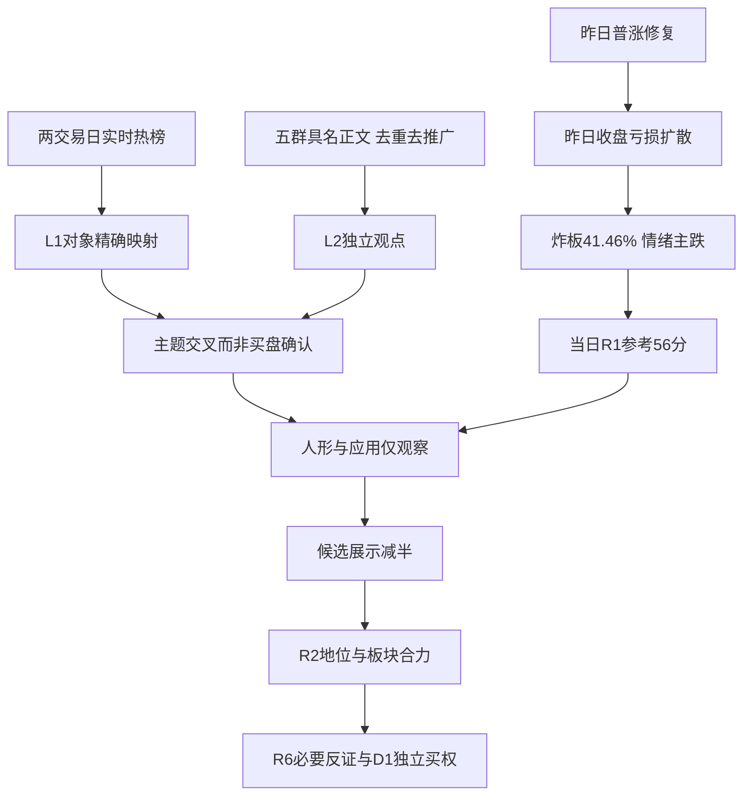

# 2026年11月4日 · 群聊情绪共振

> ⚠️ **数据源时间错位**：本文件是11月4日盘前研究，市场事实为11月3日收盘，群聊跨至11月4日凌晨；不是今日盘中信号，也不是历史回放。
> **数据源新鲜度**：partial　**降级状态**：true　**置信度**：0.364

## 一句话结论
**观察：情绪=主跌，沿用当日R1的56分；两条叙事共振不等于资金确认。**

## 🔎 详细分析

市场昨天奖励局部幸存者与消费、电池相对修复，惩罚AI硬件拥挤；并不是“所有热门股都有人接”。当日R1记录涨停48、跌停17、炸板34，炸板率41.46%，市场封板率58.54%；前日125家涨停、18.30%炸板后的修复没有延续。**情绪=主跌**是昨日温度，不是把今日全天停买写死。

本次只消费`data/research/20261104/R1_style.json`，基线56分且R1状态为degraded。R3不伪装完整量化验收，也不使用前一日R1替代。两条主题昨日都跌、排名退位，而且共享一个底层观点，因此共振调整为0；分数不是风险闸门，56分不能冲销亏损尾部。五维对照缺杠杆外资与标准化标尺，分数及差值留空，不补中性50。

五群实时查询得到372条，尾页均为0，十组群日核验与整窗多重集合一致。可读正文202条、链接标题38条，图片116条；文字长度不作方向筛选。精确去重后179个文本/标题簇、61次重复出现；它们仍混有推广和社交，不是179条独立观点。奋达J595稿六处出现、流感稿四处出现都不计多条支持。本人/疑似本人显示名内容保守排除，但无原生is_self位，不能声称身份认证完整。

L1+L2只是热榜与具名观点在同主题相遇，不保证方向正向。人形机器人与AI应用保留观察；固态电池保留附表而不为数量凑第三条进攻主题。正常展示上限5在高炸板环境下向下减半为2。中船系虽榜首走强，却没有本次可读独立群聊方向；数字人民币虽有夜间观点，却无精确L1对象。两者都不进入共振表。R2/D1仍按其真实候选逐票审查，不因本报告降级停止研究。

## 🧭 双源叙事共振（非板块进攻排序）

| 主题 | L1最终热度 | 昨日概念收益 | L2独立正文 | 态度 |
|---|---:|---:|---|---|
| 人形机器人 | 3→6 | -2.75% | K01早盘、K02夜间；不是推广六转六票 | 观察 |
| AI应用 | 2→7 | -1.34% | K01直接观点；与机器人共享底层叙事 | 观察 |

主线=未由R3认定，持续性=未知；市场封板率=58.54%，今日预期=分歧。这里不是某板块封板率，不能虚构1/3/5日持续性来填模板。真实可交易主线交R2、买权交D1。

### 人形机器人：观点续热，价格未确认
- **大资金意图**: K01、K02预期从AI硬件投入切向机器人大脑和真实场景；没有机构账户证据，不能改写为“资金已经切入”。
- **为什么走强**: 本次不能称价格走强；热度由第3降至第6、概念下跌2.75%。夜间“不是单一事件，而是一系列事件”只说明催化想象延续。
- **逻辑够不够硬**: 两位具名作者与一个可编码概念交叉，达到L1+L2；发布时间表和订单未核，公众号场景报道不增加量化共振等级。核心缺承接或跟随亏钱时不提高评价。

### AI应用：商业化叙事存在，整体回流尚未发生
- **大资金意图**: K01主张从资本开支转向付费、收入和利润；这是观点，不是R3独立核实的资金净流。
- **为什么走强**: 热榜第2降至第7、下跌1.34%；短剧第4及+0.12%仅是局部韧性，不能外推全部AI应用转强。
- **逻辑够不够硬**: 一位具名作者加一个量化榜是双层交叉，而非两位KOL或强资金共识。若今日短剧核心失去承接、应用概念继续走弱，商业化故事不提供短线确认。

## 🗣 KOL方向摘要与关键证据

| 匿名来源 | 日期 | 原文短引 / 解读 | 证据句柄 |
|---|---|---|---|
| 群01·K01 | 2026-11-03 | “从资本支出牛，切到商业化变现牛。”早盘结构判断，不当昨夜新增共识 | chats/0/messages/2 |
| 群01·K01 | 2026-11-03 | “现在硬科技属于多杀多”；融资出逃是其判断而非账户核验 | chats/0/messages/64 |
| 群02 | 2026-11-03 | 谐音与羊/洋/阳传播；不将文字相似升级为同一产业 | chats/1/messages/47 |
| 群03·K04 | 2026-11-03 | “APEC 很重要的一个环节 是 数字人民币”；群05同作者同句不增票 | chats/2/messages/63 |
| 群04·K02 | 2026-11-03 | “这不是单一事件，而是一系列事件。”连续发布仍是其预期 | chats/3/messages/3 |
| 群05·K03 | 2026-11-03 | “这个是实实在在的产业催化，不是题材。”固态扩产判断待核 | chats/4/messages/45 |

以上句柄均相对于`R3_live_evidence.json`，数组从0起；不是微信原生消息ID。群04传媒配图和业务邀约不作为独立方向观点。纯标题、宣传及自述收益只按原证据类型记录，不作为事实认证。

## 🟡 覆盖但不升级的主题

| 对象 | 现有证据 | 明确态度 / 不升级原因 |
|---|---|---|
| 固态电池 | L1第10、-0.46%；K03有直接正文 | 观察；保留附表，前日top20缺对象，不算精确排名跃升 |
| CPO | 热度12→2，但-5.02%，K01盘后偏空 | 降级；风险共振不是主动买盘 |
| 光伏设备 | 行业第14、+0.76%；群内太阳能同稿推广 | 观察；推广不作独立L2正向确认 |
| 中船系 | 概念第1、+3.44% | 观察；本次无对应独立群聊正文，不由“海洋”字样强映射 |
| 数字人民币 | 同作者跨两群一条夜间观点 | 观察；L2_only，概念精确映射未完成 |
| 羊/洋/阳与皇字 | 文字投机多群传播 | 降级；不是可编码产业主线，不能拼板块合力 |

本次无首推票、无执行票。榜单核查对象不等于研究候选，不填伪造的板型/龙头/RR/止损价。后续R2/R5若出票，必须独立提供四项必要字段并完成门禁；D1首次计划未形成，`in_today_plan`保持未知。

## 📡 人气底座：流量不等于收益

`attention_signals.json`内部使用日为11月4日、信号日为11月3日，是明确绑定的T-1基底，不冒充今日榜。即时重查同源两日榜单后，中际旭创东财人气30→2、股价却-12.69%；新易盛人气42→8、股价-9.46%。这是损失关注与辟谣围观的可能表现，不能由人气直接推出主力净买入。

持续人气字段的days_on_list没有验证为“不间断连续在榜”，且persistent.last_rank与today存在滞后混用风险。此处只消费实际分层含义，所有精确动量重新用本轮同源原始榜计算。两平台热榜均由Tushare提供，不充作两个独立provider。

## 🧾 distribution_alert_checks：范围、窗口与逐对象结果

判据为**同源相邻两交易日最终快照均第一**，不是两日盘中始终第一，也不是完整出货调查。窗口为2026-11-02及2026-11-03，精确rank_time与每条原始数组索引保存在JSON。仅既有热榜范围，不新增模式6全市场扫描。

第一名切换：同花顺热股由襄阳轴承换澳洋健康；东财人气由襄阳轴承换N皇冠；飙升由捷邦科技换融捷健康；概念由AI视频换中船系；行业由文化传媒换白酒。**这只能解释已核对象对应判据，不能从空alert列表替所有股票判false。**

逐源对象记录82条，去重对象72个；checked=56、其中false=56、true=0；null/unknown=26。

| 已查对象/代码 | 来源 | 观察窗口 | 两日名次 | 结果 | 证据/缺口 |
|---|---|---|---|---|---|
| 澳洋健康 002172.SZ | ths_stock | 2026-11-02 → 2026-11-03 | 2 → 1 | false / checked | 两日原始索引齐全 |
| 东方海洋 002086.SZ | ths_stock | 2026-11-02 → 2026-11-03 | 6 → 2 | false / checked | 两日原始索引齐全 |
| 海洋王 002724.SZ | ths_stock | 2026-11-02 → 2026-11-03 | 10 → 3 | false / checked | 两日原始索引齐全 |
| 襄阳轴承 000678.SZ | ths_stock | 2026-11-02 → 2026-11-03 | 1 → 4 | false / checked | 两日原始索引齐全 |
| 阳光照明 600261.SH | ths_stock | 2026-11-02 → 2026-11-03 | 21 → 5 | false / checked | 两日原始索引齐全 |
| 大业股份 603278.SH | ths_stock | 2026-11-02 → 2026-11-03 | 16 → 6 | false / checked | 两日原始索引齐全 |
| 中际旭创 300308.SZ | ths_stock | 2026-11-02 → 2026-11-03 | 18 → 7 | false / checked | 两日原始索引齐全 |
| 圣阳股份 002580.SZ | ths_stock | 2026-11-02 → 2026-11-03 | 61 → 8 | false / checked | 两日原始索引齐全 |
| 文投控股 600715.SH | ths_stock | 2026-11-02 → 2026-11-03 | None → 9 | null / unknown | 前日对象未覆盖 |
| 新华传媒 600825.SH | ths_stock | 2026-11-02 → 2026-11-03 | 4 → 10 | false / checked | 两日原始索引齐全 |
| 慈文传媒 002343.SZ | ths_stock | 2026-11-02 → 2026-11-03 | 35 → 11 | false / checked | 两日原始索引齐全 |
| 冰山冷热 000530.SZ | ths_stock | 2026-11-02 → 2026-11-03 | 8 → 12 | false / checked | 两日原始索引齐全 |
| 九阳股份 002242.SZ | ths_stock | 2026-11-02 → 2026-11-03 | 7 → 13 | false / checked | 两日原始索引齐全 |
| 七匹狼 002029.SZ | ths_stock | 2026-11-02 → 2026-11-03 | 40 → 14 | false / checked | 两日原始索引齐全 |
| 东山精密 002384.SZ | ths_stock | 2026-11-02 → 2026-11-03 | 3 → 15 | false / checked | 两日原始索引齐全 |
| 青岛食品 001219.SZ | ths_stock | 2026-11-02 → 2026-11-03 | 9 → 16 | false / checked | 两日原始索引齐全 |
| 皇冠新材 001381.SZ | ths_stock | 2026-11-02 → 2026-11-03 | None → 17 | null / unknown | 前日对象未覆盖 |
| 宁德时代 300750.SZ | ths_stock | 2026-11-02 → 2026-11-03 | 25 → 18 | false / checked | 两日原始索引齐全 |
| 芒果超媒 300413.SZ | ths_stock | 2026-11-02 → 2026-11-03 | None → 19 | null / unknown | 前日对象未覆盖 |
| 百洋股份 002696.SZ | ths_stock | 2026-11-02 → 2026-11-03 | 27 → 20 | false / checked | 两日原始索引齐全 |
| N皇冠 001381.SZ | dc_renqi | 2026-11-02 → 2026-11-03 | None → 1 | null / unknown | 前日对象未覆盖 |
| 中际旭创 300308.SZ | dc_renqi | 2026-11-02 → 2026-11-03 | 30 → 2 | false / checked | 两日原始索引齐全 |
| 圣阳股份 002580.SZ | dc_renqi | 2026-11-02 → 2026-11-03 | None → 3 | null / unknown | 前日对象未覆盖 |
| 东方海洋 002086.SZ | dc_renqi | 2026-11-02 → 2026-11-03 | 4 → 4 | false / checked | 两日原始索引齐全 |
| 文投控股 600715.SH | dc_renqi | 2026-11-02 → 2026-11-03 | 8 → 5 | false / checked | 两日原始索引齐全 |
| 阳光照明 600261.SH | dc_renqi | 2026-11-02 → 2026-11-03 | 9 → 6 | false / checked | 两日原始索引齐全 |
| 襄阳轴承 000678.SZ | dc_renqi | 2026-11-02 → 2026-11-03 | 1 → 7 | false / checked | 两日原始索引齐全 |
| 新易盛 300502.SZ | dc_renqi | 2026-11-02 → 2026-11-03 | 42 → 8 | false / checked | 两日原始索引齐全 |
| 澳洋健康 002172.SZ | dc_renqi | 2026-11-02 → 2026-11-03 | 6 → 9 | false / checked | 两日原始索引齐全 |
| 七 匹 狼 002029.SZ | dc_renqi | 2026-11-02 → 2026-11-03 | 40 → 10 | false / checked | 两日原始索引齐全 |
| 太阳能 000591.SZ | dc_renqi | 2026-11-02 → 2026-11-03 | None → 11 | null / unknown | 前日对象未覆盖 |
| 长鑫科技 688825.SH | dc_renqi | 2026-11-02 → 2026-11-03 | 74 → 12 | false / checked | 两日原始索引齐全 |
| 百洋股份 002696.SZ | dc_renqi | 2026-11-02 → 2026-11-03 | None → 13 | null / unknown | 前日对象未覆盖 |
| 大西洋 600558.SH | dc_renqi | 2026-11-02 → 2026-11-03 | None → 14 | null / unknown | 前日对象未覆盖 |
| 九牧王 601566.SH | dc_renqi | 2026-11-02 → 2026-11-03 | None → 15 | null / unknown | 前日对象未覆盖 |
| 大洋电机 002249.SZ | dc_renqi | 2026-11-02 → 2026-11-03 | None → 16 | null / unknown | 前日对象未覆盖 |
| 贵州茅台 600519.SH | dc_renqi | 2026-11-02 → 2026-11-03 | 18 → 17 | false / checked | 两日原始索引齐全 |
| 阳光乳业 001318.SZ | dc_renqi | 2026-11-02 → 2026-11-03 | None → 18 | null / unknown | 前日对象未覆盖 |
| 太阳电缆 002300.SZ | dc_renqi | 2026-11-02 → 2026-11-03 | None → 19 | null / unknown | 前日对象未覆盖 |
| 大晟文化 600892.SH | dc_renqi | 2026-11-02 → 2026-11-03 | 26 → 20 | false / checked | 两日原始索引齐全 |
| 融捷健康 300247.SZ | dc_surge | 2026-11-02 → 2026-11-03 | None → 1 | null / unknown | 前日对象未覆盖 |
| 中船系 885860.TI | ths_concept | 2026-11-02 → 2026-11-03 | None → 1 | null / unknown | 前日对象未覆盖 |
| 共封装光学(CPO) 886033.TI | ths_concept | 2026-11-02 → 2026-11-03 | 12 → 2 | false / checked | 两日原始索引齐全 |
| 猪肉 885573.TI | ths_concept | 2026-11-02 → 2026-11-03 | None → 3 | null / unknown | 前日对象未覆盖 |
| 短剧游戏 886060.TI | ths_concept | 2026-11-02 → 2026-11-03 | 4 → 4 | false / checked | 两日原始索引齐全 |
| 白酒概念 885525.TI | ths_concept | 2026-11-02 → 2026-11-03 | 9 → 5 | false / checked | 两日原始索引齐全 |
| 人形机器人 886069.TI | ths_concept | 2026-11-02 → 2026-11-03 | 3 → 6 | false / checked | 两日原始索引齐全 |
| AI应用 886108.TI | ths_concept | 2026-11-02 → 2026-11-03 | 2 → 7 | false / checked | 两日原始索引齐全 |
| 商业航天 886078.TI | ths_concept | 2026-11-02 → 2026-11-03 | 5 → 8 | false / checked | 两日原始索引齐全 |
| 创新药 886015.TI | ths_concept | 2026-11-02 → 2026-11-03 | 8 → 9 | false / checked | 两日原始索引齐全 |
| 固态电池 886032.TI | ths_concept | 2026-11-02 → 2026-11-03 | None → 10 | null / unknown | 前日对象未覆盖 |
| PCB概念 885959.TI | ths_concept | 2026-11-02 → 2026-11-03 | 10 → 11 | false / checked | 两日原始索引齐全 |
| 超级品牌 885761.TI | ths_concept | 2026-11-02 → 2026-11-03 | None → 12 | null / unknown | 前日对象未覆盖 |
| 机器人概念 885517.TI | ths_concept | 2026-11-02 → 2026-11-03 | 7 → 13 | false / checked | 两日原始索引齐全 |
| 冰雪产业 885825.TI | ths_concept | 2026-11-02 → 2026-11-03 | 18 → 14 | false / checked | 两日原始索引齐全 |
| 存储芯片 886042.TI | ths_concept | 2026-11-02 → 2026-11-03 | 16 → 15 | false / checked | 两日原始索引齐全 |
| AI视频 886068.TI | ths_concept | 2026-11-02 → 2026-11-03 | 1 → 16 | false / checked | 两日原始索引齐全 |
| 人工智能 885728.TI | ths_concept | 2026-11-02 → 2026-11-03 | 6 → 17 | false / checked | 两日原始索引齐全 |
| 同花顺漂亮100 885916.TI | ths_concept | 2026-11-02 → 2026-11-03 | None → 18 | null / unknown | 前日对象未覆盖 |
| 高股息精选 886072.TI | ths_concept | 2026-11-02 → 2026-11-03 | 15 → 19 | false / checked | 两日原始索引齐全 |
| 锂电池概念 885710.TI | ths_concept | 2026-11-02 → 2026-11-03 | None → 20 | null / unknown | 前日对象未覆盖 |
| 白酒 881273.TI | ths_industry | 2026-11-02 → 2026-11-03 | 5 → 1 | false / checked | 两日原始索引齐全 |
| 电池 881281.TI | ths_industry | 2026-11-02 → 2026-11-03 | 14 → 2 | false / checked | 两日原始索引齐全 |
| 半导体 881121.TI | ths_industry | 2026-11-02 → 2026-11-03 | 7 → 3 | false / checked | 两日原始索引齐全 |
| 证券 881157.TI | ths_industry | 2026-11-02 → 2026-11-03 | 2 → 4 | false / checked | 两日原始索引齐全 |
| 银行 881155.TI | ths_industry | 2026-11-02 → 2026-11-03 | 3 → 5 | false / checked | 两日原始索引齐全 |
| 保险 881156.TI | ths_industry | 2026-11-02 → 2026-11-03 | None → 6 | null / unknown | 前日对象未覆盖 |
| 文化传媒 881164.TI | ths_industry | 2026-11-02 → 2026-11-03 | 1 → 7 | false / checked | 两日原始索引齐全 |
| 零售 881158.TI | ths_industry | 2026-11-02 → 2026-11-03 | 8 → 8 | false / checked | 两日原始索引齐全 |
| 元件 881270.TI | ths_industry | 2026-11-02 → 2026-11-03 | 11 → 9 | false / checked | 两日原始索引齐全 |
| 影视院线 881274.TI | ths_industry | 2026-11-02 → 2026-11-03 | 4 → 10 | false / checked | 两日原始索引齐全 |
| 游戏 881275.TI | ths_industry | 2026-11-02 → 2026-11-03 | 6 → 11 | false / checked | 两日原始索引齐全 |
| 电网设备 881278.TI | ths_industry | 2026-11-02 → 2026-11-03 | 19 → 12 | false / checked | 两日原始索引齐全 |
| 电力 881145.TI | ths_industry | 2026-11-02 → 2026-11-03 | 10 → 13 | false / checked | 两日原始索引齐全 |
| 光伏设备 881279.TI | ths_industry | 2026-11-02 → 2026-11-03 | 18 → 14 | false / checked | 两日原始索引齐全 |
| 医疗服务 881175.TI | ths_industry | 2026-11-02 → 2026-11-03 | 15 → 15 | false / checked | 两日原始索引齐全 |
| 通信设备 881129.TI | ths_industry | 2026-11-02 → 2026-11-03 | None → 16 | null / unknown | 前日对象未覆盖 |
| 饮料制造 881133.TI | ths_industry | 2026-11-02 → 2026-11-03 | None → 17 | null / unknown | 前日对象未覆盖 |
| 中药 881141.TI | ths_industry | 2026-11-02 → 2026-11-03 | None → 18 | null / unknown | 前日对象未覆盖 |
| 机场航运 881151.TI | ths_industry | 2026-11-02 → 2026-11-03 | None → 19 | null / unknown | 前日对象未覆盖 |
| 房地产 881153.TI | ths_industry | 2026-11-02 → 2026-11-03 | None → 20 | null / unknown | 前日对象未覆盖 |
| 数字人民币 精确代码未知 | 群03/群05; ths_concept bounded top20 | 2026-11-02 → 2026-11-03 | ? → ? | null / unknown | 精确映射缺失 |

`false`只表示该来源该窗口未同时第一，不是已核机构派发阴性；`null/unknown`没有被降级成false。不同来源结果不能合并取最乐观值；候选名单形成后，R6只有精确对象与窗口匹配才可消费。未列对象一律未检查/未知。持续霸榜警报若出现，也要由R6独立结合近5日净流出等原条件，R3不授予硬否决。

## 📰 公众号观点（不参与分数与共振层级）

### 对应主题

机器人：上海证券报关于小米工厂整班作业、智元便利店24小时验证的正文，提供“进入场景”的叙事。后者同时强调从单店到规模化的标准化、业务系统接入、运维和异常恢复障碍。它们不是上市公司订单，也不是新的量化源。

AI应用/固态：财联社VIP稿同时讲漫剧和固态，含资讯产品推广；传播与市场观点分栏，不拿宣传篇数加分。

### 宏观与情绪

证券时报、上海证券报报道互换便利中标及计划尽快使用，可构成托底预期；同一政策按一个底层事件族处理。报道中的“成交天量”不是净买入，文中部分ETF净流入数字还对应前一交易日，不能冒充昨日实测。

猫笔刀写护盘与抛盘拉锯，并有中长期偏多自述；其把ETF成交额加总当买入金额的方法不采。盘口逻辑拆解写“锚定被次日证伪”，证金事强调信任与螺旋卖压，ymj0418反思最大回撤和左侧扛单。它们共同说明托底叙事与亏钱体感并存，不代表独立资金流的多源认证。

反证保留：野村目标价传言被否认，隔夜美股AI科技反弹报道出现，均可削弱“硬件一定继续跌”的单向故事；但媒体盘中报价、澄清和回购计划不能替代国内今日竞价/开盘承接。

## 数据源审计

| 源 | 日期 | 状态 | 记录数 / 覆盖与缺口 |
|---|---|:--:|---|
| 当日R1_style | 2026-11-04 | 🟡 | 基线56；状态degraded，市场事实为2026-11-03收盘 |
| Tushare ths_hot | 2026-11-02 / 2026-11-03 | 🟢 | 两日各热股100、概念20、行业20；同源最终快照 |
| Tushare dc_hot | 2026-11-02 / 2026-11-03 | 🟢 | 两日各人气100、飙升100；不混榜排序 |
| XTick market_emotion | 2026-11-03 | 🟢 | 涨停52、跌停17、未封35；复算40.23%，不与主源拼分母；zbl字段口径未知 |
| attention_signals | 2026-11-04 | 🟡 | T-1绑定底座；持续天数及旧last_rank不作连续霸榜证据 |
| wechat-cli五群 | 2026-11-03 / 2026-11-04 | 🟡 | 372条，已分页及分日核验；116图片未读、原生self身份位缺失 |
| wechat_official_rss | 2026-11-03 / 2026-11-04 | 🟢 | 88篇；本轮抓取17订阅全部可达、16有文章，一个空号属局部降级 |
| manifest / mcp_health | 2026-11-04 | 🟡 | 本轮源状态参考，查询成功不代表内容完整 |
| WeFlow | 2026-11-04 | 🔴 | 永久退场，未调用、未读旧快照；兼容字段为空 |
| hotlist_signals预计算 | 2026-11-04 | 🟡 | raw预计算不存在，本轮自行从live榜确定性计算 |
| hithink / 额外资金核查 | 2026-11-04 | 🟡 | 可选交叉未用；未声称已核资金出货或全市场扫描 |

### 匿名群覆盖

| 来源 | 2026-11-03条数 | 2026-11-04条数 | 首末消息日期 | 分页/分日 | 可读性 |
|---|---:|---:|---|---|---|
| 群01 | 68 | 1 | 2026-11-03 → 2026-11-04 | 尾页0、分日一致 | 图片10；标题3 |
| 群02 | 88 | 0 | 2026-11-03 → 2026-11-03 | 尾页0、分日一致 | 图片30；标题13 |
| 群03 | 68 | 0 | 2026-11-03 → 2026-11-03 | 尾页0、分日一致 | 图片23；标题10 |
| 群04 | 4 | 0 | 2026-11-03 → 2026-11-03 | 尾页0、分日一致 | 图片1；标题1 |
| 群05 | 142 | 1 | 2026-11-03 → 2026-11-04 | 尾页0、分日一致 | 图片52；标题11 |

查询窗口从2026-11-03起至本轮2026-11-04取证截止；精确上下界见JSON。最后一条消息时间不等于查询截止，凌晨两条均为图片不判“全群冷却”。群名按当前配置匿名，未擅改名单。只证明本机可访问分页，不证明远端同步无缺失。

## ⚠️ 不确定性 / 反证

市场主跌判据来自昨日，今日修复尚未发生也尚未被否决；不能因为旧市场建议就无限停买。数据质量缺口仅限制受影响证据，不产生全局禁买。当前56分虽有量化计算基础，却不含完整跌停惩罚；阶段与亏损尾部优先。

本轮配图未读、无法展示链接未展开，仍可能遗漏与现有观点相反的消息。两个主要主题共用K01，一条独立夜间机器人观点并不足以证明全市场共识。未审完整股票资金、龙虎榜或监管公告，不把false解释为无任何派发或财务风险。

09:25竞价或09:35首次开盘广度/核心反馈到达即由D1重新判断；封板、广度与核心跟随赚钱效应共同修复才可推翻主跌延续假设。本段是有时效的市场研究，不是买入权限。真实用户停买、有效零预算、仓位硬上限、T+1、人工确认、R6逐票hard_reject保持不变；预算未知不填正额，计划未知不填false。

## 🔗 与其他 R/D/E 的关系

- 依赖：当日R1、attention绑定底座、本轮五群及RSS、两日live热榜和XTick。
- R2：接收主题与覆盖缺口，自行确认主线与核心地位；本报告不排序交易板块。
- R4/R5：核催化、发布日程、订单和逐票必要风险，研究观察不赋予买权。
- R6：仅在精确对象/来源/窗口匹配后消费checks；唯一硬否决来源不受本报告过滤。
- D1/E1：分别负责独立买权与事后检验，降级与未知字段不可转为通过。

## Sub-Agent 元数据

- skill: analyze_sentiment_resonance_v1
- artifact: data/research/20261104/R3_sentiment.json
- evidence: data/research/20261104/R3_live_evidence.json
- model: gpt-6.1-sol
- method: llm_v1；本会话独立语义判断，确定性脚本仅采集、计算与渲染
- 置信度公式：0.65 × 0.7 × 0.8 = 0.364，是数据质量评分，不是涨跌概率
- 真实生成与知识截止：见frontmatter及JSON run_provenance；非回放、未委派模型
- 生成耗时：533秒（从首次本轮取证计）
- 资源计量：usage_unknown，不将未计量当0，不声称满足token目标
