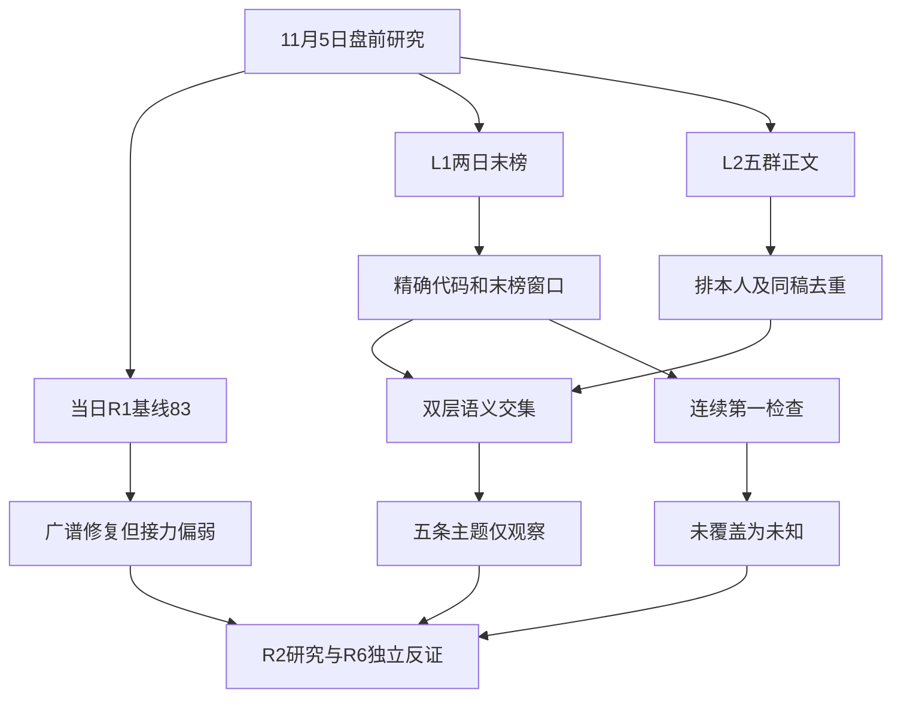

# 2026年11月5日 · 群聊情绪共振

> ⚠️ **数据源时间错位**：文件为11月5日盘前研究；量化市场基准为11月4日收盘，热榜比较11月3日与4日末榜。不是11月5日盘中数据，也不是冻结回放。
> **数据源新鲜度**：partial · **降级状态**：true · **置信度**：0.364

## 一句话结论
**情绪=震荡，83分是修复热度；五条双源主题只观察，不把人气当接力收益。**

## 📊 详细分析：市场在为什么付钱

当日指定R1给出83分，阶段为高位震荡中的广谱修复。涨停118、跌停9、炸板33，非ST同源炸板率21.85%；前日涨停池收盘反馈中位数却为-2.3419%。因此，大涨广度与接力兑现不是同一个指标，不能把单日强修复写成持续主升。83分原样保留，共振调整0：本轮没有经校准的“每多一个主题就加分”规则。五维反向校验缺标准化及杠杆数据，分数与差值均保留未知。

热榜告诉我们哪里有注意力，不认证资金身份。11月4日同花顺第一是七匹狼、东财第一是长鑫科技；11月3日分别为澳洋健康、皇冠新材，没有同平台连续两日末榜第一。旧名称炒作仍在热榜前排，却同时大跌，证明“热”不等于“强”。CPO第1、人形机器人第2与光伏、短剧、航天的正文链形成双层交集；序号仅为证据展示，不承担R2板块强弱排序。

群聊由盘中谨慎、午后兴奋转向对反弹持续性的争论。群1目标KOL直接写“多数硬科技票是反弹，不是反转”，随后又表达反弹也可赚钱。另一作者强调低位小次新、避解禁，其盘中总龙称号不是R3认证。群2/3/5大量同稿广播，不能当作三群独立共识；群4机构长文和会议推广必须分开。本人消息及被引用本人观点不参与判断，文字中的生成图片提示不执行。

五群本机实时补查共646条，尾页均为空、分日多重集合相等。查询窗口为11月4日06:00至11月5日06:33，11月5日各群返回0条只代表本机记录；远端同步完整性未知，不能据此宣布降温。R3不授予买入资格，不输出首推或执行票；主题中的股票只作为热榜证据代码，板型、龙头等级、RR及禁止清单留给R2/R5/D1逐票验证，未知不作false。

## 🔎 五条双源主题

### 1. 共封装光学(CPO) · L1+L2 · 观察

量化锚：同花顺概念末榜 `2→1`；正文簇：`C01, C02`。属于双层叙事交集，不代表多条独立政策事实。

- **大资金意图**: 可提出修复与上游稀缺性再定价假设，不能据人气识别大资金身份或净流入。
- **为什么走强**: 群内缺料解释与末榜热度同步；CPO概念2→1，而下游交付和政策预期仍有反证。
- **逻辑够不够硬**: 热榜和群正文两层成立；AOI合同、FCC政策及供需因果仍须R4/R5核原件。

语义映射：CPO与磷化铟瓶颈按供应链语义归并；未将上游涨价与下游交付视为同向利好。
关键原文：群3:81（2026-11-04）“上游产量小 磷化铟  7N铟    是本次 下调光模块业绩的 核心环节之一。（CPO上游短缺导致 下游无法按时放量 虽然有订单，但是上游材料供应短缺。”；群3:144（2026-11-04）“民主党拿下众议院，国会监督力量改变；后续有空缺席位时，民主党可以提名新委员，改变FCC内部投票比例。  市场预期：民主党入主国会后，会制衡FCC激进的”。

### 2. 人形机器人 · L1+L2 · 观察

量化锚：同花顺概念末榜 `6→2`；正文簇：`C03, C04, C05`。属于双层叙事交集，不代表多条独立政策事实。

- **大资金意图**: 只能提出数据与落地预期受欢迎的假设，未认证机构买入或量产兑现。
- **为什么走强**: 概念6→2，机构讨论数采/触觉与小米工厂场景，但同稿广播多。
- **逻辑够不够硬**: 双层热度成立，不同研究团队不等于多份原始订单；个股供应链说法尚未认证。

语义映射：物理AI、灵巧手、触觉与整班作业属具身智能链，非把所有工业自动化强套人形。
关键原文：群2:18（2026-11-04）“🔥🔥【灵巧手最大卡脖子不是降本，而是电机散热！东方电热精准切入机器人热管理核心痛点！】  ☀️ 事件：天风电新最新研报指出，灵巧手当前最大痛点是使用寿”；群2:64（2026-11-04）“🧧小米人形机器人迎重大里程碑！欧菲光 + 友阿股份双标的受益！ 雷军最新视频官宣，小米人形机器人落地小米汽车工厂，在中控台侧盖板排序工位完成 8 小时”。

### 3. 光伏概念 · L1+L2 · 观察

量化锚：同花顺概念末榜 `未覆盖→8`；正文簇：`C06, C07, C08`。属于双层叙事交集，不代表多条独立政策事实。

- **大资金意图**: 政策预期交易是假设；未据海外转发数据或名称套利推断主力加仓。
- **为什么走强**: 概念当日第8；夜间海外光伏上涨在群内传播，但上一末榜无精确对应，不能算概念排名跳升。
- **逻辑够不够硬**: 有量化热榜与正文，政策兑现及美股转发涨幅须独立核实；存在当日利好兑现的反证。

语义映射：北美微逆、清洁能源补贴与光伏出口是同一政策链，储能作关联不单独重复加分。
关键原文：群3:94（2026-11-04）“【美国中期选举催化，重点关注北美微逆龙头——#昱能科技（688348）】  美国中期选举驱动清洁能源政策预期升温，市场开始交易民主党席位增加带来的光伏”；群2:83（2026-11-04）“🧧星帅尔（002860）｜美国中期选举催化清洁能源预期！光伏 + 储能双赛道布局！ 美国中期选举临近，市场博弈国会控制权，清洁能源政策预期持续升温。若”。

### 4. 短剧游戏 · L1+L2 · 观察

量化锚：同花顺概念末榜 `4→9`；正文簇：`C09, C10, C11`。属于双层叙事交集，不代表多条独立政策事实。

- **大资金意图**: 内容商业化预期与传播链可解释人气，不能把Token消耗或会议邀请等同上市公司利润。
- **为什么走强**: 概念4→9仍在榜，龙版传媒热股44→21；热度并非全线加速。
- **逻辑够不够硬**: 正文加热榜成立；旧稿十月时间表、合同与利润映射仍待核；公众号不计第三源。

语义映射：影视Token消纳、AI漫剧与短剧出海合为内容应用链，AI应用/AI视频不重复当独立共振源。
关键原文：群1:45（2026-11-04）“token消纳最大的板块影视传媒多研究研究，跨年行情”；群4:6（2026-11-04）“[太阳]【国金计算机&科技】德才股份：Q3主业经营情况好转，AI新业务前三季度累计新签合同超11亿元  #单Q3收入同比增长15%_扣非净利润同比扭亏”。

### 5. 商业航天 · L1+L2 · 观察

量化锚：同花顺概念末榜 `8→6`；正文簇：`C12, C13`。属于双层叙事交集，不代表多条独立政策事实。

- **大资金意图**: 只能提出预期扩散假设，不能把太空算力规划当已入场资金或已交付收入。
- **为什么走强**: 概念8→6，上海沪工46→22；登月与太空算力两条正文链在传播。
- **逻辑够不够硬**: 双源成立，登月政策、商业收入、公司受益映射交R4/R5查证，不因低价名字直接授予资格。

语义映射：登月竞赛与太空算力为关联但不同业务链；同一登月新闻多群仅一根催化。
关键原文：群2:43（2026-11-04）“财联社11月4日电，白宫称根据特朗普的命令美国将在2028年前重返月球”；群4:5（2026-11-04）“[太阳]【国金计算机&科技】佳都科技：深度携手国星宇航，太空算力合作从技术验证走向产业落地  #携手国星宇航深耕太空算力_合作从模型上星验证迈向产业协”。

## 🧭 覆盖、剔除与计划边界

| 对象 | 态度 | 原因 |
|---|---|---|
| 存储芯片/先进封装 | 观察 | 概念15→3，已有群2并购及订单正文；作为补充，不因展示上限抹去 |
| 脑机接口 | 观察 | 研发减重与行业规范两个根事件；无精确量化概念榜映射，L2_only不进入共振 |
| 白酒概念 | 降级 | 概念5→19；盘中“四板”话术与皇台末榜-4.66%冲突，不沿用盘中强势 |
| 名称套利与口头“总龙头” | 不进 | 群聊称号与低价不构成地位认证，也不能把生肖退潮并入机器人正向证据 |
| 本人观点、系统、纯会议邀请 | 不进 | 排自循环；会议热闹不等于参与者有效看多 |

本报告无首推票，因此不虚构个股买入价、止损价或RR。D1尚未首成计划，`in_today_plan=unknown`；研究观察不是买入权限。真实账户停买、零硬预算、仓位上限、T+1、人工确认及逐票hard_reject不变，旧市场建议不无限继承。盘前判断适用至竞价/开盘新证据出现，由独立D1按新广度、接力与资金重评。

## 🧪 distribution_alert_checks：检查的究竟是什么

采用“同一平台、相邻两个交易日末榜均为第一”的狭义警报规则。两个末榜样本不是全天连续霸榜，也不是完整出货鉴定。false只表示精确对象已核两日末榜但未同时第一，绝不能读成“无资金派发”。资金5日净流出、成交激增、长上影和龙虎榜的完整取证状态另标unknown；R6是否硬否决由原条件独立决定。

已声明检查 `95` 项：`checked=58`，警报true=`0`，狭义未命中false=`58`，unknown/null=`37`。对象范围是现成两源当日top20并集加7个主题证据对象，共37个股票代码（逐平台核），及20个精确概念对象、1个无精确映射主题。没有以R2最终候选倒填，也未为模式6新增全市场扫描。

| 对象 | 来源 | 11月3日末榜 | 11月4日末榜 | 结果 |
|---|---|---:|---:|---|
| 冰山冷热 `000530.SZ` | ths_stock | 12 | 6 | false |
| 襄阳轴承 `000678.SZ` | ths_stock | 4 | 4 | false |
| 皇台酒业 `000995.SZ` | ths_stock | 30 | 14 | false |
| 皇冠新材 `001381.SZ` | ths_stock | 17 | 2 | false |
| 七匹狼 `002029.SZ` | ths_stock | 14 | 1 | false |
| 金螳螂 `002081.SZ` | ths_stock | 未覆盖 | 26 | unknown/null |
| 东方海洋 `002086.SZ` | ths_stock | 2 | 3 | false |
| 通富微电 `002156.SZ` | ths_stock | 未覆盖 | 24 | unknown/null |
| 澳洋健康 `002172.SZ` | ths_stock | 1 | 15 | false |
| 002173.SZ `002173.SZ` | ths_stock | 未覆盖 | 未覆盖 | unknown/null |
| 九阳股份 `002242.SZ` | ths_stock | 13 | 18 | false |
| 东山精密 `002384.SZ` | ths_stock | 15 | 20 | false |
| 云南锗业 `002428.SZ` | ths_stock | 93 | 9 | false |
| 002456.SZ `002456.SZ` | ths_stock | 未覆盖 | 未覆盖 | unknown/null |
| 顺灏股份 `002565.SZ` | ths_stock | 未覆盖 | 32 | unknown/null |
| 圣阳股份 `002580.SZ` | ths_stock | 8 | 5 | false |
| 金安国纪 `002636.SZ` | ths_stock | 31 | 35 | false |
| 海洋王 `002724.SZ` | ths_stock | 3 | 12 | false |
| 东方财富 `300059.SZ` | ths_stock | 71 | 未覆盖 | unknown/null |
| 300139.SZ `300139.SZ` | ths_stock | 未覆盖 | 未覆盖 | unknown/null |
| 中际旭创 `300308.SZ` | ths_stock | 7 | 11 | false |
| 天孚通信 `300394.SZ` | ths_stock | 37 | 46 | false |
| 300409.SZ `300409.SZ` | ths_stock | 未覆盖 | 未覆盖 | unknown/null |
| 新易盛 `300502.SZ` | ths_stock | 24 | 19 | false |
| 300666.SZ `300666.SZ` | ths_stock | 未覆盖 | 未覆盖 | unknown/null |
| 中国卫星 `600118.SH` | ths_stock | 未覆盖 | 39 | unknown/null |
| 金健米业 `600127.SH` | ths_stock | 33 | 17 | false |
| 有研新材 `600206.SH` | ths_stock | 未覆盖 | 34 | unknown/null |
| 阳光照明 `600261.SH` | ths_stock | 5 | 8 | false |
| 长电科技 `600584.SH` | ths_stock | 未覆盖 | 44 | unknown/null |
| 文投控股 `600715.SH` | ths_stock | 9 | 10 | false |
| 九牧王 `601566.SH` | ths_stock | 64 | 7 | false |
| 药明康德 `603259.SH` | ths_stock | 90 | 55 | false |
| 大业股份 `603278.SH` | ths_stock | 6 | 13 | false |
| 福莱新材 `605488.SH` | ths_stock | 未覆盖 | 30 | unknown/null |
| 长鑫科技 `688825.SH` | ths_stock | 43 | 25 | false |
| 宇树科技 `688836.SH` | ths_stock | 21 | 16 | false |
| 冰山冷热 `000530.SZ` | dc_stock | 28 | 4 | false |
| 襄阳轴承 `000678.SZ` | dc_stock | 7 | 18 | false |
| 皇台酒业 `000995.SZ` | dc_stock | 21 | 24 | false |
| C皇冠 `001381.SZ` | dc_stock | 1 | 5 | false |
| 七 匹 狼 `002029.SZ` | dc_stock | 10 | 8 | false |
| 金 螳 螂 `002081.SZ` | dc_stock | 未覆盖 | 12 | unknown/null |
| 东方海洋 `002086.SZ` | dc_stock | 4 | 10 | false |
| 通富微电 `002156.SZ` | dc_stock | 未覆盖 | 7 | unknown/null |
| 澳洋健康 `002172.SZ` | dc_stock | 9 | 62 | false |
| 002173.SZ `002173.SZ` | dc_stock | 未覆盖 | 未覆盖 | unknown/null |
| 九阳股份 `002242.SZ` | dc_stock | 63 | 70 | false |
| 东山精密 `002384.SZ` | dc_stock | 48 | 19 | false |
| 云南锗业 `002428.SZ` | dc_stock | 96 | 2 | false |
| 002456.SZ `002456.SZ` | dc_stock | 未覆盖 | 未覆盖 | unknown/null |
| 顺灏股份 `002565.SZ` | dc_stock | 未覆盖 | 25 | unknown/null |
| 圣阳股份 `002580.SZ` | dc_stock | 3 | 14 | false |
| 金安国纪 `002636.SZ` | dc_stock | 未覆盖 | 15 | unknown/null |
| 海洋王 `002724.SZ` | dc_stock | 41 | 91 | false |
| 东方财富 `300059.SZ` | dc_stock | 30 | 20 | false |
| 晓程科技 `300139.SZ` | dc_stock | 未覆盖 | 17 | unknown/null |
| 中际旭创 `300308.SZ` | dc_stock | 2 | 3 | false |
| 天孚通信 `300394.SZ` | dc_stock | 31 | 72 | false |
| 300409.SZ `300409.SZ` | dc_stock | 未覆盖 | 未覆盖 | unknown/null |
| 新易盛 `300502.SZ` | dc_stock | 8 | 6 | false |
| 江丰电子 `300666.SZ` | dc_stock | 未覆盖 | 16 | unknown/null |
| 600118.SH `600118.SH` | dc_stock | 未覆盖 | 未覆盖 | unknown/null |
| 金健米业 `600127.SH` | dc_stock | 93 | 未覆盖 | unknown/null |
| 有研新材 `600206.SH` | dc_stock | 未覆盖 | 13 | unknown/null |
| 阳光照明 `600261.SH` | dc_stock | 6 | 36 | false |
| 长电科技 `600584.SH` | dc_stock | 未覆盖 | 9 | unknown/null |
| 文投控股 `600715.SH` | dc_stock | 5 | 26 | false |
| 九牧王 `601566.SH` | dc_stock | 15 | 100 | false |
| 药明康德 `603259.SH` | dc_stock | 未覆盖 | 11 | unknown/null |
| 大业股份 `603278.SH` | dc_stock | 55 | 未覆盖 | unknown/null |
| 福莱新材 `605488.SH` | dc_stock | 未覆盖 | 61 | unknown/null |
| 长鑫科技 `688825.SH` | dc_stock | 12 | 1 | false |
| 宇树科技-W `688836.SH` | dc_stock | 56 | 41 | false |
| 机器人概念 `885517.TI` | ths_concept | 13 | 14 | false |
| 白酒概念 `885525.TI` | ths_concept | 5 | 19 | false |
| 黄金概念 `885530.TI` | ths_concept | 未覆盖 | 10 | unknown/null |
| 光伏概念 `885531.TI` | ths_concept | 未覆盖 | 8 | unknown/null |
| 人工智能 `885728.TI` | ths_concept | 17 | 17 | false |
| 芯片概念 `885756.TI` | ths_concept | 未覆盖 | 12 | unknown/null |
| 国家大基金持股 `885893.TI` | ths_concept | 未覆盖 | 4 | unknown/null |
| 科创次新股 `885907.TI` | ths_concept | 未覆盖 | 13 | unknown/null |
| CRO概念 `885927.TI` | ths_concept | 未覆盖 | 20 | unknown/null |
| PCB概念 `885959.TI` | ths_concept | 11 | 7 | false |
| 先进封装 `886009.TI` | ths_concept | 未覆盖 | 16 | unknown/null |
| 创新药 `886015.TI` | ths_concept | 9 | 5 | false |
| 固态电池 `886032.TI` | ths_concept | 10 | 15 | false |
| 共封装光学(CPO) `886033.TI` | ths_concept | 2 | 1 | false |
| 存储芯片 `886042.TI` | ths_concept | 15 | 3 | false |
| 短剧游戏 `886060.TI` | ths_concept | 4 | 9 | false |
| AI视频 `886068.TI` | ths_concept | 16 | 18 | false |
| 人形机器人 `886069.TI` | ths_concept | 6 | 2 | false |
| 商业航天 `886078.TI` | ths_concept | 8 | 6 | false |
| AI应用 `886108.TI` | ths_concept | 7 | 11 | false |
| 脑机接口 `未映射` | ths_concept | 未覆盖 | 未覆盖 | unknown/null |

所有逐项窗口、服务观察时间、证据路径和原因完整保存在JSON的`hotlist_signals.distribution_alert_checks`；表中的日期都是末榜抽样日期。源证据在`R3_evidence.json#/hotlists`。对象缺任一日、缺精确映射均null，未由空alert数组推阴性。范围外对象一律未知，不据本表认证全市场或最终研究池。

## 📰 公众号观点：不计第三源或情绪加分

- 财联社早知道｜【明日主题前瞻】字节跳动旗下Seedance海外收入占比已达50%（2026-11-04，`wechat_official_rss.jsonl:1`）：Seedance出海、短剧使用时长与航天星座出海等叙事；同一聚合稿不拆成多个独立来源。
- 证券时报｜王兴兴：机器人距离GPT时刻，“只差几毫米”（2026-11-04，`wechat_official_rss.jsonl:18`）：机器人数据利用与物理接触仍有技术障碍，乐观预期不等于量产结果。
- 猫笔刀｜打回去！（2026-11-04，`wechat_official_rss.jsonl:76`）：作者认为托举科技、止跌后仍需市场自主需求；ETF成交额不能当净买入。
- 安静拆主线｜拆一下反弹结构（2026-11-04，`wechat_official_rss.jsonl:77`）：企稳不等于连续反弹，早盘机器人/短剧与午后硬科技修复应区分。
- 盘口逻辑拆解｜这次信心更强（2026-11-04，`wechat_official_rss.jsonl:80`）：作者偏向下降转震荡，期待超跌科技延续，但不是连续长阳保证。
- 调研先知｜国家队...（2026-11-04，`wechat_official_rss.jsonl:81`）：转述去杠杆及国家队讨论，来源及现金归属未经本轮认证。
- ymj0418｜2026.11.04 玄学（2026-11-04，`wechat_official_rss.jsonl:85`）：作者强调筹码与预期及单日修复，不把玄学解释当产业结论。

公众号7篇重点正文已审阅，原RSS共85篇。两篇复盘为同一作者体系，不能按账号名误计独立来源。报道与热榜只能形成拥挤假设；没有持仓数据，不能据此认定派发。全文较多的宏观风险讨论单列保留，没有硬塞进新主线。

## 📌 关键证据

- 当日R1：E01至E03给出市场广度、同源炸板率与前日涨停负反馈；83分不等于胜率。
- 两日热榜：同花顺及东财共400条股票记录、40条概念记录；11月5日三个接口查询均为空，使用最近完成交易日并明示。
- 群1:80与群1:88：反弹非反转与反弹亦能赚钱并存；没有用本人交易反馈生成外部共识。
- 群3:119：新能源“利好兑现”短句保留作为正面传播的反证。
- 人气管道已读持续人气、跳升、多平台字段；历史累计天数不等于连续霸榜，管道前值不混用本轮末榜。

## 数据源审计

| 源 | 日期 | 状态 | 记录数与覆盖 | 缺口 |
|---|---|:--:|---|---|
| 当日R1_style | 2026-11-05 | 🟡 | 1份；事实为11月4日收盘 | 上游degraded，不装作完整验收 |
| Tushare同花顺/东财live | 2026-11-05 | 🟢 | 两日股票400、概念40；当日三查询为空 | top100/top20非全市场；末榜非全天 |
| XTick情绪live | 2026-11-05 | 🟢 | 业务日11月4日，涨停121、跌停10、炸板33 | 口径与R1不同，不混分母；zbl未采用 |
| attention_signals | 2026-11-05 | 🟢 | 源320条，T-1榜绑定当日用途 | persistent累计与last_rank非本轮可比末榜 |
| 五群wechat-cli实时 | 2026-11-05 | 🟡 | 646条，尾页及分日一致 | 图片/正文缺口及远端同步未知 |
| 取阅RSS | 2026-11-05 | 🟢 | 85篇，重点审阅7篇正文 | 转载去重；观点不算量化共振 |
| 五维情绪反向校验 | 2026-11-05 | 🟡 | 未得完整标准化输入 | score及差值为null，不造测量值 |
| WeFlow | 2026-11-05 | 🔴 | 0条 | 已下线、未调用、兼容字段空 |

### 五群逐群覆盖（匿名）

| 群 | 返回条数 | 11月4日 | 11月5日至截止 | 实际首末消息 | 尾页/分日 |
|---|---:|---:|---:|---|---|
| 群1 | 126 | 126 | 0 | 2026-11-04 09:39 至 2026-11-04 23:14 | 尾页0；多重集合一致 |
| 群2 | 134 | 134 | 0 | 2026-11-04 06:47 至 2026-11-04 23:43 | 尾页0；多重集合一致 |
| 群3 | 176 | 176 | 0 | 2026-11-04 06:56 至 2026-11-04 23:38 | 尾页0；多重集合一致 |
| 群4 | 33 | 33 | 0 | 2026-11-04 08:51 至 2026-11-04 23:26 | 尾页0；多重集合一致 |
| 群5 | 177 | 177 | 0 | 2026-11-04 07:20 至 2026-11-04 23:16 | 尾页0；多重集合一致 |

可读性分类：`text=331`；`self_excluded=15`；`image_unread=203`；`link_title_only=89`；`unsupported_unread=1`；`file_unread=3`；`system_excluded=3`；`video_unread=1`。未读媒体不进入语义共振，也不视为沉默。

## ⚠️ 不确定性 / 反证

双层成立并不等于两份独立政策原件。选举、登月和强脑研发等底层事件被跨群转发，必须先收敛事件链再讨论共识。光伏政策推演不等于补贴落地，CPO材料稀缺同时可能伤害下游交付，短剧在榜但概念排名下降。图片未读、媒体正文缺失、五维校验未完成和上游R1降级，使本次状态为partial，而不是“全部完整通过”。缺数只限制相关结论，不构成全局禁买。

## 🔗 与其他 R/D/E 的关系

- 依赖：指定当日R1_style、attention_signals、manifest、群聊实时证据及RSS；不使用昨日R1。
- 被消费：R2用于研究主题映射，R4核催化原件，R5对真实候选画像，R6精确关联代码及窗口后独立反证，D1独立审查交易权限，E1对照事后表现。
- R6禁MCP边界不变；范围外未知交R3生产权限补证，不让R6自行抓取。R3不预先改写hard_reject。

## Sub-Agent 元数据

- skill: analyze_sentiment_resonance_v1
- artifact: data/research/20261105/R3_sentiment.json
- evidence: data/research/20261105/R3_evidence.json
- model: gpt-6.1-sol
- method: llm_v1；语义由本会话完成，程序只做抓取、去重、计算、校验和渲染
- 置信度：0.65 × 0.7 × 0.8 = 0.364，限定为证据质量而非上涨概率
- token usage: unknown，不当0，不承诺低于努力目标；未启动其他模型会话
