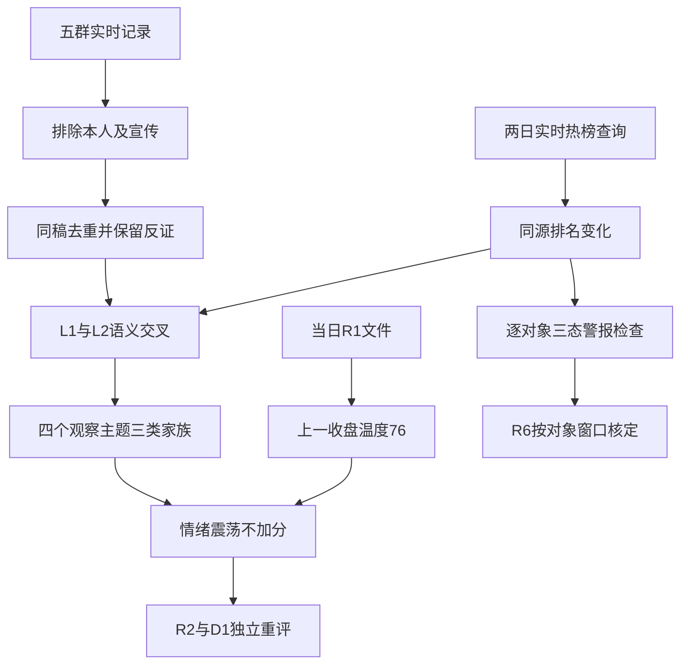

# 2026年11月6日 · **群聊情绪共振**

> **数据源新鲜度**：partial · **降级状态**：true · **置信度**：0.364
> 业务日为2026-11-06；盘前使用2026-11-05已完成收盘和两日末次榜单，不冒充今日盘中。

## 一句话结论
**观察：修复有兑现，情绪=震荡；四个双源主题中应用与短剧重叠，不将热度当买权。**

## 🧭 详细分析

市场正在为什么付钱？当日R1的量化证据指向广谱修复与部分隔日接力：上涨4869家、下跌625家，中位涨幅2.02%，成交额约21351亿元；前日涨停池下一收盘反馈均值+4.49%。但收盘涨停118降至84，未封炸板33增至48，同源炸板率 **36.36%**、封板率 **63.64%**。因此明确标 **情绪=震荡**，不从普涨直接跳到持续主升。

现在处在哪一段？沿用当日R1的高位震荡定位，研究温度 **76分，调整0分**。只消费 `data/research/20261106/R1_style.json`，不用前一日R1文件。该文件整体为degraded，国内量化分项可核，本次仅有条件承接上一收盘温度，仍以degraded交付；76不是今日竞价分，更不是信心、仓位或胜率。

谁有地位？R3不认定股票龙头，也不做R2板块强弱排序。热榜与群聊在光伏、短剧、AI应用和机器人形成渠道交叉，但 **短剧与应用同属AI内容应用家族**，不能当四条独立主线，也不能把同一文案跨三个群转发算三个独立论据。主线、1/3/5日持续性和逐板块封板率本阶段未知，交R2核定，绝不填造。

今天做什么、不做什么？**观察**上述研究主题，**降级**未经核实的海外政策映射，**不进**仅凭同音字与推广活动产生的候选。所有股票只作榜单证据锚，`suggested_stocks`为空，不选首推票，不造板型、龙头认定、RR或止损价。炸板阈值触发下游候选数量按正常上限减半，但不削减研究来源；真实预算、停买、T+1和R6硬否决不变。

## 🔎 双源共振主题

以下编号仅为情绪证据展示顺序，不是可交易板块排名。

| 主题 | 两日同花顺概念名次 | L2有效证据 | 态度 | 重要反证 |
|---|---|---|---|---|
| 光伏概念 | 8→1 | 群2需求/供给观点、群3报价及海外映射 | 观察 · L1+L2 | 海外政策与订单未认证，当前榜首不等于连续霸榜 |
| 短剧游戏 | 9→5；AI视频18→9 | 群4实质机构正文、群2/群5 IP和工具观点 | 观察 · L1+L2 | 同稿高度重复；芒果还叠加综艺事件 |
| AI应用 | 11→2 | 群2编程/出海、群4Agent正文，群3有反驳 | 观察 · L1+L2 | 美国旧草案≠新法；算租与应用不是一套利润逻辑 |
| 人形机器人 | 2→4；机器人概念14→8 | 群4部件正文、群2工厂与仓储观点 | 观察 · L1+L2 | 主要概念排名回落；演示/规划不等于交付 |

### ☀️ 光伏概念：研究交叉成立，政策兑现未确认
- **大资金意图**: 可能交易风险回补、清洁能源需求和盈利修复预期；没有资金身份数据，不把可能性写成机构已加仓。
- **为什么走强**: 概念8→1，阳光电源同花顺52→8；群2“美国有光伏工厂，订单充裕”的讨论和群3光储报价转述提供不同论据。行情数据证明热度，群聊仅证明参与者如此解释。
- **逻辑够不够硬**: 热榜与可读观点双渠道成立，但部分论据共用美国选举底层事件。需要R4核政策实施状态、R5核订单与盈利，不把转发当硬业绩。

### 🎬 短剧游戏：内容叙事有合力，不能把传播数当利润
- **大资金意图**: IP复用、制作降本和出海变现是群聊中的定价假设，不是已确认机构仓位迁移。
- **为什么走强**: 短剧与AI视频名次提升，芒果超媒东财74→10。群4有Agent业务正文，群2/群5有IP和制作工具论述；芒果的综艺热度须单独分辨，不全归因AI短剧。
- **逻辑够不够硬**: 同一新经典同稿改写合一簇，不能算多群独立验证。流水、收入目标、获奖作品与持续净利润不同，缺商业兑现证据时保持观察。

### 🤖 AI应用：热度扩散明确，海外监管受益链有反证
- **大资金意图**: 可能从海外扩建预期转向应用变现或存量算力利用率，但监管约束也可能损害总需求，不可单向解释。
- **为什么走强**: 概念11→2，人工智能17→7；群2讨论AI编程、Token出海，群4有Agent实质正文。11→2只升9位，不误标为达到“上升≥10”的动量信号。
- **逻辑够不够硬**: 群3明确指出“9月23日就已经提交”“只是草案”，另有“延期，而非取消”的论述。它们是本轮反证观点，并非R3已完成法律事实核验；交R4逐项确认。

### 🦾 人形机器人：保留产业观察，不描述为整体加速
- **大资金意图**: 工业落地和核心部件国产供给可能提高产业可信度，但没有真实大资金买入测量。
- **为什么走强**: 工厂、仓储和物理AI正文与热榜并存；人形概念2→4说明热度仍在但非继续加速。京东同一采购规划稿多次跨群，不能重复增加确认。
- **逻辑够不够硬**: 部件卖方正文与工厂部署是不同论据，但订单、采购计划和收入不是同一概念。活动、演示和目标估值不赋予开仓资格。

## 🧩 关键证据与去重

| 句柄 | 日期 | 匿名来源与短原文 | 判断用途 |
|---|---|---|---|
| K01 | 2026-11-05 | 群1：“不过硬科技还是要谨慎”“看看能不能持续” | 同一作者盘中观点变化，不拼成今日盘前坚定看多 |
| K03/K04 | 2026-11-05 | 群2：“美国有光伏工厂…订单充裕”；群3：“光储拟提价” | 需求与价格转述，事实待核 |
| K07 | 2026-11-05 | 群4：“已形成漫剧制作、广告电商、互动影游三大Agent矩阵” | 实质卖方观点，不把会议邀请当正文 |
| K06 | 2026-11-05 | 群3：“当前风险主要是延期，而非取消”“只是草案” | 反驳全面封禁与无条件国产受益 |
| K08 | 2026-11-05 | 群4：“这不是打铁件，这是T的眼睛” | 部件观点存在，不认证订单 |
| K10/K11 | 2026-11-05至2026-11-06 | 群2/群5：“偏上游IP授权” | 同稿跨群归并，不算独立源倍增 |

完整行号和原始证据定位保存在JSON的 `kol_summary`；群名只保留匿名编号。本人9条发言或被引用观点已排除分析，调研宣传与会议邀请不计有效方向；链接标题只作传播证据。

## 🧮 distribution_alert_checks：范围、窗口与三态结果

规则限定为 **同一提供源两日末次快照均排名第一**。比较日期为 **2026-11-04→2026-11-05**，不是今日盘中榜单，亦不是盘中连续霸榜检查。机器产物逐条保留精确观察时间、源、对象、行级引用和结果。

实际范围为两平台最新各前20并集32只热榜对象，分别对同花顺、东财检查；另有同花顺20个概念，以及群聊提及但本次榜单范围外的杭州柯林。合计 **85条对象×源检查：62条checked/false、23条unknown/null、0条true**。只把实际两日同源对象匹配后的结果写false；不以空命中数组反推。

**false只表示这个连续两日第一条件未命中，不表示不存在出货、没有资金流出或公告风险。** 完整成交/长上影/资金/公告复合派发诊断尚未执行，结果另列unknown。利欧股份等缺前日精确对象覆盖者仍是unknown，即使当前榜首已知，也不拿其他源或其他股票的名次填补。R6必须精确匹配规则、对象、源和窗口才能消费；范围外继续未知，不为模式6追加全市场扫描。

| 对象 | 源 | 前次名次→末次名次 | check_status | distribution_alert |
|---|---|---|---|---|
| 000530.SZ 冰山冷热 | ths_stock | 6→12 | checked | false |
| 000678.SZ 襄阳轴承 | ths_stock | 4→7 | checked | false |
| 000995.SZ 皇台酒业 | ths_stock | 14→9 | checked | false |
| 002029.SZ 七匹狼 | ths_stock | 1→14 | checked | false |
| 002081.SZ 金螳螂 | ths_stock | 26→18 | checked | false |
| 002086.SZ 东方海洋 | ths_stock | 3→1 | checked | false |
| 002131.SZ 利欧股份 | ths_stock | 未知→21 | unknown | null |
| 002156.SZ 通富微电 | ths_stock | 24→10 | checked | false |
| 002185.SZ 华天科技 | ths_stock | 38→19 | checked | false |
| 002309.SZ 中利集团 | ths_stock | 未知→96 | unknown | null |
| 002343.SZ 慈文传媒 | ths_stock | 40→30 | checked | false |
| 002384.SZ 东山精密 | ths_stock | 20→6 | checked | false |
| 002428.SZ 云南锗业 | ths_stock | 9→5 | checked | false |
| 002506.SZ 协鑫集成 | ths_stock | 未知→60 | unknown | null |
| 002580.SZ 圣阳股份 | ths_stock | 5→11 | checked | false |
| 002636.SZ 金安国纪 | ths_stock | 35→13 | checked | false |
| 002865.SZ 钧达股份 | ths_stock | 未知→35 | unknown | null |
| 300071.SZ  | ths_stock | 未知→未知 | unknown | null |
| 300093.SZ  | ths_stock | 未知→未知 | unknown | null |
| 300274.SZ 阳光电源 | ths_stock | 52→8 | checked | false |
| 300308.SZ 中际旭创 | ths_stock | 11→2 | checked | false |
| 300413.SZ 芒果超媒 | ths_stock | 37→62 | checked | false |
| 300502.SZ 新易盛 | ths_stock | 19→16 | checked | false |
| 300750.SZ 宁德时代 | ths_stock | 47→17 | checked | false |
| 600206.SH 有研新材 | ths_stock | 34→3 | checked | false |
| 600261.SH 阳光照明 | ths_stock | 8→4 | checked | false |
| 600584.SH 长电科技 | ths_stock | 44→15 | checked | false |
| 600986.SH  | ths_stock | 未知→未知 | unknown | null |
| 601599.SH 浙文影业 | ths_stock | 48→50 | checked | false |
| 603381.SH  | ths_stock | 未知→未知 | unknown | null |
| 688825.SH 长鑫科技 | ths_stock | 25→22 | checked | false |
| 688836.SH 宇树科技 | ths_stock | 16→20 | checked | false |
| 000530.SZ 冰山冷热 | dc_renqi | 4→46 | checked | false |
| 000678.SZ 襄阳轴承 | dc_renqi | 18→43 | checked | false |
| 000995.SZ 皇台酒业 | dc_renqi | 24→19 | checked | false |
| 002029.SZ 七 匹 狼 | dc_renqi | 8→未知 | unknown | null |
| 002081.SZ 金 螳 螂 | dc_renqi | 12→6 | checked | false |
| 002086.SZ 东方海洋 | dc_renqi | 10→2 | checked | false |
| 002131.SZ 利欧股份 | dc_renqi | 未知→1 | unknown | null |
| 002156.SZ 通富微电 | dc_renqi | 7→22 | checked | false |
| 002185.SZ 华天科技 | dc_renqi | 27→91 | checked | false |
| 002309.SZ 中利集团 | dc_renqi | 71→20 | checked | false |
| 002343.SZ 慈文传媒 | dc_renqi | 未知→16 | unknown | null |
| 002384.SZ 东山精密 | dc_renqi | 19→34 | checked | false |
| 002428.SZ 云南锗业 | dc_renqi | 2→17 | checked | false |
| 002506.SZ 协鑫集成 | dc_renqi | 未知→7 | unknown | null |
| 002580.SZ 圣阳股份 | dc_renqi | 14→80 | checked | false |
| 002636.SZ 金安国纪 | dc_renqi | 15→72 | checked | false |
| 002865.SZ 钧达股份 | dc_renqi | 未知→15 | unknown | null |
| 300071.SZ 福石控股 | dc_renqi | 未知→11 | unknown | null |
| 300093.SZ 金刚光伏 | dc_renqi | 未知→13 | unknown | null |
| 300274.SZ 阳光电源 | dc_renqi | 59→8 | checked | false |
| 300308.SZ 中际旭创 | dc_renqi | 3→3 | checked | false |
| 300413.SZ 芒果超媒 | dc_renqi | 74→10 | checked | false |
| 300502.SZ 新易盛 | dc_renqi | 6→26 | checked | false |
| 300750.SZ 宁德时代 | dc_renqi | 未知→48 | unknown | null |
| 600206.SH 有研新材 | dc_renqi | 13→4 | checked | false |
| 600261.SH 阳光照明 | dc_renqi | 36→5 | checked | false |
| 600584.SH 长电科技 | dc_renqi | 9→63 | checked | false |
| 600986.SH 浙文互联 | dc_renqi | 未知→12 | unknown | null |
| 601599.SH 浙文影业 | dc_renqi | 30→18 | checked | false |
| 603381.SH 永臻股份 | dc_renqi | 21→14 | checked | false |
| 688825.SH 长鑫科技 | dc_renqi | 1→9 | checked | false |
| 688836.SH 宇树科技-W | dc_renqi | 41→52 | checked | false |
| 885531.TI 光伏概念 | ths_concept | 8→1 | checked | false |
| 886108.TI AI应用 | ths_concept | 11→2 | checked | false |
| 886078.TI 商业航天 | ths_concept | 6→3 | checked | false |
| 886069.TI 人形机器人 | ths_concept | 2→4 | checked | false |
| 886060.TI 短剧游戏 | ths_concept | 9→5 | checked | false |
| 886015.TI 创新药 | ths_concept | 5→6 | checked | false |
| 885728.TI 人工智能 | ths_concept | 17→7 | checked | false |
| 885517.TI 机器人概念 | ths_concept | 14→8 | checked | false |
| 886068.TI AI视频 | ths_concept | 18→9 | checked | false |
| 885921.TI 储能 | ths_concept | 未知→10 | unknown | null |
| 886033.TI 共封装光学(CPO) | ths_concept | 1→11 | checked | false |
| 886032.TI 固态电池 | ths_concept | 15→12 | checked | false |
| 885710.TI 锂电池概念 | ths_concept | 未知→13 | unknown | null |
| 886053.TI BC电池 | ths_concept | 未知→14 | unknown | null |
| 885959.TI PCB概念 | ths_concept | 7→15 | checked | false |
| 886050.TI 算力租赁 | ths_concept | 未知→16 | unknown | null |
| 886042.TI 存储芯片 | ths_concept | 3→17 | checked | false |
| 885530.TI 黄金概念 | ths_concept | 10→18 | checked | false |
| 885525.TI 白酒概念 | ths_concept | 19→19 | checked | false |
| 885573.TI 猪肉 | ths_concept | 未知→20 | unknown | null |
| 688611.SH 杭州柯林 | KOL范围外 | 未知→未知 | unknown | null |

## 🗣️ 群聊覆盖审计

本轮五群全部按当前配置实时重查，主窗从2026-11-05早晨至本次查询截止；精确边界见JSON。五群尾页均为空，另按自然日补查，与主窗消息多重集合完全一致。但这仅证明本机可访问覆盖，**不能证明远端完整同步**，不可把最后发言时间当抓取截止。

| 匿名源 | 2026-11-05 | 2026-11-06截至查询截止 | 图片/图片回复未读 | 分页与分日核验 |
|---|---:|---:|---:|---|
| 群1 | 76 | 0 | 7 | 尾页0，分日一致 |
| 群2 | 126 | 2 | 41 | 尾页0，分日一致 |
| 群3 | 110 | 1 | 34 | 尾页0，分日一致 |
| 群4 | 26 | 0 | 5 | 尾页0，分日一致 |
| 群5 | 141 | 0 | 55 | 尾页0，分日一致 |

共482条。图片/图片回复142条未展开、链接或小程序等71条只见标题；因此不把“未看见正文”解释成安静。完整日与部分日不直接比较热度降幅；可读文本精确去重只是候选审阅量，不当有效观点或语义情绪评分。

## 📰 公众号观点

公众号仅补观点，**不计L1/L2共振等级，也不改市场分**。当次RSS90篇，17个订阅源均返回成功，两个订阅源未见文章；不把“空源”自动说成技术故障。

| 观点组 | 日期 | 来源与内容 | 保留的反证 |
|---|---|---|---|
| 主题补充 | 2026-11-05 | 财联社VIP日报、上海证券报讨论光伏/储能修复 | 产业盈利仍需验证，报道不能代替资金 |
| AI内容与端侧 | 2026-11-05至2026-11-06 | 股痴流沙河从“官底”转向讨论内生方向；ymj0418讨论短剧/端侧 | 同一作者两篇不算两个独立源；持仓自报非认证 |
| 宏观与情绪 | 2026-11-05 | 猫笔刀“断奶了，靠自己了”；安静拆主线强调结构与持续反馈 | 对稳市力量身份的推断不当交易所确认 |
| 周期与外部风险 | 2026-11-05 | 盘口逻辑拆解强调反弹初期节点并提示外围变量 | 反弹初期观点不否定36.36%炸板事实 |
| 监管叙事分歧 | 2026-11-05 | 傅里叶的猫讨论数据中心电力与许可瓶颈；财闻私享汇总国产算力叙事 | 可能共用同一底层新闻，不凑成独立硬事实 |
| 隔夜风险提示 | 2026-11-06 | 金渐成盘中长文描述美股急跌与监管担忧 | 文章明确是盘中，不当最新完成收盘，也不把盘中数写进R1 |

## 🔁 双源证据链

## 数据源审计

| 源 | 日期 | 状态 | 备注 |
|---|---|:--:|---|
| 当日R1_style | 2026-11-06生成，事实至2026-11-05 | 🟡 | 整体degraded；国内量化可核，76仅作有条件基线 |
| attention_signals | 2026-11-06绑定，信号2026-11-05 | 🟡 | 已消费；明确滞后1日，不冒充今日实时热度 |
| Tushare ths_hot/dc_hot | 2026-11-04至2026-11-05 | 🟢 | MCP及HTTP实时重查；每源每日100只股票、20概念 |
| wechat-cli五群 | 2026-11-05至2026-11-06 | 🟡 | 482条，分页与分日核验通过；图片缺读，远端同步未知 |
| XTick market_emotion | 2026-11-05 | 🟢 | MCP先因紧凑日期报错，ISO格式重试成功；86涨停、49未封，源内炸板36.30% |
| 取阅RSS | 2026-11-05至2026-11-06 | 🟡 | 90篇观点；两个订阅源为空，正文有覆盖缺口 |
| manifest / mcp_health | 2026-11-06 | 🟡 | 已读；severity=2含退场源，不能机械推全局停买 |
| WeFlow | 2026-11-06 | 🔴 | 已永久下线；本阶段未调用，兼容字段均空 |
| 五维情绪交叉 / 资金派发复核 | 2026-11-06 | 🟡 | 归一化、杠杆外资及逐票资金未补，相关判断未知 |

## ⚠️ 不确定性 / 反证

1. 广度、涨停池兑现改善支持修复，但封板质量恶化同时存在；不能只取“普涨”一边解释。XTick与Tushare各用自己分母，不混口径；提供商原始zbl=12.4定义未核，不拿它顶替36%左右的未封比例。
2. 热度不是资金身份，不证明持仓结构、拥挤出货或利润兑现。没有逐主题封板率与持续性数据，本报告不宣布已确认可交易主线。
3. 美国监管、数据中心延期、Token出海与新能源政策在群聊中有明显相反论述；公众号补充仅为观点，不能替代R4硬事件核验。端侧AI与商业航天均保留原覆盖，前者缺精确双源映射，后者宣传证据偏弱，降级而不造确定性。
4. R1整体degraded，且五维反向校验无法完成；本R3不宣称完整通过。辅助缺数只限制相应判断，不据此全局禁买；不从历史研究零仓或不明预算继承0，也不擅自提升为正预算。
5. 竞价后由D1按当日广度、昨日涨停反馈、资金确认和核心地位重评，最迟开盘时本轮市场温度须更新；真实账户约束和逐票硬否决始终有效。

## 🔗 与其他 R/D/E 的关系

- 依赖：当日R1、attention绑定产物、当次抓取manifest/health、实时热榜与五群证据。
- R2：消费主题与来源独立性，不消费本报告编号为主线排名；其后独立核核心地位和板块合力。
- R4/R5：核海外法律/政策与产业、公司事实；研究观察不构成今日计划或开仓权限。
- R6：读取逐对象distribution_alert_checks，unknown不可改false；硬否决保持独立。
- D1/E1：分清业务日、事实日、观察窗口、未读图片与实际生成时间；后续不把本报告当盘中事实。

## Sub-Agent 元数据

- skill：analyze_sentiment_resonance_v1@1.1
- artifact：data/research/20261106/R3_sentiment.json
- method：llm_v1；本会话唯一研究者，未启动其他模型或重复流水线。
- model：gpt-6.1-sol
- confidence：0.65 × 0.7 × 0.8 = 0.364；质量置信度，不是交易胜率。
- 状态：degraded；Pydantic嵌套契约通过，Mermaid 11.4.0实际SVG渲染通过；数据完整性不宣称完整通过。
