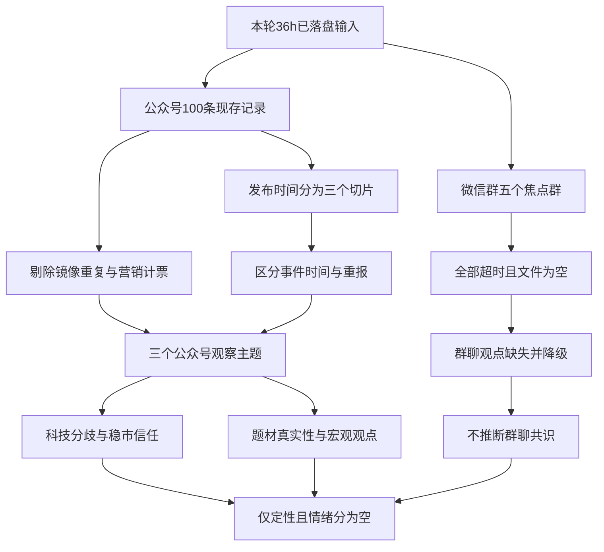

# 2026年11月7日（周六）· 周末轻量情绪观察

> **一句话结论：公众号围绕科技修复、稳市信心与题材真实性存在分歧；群聊缺失，无法判断周末共识。**
>
> 🟡 新鲜度 `partial` · 降级 `true`（**仅因群聊观点缺失**）· 情绪分 `null` · 置信度 `null`。这是公众号观察，不是群聊投票、市场情绪评分或交易结论。

## 🧭 范围与情绪浓度口径

- 只读本轮已落盘的**微信群、公众号两类输入**；微信群实际上不可用，结论只能落在公众号样本。未补抓群聊、未以新闻快讯或公告库替代公众号，也未调用热榜评分。
- 抓取声明为 `36h`，群聊起点和各生成时钟见 frontmatter。`manifest`、RSS状态、热榜审计件先后生成，**不是同一原子快照**。公众号实际发布时间为 **2026-11-06 06:43—2026-11-07 17:23（中国时区）**；文件名是周末观察日期，不是交易日字段。
- 已逐条审阅 `100` 条全部现存标题与正文。按发布时间分为**周五收盘前 `35` 条、周五盘后 `39` 条、周六 `26` 条**，不是100条纯周末新观点。收盘前/盘后以周五 `15:00` 分界，文章内事件日期另行识别。
- **浓度只作定性阅读：**样本内科技、资本开支与稳市讨论较突出，但恐慌解释、反弹观察与长期乐观同时存在，不能概括成一致转多。没有同长窗口基准、有效群聊或市场量化证据，不给比例型情绪浓度、不填默认分数、不判断情绪周期。
- 证券时报与上海证券报各 `46` 条，合计 `92` 条，余下 `8` 条来自其他 `7` 个公众号。**媒体供给集中不等于投资者意见集中**；文章数也不等于独立观点数。下列仅保留三个观察主题，不强凑五个，不形成板块排名或 `L1+L2` 量化共振。

## 🔎 详细分析：三个公众号观察主题

### ① 科技：近端订单与远端回报的争论，尚未被一夜反弹解决

**观察：从周五急跌归因，到周六反弹报道，变的是报道阶段，不是已验证的共同转向。**周五盘前《傅里叶的猫》把讨论焦点放在远期资本开支、项目执行与去杠杆，同时保留在建项目难以骤停的多头解释；周五盘后上海证券报采访强调国内科技的相对独立叙事；周六《证金事》继续质疑盈利预期和基金经理判断，《金渐成》则说反转仍待观察。[E01–E05]

- **大资金意图**: **未核。**报道中的机构研判、作者对ETF/杠杆资金的解释均是二手观点；本报告没有独立持仓、成交或资金流证据，不能据此声称机构已统一抄底或派发。
- **为什么走强**: 这里只解释**修复叙事为何出现**：周六报道记录隔夜科技反弹，国内文章又援引订单与回购增强信心。[E02、E03] 没有据此认证A股周末走强，更不能把周六转述的周五海外交易当成周六新增买盘。
- **逻辑够不够硬**: **“观点有分歧”可以核，行业需求无虞不能核。**算力服务合同报道同时存在浮动定价、分批订单、融资投入条件；磷化铟报道明确属于意向协议，最终协议与出口许可仍不确定。[E06、E07] 这些约束反驳了“大单标题等于未来盈利锁定”，但也不证明需求已经消失。

**支持 / 反证：**有订单与国产替代的正向叙事，也有远期回报和去杠杆的负向解释；同一篇长文可能兼具两端，不能拆成两票共识。个别基金爆仓、禁止AI法案等说法在评论中出现，但**本轮未核原始法案、基金公告或交易台原报，均不升格为事实**。[E01、E21]

### ② 稳市：政策与回购强化信心叙事，但“喊话是否有效”仍有疑问

**观察：政策支持与市场信任不是同一个变量。**国常会部署、互换便利操作和回购报道提供了支持性文本；上海证券报采访进一步将其解释为预期修复。与此同时，《猫笔刀》质疑宽基ETF层面的干预可见度和公司喊话的短期效果，《证金事》对科技修复仍偏谨慎。[E04、E08–E11]

- **大资金意图**: **未核。**仅能复述公众号所报道的券商互换便利买入，不推断买入总额、具体标的、持续性或全市场净流入；自购计划也不等于已成交。
- **为什么走强**: 此处指**信心修复话语的依据**：有政策表述、券商操作报道和公司回购信息，而非只有口号。[E08–E10] 但“提议—方案—实际完成”阶段不同，不能合并为同一强度的执行证据。
- **逻辑够不够硬**: **政策与报道文本可追溯，情绪效果未确认。**《猫笔刀》“未见官军痕迹”是作者依ETF观察作出的判断，不是官方资金未入市的事实；券商买入报道与ETF渠道观察也不是互相否定的同口径证据。[E09、E11] 不因此宣判政策失效或恐慌结束。

**支持 / 反证：**国常会多篇报道共享同一会议底稿；两报回购汇总也大幅共享底层公告。保留不同解读，不把转载次数计成独立支持票。[E08、E10；见去重表]

### ③ 题材：AI短剧与“东方”叙事的传播，必须与业务真实性分开

**观察：主题吸引注意，不等于业务已兑现。**财联社早知道的VIP日报将AI漫剧、光伏、算力租赁列为案例，但正文含付费栏目成绩展示和订阅引导，应视为**营销夹杂资讯**，不是独立群聊认同。周六发布的浙文影业澄清报道、周五的“东方”系风险报道，又对题材映射构成直接限制。[E12–E14]

- **大资金意图**: **未核。**不能从连板、名称联想或报道语气断言游资抱团、诱多出货；未使用文内龙虎榜转述推演资金对手盘。
- **为什么走强**: 仅说明**传播抓手**：短剧出海/AI内容商业化叙事、名称联想和既有赚钱案例让标题易扩散。群聊缺失，实际传播范围、参与人数和周六新增关注度均未知。
- **逻辑够不够硬**: **题材映射有可核反证。**上海证券报周六文章转述公司无AI短剧业务及监管函，事件发生在周五盘后；不能因周六才刊发而当作周六新事件。[E13] “东方”系报道也列出业务亏损与非理性波动提醒，不能把名称相关性当盈利逻辑。[E14]

**支持 / 反证：**可保留内容应用这一研究观察，但不能将公司澄清泛化成整个短剧产业无需求，也不能把营销文章的历史涨幅当周末情绪浓度。文中公司仅为原文身份核对，**不构成股票推荐**。

## 🌐 宏观与情绪观点（独立保留，不强塞板块）

| 观察 | 支持性文本 / 反向约束 | 来源 |
|---|---|---|
| 中美沟通与限制并存 | 周六两报转述的是周五晚视频通话；同时有制裁回应报道，不能只取沟通措辞便判风险消除。两报通话稿同源于新华社。 | [E15、E16] |
| 民间投资与“六张网” | 周六民企座谈会报道实际指向周五会议，周五另有项目调度稿。属于政策信心背景，不自动等于周末新政策或新增成交。 | [E17、E18] |
| 黄金与风险偏好 | 周六报道把央行储备多元化与短期黄金受去杠杆影响并列；两种机制并存，不能从储备变化直接推短线避险强弱。具体数据未经本轮原始统计核验。 | [E19] |
| 白酒修复分歧 | 周六采访既谈报表与去库存改善，也保留终端动销未好转、渠道退出的证言。单篇内有反证，不提炼成全面消费复苏共识。 | [E20] |
| 恐慌、耐心与单因归因 | 《贩财局》放大监管和爆仓叙事；《猫笔刀》不认同简单“清算AI”归因；《金渐成》强调反转待观察；《证金事》持续警惕远期预期。是公众号表达分歧，**群聊是否同样分歧仍未知**。 | [E04、E05、E11、E21] |
| 其他产业观察不升格为主线 | 机器人“回本/复购”讨论、商业航天发射报道、农业和电力报道均已阅读；单条事件或周五盘中叙述不足以证明周六发酵。 | [E22–E24] |

## 🧾 关键证据索引

**统一源文件：`data/raw/20261107/wechat_official_20.jsonl`。下表 `L` 为一基物理行号；日期取记录 `update_time_str`，不是正文所述事件日。**所有“事实”均只代表文章的事实性转述，未以外部一手资料独立认证。

| 锚点 | 源行 | 公众号 · 发布日期 | 文章标题 | 证据身份 |
|---|---:|---|---|---|
| E01 | L96 | 傅里叶的猫 · 2026-11-06 | 昨夜美股，市场正用提前交易2028年的AI资本开支拐点 | 多空解释并存；尾部知识星球推广不计观点证据 |
| E02 | L72 | 上海证券报 · 2026-11-06 | 无惧外围扰动！机构研判：A股科技行情具备相对独立叙事 | 采访与研报观点，不代表全体投资者 |
| E03 | L58 | 上海证券报 · 2026-11-07 | 美股科技股超跌反弹，热门中概股普涨 | 海外周五收盘报道；不能作周六A股行情 |
| E04 | L100 | 证金事 · 2026-11-07 | 基金经理大梦不醒 | 审慎/批评观点；出货及后市判断未核 |
| E05 | L97 | 金渐成 · 2026-11-07 | 最漫长的一条路~ | 反转待观察的个人观点；个人配置与生活段不迁移到本报告建议 |
| E06 | L56 | 上海证券报 · 2026-11-07 | 49.15亿元，301248签算力大单 | 周五合同的后续报道；分批、浮价、投入条件 |
| E07 | L63 | 上海证券报 · 2026-11-06 | 300489，签署超6.01亿美元磷化铟衬底供货协议 | 正文为意向协议，最终签约与许可有不确定性 |
| E08 | L67 | 上海证券报 · 2026-11-06 | 国常会：完善资本市场稳市机制，增强股市内在稳定性 | 会议报道加专家解读 |
| E09 | L78 | 上海证券报 · 2026-11-06 | 中金公司、银河证券，执行买入操作 | 券商操作的事实性转述，标的/规模未给完整 |
| E10 | L66 | 上海证券报 · 2026-11-06 | 密集披露！又一波回购来了 | 回购方案与提议汇总，并非全部已实施 |
| E11 | L95 | 猫笔刀 · 2026-11-06 | 两件事挺意外的 | 个人ETF观察与政策信任判断，不能代替资金监测 |
| E12 | L1 | 财联社早知道 · 2026-11-06 | 【VIP日报】市场缩量调整 AI漫剧逆势活跃 栏目精选行业研报 提及相关公司涨停 | 营销夹杂资讯，历史案例不计独立共识 |
| E13 | L61 | 上海证券报 · 2026-11-07 | 5连板后收监管函！601599澄清：无AI短剧相关业务 | 周五盘后公司风险提示的周六报道 |
| E14 | L82 | 上海证券报 · 2026-11-06 | A股“东方”系个股，集体走强 | 盘中题材报道；含非理性波动与经营风险提示 |
| E15 | L59 | 上海证券报 · 2026-11-07 | 何立峰与美国财政部长贝森特、贸易代表格里尔举行视频通话 | 新华社通稿，与L10共享底稿 |
| E16 | L8 | 证券时报 · 2026-11-07 | 商务部新闻发言人就美制裁中国企业答记者问 | 引述回应，风险背景而非市场资金行为 |
| E17 | L3 | 证券时报 · 2026-11-07 | 国家发展改革委召开民企座谈会，多家A股公司代表参加 | 周五会议的周六报道；来源标第一财经 |
| E18 | L70 | 上海证券报 · 2026-11-06 | “六张网”重大项目建设，最新消息 | 政策/项目建设背景 |
| E19 | L6 | 证券时报 · 2026-11-07 | 央行连续24个月增持黄金，最新解读→ | 储备转述与分析师解释，短期机制并不单向 |
| E20 | L52 | 上海证券报 · 2026-11-07 | 寒意渐退，暖意初生：2027年白酒行业或现“微型反转”？ | 同文保留渠道反证 |
| E21 | L99；L98 | 贩财局 · 2026-11-06；2026-11-07 | 《美股史诗级暴跌，周小川再度封神》；《都说这轮美股崩盘的导火索，是这条法案：…》（第二条为长标题，明确仅列开头） | 评论/传闻，未核法案阶段及基金爆仓；同作者同一叙事不计两票 |
| E22 | L94 | 上海证券报 · 2026-11-06 | 回归订单验证，具身智能场景落地的真需求在哪？ | 行业访谈，以回本与复购检验需求 |
| E23 | L57 | 上海证券报 · 2026-11-07 | 一箭四星，发射成功！ | 周六单条发射报道，不证明情绪扩散 |
| E24 | L87 | 上海证券报 · 2026-11-06 | 4连板！603381，“一字”涨停 | 周五午间农业/电力等报道，不是周末新增共识 |

## 🧮 时间切分、去重与覆盖审阅

### 发布时间与事件时间分开

| 发布切片 | 记录数 | 能回答什么 | 不能回答什么 |
|---|---:|---|---|
| 2026-11-06 收盘前 | `35` | 周五盘前/盘中流传的叙事与既有背景 | 不是周末新增热度；午间数据不能作收盘结果 |
| 2026-11-06 盘后 | `39` | 收盘后解读、政策与公司事件的文本变化 | 不能凭文章推断晚间资金实际去向 |
| 2026-11-07 周六 | `26` | 周六发布的报道与作者观点 | 包含周五事件重报，不等于26个新事件 |
| **合计** | **`100`** | 全量现存记录已阅 | 不代表100篇完整原文或100个独立观点 |

`L35–L48` 共 `14` 条的 `content` 与标题相同，**只作为标题传播痕迹，不补写正文、不参与观点判断**。其余 `86` 条有正文，但不宣称全文齐全：例如 `L54` 末尾明显截断。`L98` 标题本身是长段落，正文又重复该段，内部重复只读作一个表达。RSS兼容镜像与主文件字节相同，不能再加一次变为200条。

### 重要同稿 / 同事件归并（仅用于排除重复，不给独立观点总数）

| 源行组 | 共享底层信息 | 处理 |
|---|---|---|
| L10、L59 | 同一中美通话新华社稿 | 一个底稿；两平台刊发不是双源意见 |
| L19、L67、L69 | 同一次国常会 | 一个会议；L67附带采访保留为解读，不重复计算会议支持票 |
| L17、L56 | 同一算力服务合同 | 周五/周六跟进合并；周六补充条款保留，不当新订单 |
| L20、L66 | 同一晚多家公司回购事项 | 重叠公司事件归并；不把总方案额当成交额 |
| L33、L85 | 同批午间回购/经营信息 | 按公司事项归并；金额/主体口径存在疑点，不搬运为量化基础 |
| L26、L28、L78；L67相关段 | 同批券商互换便利操作 | 不把汇总稿重复加成新操作 |
| L27、L77 | 同一私募自购计划 | 合并为计划；不当已完成自购或周末资金流 |
| L23、L60；L15、L74 | 两起公司/实控人立案事项 | 各按其自身事项归并；不是四起独立风险事件 |
| L32、L71 | 同一港交所三季报 | 合并财报底稿；历史业绩不当本周末情绪 |
| L12、L58；L13、L62及其他盘前稿 | 同一海外周五交易的不同阶段 | 区分盘前/盘中/收盘，后阶段更新不算多次独立反弹 |
| L98、L99 | 同一作者围绕监管冲击的延续叙事 | 不当两名独立KOL；法案、爆仓传闻不升级为事实 |

**全量审阅留痕：**`L1–L2` 为营销/盘前汇编；`L3–L34` 为媒体政策、公司及行情报道；`L35–L48` 为仅标题；`L49–L94` 为另一媒体的宏观、公司、产业与市场报道；`L95–L100` 为作者评论。上述范围覆盖全部100行，并非自动关键词计票。媒体周年/峰会稿（如L51、L54–L55）、L95/L97的非市场段落未用于情绪结论；L1、L96及部分异动稿的订阅/栏目导流不作认同证据。

## 数据源审计

| 源 / 审计对象 | 日期 | 状态 | 数量与边界 |
|---|---|:--:|---|
| `wechat_cli_5groups.jsonl` | 2026-11-07 | 🔴 timeout | 文件实际 `0` 字节、`0` 记录；manifest记载 `5/5` 群 `timeout>45s`，成功群 `0/5`。是观点缺失，不是群聊安静。 |
| `wechat_official_20.jsonl` | 2026-11-06—2026-11-07 | 🟢 可读 | 实际 `100` 条、`352443` 字节、`9` 个有文章公众号；100条现存内容均已审阅，全文可读性有上述限制。 |
| `wechat_official_rss.jsonl` | 2026-11-07 | 🟢 同源镜像 | 与上项逐字节相同；只计100条，不叠加为独立源。 |
| `rss_fetch_status.json` | 2026-11-07 | 🟡 覆盖不均 | `17/17` feed可达，`9/17` 有窗口文章；core覆盖 `6/10`。8个订阅窗口内无记录，不等于8个作者没有观点。 |
| `manifest.json` | 2026-11-07 | 🟡 声明须分项看 | 声明36h；虽`global_severity=0`，群聊分项明确报错。本报告依实际文件与分项状态降级，不照抄全局绿灯。 |
| `attention_weekend.json`（仅元信息审计） | 2026-11-07 | 🟡 not_available | 周六东财人气、飙升、同花顺热股、概念榜均 `0` 行。文件里的 `25` 条 `weekend_persistent` **没有周六有效榜支撑**，不能当周六持续发酵。 |
| `attention_signals.json`（仅绑定审计） | 2026-11-06 | 🟡 非周六信号 | `use_trade_date=20261107`，但`trade_date`/`signal_trade_date=20261106`，来源绑定周五。未读其个股信号作分析，未拿周五榜充周末榜。 |

公众号窗口内无记录的8个订阅为：股痴流沙河、安静拆主线、盘口逻辑拆解、调研先知、远川研究所、李迅雷金融与投资、财闻私享、ymj0418。feed可达不保证作者历史和窗口覆盖完整；这些是公众号公开名称，**不披露任何真实群名**。

**三道证据边界：**
1. **表达边界：**媒体、作者评论、营销、标题和不可读内容分开；本报告没有可读群聊，不能替五个群造立场。
2. **独立性边界：**公众号正文与RSS镜像不双计；同一通稿、公告、海外交易及同作者延续说法不累积成“共振”。
3. **时间与量化边界：**周五盘前/盘中、盘后、周六发布分开；发布时间不等于事件发生日；热榜只审计缺口，`not_available`不触发本轮额外降级，情绪分保持`null`。

## 🧩 证据边界图

**图表验收：**主控追加验收（2026-11-07 18:38，中国时区）：部署同版Mermaid 11.4.0已实际解析并渲染SVG 22031字节；仍是因缺群聊而降级的周末文本，不是完整量化共振通过。

## ⚠️ 不确定性 / 反证与仍缺的数据

- **核心缺口是群聊：**五群全部超时，没有作者、回复上下文、跨群去重或分日传播数据。因此不说群聊安静、不说KOL一致、不说没有分歧，也不能判断周五到周六群内情绪变化。
- 公众号样本被两家媒体显著占据；同一报道内多个分析师只说明该稿采样，不代表市场总体。没有同长窗口对照，不能说周六升温/降温；周六26条也不能与周五74条直接比较。
- 缺少14条标题对应正文、部分被截正文、所引原始法案/机构报告/公司公告的独立核验。正文引用的行情、资金和预测只是报道内容，不是本报告重新取得的量化证据；未据此计算市场分。
- 周六无新榜已标`not_available`，不是观点缺失的替代证据；也不为凑完整评分读取其他量化源。没有`L1+L2`共振、资金意图、个股买卖建议、价位、止损或仓位输出。

## 🔗 与其他研究的关系

- 依赖：本轮raw目录的manifest、公众号主文件/镜像、群聊空文件及RSS状态；attention两文件仅作时点、空榜和绑定审计。**未依赖或生成任何R1/R3/R4机读研究产物。**
- 交付边界：只写本md及原子替换必需临时文件；不修改`data/research`、`data/health`、源码、技能、cron或其他profile，不发送消息。
- 后续可作定性上下文；不能自动赋予任何交易资格，也不能把本报告替代完整R3量化流程。

## 🏷️ Sub-Agent 元数据

- skill：`analyze_sentiment_resonance_v1`；按本轮明确授权采用`weekend_light`文本口径，常规交易评分/首推票契约不适用。
- artifact：仅本md，无新增JSON；confidence无可继承有效测量故为`null`，不套缺证默认公式。
- model：`gpt-6.1-sol`；生成耗时未单独计时，不填估计值。
- 完成身份：**降级的周末轻量文本交付**；主控追加验收（2026-11-07）：部署同版Mermaid 11.4.0已实际解析并渲染SVG 22031字节；仍因缺群聊而降级，不是完整量化共振验收通过。
