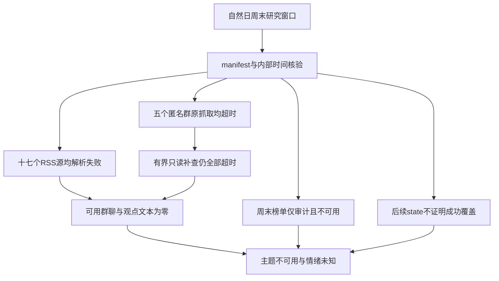

# 2026年11月8日 · 周末轻量群聊情绪

> **结论：主文本源失效，无法识别周末主导主题；不能把缺数解释成群聊安静。**
> **状态：** `partial` · **新鲜度：** `partial` · **降级：** `true` · **置信度：** `null`
> 本篇按自然日标记，不是交易日情绪报告；不生成市场情绪分，也不提供交易执行内容。

## 🧭 主题与情绪结论

| 研究项 | 本轮结论 | 证据边界 |
|---|---|---|
| Top主题 | **`not_available`** | 没有可读群聊样本，不能编排Top5或用旧题材补位 |
| 群聊情绪偏向 | **`unknown`** | 无法区分乐观、谨慎、分歧或中性 |
| 情绪浓度 / 一致预期 | **`unknown` / `unknown`** | 不是0分，也不是已观测到低共识 |
| 周六到周日变化 | **`unknown`** | 没有等长、分日、可核的文本覆盖 |
| 独立观点及跨群传播 | **`unknown`** | 不能把5个目标群当作5个已覆盖独立信源 |
| 双源共振 | **未验证** | 群聊无文本，周末榜单仅作健康审计且不可用 |

## 🔍 详细分析

### 文本不可得，不等于没有讨论

实际读取的群聊、公众号RSS及其兼容副本、两类新闻、公告窗口共六个JSONL文件均为 **0字节、0条本地记录**。这只能说明本次没有取得可分析正文，**实际窗口内消息总量仍未知**。群聊原抓取5群全部超时，公众号17个RSS源全部DNS解析失败，因此无法把本地空文件解释为参与者沉默、情绪冷却或题材退潮。

### 有界只读替代路径仍未恢复样本

已读取当前抓取端的5群名单及群聊证据审计配方，核对 `wechat-cli --help` 与 `history --help` 均正常返回。随后按显式起止边界，逐群执行只读 `history` 查询，每群上限500条、偏移0、单次超时8秒；**匿名群1至5全部超时，标准输出和错误输出均未取得内容**。这验证了CLI命令帮助可用，但没有验证实际微信数据连接或同步覆盖。没有可解析首屏，分页、尾页与分日完整性均未验证；未继续重试或重跑整套抓取。

### 公众号观点不冒充群聊共识

公众号RSS没有成功获取文章，因此产业观点、宏观与情绪观点均为 **`not_available`**。兼容文件与RSS属于同一来源，不能重复计独立确认；新闻和公告也没有可读正文，不能补造周末主题。因有效文本为空，本轮无法执行本人及被引用内容排除、作者同文去重、标题/推广/直接观点分类和语义归并；这些步骤均标为 **未能检验**，不伪称“去重后无主题”。

### 本轮只交付证据覆盖审计

同日原始目录没有其他可用群聊或公众号正文快照，同日研究目录仅有周末榜单健康文件。没有回填周五内容，也没有把榜单空值解释为热度消失。**置信度保留 `null`**，不在无有效样本时套用公式生成貌似精确的分数；本篇的 `partial` 是交付与覆盖状态，不是市场情绪结论。

## 🕰️ 窗口差异与时间证据

- **25小时不是完整“周五收盘以来”。** `manifest` 声明回看25小时，群聊 `since` 为2026-11-07 18:00（原值精确保留于frontmatter），不覆盖2026-11-06收盘至该起点的完整周末区间。不能据此声称已审阅整个周末。
- **存在多个文件内部时钟，不能拼成连续覆盖。** manifest标记2026-11-08 18:43，RSS健康文件生成于同日19:00；后续 `fetch_window_state` 与周末榜单文件记录到22:04。后者晚于manifest，仍未带来有效正文，不能把状态更新时间当成抓取成功或把窗口自动延长到22:04。
- **补查上界与原抓取上界不同。** 本轮只读补查将结束边界显式设为2026-11-08 23:33，起点沿用原群聊 `since`；全部超时，因此该上界仅是查询参数，不是已经观测到消息的截止点。精确边界见frontmatter。
- **最早/最晚真实消息时间均为 `unknown`。** 本文未使用文件mtime、文件名或state声称连续覆盖；manifest及state原始时间不含时区，保持原值，查询按本地中国时区执行。

## 🧩 关键证据与健康冲突

| 证据 | 可核事实 | 不允许推出的结论 |
|---|---|---|
| `manifest.json` 的群聊分项 | `groups_total=5`、`groups_ok=0`，每群 `timeout>45s` | 5群没有聊天 |
| `rss_fetch_status.json` | `feeds_total=17`、`feeds_ok=0`、`articles_total=0`，均DNS失败 | 公众号没有发文 |
| 六个正文JSONL | 均0字节、0条本地记录 | 实际文本总量为0 |
| `manifest.json` 的汇总 | `global_severity=0`，但文本源分项全部失败 | 全源健康或完整覆盖 |
| `attention_weekend.json` | 各日期子源均error、`top`为空、持续在榜列表为空 | 周末无热点或热度回落 |
| `fetch_window_state.json` | 内部更新时间晚于manifest | 后续抓取成功、漏窗已经补齐 |

**汇总健康标记与明细冲突。** `global_severity=0` 不能覆盖群聊超时和RSS解析失败的直接证据；manifest的周末榜单外层 `status=ok` 也与其逐日子源错误不一致。本篇按实际正文缺失标 `degraded: true`，不修改任何上游文件。周末无榜统一标 `not_available`，**不因非交易日本身或无榜单单独触发降级**。

## 🗺️ 证据覆盖链

> 图仅表达证据链，不描绘虚构题材。已核对有9个ASCII节点及分层关系；当前环境未找到 `mmdc` 或项目内Mermaid渲染包，**实际阅读端解析及SVG渲染未验证**，没有安装依赖。

## 数据源审计

| 源 | 日期 | 状态 | 本地记录 / 缺口 |
|---|---|:--:|---|
| 群聊 · 匿名群1 | 2026-11-08 | 🔴 | 原抓取超时；本轮8秒只读补查超时；真实消息量unknown |
| 群聊 · 匿名群2 | 2026-11-08 | 🔴 | 同上；无可读样本，分日和分页未验证 |
| 群聊 · 匿名群3 | 2026-11-08 | 🔴 | 同上；无可读样本，分日和分页未验证 |
| 群聊 · 匿名群4 | 2026-11-08 | 🔴 | 同上；无可读样本，分日和分页未验证 |
| 群聊 · 匿名群5 | 2026-11-08 | 🔴 | 同上；无可读样本，分日和分页未验证 |
| `wechat_cli_5groups.jsonl` | 2026-11-08 | 🔴 | 0字节、0条本地记录；不是聊天量测量值 |
| `wechat_official_rss.jsonl` | 2026-11-08 | 🔴 | 0字节、0篇；17个RSS源均DNS错误 |
| `wechat_official_20.jsonl` | 2026-11-08 | 🔴 | 0字节、0篇；RSS兼容副本，不额外计源 |
| `news_cls.jsonl` / `news_major.jsonl` | 2026-11-08 | 🔴 | 各0字节、0条；`news_extras` 整体180秒超时 |
| `anns_window.jsonl` | 2026-11-08 | 🔴 | 0字节、0条；分项error，实际公告量unknown |
| `attention_weekend.json` | 2026-11-08 | 🟡 | `not_available`；只读健康审计，含2026-11-05至2026-11-08错误记录，未用于主题或情绪判断 |
| `attention_signals.json` | 2026-11-08 | 🟡 | 文件不存在；不以旧交易日榜单补位 |
| `mcp_health.json` | 2026-11-08 | 🟡 | 文件缺失；连通健康unknown |
| `manifest.json` / `rss_fetch_status.json` | 2026-11-08 | 🟡 | 健康审计资料可读；汇总标记与子项存在冲突 |
| `fetch_window_state.json` | 2026-11-08 | 🟡 | 仅状态时间可读，不证明成功覆盖 |
| WeFlow兼容层 | 2026-11-08 | 🟡 | 已下线、不适用；未调用或使用历史快照 |

## ⚠️ 不确定性 / 反证

1. **对“周末冷清”的反证是取数失败。** 没有成功响应，无法确认其安静；本报告也不主张实际很热，只保留未知。
2. **对“没有主导主题”的反证是无样本。** `not_available` 描述本轮可用性，不是证明市场不存在主导叙事。
3. CLI帮助成功不代表数据库可访问；本轮只定位到数据查询超时，未确认其具体网络、数据库或同步根因。
4. 任何后来恢复的窗口内正文都可能改变结论；只有核验消息内部时间、可读性、分页及独立性后，才可比较两日变化，不能凭文件更新日期替代。
5. 本轮没有Top对象、首推对象或市场强弱判断，故交易日模板的资金意图推测、个股思维链与分数条款不适用；不为满足格式虚构内容。

## 🔗 与其他研究的关系

- 本篇仅提供R3窗口覆盖与证据缺口，未消费其他R/D/E结论来反推周末群聊情绪。
- 可向主控说明“情绪与主题未知”，不得被下游当成中性、悲观、低热度或一致预期已经消失的证据。
- 未写入 `data/research` JSON，未改原始数据、技能、调度或配置；未调用QMT，未自行发送消息。

## 🧾 Sub-Agent 元数据与验证边界

- skill：`analyze_sentiment_resonance_v1`；遵循本次用户授权的周末轻量特例。
- 文档契约：`render_kg_md_v1` 与 `canghai_writing_contract_v1.md`；无有效样本时保留未知，不套用交易日补值。
- 唯一报告目标：`chzl_kg/投研交易/群聊情绪/20261108.md`；经同目录临时文件原子替换。
- 模型：`gpt-6.1-sol`。
- 机读研究产物：无；`confidence=null` 的原因为没有有效文本样本。
- 内容验收：自然日字段、来源条数、匿名化、无交易执行内容及证据链结构；实际图形渲染未验证。
