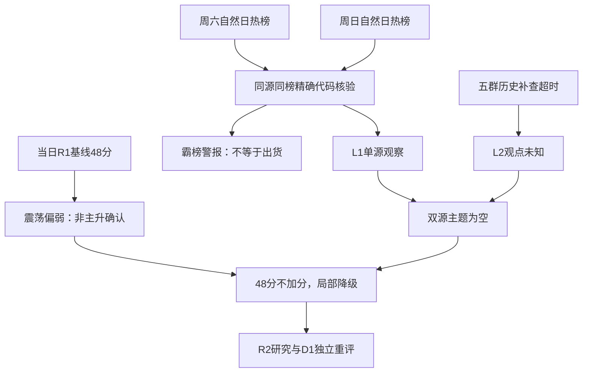

# 2026年11月9日 · 群聊情绪共振

> ⚠️ **数据源时间错位**：使用日为2026-11-09；行情事实为2026-11-06收盘，热榜为2026-11-07至2026-11-08，公众号为2026-11-08。不能当作今日盘中实测。
> 数据源新鲜度：partial；降级：true；本阶段状态：partial。

## 🧭 一句话结论
降级：48分震荡偏弱；五群失联，双源主题为零，周末榜单仅作观察，霸榜不等于出货。

## 🔎 详细分析

先认市场：当日R1显示，上一交易日上涨758家、下跌4741家，涨跌中位数为-1.8692%，收盘涨停32只、跌停15只；昨日涨停池收盘反馈中位数为-1.7449%。市场在奖励少数接力与相对抗跌，而非普遍主升。阶段描述为高位震荡、偏弱，不据此预断今日必跌，也不授予任何个股开仓资格。

再核情绪：严格消费 data/research/20261109/R1_style.json 的48分，没有调用前日R1。此文件本身为degraded，但有可核的量化公式与收盘证据，因此作有条件基线使用；本轮群聊全部缺失，0条双源主题，按“每个已认证L1+L2主题加2分，上限15”的规则，调整为0。48分是上一已完成交易日温度，不是今日盘前舆论测量值。五维反校验未取得认证的完整输入，分数与差值均留空。

周末人气仍活跃，但热度与赚钱不能划等号：商业航天两日概念榜第1，光伏第2、AI应用第3保持，短剧和机器人也在榜；这只是同源榜单中的关注排序。热股概念标签与AI摘要不能证明本轮真实驱动，更不能把“东方”等名称联动归成已确认产业主线。主线、持续性、板块封板率及今日加速/分歧/退潮预期由R2认证，R3均不擅自填值。

五群按配置名称补查及按联系人ID重试均超时，虽然联系人查询成功，也不能证明聊天内容可访问。群01当前昵称与配置备注有差异，未修改配置。没有正文、分页与同步认证，消息量是未知，不是0条，更不是“周末冷清”。因此 resonance_top_themes 和 kol_summary 都为空；公众号不能顶替群聊L2。研究观察保留，辅助源失效不构成全市场停买令。

## 📊 双源共振与L1单源观察

正式L1+L2主题：**0条**。以下按周日平台人气顺序展示五项，不是R2主线排序，不是五只候选股；态度均为**观察**。

| 主题 | 周六→周日概念榜 | 共振层 | 态度 | 边界 |
|---|---:|---|---|---|
| 商业航天 | 1→1 | L1_only | 观察 | 群聊未知，不进正式共振 |
| 光伏概念 | 2→2 | L1_only | 观察 | 群聊未知，不进正式共振 |
| AI应用 | 3→3 | L1_only | 观察 | 群聊未知，不进正式共振 |
| 短剧游戏 | 5→6 | L1_only | 观察 | 群聊未知，不进正式共振 |
| 人形机器人 | 6→7 | L1_only | 观察 | 群聊未知，不进正式共振 |

### 商业航天：观察

- **大资金意图**: 未核验本主题新增资金，榜单只证明注意力，不能反推机构下注。
- **为什么走强**: 本轮只认证排名，不认证价格走强。连续榜首只证明周末叙事集中；名称、发射和海外估值叙事不能替代A股订单确认。
- **逻辑够不够硬**: 热榜有证据，群聊无证据；公众号即使命中仍属补充，不满足双源确认。今日若无核心与新增资金共同确认，不升级可交易结论。

### 光伏概念：观察

- **大资金意图**: 未核验本主题新增资金，榜单只证明注意力，不能反推机构下注。
- **为什么走强**: 本轮只认证排名，不认证价格走强。周末持续在人气前列，但榜单涨跌幅来自既有行情，不证明周末或今日资金流入。
- **逻辑够不够硬**: 热榜有证据，群聊无证据；公众号即使命中仍属补充，不满足双源确认。今日若无核心与新增资金共同确认，不升级可交易结论。

### AI应用：观察

- **大资金意图**: 未核验本主题新增资金，榜单只证明注意力，不能反推机构下注。
- **为什么走强**: 本轮只认证排名，不认证价格走强。软件平台与Token出海叙事被公众号提出，Token算力服务不与全部AI应用简单等同。
- **逻辑够不够硬**: 热榜有证据，群聊无证据；公众号即使命中仍属补充，不满足双源确认。今日若无核心与新增资金共同确认，不升级可交易结论。

### 短剧游戏：观察

- **大资金意图**: 未核验本主题新增资金，榜单只证明注意力，不能反推机构下注。
- **为什么走强**: 本轮只认证排名，不认证价格走强。公众号既有反弹高度讨论，又有治理和业务澄清反证；热度不等于业务兑现。
- **逻辑够不够硬**: 热榜有证据，群聊无证据；公众号即使命中仍属补充，不满足双源确认。今日若无核心与新增资金共同确认，不升级可交易结论。

### 人形机器人：观察

- **大资金意图**: 未核验本主题新增资金，榜单只证明注意力，不能反推机构下注。
- **为什么走强**: 本轮只认证排名，不认证价格走强。产品报道可解释传播热度，但同事件多转载不增加独立观点。
- **逻辑够不够硬**: 热榜有证据，群聊无证据；公众号即使命中仍属补充，不满足双源确认。今日若无核心与新增资金共同确认，不升级可交易结论。

## 🧩 证据传导图

Mermaid实际SVG渲染验收：passed。未通过时不得视为完整写作验收通过。

## 🚨 distribution_alert_checks：范围、对象与结果

仅检查周日同花顺热股top20、东财人气top20、同花顺概念top20，对照周六同榜末次快照。股票两日原始榜各100条，概念各20条；没有新增全市场扫描，没有冒充覆盖后续R2名单。观察窗口为2026-11-07至2026-11-08，逐对象时间、代码、排名及原始引用见JSON同名字段。两日末次快照不等于两日全天连续第一；本轮规则按自然日，不冒充两个交易日。

检查行数60，checked=55，unknown=5；true=2，false=53，null=5。同票跨榜分行，不按行数宣称独立股票数。

| 对象 | 精确代码 | 来源 | 周六→周日 | 结果 |
|---|---|---|---|---|
| 东方海洋 | 002086.SZ | ths_hot/热股 | 2→1 | false / 本窗未命中 |
| 日出东方 | 603366.SH | ths_hot/热股 | 3→2 | false / 本窗未命中 |
| 东方新能 | 002310.SZ | ths_hot/热股 | 7→3 | false / 本窗未命中 |
| 阳光照明 | 600261.SH | ths_hot/热股 | 4→4 | false / 本窗未命中 |
| 九阳股份 | 002242.SZ | ths_hot/热股 | 6→5 | false / 本窗未命中 |
| 浙文影业 | 601599.SH | ths_hot/热股 | 8→6 | false / 本窗未命中 |
| 大东方 | 600327.SH | ths_hot/热股 | 12→7 | false / 本窗未命中 |
| 闽发铝业 | 002578.SZ | ths_hot/热股 | 13→8 | false / 本窗未命中 |
| 华新建材 | 600801.SH | ths_hot/热股 | 未覆盖→9 | null / unknown |
| 润建股份 | 002929.SZ | ths_hot/热股 | 21→10 | false / 本窗未命中 |
| 襄阳轴承 | 000678.SZ | ths_hot/热股 | 10→11 | false / 本窗未命中 |
| 东方日升 | 300118.SZ | ths_hot/热股 | 14→12 | false / 本窗未命中 |
| 东方嘉盛 | 002889.SZ | ths_hot/热股 | 17→13 | false / 本窗未命中 |
| 鲁阳节能 | 002088.SZ | ths_hot/热股 | 9→14 | false / 本窗未命中 |
| 东山精密 | 002384.SZ | ths_hot/热股 | 5→15 | false / 本窗未命中 |
| 长鑫科技 | 688825.SH | ths_hot/热股 | 1→16 | false / 本窗未命中 |
| 红太阳 | 000525.SZ | ths_hot/热股 | 15→17 | false / 本窗未命中 |
| 龙江交通 | 601188.SH | ths_hot/热股 | 16→18 | false / 本窗未命中 |
| 冰山冷热 | 000530.SZ | ths_hot/热股 | 18→19 | false / 本窗未命中 |
| 永臻股份 | 603381.SH | ths_hot/热股 | 23→20 | false / 本窗未命中 |
| 日出东方 | 603366.SH | dc_hot/人气榜 | 1→1 | true / 霸榜警报 |
| 东方海洋 | 002086.SZ | dc_hot/人气榜 | 2→2 | false / 本窗未命中 |
| 东方新能 | 002310.SZ | dc_hot/人气榜 | 4→3 | false / 本窗未命中 |
| 大东方 | 600327.SH | dc_hot/人气榜 | 3→4 | false / 本窗未命中 |
| 东方日升 | 300118.SZ | dc_hot/人气榜 | 8→5 | false / 本窗未命中 |
| 浙文影业 | 601599.SH | dc_hot/人气榜 | 6→6 | false / 本窗未命中 |
| 阳光照明 | 600261.SH | dc_hot/人气榜 | 11→7 | false / 本窗未命中 |
| 龙江交通 | 601188.SH | dc_hot/人气榜 | 15→8 | false / 本窗未命中 |
| 东方创业 | 600278.SH | dc_hot/人气榜 | 14→9 | false / 本窗未命中 |
| 立新能源 | 001258.SZ | dc_hot/人气榜 | 18→10 | false / 本窗未命中 |
| 润建股份 | 002929.SZ | dc_hot/人气榜 | 21→11 | false / 本窗未命中 |
| 东方嘉盛 | 002889.SZ | dc_hot/人气榜 | 19→12 | false / 本窗未命中 |
| 闽发铝业 | 002578.SZ | dc_hot/人气榜 | 17→13 | false / 本窗未命中 |
| 红太阳 | 000525.SZ | dc_hot/人气榜 | 16→14 | false / 本窗未命中 |
| 思美传媒 | 002712.SZ | dc_hot/人气榜 | 20→15 | false / 本窗未命中 |
| 东山精密 | 002384.SZ | dc_hot/人气榜 | 5→16 | false / 本窗未命中 |
| 鲁阳节能 | 002088.SZ | dc_hot/人气榜 | 10→17 | false / 本窗未命中 |
| 新能股份 | 000595.SZ | dc_hot/人气榜 | 28→18 | false / 本窗未命中 |
| 万向德农 | 600371.SH | dc_hot/人气榜 | 22→19 | false / 本窗未命中 |
| 永臻股份 | 603381.SH | dc_hot/人气榜 | 23→20 | false / 本窗未命中 |
| 商业航天 | 886078.TI | ths_hot/概念板块 | 1→1 | true / 霸榜警报 |
| 光伏概念 | 885531.TI | ths_hot/概念板块 | 2→2 | false / 本窗未命中 |
| AI应用 | 886108.TI | ths_hot/概念板块 | 3→3 | false / 本窗未命中 |
| 军工 | 885700.TI | ths_hot/概念板块 | 未覆盖→4 | null / unknown |
| 创新药 | 886015.TI | ths_hot/概念板块 | 4→5 | false / 本窗未命中 |
| 短剧游戏 | 886060.TI | ths_hot/概念板块 | 5→6 | false / 本窗未命中 |
| 人形机器人 | 886069.TI | ths_hot/概念板块 | 6→7 | false / 本窗未命中 |
| 机器人概念 | 885517.TI | ths_hot/概念板块 | 7→8 | false / 本窗未命中 |
| 人工智能 | 885728.TI | ths_hot/概念板块 | 9→9 | false / 本窗未命中 |
| 芯片概念 | 885756.TI | ths_hot/概念板块 | 未覆盖→10 | null / unknown |
| 猪肉 | 885573.TI | ths_hot/概念板块 | 13→11 | false / 本窗未命中 |
| 共封装光学(CPO) | 886033.TI | ths_hot/概念板块 | 8→12 | false / 本窗未命中 |
| 算力租赁 | 886050.TI | ths_hot/概念板块 | 未覆盖→13 | null / unknown |
| 光刻机 | 886054.TI | ths_hot/概念板块 | 未覆盖→14 | null / unknown |
| 冰雪产业 | 885825.TI | ths_hot/概念板块 | 16→15 | false / 本窗未命中 |
| AI视频 | 886068.TI | ths_hot/概念板块 | 17→16 | false / 本窗未命中 |
| 高股息精选 | 886072.TI | ths_hot/概念板块 | 10→17 | false / 本窗未命中 |
| 固态电池 | 886032.TI | ths_hot/概念板块 | 15→18 | false / 本窗未命中 |
| 转基因 | 885877.TI | ths_hot/概念板块 | 11→19 | false / 本窗未命中 |
| 存储芯片 | 886042.TI | ths_hot/概念板块 | 12→20 | false / 本窗未命中 |

两项阳性分别是日出东方（东财人气）与商业航天（同花顺概念）。东方海洋在同花顺热股为2→1，未满足同榜两日均第1，不能与其他榜单或周五快照拼接成连续霸榜。前日对象不在返回范围时置null；false仅是该对象、该榜单、该窗口内规则未命中，不等于没有任何派发风险。

完整L4的成交激增、长上影、席位卖出组合，以及近5日净流出均未在本轮认证，统一未知。警报不是hard_reject；后续R6只有精确映射对象且匹配窗口才能消费，不得把空alert或检查表缺席解释为阴性，更不得由禁MCP的R6补抓数据。

## 📰 公众号观点：补充，不计共振或加分

| 观点簇 | 支持与反证 | 阅读边界 |
|---|---|---|
| 宏观与情绪 | 《乐观》预期国内外修复；《忐忑，等周一》认为外围反弹偏弱，并澄清额度不等于已全额买入 | 两种判断并存，不能裁成一致乐观；传闻与概率不认证 |
| 反弹阶段 | 《周复盘：继续释放暖意》与《下周反弹看法》讨论止跌、缩圈与中位难度 | 两账号同署名，不视为两个独立作者；产业框架不是资金确认 |
| AI与Token | 端侧、云与Token出海被提出；海外数据中心约束、建设节奏及估值均有争论 | AI应用与算力租赁是相邻而非完全相同主题，不机械合并 |
| 短剧 | 热度延续，同时有专项治理、浙文影业无AI短剧业务的报道 | 留真实反证，交R4/R5核对原始披露，不凭人气标签授予业务地位 |
| 机器人与光刻机 | 机器人下线被多次报道；光刻机文章正文明确模型展示 | 同一事件转载不加票；模型不等于新增订单 |
| 股市获利结构 | 《股民困在A股时间里》对利润分布与投资体验提出批评 | 同题两版本归一观点；未把文章统计升级为本轮财务事实 |

原始RSS有38篇、覆盖11月8日；所有公众号均只作观点/报道证据。两篇图表复盘的可读正文只有免责声明，未读图内数据，不能据此认证其图表结论。转载独立性及摘要/改写情况已标注在机读文件，不将文章数当独立赞同票数，不比较不存在的两个完整自然日群聊热度。

## 🧾 关键证据

- 当日R1的E01/E02/E03及sentiment_calculation：48分、普跌广度及涨停池负中位反馈，事实日2026-11-06。
- R3_hotlist_evidence.json：按自然日实时直取8份榜单，每日股票三榜各100条、概念20条；rank_time为周末实际榜单时间。
- 同花顺商业航天1→1、东财日出东方1→1：霸榜警报；同花顺东方海洋2→1：同窗口规则阴性。
- wechat-cli：五群历史补查两轮均超时，联系人成功不等于消息覆盖成功；未知而非沉默。
- RSS原始第28/29/30/33行：乐观、审慎与反弹后半程的不同观点；第9行保留连板股业务/异动风险报道。

## 数据源审计

| 源 | 日期 | 状态 | 数量与覆盖 | 备注 |
|---|---|:--:|---|---|
| 当日R1 | 2026-11-09 | 🟡 | 1份；行情截至2026-11-06 | 原状态degraded；只用本日文件 |
| 同花顺热股 | 2026-11-07至2026-11-08 | 🟢 | 各100条 | 实时MCP交叉SDK直取；末次快照 |
| 东财人气/飙升榜 | 2026-11-07至2026-11-08 | 🟢 | 每榜每日100条 | 飙升不混作人气霸榜 |
| 同花顺概念榜 | 2026-11-07至2026-11-08 | 🟢 | 各20条 | 前日对象缺页/未覆盖保留unknown |
| 当日热榜查询 | 2026-11-09 | 🟡 | 热股、概念、人气均0条 | 尚无当日榜，不是市场热度零 |
| attention_signals | 2026-11-06 | 🟡 | 320条T-1绑定基准 | 不称今日实时，不用于替代周末榜 |
| attention_weekend | 2026-11-07至2026-11-08 | 🟢 | 本轮实时生成 | 价格沿用已完成行情，不当周末成交 |
| 群01至群05 | 2026-11-09 | 🔴 | 两轮全部timeout；实际量未知 | 0可用正文；分页与同步未核验 |
| RSS公众号 | 2026-11-08 | 🟡 | 38篇；16/17 feed成功，核心8/10 | 仅L2b，不顶替群聊 |
| XTick情绪 | 2026-11-06 | 🟢 | 1份；33涨停、15跌停、14炸板、高度5 | 与R1不含ST主口径存在差异；zbl字段不用 |
| 主力资金/完整L4 | 2026-11-09 | 🟡 | 本轮未核验 | 不能证明派发，不能给未知对象阴性 |
| WeFlow | 2026-11-09 | 🔴 | 永久退场；未调用 | 兼容字段置空，不阻塞其他有效证据 |

## ⚖️ 不确定性 / 反证

最大缺口是群聊正文，限制双源共振认证而非整个市场研究。榜单热度升温可能来自讨论风险而非主动买入；日出东方和商业航天的警报不能直接推断持仓结构，更不能推断已出货。上日主口径炸板率为30.43%，未达到35%减半触发；本轮没有研究首推个股，不编造候选数或价位。前日存在较高炸板的历史事实，不当作今日已发生状态。

本阶段不做板块资金排序或个股画像，不设首推/执行池，因而每票买入理由、板型、龙头、RR、禁止清单四项门禁由有权限的R2/R5/D1对真实候选完成，不能以热榜对象替代候选。R3不提供止损价，不假装已核开仓资格。in_today_plan未知，不用false提前排除本轮研究对象。

市场性判断以竞价后新增广度、昨日涨停反馈及核心资金为重评条件，最迟开盘重评；不无限继承旧计划的停买/零仓建议。真实账户停买、有效零预算、仓位硬上限、T+1、人工确认、既有授权保护和R6逐票hard_reject均不改变。预算来源未知不改成正额度。

## 🔗 与其他R/D/E的关系

- 依赖：当日R1_style.json、attention_signals.json、原始RSS、manifest；本轮补证写R3_hotlist_evidence.json与attention_weekend.json。
- R2：把单源热榜作为研究线索，不视为已确认主线或龙头地位。
- R4/R5：核对短剧业务澄清、机器人产品与光刻机模型等原始披露，保留真实反证。
- R6：精确消费distribution_alert_checks；未覆盖对象仍未知，硬否决权保持独立。
- D1：本阶段状态partial，局部缺证不能转成全局禁买；开仓资格与逐票门禁仍独立。
- E1：可追溯本次自然日榜单、降级原因及未认证项，不把未量化usage当0。

## Sub-Agent 元数据

- skill：analyze_sentiment_resonance_v1
- artifact：data/research/20261109/R3_sentiment.json
- method：llm_v1；语义审阅由本会话完成，未重开模型或调用旧关键词共振算法
- model：gpt-6.1-sol
- 真实生成日期：2026-11-09；非回放，不以业务日倒推资料时点
- 用量：usage_unknown；不保证低于努力目标
- 状态：partial；原因是群聊缺失，不冒充L1+L2完整通过
