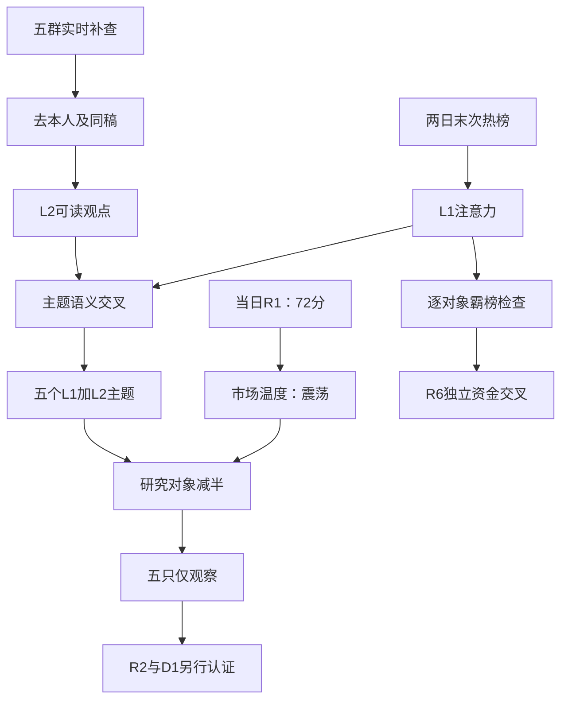

# 2026年11月10日 · 群聊情绪共振

> ⚠️ 数据源时间错位披露：业务日为2026-11-10，市场事实与热榜来自2026-11-09；对照日为2026-11-06。群聊覆盖延伸至2026-11-10。本报告使用当日R1，不使用前一日R1，也不冒充今日盘中观察。
> 数据新鲜度：partial；降级状态：true；交付状态：partial。研究判断不是买入权限，辅助缺数不全局禁买。

## 一句话结论
**情绪=震荡，72分不加码；五主题双源有交集，东方海洋霸榜警报，五只仅观察。**

## 📊 详细分析：先认市场，再读热度

市场目前奖励的是前排隔夜接力，不是盘中无差别追涨。用户指定的当日R1给出72分，其收盘事实为54只涨停、44只炸板、1只跌停、6板高度；同源炸板率为44.90%，封板率55.10%。前日32只涨停样本收盘反馈均值约+4.17%，但开盘到收盘均值仅约+0.24%。这两项可以同时成立，因此“有人赚钱”不能推成“盘中追谁都能赚钱”。本轮温度为高位震荡，情绪=震荡。

注意力的交集落在人形机器人、商业航天、冰雪产业、CPO和PCB。下面的顺序只表示共振证据优先级，不是R2板块排序，更不是五条可交易主线。主线=未知（交R2），持续性=未知，板块封板率=未知；全市场封板率55.10%不冒充单板块数字，下一交易窗口预期=分歧，新增竞价与资金证据出现即重评。

群聊不是五张独立选票。五群共407条记录，剔除一条本人链接；257次可读文本/标题精确去重后为181个正文簇，但181不等于独立观点数。奋达推广、ATP激光、采暖热泵和晚间复盘都有同稿跨群传播；卖方有署名的产业观点保留其推介属性，纯邀约、标题和未读图片不当直接观点。126张图片尚未读取，不能把这些消息当沉默，也不推断图中资金、价格或仓位。

情绪分保留72，双源调整为0。理由不是没有共振，而是主题关注度并无经验证规则可直接换成更高的市场情绪分。R1本身为degraded，其数值有真实量化依据且适用于本次盘前，置信度缺口同时保留。五维反校验缺分项归一化与杠杆外资中位，分数和差值均为null；公众号不加分，警报也不机械扣分。

## 🧭 双源共振主题：交集不等于资金确认

| 主题 | 概念热榜变化 | 双源解释 | 态度 |
|---|---|---|---|
| 人形机器人 | 8→2 | 本体、数采和触觉可读观点与人气上升相交 | 观察 |
| 商业航天 | 2→1 | 太空IDC、材料和星间通信传播；单柜测算冲突保留 | 观察 |
| 冰雪产业 | 20→3 | 冰雪复盘与设备热度相交；采暖、流感不是独立冰雪确认 | 观察 |
| 共封装光学(CPO) | 5→5 | 有直接短句，但中际关注度排名下降，不称人气加速 | 降级观察 |
| PCB概念 | 12→10 | 材料涨价和检测观点相交；上下游盈利方向不同 | 观察 |

### 人形机器人 · L1+L2

本体与数采、触觉叙事相互强化；长城、申万、HF三组明确归属文本与参与者短句，不能把苹果HALO的重复报道当四次产业确认。

- **大资金意图**: 模型到物理交互的瓶颈迁移吸引主题交易是合理假设，持仓与大资金真实意图未知。
- **为什么走强**: 概念热榜8→2，宇树热股35→2；说明关注度回流，不证明所有机器人票已是主升。
- **逻辑够不够硬**: 产业观点有多组署名，但HALO与本体量产有共同底层事件；上纬风险报道提示收入占比与需求持续性未知。

证据：G2 · 2026-11-09 · “【申万机器人】机器人成为市场主线，建议把握β机会！ 本轮的变化在哪里？  1）模型端是最大变化：OpenAI重”；G4 · 2026-11-09 · “🚩【长城邓宇亮】机器人盛世：三条思路与王牌票池[爱心]  大脑的进化会让机器人全面开花、走向全面盛世❗  💡三”。原句与精确时点见JSON证据引用；显示作者已使用匿名编号。

### 商业航天 · L1+L2

太空IDC、钛板和星间激光是商业航天的不同细分映射；天风相关稿跨群重复只算一簇，国金方向与中信测算分开保存。

- **大资金意图**: 资金可能交易地面算力约束向轨道基础设施延伸的预期，R3不认证资金流与供应链订单。
- **为什么走强**: 概念热榜2→1；顺灏同花顺83→38、东财99→10，西部材料东财56→20，属于已有关注加速而非无人知晓。
- **逻辑够不够硬**: 钛板单柜1万与4万估计互相冲突，商业化取决于复用降本及发射进度；不把愿景写成订单或营收。

证据：G5 · 2026-11-09 · “【天风电新】新一轮太空算力：看好Fii上天的供应链，增量在钛板和正交背板-1108 ———————————— ”；G4 · 2026-11-09 · “【国金计算机&科技】#地面束缚推动太空IDC风云起_关注AI基建新方向  【1】#马斯克首次明确2027Q3发”。原句与精确时点见JSON证据引用；显示作者已使用匿名编号。

### 冰雪产业 · L1+L2

冰雪旅游/制冷设备为概念本体；寒潮采暖、羽绒服仅作邻近天气叙事，不把热泵、流感合并成独立冰雪确认。

- **大资金意图**: 可能是季节性催化下的短周期轮动，资金是否从科技持续迁入未知。
- **为什么走强**: 概念20→3；雪人东财新进前20、同花顺58→44，冰山东财42→5，热榜与群聊确有交集。
- **逻辑够不够硬**: 季节性与可读复盘支持传播，但本地五群广播高度重复；旅游客流、订单、寒潮持续时间都未获R3量化认证。

证据：G2 · 2026-11-09 · “#1109复盘汇总  1️⃣机器人概念：午后涨停潮，全天最强主线  据外媒报道，三星、SK海力士、美光三大存储”；G5 · 2026-11-09 · “寒潮老师们重视急剧降温：【热泵日出东方】 【羽绒服古麟绒材】 【电热毯彩虹集团】”。原句与精确时点见JSON证据引用；显示作者已使用匿名编号。

### 共封装光学(CPO) · L1+L2

CPO短对话与国金太空硬件名单的光互联语义相交；不能拿公众号文章冒充L2独立群聊。

- **大资金意图**: 可能交易AI硬件修复与太空高速互联预期，但不确定是新增长资金还是旧仓修复。
- **为什么走强**: 概念5→5，中际热股3→5、东财2→31；价格修复与关注度走弱并存，不能写成新一轮人气加速。
- **逻辑够不够硬**: L1+L2存在但L2短句较薄、出口与海外事件扰动未核完；观察，不认证反转，更不以热度推派发。

证据：G5 · 2026-11-09 · “CPO  底部反转”；G5 · 2026-11-09 · “易中天   买买”。原句与精确时点见JSON证据引用；显示作者已使用匿名编号。

### PCB概念 · L1+L2

覆铜板涨价、检测设备与太空PCB是不同环节；共同映射PCB但不互相替代业绩证据。

- **大资金意图**: 可能交易硬件修复、供需与扩产预期，板材涨价对上下游利润方向不同，真实配置意图未知。
- **为什么走强**: 概念12→10；超声东财新进前20，沪电热股90→53，存在个股热度修复但不是全行业一致主升。
- **逻辑够不够硬**: 群聊和热榜支持双源叙事，订单口径、材料涨价是否挤压板厂与利润持续性需R5/R7继续核验。

证据：G2 · 2026-11-09 · “松下失火冲击AI材料供应，国内覆铜板大厂称即便无前述事件影响，本月也将调价 https://m.21jingj”；G2 · 2026-11-09 · “金安国纪 南亚新材”。原句与精确时点见JSON证据引用；显示作者已使用匿名编号。

## 🔍 五只研究观察对象：不授予执行资格

炸板率达到35%阈值，源内十个研究对象减半为五个。减半只约束本轮研究观察表，不替代R2最终名单，不据此清池或修改交易授权。未保留的五个源内对象为上纬新材、顺灏股份、中国卫星、冰山冷热、中际旭创；这是证据覆盖和研究容量取舍，不宣称其都是杂毛或已触发硬否决。

| 对象 | 板型 | 龙头认定 | 盈亏比 | 禁止清单 | 结论 |
|---|---|---|---|---|---|
| 宇树科技 688836.SH | 未认证 | R2待认定，通过条数未知 | 未测量，RR=null | 未逐项核验，空命中不代表通过 | 观察，不进execution |
| 凡拓数创 301313.SZ | 未认证 | R2待认定，通过条数未知 | 未测量，RR=null | 未逐项核验，空命中不代表通过 | 观察，不进execution |
| 西部材料 002149.SZ | 未认证 | R2待认定，通过条数未知 | 未测量，RR=null | 未逐项核验，空命中不代表通过 | 观察，不进execution |
| 雪人集团 002639.SZ | 未认证 | R2待认定，通过条数未知 | 未测量，RR=null | 未逐项核验，空命中不代表通过 | 观察，不进execution |
| 超声电子 000823.SZ | 未认证 | R2待认定，通过条数未知 | 未测量，RR=null | 未逐项核验，空命中不代表通过 | 观察，不进execution |

### 宇树科技 · 观察

- **买入理由**: 尚未形成买入许可；仅有研究理由：本体产业讨论密集；同花顺35→2、东财74→4为两条实际热榜锚。

- **风险点**: 高人气不保证承接；HALO、本体出货与利润兑现不能直接划等号。

- **止损条件**: R3无执行价位，以下是研究撤回条件而非委托止损：若R2不能认证核心地位，或所据本体/数采逻辑被原始公告否定，撤回该研究假设。 逐票止损距、RR和交易门禁由R5/D1按真实价格另算，不能用此段替代。

- **可验证假设**: 未来24—72小时查同花顺/东财是否至少一平台仍在前20；均退出且无新增可读独立观点，则注意力假设失效。

### 凡拓数创 · 观察

- **买入理由**: 尚未形成买入许可；仅有研究理由：物理AI和数据服务被群聊点名；当前同花顺热股31名提供可核注意力。

- **风险点**: “总龙头、翻数倍”是参与者自述；没有独立量价、板型、RR与禁止清单认证。

- **止损条件**: R3无执行价位，以下是研究撤回条件而非委托止损：若数据服务客户/业务归属被原始披露否定，或R2判为非核心，则撤回观察逻辑。 逐票止损距、RR和交易门禁由R5/D1按真实价格另算，不能用此段替代。

- **可验证假设**: 未来24—72小时核同花顺是否保留前50；若跌出且未出现新增独立客户/业务披露，撤回热度延续假设。

### 西部材料 · 观察

- **买入理由**: 尚未形成买入许可；仅有研究理由：太空钛板被不同署名文本讨论；东财56→20和同花顺32名为实际热榜锚。

- **风险点**: 单柜钛板1万元与4万元测算冲突；愿景、材料适配与订单收入之间尚无闭环。

- **止损条件**: R3无执行价位，以下是研究撤回条件而非委托止损：若原始客户/公告否认核心用途或商业化前提明显失效，撤回太空材料增量假设。 逐票止损距、RR和交易门禁由R5/D1按真实价格另算，不能用此段替代。

- **可验证假设**: 未来24—72小时查两平台是否至少一榜保持前50，并核是否出现可归属订单/验证披露；排名与产业事实分别记录，不相互代替。

### 雪人集团 · 观察

- **买入理由**: 尚未形成买入许可；仅有研究理由：冰雪设备季节性叙事明确；东财当前2名、同花顺58→44形成关注度交集。

- **风险点**: 天气催化窗口短；制冷、液冷和旅游收入不应混用，也没有R3资金持续性认证。

- **止损条件**: R3无执行价位，以下是研究撤回条件而非委托止损：若天气/雪季事件失效或R2不能认证板块前排，撤回观察假设，不把名称相近当补涨逻辑。 逐票止损距、RR和交易门禁由R5/D1按真实价格另算，不能用此段替代。

- **可验证假设**: 未来24—72小时核东财是否仍在前20、冰雪概念是否仍在前10；两者均失守则热度延续假设失败。

### 超声电子 · 观察

- **买入理由**: 尚未形成买入许可；仅有研究理由：PCB修复与供需观点相交；东财当前12名、同花顺26名为已取热榜锚。

- **风险点**: 覆铜板提价可能压缩板厂利润；热榜AI归因文本未经公告逐项验证。

- **止损条件**: R3无执行价位，以下是研究撤回条件而非委托止损：若原始公告否定扩产/订单关键假设或R2判定无核心地位，撤回其PCB修复观察。 逐票止损距、RR和交易门禁由R5/D1按真实价格另算，不能用此段替代。

- **可验证假设**: 未来24—72小时查双平台是否至少一榜仍在前50，并查是否有可归属新增产销披露；热度退潮与经营证伪分开记录。

## 🚨 distribution_alert_checks：结果与范围逐项披露

规则仅检查同一精确对象在2026-11-06与2026-11-09末次日榜是否均为第一；这是两个相邻交易日，不把周末补成自然日连续。没有检查所有盘中采样，也没有新增模式6全市场扫描。

范围为热股前20并集加五个观察对象，共33个股票对象，以及已返回的20个概念。共53项：checked=39，其中true=1、false=38；unknown=14。

东方海洋002086.SZ为唯一命中对象：同花顺1→1、东财1→1。它是人气拥挤/待资金交叉警报，不是已证实出货；R3不据此hard_reject。近五日资金净流出与该警报是否同对象、同窗口满足原规则，由R6独立核验。

下表来源：股票为本轮实时Tushare同花顺热股+东财人气榜，概念为同花顺概念榜。MCP先取证，随后同参数SDK重新取得完整序列计算存证。共同查询窗口为2026-11-06至2026-11-09末次榜；逐对象精确观察时间、实际窗口端点、来源与JSON定位在机读distribution_alert_checks中。

| 对象 | 类型 | 同花顺两端排名 | 东财两端排名 | 检查状态/结果 |
|---|---|---|---|---|
| 红太阳 000525.SZ | 股票 | 缺端点→64 | 20→17 | unknown / null · unknown |
| 冰山冷热 000530.SZ | 股票 | 8→11 | 42→5 | checked / false · 本窗口未命中 |
| 襄阳轴承 000678.SZ | 股票 | 14→6 | 31→71 | checked / false · 本窗口未命中 |
| 超声电子 000823.SZ | 股票 | 缺端点→26 | 缺端点→12 | unknown / null · unknown |
| 东方海洋 002086.SZ | 股票 | 1→1 | 1→1 | checked / true · 警报 |
| 西部材料 002149.SZ | 股票 | 缺端点→32 | 56→20 | unknown / null · unknown |
| 澳洋健康 002172.SZ | 股票 | 45→17 | 82→23 | checked / false · 本窗口未命中 |
| 九阳股份 002242.SZ | 股票 | 10→8 | 30→36 | checked / false · 本窗口未命中 |
| 东方新能 002310.SZ | 股票 | 缺端点→22 | 10→7 | unknown / null · unknown |
| 东山精密 002384.SZ | 股票 | 4→4 | 3→54 | checked / false · 本窗口未命中 |
| 顺灏股份 002565.SZ | 股票 | 83→38 | 99→10 | checked / false · 本窗口未命中 |
| 闽发铝业 002578.SZ | 股票 | 26→33 | 17→18 | checked / false · 本窗口未命中 |
| 雪人集团 002639.SZ | 股票 | 58→44 | 缺端点→2 | unknown / null · unknown |
| 东方日升 300118.SZ | 股票 | 6→13 | 6→32 | checked / false · 本窗口未命中 |
| 信维通信 300136.SZ | 股票 | 缺端点→21 | 缺端点→9 | unknown / null · unknown |
| 中际旭创 300308.SZ | 股票 | 3→5 | 2→31 | checked / false · 本窗口未命中 |
| 芒果超媒 300413.SZ | 股票 | 15→15 | 12→49 | checked / false · 本窗口未命中 |
| 新易盛 300502.SZ | 股票 | 9→10 | 9→62 | checked / false · 本窗口未命中 |
| 凡拓数创 301313.SZ | 股票 | 缺端点→31 | 缺端点→88 | unknown / null · unknown |
| 中国卫星 600118.SH | 股票 | 缺端点→12 | 缺端点→8 | unknown / null · unknown |
| 郑州煤电 600121.SH | 股票 | 缺端点→48 | 缺端点→14 | unknown / null · unknown |
| 金健米业 600127.SH | 股票 | 5→20 | 18→83 | checked / false · 本窗口未命中 |
| 阳光照明 600261.SH | 股票 | 2→3 | 5→16 | checked / false · 本窗口未命中 |
| 大东方 600327.SH | 股票 | 32→14 | 8→6 | checked / false · 本窗口未命中 |
| 先导基电 600641.SH | 股票 | 28→18 | 60→76 | checked / false · 本窗口未命中 |
| 文投控股 600715.SH | 股票 | 55→23 | 55→11 | checked / false · 本窗口未命中 |
| 工业富联 601138.SH | 股票 | 47→19 | 47→58 | checked / false · 本窗口未命中 |
| 龙江交通 601188.SH | 股票 | 42→63 | 21→13 | checked / false · 本窗口未命中 |
| 浙文影业 601599.SH | 股票 | 16→7 | 7→19 | checked / false · 本窗口未命中 |
| 日出东方 603366.SH | 股票 | 20→9 | 4→3 | checked / false · 本窗口未命中 |
| 上纬新材 688585.SH | 股票 | 缺端点→82 | 缺端点→15 | unknown / null · unknown |
| 长鑫科技 688825.SH | 股票 | 24→16 | 27→43 | checked / false · 本窗口未命中 |
| 宇树科技 688836.SH | 股票 | 35→2 | 74→4 | checked / false · 本窗口未命中 |
| 机器人概念 885517.TI | 概念 | 10→6 | 不适用 | checked / false · 本窗口未命中 |
| 黄金概念 885530.TI | 概念 | 18→17 | 不适用 | checked / false · 本窗口未命中 |
| 光伏概念 885531.TI | 概念 | 1→4 | 不适用 | checked / false · 本窗口未命中 |
| 猪肉 885573.TI | 概念 | 16→15 | 不适用 | checked / false · 本窗口未命中 |
| 卫星导航 885574.TI | 概念 | 缺端点→16 | 不适用 | unknown / null · unknown |
| 军工 885700.TI | 概念 | 缺端点→18 | 不适用 | unknown / null · unknown |
| 人工智能 885728.TI | 概念 | 9→13 | 不适用 | checked / false · 本窗口未命中 |
| 芯片概念 885756.TI | 概念 | 缺端点→12 | 不适用 | unknown / null · unknown |
| 冰雪产业 885825.TI | 概念 | 20→3 | 不适用 | checked / false · 本窗口未命中 |
| PCB概念 885959.TI | 概念 | 12→10 | 不适用 | checked / false · 本窗口未命中 |
| 创新药 886015.TI | 概念 | 7→8 | 不适用 | checked / false · 本窗口未命中 |
| 共封装光学(CPO) 886033.TI | 概念 | 5→5 | 不适用 | checked / false · 本窗口未命中 |
| 6G概念 886037.TI | 概念 | 缺端点→11 | 不适用 | unknown / null · unknown |
| 存储芯片 886042.TI | 概念 | 11→20 | 不适用 | checked / false · 本窗口未命中 |
| 算力租赁 886050.TI | 概念 | 14→19 | 不适用 | checked / false · 本窗口未命中 |
| 短剧游戏 886060.TI | 概念 | 4→7 | 不适用 | checked / false · 本窗口未命中 |
| AI视频 886068.TI | 概念 | 13→14 | 不适用 | checked / false · 本窗口未命中 |
| 人形机器人 886069.TI | 概念 | 8→2 | 不适用 | checked / false · 本窗口未命中 |
| 商业航天 886078.TI | 概念 | 2→1 | 不适用 | checked / false · 本窗口未命中 |
| AI应用 886108.TI | 概念 | 6→9 | 不适用 | checked / false · 本窗口未命中 |

false只表示本表对象在声明平台和窗口真实查过且没有连续第一，不证明没有派发、没有风险或可以交易。对象缺一个端点即为null/unknown；局部平台查过的结果仍留在platform_checks。表外股票、未映射板块及之后出现的R2候选一律未查，不可从未列出推false。板块阴性不自动传递给其所有个股。

## 🗣️ KOL方向、传播与反证

| 匿名来源 | 日期 | 直接观点/角色 | 处理 |
|---|---|---|---|
| G1 · 参与者群 | 2026-11-09 | “机器人有机会带动下一波行情的主升浪”；回复“不要追高” | 正反观点同时保留；自报收益不认证 |
| G2 · 题材讨论群 | 2026-11-09 | 申万机器人产业观点、太空钛板与热泵推广 | 按作者/同稿/同底层事件去重 |
| G3 · 核心讨论群 | 2026-11-09 至 2026-11-10 | 触觉、太空算力、寒潮；凌晨国产GPU推介 | 短句保留；GPU单源方向不强凑共振 |
| G4 · 机构讨论群 | 2026-11-09 | 长城机械、国金太空IDC可读正文 | 同作者晚间补充不另计独立源，会议邀请剔除 |
| G5 · 新闻讨论群 | 2026-11-09 | 天风/中信钛板测算与CPO短句 | 单柜1万/4万分歧保留；一条本人链接排除 |

明确降级：CPO不是人气再加速；热泵/流感不是冰雪的另一独立来源；短剧、创新药、农业等热榜单源或群聊标题线索不进入本轮top5；军贸仅有推介缺对应本轮闭环。字头、生肖、名字谐音不构成产业逻辑，也不据此把具体票提前贴成执行杂毛。海鸥住工相关推广出现海欧/海鸥股份等名称混淆及资产注入猜测，不进行代码修复，不据传言补入研究候选。

## 📰 公众号观点：不参与共振等级或情绪加分

RSS为83篇抓取记录、15个有文账号；17个订阅均成功，两个空订阅不是故障。公众号只作L2b观点层，不与五群叠成第三源，不把重复新华社/同一新闻转载当多源独立事实。

| 主题/宏观 | 来源与文章 | 观点及用途 |
|---|---|---|
| 机器人反证 | 上海证券报《上纬新材，紧急提示风险》 | 报道收入占比低、需求持续性未知，与本体量产热度并存；不由R3扩大成全板块硬否决 |
| 商业航天 | 上海证券报《商业航天，新趋势》 | 强调组网与制造；群聊同事件去重，不额外加分 |
| PCB | 上海证券报《供应偏紧！PCB板块集体大涨》 | 供需与采访观点补充；不代替逐公司订单/盈利认证 |
| 轮动温度 | 股痴流沙河《裤子》 | 多题材争有限资金的隐喻，不能当净流入数据 |
| 节奏反证 | 安静拆主线《节奏问题要注意》、盘口逻辑拆解《好多天线宝宝》 | 偏震荡、缩容与追高回报恶化；两文出现同一执业作者，不算两份独立确认 |
| 海外风险 | 傅里叶的猫《半导体大跌之后，市场还在担心什么？》 | 融资、电力、建设延期影响兑现；不是GPU价格即时行情 |
| 宏观与情绪 | 财闻私享晚间资讯、官媒关税/英伟达相关报道 | 情绪扰动与制度消息保留；未由R3独立核验的敏感传闻不复述为确定事实，交R4核验 |

## 关键证据

- 当日R1_style.json：72分、非ST炸板44/(54+44)、前日涨停反馈，明确事实时点为2026-11-09收盘。
- 实时热榜：同花顺与东财各两日100行股票、同花顺各两日20行概念，共440行；方向与个股精确排名均存R3_evidence_20261110.json。
- 具名归属产业观点已匿名到群级：原始JSONL第105、281、282、317、320、356行；CPO直接短句第337、339行，PCB观点第140、141、99行。
- 双平台东方海洋1→1为真实正例；凡拓等端点不全保留unknown，不以当前不在第一偷换成已查阴性。
- attention_signals必读产物声明使用日20261110、信号日20261109；其50条同花顺股票、50条东财股票和20条概念均与本轮实时榜精确代码排名一致。persistent的1959项是历史统计，60条跨平台合力与19条surge不是1959只可执行票；不继承历史在榜天数为连续霸榜。

## 数据源审计

| 源 | 日期 | 状态 | 记录数与覆盖说明 |
|---|---|:--:|---|
| 当日R1 | 2026-11-10 | 🟡 | 当日文件，基线72；status=degraded，实际量化事实为2026-11-09 |
| Tushare同花顺股票 | 2026-11-06 至 2026-11-09 | 🟢 | 每日100行，两个相邻交易日末次榜；MCP和SDK实时取证 |
| Tushare东财人气 | 2026-11-06 至 2026-11-09 | 🟢 | 每日100行；与同花顺不同平台，不把两个接口当资金确认 |
| Tushare概念榜 | 2026-11-06 至 2026-11-09 | 🟢 | 每日20行，精确板块代码归并 |
| attention_signals | 2026-11-10 | 🟡 | 必读；内部signal_trade_date=20261109；120条精确排名实时核对一致 |
| attention_weekend | 2026-11-10 | 🟡 | 周二档，不触发周末/周一必读；未回填周末热榜 |
| G1 | 2026-11-09 至 2026-11-10 | 🟡 | 71条；11月9日71、11月10日0，8张图片未读 |
| G2 | 2026-11-09 至 2026-11-10 | 🟡 | 95条；11月9日95、11月10日0，35张图片未读 |
| G3 | 2026-11-09 至 2026-11-10 | 🟡 | 113条；11月9日111、11月10日2，44张图片未读 |
| G4 | 2026-11-09 至 2026-11-10 | 🟡 | 22条；11月9日22、11月10日0，5张图片未读 |
| G5 | 2026-11-09 至 2026-11-10 | 🟡 | 106条；11月9日106、11月10日0，34张图片未读 |
| RSS公众号 | 2026-11-09 至 2026-11-10 | 🟢 | 83条、15个有文账号；本次不补称实时刷新，正文只计观点 |
| XTick情绪 | 2026-11-09 | 🟡 | ISO日期重试成功；57涨停/2跌停/45炸板，zbl=30.3与自有家数不一致 |
| 五维反校验 | 2026-11-10 | 🔴 | 分项归一化与杠杆外资基准缺证，score_5d=null |
| WeFlow | 2026-11-10 | 🔴 | 永久下线，未调用，兼容数组为空，不参与评分 |

五群本次查询截止与实际首末消息时间分开保存在JSON。每群均在500条上限内完成，随后用offset=已取数量核验尾页0条；两自然日补查后的消息多重集合与全窗一致。成功仅证明本机可访问范围，不证明远端完整同步。未将凌晨两条与完整交易日作量差比较，不宣称市场“安静”。manifest与mcp_health仅为抓取健康上下文，不能代替本次接口结果；manifest中的旧WeFlow失败不复活该源。

## ⚖️ 不确定性 / 反证

本次为部分降级交付，不宣称完整通过市场情绪验收：R1已降级、五维交叉未完成、图片未读、XTick口径冲突仍在。主源文本和热榜均真实获取，这些缺口只影响相关结论置信度，不产生全局禁买或硬预算。

最重要的反证是热度不等于增量资金：CPO概念稳居第五但中际双平台排名转弱；冰雪、寒潮与机器人可能争同一批交易资金；钛板估计单柜相差数倍。所有产业订单、海外传闻与股价敏感推介仍需原始披露核对。只把双源共振认作注意力和观点交集，不认作主升浪、龙头资格或RR通过。

置信度按证据质量公式0.65×0.7×0.8计算为0.364，不是胜率。没有资金归因/持仓结构证据，不能把霸榜等同出货，也不能把无警报等同安全。R6保留唯一实质硬否决权。

## 🔗 与其他 R/D/E 的关系

- 依赖：data/research/20261110/R1_style.json、attention_signals.json，data/raw/20261110/manifest.json、mcp_health.json、wechat_cli_5groups.jsonl与wechat_official_rss.jsonl；实时榜单/补查作为本次主证据。
- R2：消费主题与五只研究观察对象，自行认主线和龙头、绑定唯一主模板，不用R3顺序替代板块排序。
- R5/R7：核产业归属、真实资金、RR和必要风险；研究观察不构成执行权限。
- R6：只消费逐对象三值检查和同窗口原始证据，不因表外缺席投否决票，不让禁MCP的R6承担补抓。
- D1/E1：D1首次计划前in_today_plan=null；有效零预算、用户停买、T+1、人工确认及逐票hard_reject均不变。E1可按24—72小时假设回填。

## Sub-Agent 元数据

- skill：analyze_sentiment_resonance_v1@1.1
- model：gpt-6.1-sol
- 机读产物：data/research/20261110/R3_sentiment.json
- 证据产物：data/research/20261110/R3_evidence_20261110.json
- 当前会话唯一执行，未启动其他模型或重跑技能会话。
- 生成耗时按本轮首个实际工具观察计入验收记录；token用量未完整计量，不视作0，不保证低于努力目标。

- 本轮生成耗时：733.205秒（从首个实际工具观察计，不冒充流水线总耗时）。
- Mermaid真实SVG渲染：通过，版本11.4.0，SVG为21276字节；并非仅语法parse。
- 结构验收通过；证据完整性仍为partial，不把绘图成功写成全量研究验收成功。
