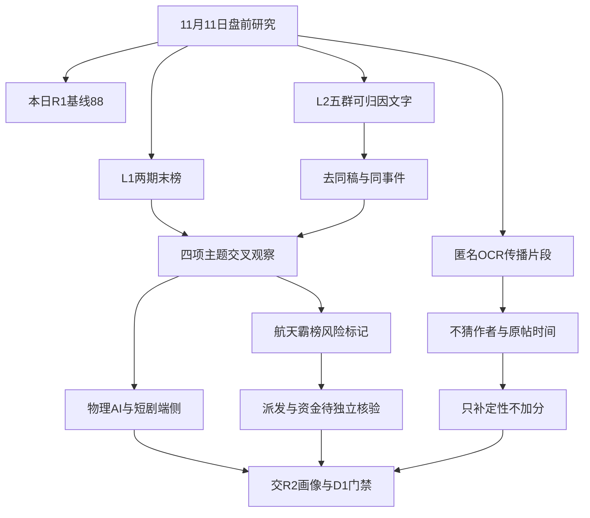

# 2026年11月11日 · 群聊情绪共振

> 数据源新鲜度：partial ｜ 降级：是 ｜ 数据置信度：0.364
> 时间边界：本日R1文件描述11月10日已完成收盘；热榜对比11月9日与10日末榜。不是11月11日盘中事实，也不是历史回放。

## 一句话结论
观察：接力修复，物理AI、短剧与端侧双源同向；航天霸榜不加分，热度不授买权。

## 📊 详细分析：先认市场，再解释群聊

本日R1给出的市场温度是88分：11月10日4273家上涨、1149家下跌，中位涨跌幅+1.31%；非ST收盘涨停93家、跌停0家，7板高度，前日涨停池收盘反馈均值+4.91%。市场在为接力与辨识度付钱，而非只奖励单一防御资产。封板率83.04%、炸板率16.96%，未触发炸板率35%的候选减半规则。此处只消费当日R1，不借用前日R1，也不把11月9日44.90%的炸板率套到最新收盘。

但“前收盘主升温度”不等于“今日全面主升”。R1自身为degraded，量能仅弱增、梯队4—6板断层，隔夜外部风险仍可能改变承接。因此本轮接受其可追溯定量基线，保留质量折减，双源调整为0，最终仍为88分。没有经过验证的“多一篇文章加几分”尺度；五维反校验缺统一归一化及杠杆外资输入，分值和分差均留空，不以50补洞。

五群本机记录已按当前配置实时重查，并核对尾页0条，与本日494条文字记录逐条多重集合一致。当前文本的乐观并不单一：有看多修复，也有关于机器人利空的短回复、第三方零件自研替代风险以及短剧利润变现争议。显示名称不能独立认证账户身份；不采系统消息、自宣传、纯荐股推广，也不把链接标题或会议邀请当转发者背书。

四项是“叙事双源交叉观察”，不是四条独立主线，更不是R2板块强弱排序。物理AI、AI眼镜与短剧共享模型、字节生态和风险偏好因子；PICO头显与AI眼镜不是同一产品。R3不授予任何票龙头地位，不生成首推/执行名单，板型、盈亏比和禁止清单交R2/R5/D1逐票验证；本阶段不预判in_today_plan=false。

## 🧭 双源证据链

图表已按阅读端Mermaid 11.4.0完成浏览器解析、布局和SVG渲染；不是仅检查围栏或语法。

## 🔍 四项主题观察（非板块排序）

| 叙事 | L1末榜证据 | L2有效文字 | 态度 | 边界 |
|---|---|---|---|---|
| 人形机器人 | 概念2→2；机器人概念6→4 | 触觉数采/本体先行与自研替代论证 | 观察 | 不把全链条都视为已兑现 |
| 短剧游戏 | 短剧7→3；AI视频14→5 | IP稀缺与带货/投流分工 | 观察 | 低制作费不等于高利润 |
| AI眼镜 | 前榜top20未见→本期10 | 端侧SoC、空间理解与产品约束 | 观察 | PICO/MR只作相邻催化，前日精确名次未知 |
| 商业航天 | 两期1→1；顺灏两平台变化相反 | 太空算力产业链与落地风险 | 观察 | 反向警报，正向加分为0 |

### 1. 人形机器人 · L1+L2 · 观察

语义依据：模型/大脑进步→触觉数采与本体需求的语义链，直接文本明确；不把每个零件或旧投资公告都当新订单。

- **大资金意图**: 只能推测资金偏向模型外溢的具身载体和数采稀缺性；热榜不是机构持仓，真实增量意图未知。
- **为什么走强**: 榜单与触觉/本体长文同向，市场在奖励辨识度与模型映射；估值拔升多于已核订单，不把走强解释成业绩兑现。
- **逻辑够不够硬**: 双机制证据成立，但模型指标、订单及利润未独立验证；自研替代和无收入公告是反证，不足以授予逐票买权。

反证：整机厂自研压缩第三方利润；触觉方案和可靠性仍未收敛；晚间短对话利空事件不明；华培机器人无收入报道反驳板块全员兑现；宇树仅新登顶，本两期不满足连续双日第一；高人气不等于可追价格。

证据：T163、T324、T339；公众号补充 A1、A12、A43、A76，后者不计共振或情绪分。

### 2. 短剧游戏 · L1+L2 · 观察

语义依据：AI制作降本与IP/投流/电商变现是同一内容产业链，不把京东短剧、PICO互动剧拆成额外独立市场主线。

- **大资金意图**: 可检验假设是交易资金从AI中游向可讲用户时长的内容端轮动；没有逐账户持仓数据，不能认证大资金已长期布局。
- **为什么走强**: 概念和多票末榜跃升，群文从降本转向IP和带货变现；这解释叙事接力，不证明企业利润兑现。
- **逻辑够不够硬**: 双源共振比单篇荐股强；但上证报盈利不足1%的行业采访、销售费用压力对“低成本必盈利”构成实质反证。

反证：供给门槛下降可能竞争加剧；多数作品盈利与资本市场上涨不是同一概念；群文投流占90%与报道海外成本口径50%不同，不能混为事实；互动影游平台化估值尚为假设。

证据：T281、T100；公众号补充 A3、A19、A38、A71、A72、A84，后者不计共振或情绪分。

### 3. AI眼镜 · L1+L2 · 观察

语义依据：标准概念AI眼镜的L1与端侧SoC/空间理解L2对应；PICO MR及世界模型仅为相邻催化，不视为同一终端或同一供应链。

- **大资金意图**: 资金可能交易端侧入口而非继续单押算力扩建；实际订单和份额未核，不将供应链联想写作资金承诺。
- **为什么走强**: AI眼镜新进前20，端侧芯片文本同向；PICO/世界模型扩展了叙事，但MR与眼镜边界必须保留。
- **逻辑够不够硬**: 眼镜热榜+独立文本满足双源；新品日期、供应关系、终端量产未逐家核验，画像和风险转R5，不升执行。

反证：PICO日期群文存在12月2日与双十二不同口径，非官方确认；旧PICO经销/公益VR合作不等于新机直接独供；前榜缺AI眼镜精确行，霸榜规则未知；没有首发早期认证。

证据：T134、T137、T110；公众号补充 A3、A51、A71、A84，后者不计共振或情绪分。

### 4. 商业航天 · L1+L2 · 观察

语义依据：太空算力、电力约束、卫星与激光通信在太空基础设施语义上归并；不从马斯克转述认定订单已兑现。

- **大资金意图**: 可推测在交易地面能源约束的太空替代选项，但资金连续流入未验证；霸榜只提示拥挤核查，不能认证出货。
- **为什么走强**: 卖方有完整产业链和风险推演，概念仍居末榜第一；顺灏两平台反向变化说明人气并非一致扩张。
- **逻辑够不够硬**: 观察层面L1+L2成立，正向分值禁加；一条卖方分析与同事件转述不能作三源共识，R6须独立按资金条件核定硬否决。

反证：两期第1是反向警报，不作正向共振加分；派发资金证据未核；同花顺概念hot从187593.5降至164972，排名持平不等于热度增加；升空/回收、芯片可靠性、散热与监管均可证伪；时间表未一手验证。

证据：T308；公众号补充 A1、A76，后者不计共振或情绪分。

主线认定边界：R3不代R2填写主线持续性；各主题持续性与主题封板率均未知。市场整体封板率83.04%不能复制成任何题材的封板率。11月11日预期为分歧假设，需开盘证伪，不冒充今日已发生。

### 未进入第五项的传播

CPO热榜5→11，光芯片IPO与FCC消息确在传播，但主要文字是同题推广、估值想象和新闻转述，缺合格独立KOL方向确认；不凑第五项。冰雪热榜3→9，现有荐股推广不作独立观点。中药、iPSC、二手燃气轮机保留单层传播观察。名字流有扩散，但“东方、阳、龙、凤、照明”不自动构成产业主线。

## 🗣️ 群聊观点：表达与传播分开

| 匿名来源 | 日期 | 短引文/观点 | 身份与处理 |
|---|---|---|---|
| group_02 · T163 | 2026-11-10 | “行情的底层逻辑来自具身模型(大脑)侧的突破” | 分析型长文；模型/订单未一手认证 |
| group_04 · T324—T326 | 2026-11-11 | “本体的放量会在大脑成熟之前” | 同作者同轮观点合并，估值目标不采信 |
| group_05 · T339 | 2026-11-10 | “整机自研加速，第三方分化” | 保留与上行叙事相冲的实质风险 |
| group_03 · T281 | 2026-11-10 | “AI负责工业化造量，IP负责锁价值” | 方向观点，不将“唯一核心”当事实 |
| group_02/group_05 · T100/T394/T396 | 2026-11-10 | “京东追剧直奔电商带货” | 同作者、同底层事件去重 |
| group_02/group_03 · T110/T242 | 2026-11-10 | 端侧SoC产品周期与估值消化 | 同一卖方团队同稿改写，只留一簇 |
| group_04 · T308 | 2026-11-10 | 太空算力、电力约束、发射与散热风险 | 有论证卖方观点；不把订单转述当实证 |
| group_03 · T293/T295/T296 | 2026-11-10 | “机器人重大利空？”、“有点”、“软利空” | 短对话保留；具体事件未知，不能判已证利空 |

## 🖼️ 图片文字：在传播什么，而不是谁在背书

本日唯一图片文字侧文件共108条：成功99条，其中非空49条、成功但空50条，失败9条。非空中清晰识别3条、partial 46条，低分辨率33条。所有非空正文已消费；乱码无法解释的也留原片段及质量，不靠猜字变成股票或事件。

| 匿名资产证据 | 可读内容/传播叙事 | 质量与反证边界 |
|---|---|---|
| group_05 · O3 | 纵慧芯光IPO辅导、VCSEL/InP | partial；与文字T166/T300同事件，不新增独立源 |
| group_02/group_03/group_05 · O11 | “广东省具身智能训练场” | 低清partial，只保留可读部分，同图跨群只算传播 |
| group_02 · O28 | 超聚变审议会议，截图显示11月12日 | recognized；未另核公告，截图不认证一手原件 |
| group_01 · O30 | 中文在线分批低吸旧聊天 | recognized；图内10月10日无年份，不当昨夜KOL观点 |
| group_05 · O17/O69 | PICO经销报道、丝路视觉公益VR合作 | partial；渠道/旧公益合作不等于新机独供，反驳“独家”升级 |
| group_02/group_05 · O63/O86 | 京东短剧福利社小程序 | 同稿合并；与T100等同事件，不算第三源 |
| group_02 · O68 | AI漫剧招聘截图 | partial；招聘证明岗位宣传，不等于产生收入 |
| group_05 · O72 | 互动影游路线比较图 | partial；平台化是叙事，不是已实现商业模式 |
| group_02/group_05 · O23/O95/O47 | 他山投资、隆盛VLA旧半年报 | O95 recognized，其他partial；旧投资/合作不当新订单 |
| group_05 · O73 | 中美疾控流感合作交流报道 | partial；交流不能证明病例暴增 |
| group_05 · O78 | iPSC帕金森文章、治愈/商业化标题 | partial；未查医学一手，强表述不采信 |
| group_03 · O10 | “彩讯股份：与火山引辈合作，公司Rich” | 低清原文片段照收，不把错字补成供货/模型事实 |
| group_04 · O21/O33/O43/O62 | 物理AI/互动剧/仿真交流海报 | 可读片段保留；会议不等于订单，不强行归因发言人 |
| group_01 · O98 | 结构性熊市/反弹片段 | 低清且时点未知；不能覆盖本日R1 |

缓存文件窗口为11月10日至11月11日，仅按缓存mtime筛选；采集时间是采集，不是消息/原帖时间。所有图片的消息时间、原帖时间未知仍为null；图内旧日期只作旧稿线索，不升格为可靠发表时间。同图、近似同稿和文字转载合并，不增加独立作者或量化频次。完整49条匿名片段、原始置信度和定位已进入R3主JSON，D1无需、也不应直接读取原始图片侧文件。OCR失败仅降图片覆盖，不生成分数或交易门槛。

## 📰 公众号观点（不参与共振等级与情绪加分）

| 方向 | 来源及证据 | 支持/反证 |
|---|---|---|
| 触觉与具身 | A1财联社主题前瞻；A43上海证券报采访 | 触觉/手套叙事；不代替逐票订单认证 |
| AI短剧变现 | A38上海证券报；A72猫笔刀 | 制作降本不消除投流与爆款成本，行业繁荣不保证影视公司盈利 |
| 端侧/PICO | A51上海证券报；A84预期差寻找 | 新品与互动影游想象；销量/平台化仍待证 |
| TDR叙事 | A71股痴流沙河 | 端侧、短剧、机器人同步被讨论，不是三条独立资金确认 |
| 节奏 | A73安静拆主线；A76盘口逻辑拆解 | 同执业主体，合并；从活跃轮动到亢奋分化，不能当两位独立KOL |
| 机器人无收入反证 | A12证券时报 | 华培相关产品未形成收入，交R4/R5核公告原件 |

### 宏观与情绪

A40转述私募乐观、A47转述修复行情，与A76“市场有些亢奋”的分化提醒并存。A8/A46提示加息与IPO估值敏感度；只是报道层，不把CME概率或SEC申报内容冒充本轮已查一手。A79提示外需和财政约束，A78质疑找不到原文的小作文。A72引用的隔夜纳指+3.5%与R1核对口径不符，该数字弃用，只保留其存量轮动和商业化观点。公众号84篇、18个feed中15有内容，核心8/10；篇数不生成情绪分。A74/A75正文仅免责声明，不能据标题虚构图表。

## 🚨 distribution_alert_checks：对象、范围、窗口与结果

本轮直接检查已获取末榜，不新增全市场扫描。规则仅为同一平台11月9日与10日两期末榜均第1；不认证盘中连续霸榜，更不证明派发。逐对象observed_at、实际window_start/window_end、请求窗口、来源、结果及evidence_refs均在主JSON的同名数组中。

| 平台 | 前期行数 | 本期已查对象 | 精确两期匹配 | true | false | unknown/null |
|---|---:|---:|---:|---:|---:|---:|
| ths_stock | 100 | 100 | 84 | 0 | 84 | 16 |
| ths_concept | 20 | 20 | 16 | 1 | 15 | 4 |
| dc_popularity | 100 | 100 | 45 | 0 | 45 | 55 |

合计220个平台对象记录，checked 145项：true 1、false 144；unknown/null 75。同一股票跨平台分别报告，不将平台数当独立股票数。

唯一true为商业航天886078.TI的同花顺概念末榜1→1；这不是股票警报，也不自动广播给所有成分股。宇树同花顺2→1、东财4→1均只满足新登顶，本两期规则为false，不是“没有出货”。前榜缺精确对象时，即使本期不是第1，也按契约保留unknown，不利用缺席推阴性。范围外、R2后续名单、资金和完整派发诊断均未知。R6保留独立硬否决权。

逐对象表：S=同花顺热股，C=同花顺概念，D=东财人气榜；共同观察日期为2026-11-09→2026-11-10末榜。精确时间保留在JSON，不用采集/文件时间替代。两期均覆盖才填实际完整窗口；缺前期行的实际window_start为null，已请求范围仍清楚列示。

| JSON检查索引 | 源 | 精确对象 | 前期→本期 | 检查状态/结果 |
|---:|---|---|---|---|
| 0 | S | 688836.SH 宇树科技 | 2→1 | checked/false |
| 1 | S | 002086.SZ 东方海洋 | 1→2 | checked/false |
| 2 | S | 000530.SZ 冰山冷热 | 11→3 | checked/false |
| 3 | S | 600261.SH 阳光照明 | 3→4 | checked/false |
| 4 | S | 000678.SZ 襄阳轴承 | 6→5 | checked/false |
| 5 | S | 002639.SZ 雪人集团 | 44→6 | checked/false |
| 6 | S | 601188.SH 龙江交通 | 63→7 | checked/false |
| 7 | S | 300308.SZ 中际旭创 | 5→8 | checked/false |
| 8 | S | 002384.SZ 东山精密 | 4→9 | checked/false |
| 9 | S | 002565.SZ 顺灏股份 | 38→10 | checked/false |
| 10 | S | 601599.SH 浙文影业 | 7→11 | checked/false |
| 11 | S | 603366.SH 日出东方 | 9→12 | checked/false |
| 12 | S | 002242.SZ 九阳股份 | 8→13 | checked/false |
| 13 | S | 002343.SZ 慈文传媒 | 56→14 | checked/false |
| 14 | S | 603533.SH 掌阅科技 | 87→15 | checked/false |
| 15 | S | 002578.SZ 闽发铝业 | 33→16 | checked/false |
| 16 | S | 300413.SZ 芒果超媒 | 15→17 | checked/false |
| 17 | S | 300502.SZ 新易盛 | 10→18 | checked/false |
| 18 | S | 002889.SZ 东方嘉盛 | 43→19 | checked/false |
| 19 | S | 300364.SZ 中文在线 | 28→20 | checked/false |
| 20 | S | 600715.SH 文投控股 | 23→21 | checked/false |
| 21 | S | 600327.SH 大东方 | 14→22 | checked/false |
| 22 | S | 600825.SH 新华传媒 | 35→23 | checked/false |
| 23 | S | 002310.SZ 东方新能 | 22→24 | checked/false |
| 24 | S | 603278.SH 大业股份 | 49→25 | checked/false |
| 25 | S | 600127.SH 金健米业 | 20→26 | checked/false |
| 26 | S | 000823.SZ 超声电子 | 26→27 | checked/false |
| 27 | S | 300133.SZ 华策影视 | 未知→28 | unknown/null |
| 28 | S | 002724.SZ 海洋王 | 41→29 | checked/false |
| 29 | S | 605488.SH 福莱新材 | 62→30 | checked/false |
| 30 | S | 002149.SZ 西部材料 | 32→31 | checked/false |
| 31 | S | 002354.SZ 天娱数科 | 61→32 | checked/false |
| 32 | S | 600118.SH 中国卫星 | 12→33 | checked/false |
| 33 | S | 688825.SH 长鑫科技 | 16→34 | checked/false |
| 34 | S | 002636.SZ 金安国纪 | 30→35 | checked/false |
| 35 | S | 002463.SZ 沪电股份 | 53→36 | checked/false |
| 36 | S | 300118.SZ 东方日升 | 13→37 | checked/false |
| 37 | S | 002708.SZ 光洋股份 | 57→38 | checked/false |
| 38 | S | 603466.SH 风语筑 | 未知→39 | unknown/null |
| 39 | S | 601595.SH 上海电影 | 54→40 | checked/false |
| 40 | S | 605058.SH 澳弘电子 | 71→41 | checked/false |
| 41 | S | 002081.SZ 金螳螂 | 46→42 | checked/false |
| 42 | S | 603703.SH 盛洋科技 | 98→43 | checked/false |
| 43 | S | 001219.SZ 青岛食品 | 29→44 | checked/false |
| 44 | S | 600206.SH 有研新材 | 27→45 | checked/false |
| 45 | S | 002181.SZ 粤传媒 | 92→46 | checked/false |
| 46 | S | 002172.SZ 澳洋健康 | 17→47 | checked/false |
| 47 | S | 300136.SZ 信维通信 | 21→48 | checked/false |
| 48 | S | 600371.SH 万向德农 | 55→49 | checked/false |
| 49 | S | 600487.SH 亨通光电 | 24→50 | checked/false |
| 50 | S | 600641.SH 先导基电 | 18→51 | checked/false |
| 51 | S | 603598.SH 引力传媒 | 74→52 | checked/false |
| 52 | S | 002428.SZ 云南锗业 | 34→53 | checked/false |
| 53 | S | 002050.SZ 三花智控 | 96→54 | checked/false |
| 54 | S | 600121.SH 郑州煤电 | 48→55 | checked/false |
| 55 | S | 600408.SH 安泰集团 | 未知→56 | unknown/null |
| 56 | S | 301313.SZ 凡拓数创 | 31→57 | checked/false |
| 57 | S | 002865.SZ 钧达股份 | 42→58 | checked/false |
| 58 | S | 002747.SZ 埃斯顿 | 95→59 | checked/false |
| 59 | S | 002156.SZ 通富微电 | 未知→60 | unknown/null |
| 60 | S | 600278.SH 东方创业 | 85→61 | checked/false |
| 61 | S | 000525.SZ 红太阳 | 64→62 | checked/false |
| 62 | S | 001330.SZ 博纳影业 | 91→63 | checked/false |
| 63 | S | 601138.SH 工业富联 | 19→64 | checked/false |
| 64 | S | 002088.SZ 鲁阳节能 | 25→65 | checked/false |
| 65 | S | 603259.SH 药明康德 | 未知→66 | unknown/null |
| 66 | S | 600183.SH 生益科技 | 66→67 | checked/false |
| 67 | S | 002029.SZ 七匹狼 | 51→68 | checked/false |
| 68 | S | 600838.SH 上海九百 | 72→69 | checked/false |
| 69 | S | 002249.SZ 大洋电机 | 99→70 | checked/false |
| 70 | S | 600776.SH 东方通信 | 未知→71 | unknown/null |
| 71 | S | 603986.SH 兆易创新 | 70→72 | checked/false |
| 72 | S | 002361.SZ 神剑股份 | 40→73 | checked/false |
| 73 | S | 603893.SH 瑞芯微 | 未知→74 | unknown/null |
| 74 | S | 000995.SZ 皇台酒业 | 65→75 | checked/false |
| 75 | S | 605577.SH 龙版传媒 | 未知→76 | unknown/null |
| 76 | S | 002388.SZ 新亚制程 | 39→77 | checked/false |
| 77 | S | 002696.SZ 百洋股份 | 84→78 | checked/false |
| 78 | S | 000559.SZ 万向钱潮 | 未知→79 | unknown/null |
| 79 | S | 002185.SZ 华天科技 | 83→80 | checked/false |
| 80 | S | 002131.SZ 利欧股份 | 97→81 | checked/false |
| 81 | S | 002611.SZ 东方精工 | 77→82 | checked/false |
| 82 | S | 300058.SZ 蓝色光标 | 69→83 | checked/false |
| 83 | S | 603667.SH 五洲新春 | 未知→84 | unknown/null |
| 84 | S | 300274.SZ 阳光电源 | 50→85 | checked/false |
| 85 | S | 300418.SZ 昆仑万维 | 52→86 | checked/false |
| 86 | S | 600892.SH 大晟文化 | 59→87 | checked/false |
| 87 | S | 001318.SZ 阳光乳业 | 未知→88 | unknown/null |
| 88 | S | 002929.SZ 润建股份 | 67→89 | checked/false |
| 89 | S | 603381.SH 永臻股份 | 45→90 | checked/false |
| 90 | S | 600637.SH 东方明珠 | 73→91 | checked/false |
| 91 | S | 002931.SZ 锋龙股份 | 未知→92 | unknown/null |
| 92 | S | 002009.SZ 天奇股份 | 未知→93 | unknown/null |
| 93 | S | 300394.SZ 天孚通信 | 81→94 | checked/false |
| 94 | S | 300750.SZ 宁德时代 | 60→95 | checked/false |
| 95 | S | 002712.SZ 思美传媒 | 88→96 | checked/false |
| 96 | S | 000547.SZ 航天发展 | 76→97 | checked/false |
| 97 | S | 002347.SZ 泰尔股份 | 未知→98 | unknown/null |
| 98 | S | 600584.SH 长电科技 | 未知→99 | unknown/null |
| 99 | S | 600664.SH 哈药股份 | 未知→100 | unknown/null |
| 100 | C | 886078.TI 商业航天 | 1→1 | checked/true |
| 101 | C | 886069.TI 人形机器人 | 2→2 | checked/false |
| 102 | C | 886060.TI 短剧游戏 | 7→3 | checked/false |
| 103 | C | 885517.TI 机器人概念 | 6→4 | checked/false |
| 104 | C | 886068.TI AI视频 | 14→5 | checked/false |
| 105 | C | 885531.TI 光伏概念 | 4→6 | checked/false |
| 106 | C | 885728.TI 人工智能 | 13→7 | checked/false |
| 107 | C | 886108.TI AI应用 | 9→8 | checked/false |
| 108 | C | 885825.TI 冰雪产业 | 3→9 | checked/false |
| 109 | C | 886085.TI AI眼镜 | 未知→10 | unknown/null |
| 110 | C | 886033.TI 共封装光学(CPO) | 5→11 | checked/false |
| 111 | C | 886015.TI 创新药 | 8→12 | checked/false |
| 112 | C | 885959.TI PCB概念 | 10→13 | checked/false |
| 113 | C | 885771.TI 智能音箱 | 未知→14 | unknown/null |
| 114 | C | 885756.TI 芯片概念 | 12→15 | checked/false |
| 115 | C | 885418.TI 文化传媒概念 | 未知→16 | unknown/null |
| 116 | C | 885939.TI 海峡两岸 | 未知→17 | unknown/null |
| 117 | C | 886042.TI 存储芯片 | 20→18 | checked/false |
| 118 | C | 886050.TI 算力租赁 | 19→19 | checked/false |
| 119 | C | 885530.TI 黄金概念 | 17→20 | checked/false |
| 120 | D | 688836.SH 宇树科技-W | 4→1 | checked/false |
| 121 | D | 603366.SH 日出东方 | 3→2 | checked/false |
| 122 | D | 600715.SH 文投控股 | 11→3 | checked/false |
| 123 | D | 000530.SZ 冰山冷热 | 5→4 | checked/false |
| 124 | D | 002578.SZ 闽发铝业 | 18→5 | checked/false |
| 125 | D | 002086.SZ 东方海洋 | 1→6 | checked/false |
| 126 | D | 002310.SZ 东方新能 | 7→7 | checked/false |
| 127 | D | 600327.SH 大东方 | 6→8 | checked/false |
| 128 | D | 601188.SH 龙江交通 | 13→9 | checked/false |
| 129 | D | 000678.SZ 襄阳轴承 | 71→10 | checked/false |
| 130 | D | 300613.SZ 富瀚微 | 未知→11 | unknown/null |
| 131 | D | 300052.SZ 中青宝 | 未知→12 | unknown/null |
| 132 | D | 300133.SZ 华策影视 | 未知→13 | unknown/null |
| 133 | D | 600261.SH 阳光照明 | 16→14 | checked/false |
| 134 | D | 002865.SZ 钧达股份 | 47→15 | checked/false |
| 135 | D | 002343.SZ 慈文传媒 | 未知→16 | unknown/null |
| 136 | D | 002708.SZ 光洋股份 | 22→17 | checked/false |
| 137 | D | 300556.SZ 丝路视觉 | 未知→18 | unknown/null |
| 138 | D | 603533.SH 掌阅科技 | 未知→19 | unknown/null |
| 139 | D | 603893.SH 瑞芯微 | 未知→20 | unknown/null |
| 140 | D | 603466.SH 风语筑 | 未知→21 | unknown/null |
| 141 | D | 603381.SH 永臻股份 | 79→22 | checked/false |
| 142 | D | 600892.SH 大晟文化 | 30→23 | checked/false |
| 143 | D | 605488.SH 福莱新材 | 78→24 | checked/false |
| 144 | D | 002639.SZ 雪人集团 | 2→25 | checked/false |
| 145 | D | 002565.SZ 顺灏股份 | 10→26 | checked/false |
| 146 | D | 002009.SZ 天奇股份 | 未知→27 | unknown/null |
| 147 | D | 002045.SZ 国光电器 | 未知→28 | unknown/null |
| 148 | D | 601595.SH 上海电影 | 74→29 | checked/false |
| 149 | D | 603278.SH 大业股份 | 未知→30 | unknown/null |
| 150 | D | 002048.SZ 宁波华翔 | 未知→31 | unknown/null |
| 151 | D | 000810.SZ 创维数字 | 未知→32 | unknown/null |
| 152 | D | 603703.SH 盛洋科技 | 29→33 | checked/false |
| 153 | D | 300426.SZ 华智数媒 | 未知→34 | unknown/null |
| 154 | D | 002432.SZ 九安医疗 | 未知→35 | unknown/null |
| 155 | D | 002425.SZ 凯撒文化 | 未知→36 | unknown/null |
| 156 | D | 002931.SZ 锋龙股份 | 41→37 | checked/false |
| 157 | D | 603598.SH 引力传媒 | 未知→38 | unknown/null |
| 158 | D | 002347.SZ 泰尔股份 | 34→39 | checked/false |
| 159 | D | 002036.SZ 联创电子 | 未知→40 | unknown/null |
| 160 | D | 603121.SH 华培动力 | 51→41 | checked/false |
| 161 | D | 603809.SH 豪能股份 | 未知→42 | unknown/null |
| 162 | D | 600609.SH 金杯汽车 | 45→43 | checked/false |
| 163 | D | 605577.SH 龙版传媒 | 未知→44 | unknown/null |
| 164 | D | 002376.SZ 新北洋 | 未知→45 | unknown/null |
| 165 | D | 300364.SZ 中文在线 | 86→46 | checked/false |
| 166 | D | 002623.SZ 亚玛顿 | 未知→47 | unknown/null |
| 167 | D | 601599.SH 浙文影业 | 19→48 | checked/false |
| 168 | D | 600408.SH 安泰集团 | 28→49 | checked/false |
| 169 | D | 300308.SZ 中际旭创 | 31→50 | checked/false |
| 170 | D | 002354.SZ 天娱数科 | 未知→51 | unknown/null |
| 171 | D | 002995.SZ 天地在线 | 未知→52 | unknown/null |
| 172 | D | 002324.SZ 普利特 | 未知→53 | unknown/null |
| 173 | D | 603706.SH 东方环宇 | 38→54 | checked/false |
| 174 | D | 001308.SZ 康冠科技 | 未知→55 | unknown/null |
| 175 | D | 605598.SH 上海港湾 | 未知→56 | unknown/null |
| 176 | D | 002160.SZ 常铝股份 | 未知→57 | unknown/null |
| 177 | D | 300264.SZ 佳创视讯 | 未知→58 | unknown/null |
| 178 | D | 600829.SH 人民同泰 | 未知→59 | unknown/null |
| 179 | D | 002905.SZ 金逸影视 | 未知→60 | unknown/null |
| 180 | D | 300118.SZ 东方日升 | 32→61 | checked/false |
| 181 | D | 603286.SH 日盈电子 | 75→62 | checked/false |
| 182 | D | 001318.SZ 阳光乳业 | 未知→63 | unknown/null |
| 183 | D | 300413.SZ 芒果超媒 | 49→64 | checked/false |
| 184 | D | 002981.SZ 朝阳科技 | 未知→65 | unknown/null |
| 185 | D | 002535.SZ 林州重机 | 未知→66 | unknown/null |
| 186 | D | 002242.SZ 九阳股份 | 36→67 | checked/false |
| 187 | D | 002313.SZ 日海智能 | 未知→68 | unknown/null |
| 188 | D | 603666.SH 亿嘉和 | 未知→69 | unknown/null |
| 189 | D | 600281.SH 华阳新材 | 未知→70 | unknown/null |
| 190 | D | 300502.SZ 新易盛 | 62→71 | checked/false |
| 191 | D | 001339.SZ 智微智能 | 未知→72 | unknown/null |
| 192 | D | 001379.SZ 腾达科技 | 72→73 | checked/false |
| 193 | D | 603037.SH 凯众股份 | 未知→74 | unknown/null |
| 194 | D | 002021.SZ 中捷资源 | 未知→75 | unknown/null |
| 195 | D | 600118.SH 中国卫星 | 8→76 | checked/false |
| 196 | D | 002861.SZ 瀛通通讯 | 未知→77 | unknown/null |
| 197 | D | 603602.SH 纵横通信 | 未知→78 | unknown/null |
| 198 | D | 300059.SZ 东方财富 | 66→79 | checked/false |
| 199 | D | 603215.SH 比依股份 | 未知→80 | unknown/null |
| 200 | D | 002149.SZ 西部材料 | 20→81 | checked/false |
| 201 | D | 600825.SH 新华传媒 | 65→82 | checked/false |
| 202 | D | 001314.SZ 亿道信息 | 未知→83 | unknown/null |
| 203 | D | 301255.SZ 通力科技 | 未知→84 | unknown/null |
| 204 | D | 002238.SZ 天威视讯 | 未知→85 | unknown/null |
| 205 | D | 603283.SH 赛腾股份 | 未知→86 | unknown/null |
| 206 | D | 603058.SH 永吉股份 | 未知→87 | unknown/null |
| 207 | D | 000525.SZ 红太阳 | 17→88 | checked/false |
| 208 | D | 002664.SZ 信质集团 | 未知→89 | unknown/null |
| 209 | D | 688825.SH 长鑫科技 | 43→90 | checked/false |
| 210 | D | 603536.SH 惠发食品 | 未知→91 | unknown/null |
| 211 | D | 301313.SZ 凡拓数创 | 88→92 | checked/false |
| 212 | D | 001232.SZ 嘉立创 | 未知→93 | unknown/null |
| 213 | D | 002384.SZ 东山精密 | 54→94 | checked/false |
| 214 | D | 002889.SZ 东方嘉盛 | 25→95 | checked/false |
| 215 | D | 600778.SH 友好集团 | 未知→96 | unknown/null |
| 216 | D | 000593.SZ 德龙汇能 | 未知→97 | unknown/null |
| 217 | D | 001219.SZ 青岛食品 | 63→98 | checked/false |
| 218 | D | 605398.SH 新炬网络 | 未知→99 | unknown/null |
| 219 | D | 600793.SH 宜宾纸业 | 未知→100 | unknown/null |

## 📌 关键证据

- 当日R1：市场整体封板83.04%，前日涨停池反馈+4.91%，支持前收盘修复，不认证今日任何股票。
- 实时两期热榜：短剧7→3、AI视频14→5，人形2→2，航天1→1；来源对象和负面警报分开处理。
- group_04最新夜间长文与group_05自研替代论证方向相冲，保留双方，不只摘看多。
- OCR49条非空全部审阅；O30旧截图、O17渠道报道、O73交流稿能限制把传播升级成新催化的冲动。

## 数据源审计

| 源 | 日期 | 状态 | 记录/窗口与缺口 |
|---|---|:--:|---|
| 本日R1_style | 2026-11-11 | 🟡 | artifact当日，市场事实来自2026-11-10收盘；status=degraded |
| Tushare ths_hot热股 | 2026-11-09、2026-11-10 | 🟢 | 每期100；MCP核对后SDK重新实取存证 |
| Tushare ths_hot概念 | 2026-11-09、2026-11-10 | 🟢 | 每期20；缺前期对象保持未知 |
| Tushare dc_hot人气 | 2026-11-09、2026-11-10 | 🟢 | 每期100；不与同花顺合并为第三层 |
| attention_signals | 2026-11-10 | 🟢 | 本日绑定，信号T-1；100人气+100飙升+100热股+20概念；persistent是累计非连续 |
| XTick情绪MCP | 2026-11-10 | 🟡 | 改ISO日期后成功；95涨停/19炸板/7板；观察时间未知，zbl口径不采用 |
| group_01 | 2026-11-10 | 🟢 | 32条，实时重查一致、尾页0；远端同步未知 |
| group_02 | 2026-11-10、2026-11-11 | 🟢 | 140条，实时重查一致、尾页0；远端同步未知 |
| group_03 | 2026-11-10、2026-11-11 | 🟢 | 132条，实时重查一致、尾页0；远端同步未知 |
| group_04 | 2026-11-10、2026-11-11 | 🟢 | 22条，实时重查一致、尾页0；远端同步未知 |
| group_05 | 2026-11-10、2026-11-11 | 🟢 | 168条，实时重查一致、尾页0；远端同步未知 |
| 唯一图片文字侧文件 | 2026-11-11 | 🟡 | 108资产/49非空/50成功空/9失败；原帖时间和作者未知 |
| 公众号RSS | 2026-11-10、2026-11-11 | 🟡 | 84篇/18 feed/15有文，核心8/10；仅观点，非独立资金源 |
| manifest/mcp_health | 2026-11-11 | 🟡 | 已读；全局severity=2包含旧退役/账户源状态，不据此全局禁买 |
| 预计算hotlist_signals | 2026-11-11 | 🟡 | 本日raw未提供；本轮实时计算并显式逐对象检查 |
| WeFlow | 2026-11-11 | 🔴 | 永久退役，未调、未补历史；兼容字段为空 |
| 个股5日资金/辅助hithink | 2026-11-11 | 🟡 | 本轮未做，不伪称完整派发核定；交获准责任阶段 |

实时群聊核验窗口和真实生成时点保存在主JSON；没有用“最后一条消息”假装查询截止。不同长度窗口不比较消息量降温，图片失败不判群聊沉默。

## ⚠️ 不确定性 / 反证

本研究可确认“哪些叙事在被讨论且进入榜单”，不能确认全部群成员态度、机构仓位或消息真实性。模型测试、PICO日期与供应关系、太空订单、利率概率、临床治愈及创投浮盈均有原始来源核验缺口。已把商业航天警报、短剧盈利争议、机器人自研替代、无收入报道、夜间软利空及旧截图放回主产物，不以乐观共识覆盖反证。

## 🛡️ 权限与消费边界

- 本轮态度为观察，不新增全局市场no_trade，也不解除任何真实停买、有效预算含0、仓位硬上限、T+1、人工确认、逐票hard_reject及既有授权与保护。预算未知仍未知。
- 88分仅为当日R1支持的前收盘温度；竞价结束后重评，最迟开盘失效。辅助源缺失只影响对应结论，不成为新交易门槛。
- 无首推或执行票，因此每票买入理由/风险点/止损条件/可验证假设不适用；不为套模板凭空造票、价位或RR。

## 🔗 与其他 R/D/E 的关系

- 依赖：本日R1_style、attention_signals、manifest、mcp_health、五群文字、唯一OCR侧文件与公众号观点，以及本轮实时榜单。
- R2/R5：消费主题与反证，独立认证主线、核心地位、板型、RR和禁止清单；未进本产物不等于不研究。
- R6：只按精确对象、平台和窗口消费distribution_alert_checks，未知不可改false；真警报与资金条件独立核定，硬否决权不变。
- D1：消费R3主产物中已归并的图片观点，不直接读取原始图片侧文件；首次计划前in_today_plan保持未知。
- E1：可复核热度与次日表现；本轮观察并非成交保证。

## 🧾 Sub-Agent 元数据

- skill: analyze_sentiment_resonance_v1@1.1
- artifact: data/research/20261111/R3_sentiment.json
- 热榜存证: data/research/20261111/R3_hotlist_evidence.json
- 方法: llm_v1，当前会话独立执行，未再次启动模型/委派
- model: gpt-6.1-sol
- 置信度: 0.65 × 0.7 × 0.8 = 0.364（数据质量，不是胜率）
- usage: usage_unknown，非0，不承诺低于努力目标
- 交付目标: 2026-11-11盘前；observe_only，不改变交易授权
