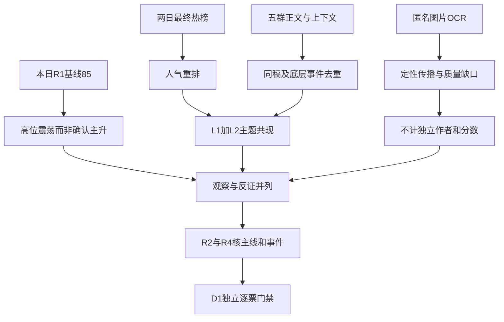

# 2026年11月12日 · 群聊情绪共振

> **数据源新鲜度**：partial｜**降级状态**：true｜**情绪**：震荡（高位）
> 本日R1基线 **85分**，共振增量 **0分**。实际行情观察日为 **2026-11-11收盘**，不是今日盘中情绪。

## 🧭 一句话结论
观察容量科技修复与机器人、短剧、AI游戏双源共振；高标缩圈，太空光伏映射降级。

## 🔍 详细分析

先认市场：昨日上涨3538家、非ST涨停85家、炸板19家，说明修复与接力仍有正反馈；但R1记录最高高度从七板缩到四板、前日涨停池开盘溢价下降，故 **高位震荡，不确认持续主升**。市场奖励的是容量科技修复和辨识度，并非群内“阿猫阿狗都可以”。封板率只在全市场同源口径下为81.73%，不能偷换成某个主题封板率。

再认传播：光通信有量化人气重排及盘中直接观点，同时存在“不过右侧还没明确目前”的反证；机器人讨论扩展到大脑、数采与感知；短剧扩展到确权、版权和工具链；AI游戏出现H5、UGC、低门槛制作的新映射。**双源只说明讨论与人气同现，不等于资金流入、主线确定或买入权限。**

最后控制独立性：五群本机数据库已补查至本轮实际截止，分页尾页和分自然日多重集合一致，496条与本日抓取一致；并不证明远端同步完整。两条本人消息排除。220条正文精确空白去重后145条文本，仍含同稿改写及同底层新闻，不能把145当独立KOL数。公众号只补观点，匿名图片只说明“在传播什么”。

本轮 **观察，不直接出股票候选**：热榜对象不是R2确认龙头，板型、龙头认定、RR与禁止清单未核定，不给execution资格，也不凭缺数全局禁买。in_today_plan在首次D1形成前保持未知。账户硬预算、T+1、人工确认与R6逐票硬否决独立生效；不继承旧市场零仓建议，不制造正预算。

## 🧩 五个共振主题

展示顺序是传播证据顺序，不是板块强弱排序。下表热度为2026-11-11最终快照，比较日为2026-11-10。主题持续性均未知；明日预期均为分歧假设，不伪造1/3/5日持续性。

| 主题 | 热榜证据 | L2证据 | 态度 |
|---|---|---|---|
| CPO/关联PCB | CPO 11→1；东财东山94→1、中际50→2、新易盛71→4 | 匿名群01硬件反弹及右侧未明；材料讨论 | 观察 |
| 人形机器人 | 概念2→2；光洋热股38→9 | 大脑/数采/面罩/电子皮肤 | 观察 |
| 短剧游戏 | 概念3→5；文投热股21→1 | 确权、版权、两岸创作、工具平台 | 观察 |
| 网络游戏 | 凯撒东财36→17，电魂26、名臣91 | H5/UGC与制作提效直接讨论 | 观察 |
| 商业航天/太空光伏 | 航天1→3、光伏6→9 | Singulus采购与合作方映射稿 | 降级 |

### 1 · 共封装光学(CPO)｜L1+L2

- **大资金意图**: 容量科技修复与光互连叙事同步，热榜可见不等于新增机构净买；PCB只作关联扩散，不重复列成第二条独立共识。
- **为什么走强**: 人气重排和昨日上涨支持修复；FCC叙事仍为转述，禁令撤销未核验，不能从一次大涨确认主升。
- **逻辑够不够硬**: 热榜与真实群聊方向一致，但右侧未明确的反证同时存在；出口政策、订单和持续性须由R4/R5/R7继续核验。

### 2 · 人形机器人｜L1+L2

- **大资金意图**: 传播从模型与整机延伸至感知、执行和数采；不能据供应链表格反推资金已完成高低切。
- **为什么走强**: 人形机器人热度连续居前，关节/面罩/数采形成不同应用叙事，但许多材料仍是估值推演或早期验证。
- **逻辑够不够硬**: 有L1+L2，模型进步与政策稿不自动兑现上市公司利润；仅人气前排，不授予总龙或龙二身份。

### 3 · 短剧游戏｜L1+L2

- **大资金意图**: 市场叙事向IP、虚拟形象确权和工具平台收费扩展；热度不能证明持仓结构或派发。
- **为什么走强**: 文投热股21升1、概念仍在top5；短剧与AI视频存在重叠，政策/版权热议不代表全产业盈利提升。
- **逻辑够不够硬**: 双源只确认讨论与人气同现；确权不兜底版权，免费短剧竞争及后排走弱构成反证。

### 4 · 网络游戏｜L1+L2

- **大资金意图**: H5与UGC被当作降低创作门槛的期权；资金意图未用个股流向核实，不把“所有建模人失业”当投资事实。
- **为什么走强**: L1为精确游戏个股榜单：凯撒文化东财36升17、电魂网络26、名臣健康91；AI应用8仅背景，不能靠宽概念制造共振。
- **逻辑够不够硬**: 已达主题层L1+L2，但样本游戏演示与A股业务绑定未核实；被推广的游族/星辉未出现在这两张最终热股top100，逐票人气未知，不能偷换为股票级共振。

### 5 · 商业航天｜L1+L2

- **大资金意图**: 太空供电成为预期映射，但采购规划、合资主体与上市公司收益链条不能互相替代。
- **为什么走强**: 商业航天热度1降3、光伏6降9，说明讨论在扩散但热度未加速；东方日升昨日跌幅不支持将映射直接变成资金确认。
- **逻辑够不够硬**: 仅主题级双源共现，合同规模及合作方映射不硬，降级观察而非可交易主线；同一传闻的跨群转载不提高独立性。

## 🗣️ KOL方向与传播边界

| 匿名来源 | 可读观点/短原文 | 时间性质与反证 |
|---|---|---|
| 群01 | “硬件都反弹了一波”“不过右侧还没明确目前” | 2026-11-11盘中，非昨夜大V预判 |
| 群01 | “大票开始启动，小票要休息一段时间了” | 与上行接力并存的切换观点，不是流量测量 |
| 群02/03/05 | AI手搓页游、H5、UGC、游戏“短剧时刻” | 同一模型演示与HTML样例大量转述，去重后不计多人独立验证 |
| 群04 | “算力过于悲观”、国产AI、物理AI | 机构观点与会议营销分开；同机构重发只计一稿 |
| 群02/03/05 | “奇迹时代”、AI制药 | 同一演讲叙事；没有精确AI制药热榜，不进top5 |

存储芯片概念18升6，群内有存储涨价报道与跨界推广；保留为次级L1+L2观察，但涨价并非全品类普涨。冰雪热股显著却缺可确认的同窗口独立方向观点，降为L1_only；不把名称梗当产业主线。

## 🖼️ 图片在传播什么

107张唯一图片中，58张实际识出非空正文、41张成功但空、8张OCR失败。非空片段全部进入R3机读主产物，并保留匿名群标签、原文、质量和逐区域置信度。低清片段不因partial被整条丢弃；不可辨的公司名和数字不猜补。以下不是作者背书或可交易标的表。

| 传播簇 | 本日侧文件行号 | 可用内容与限制 |
|---|---|---|
| AI游戏 | 7/20/21/28/35/48/50/60/87/91/104 | 手搓游戏、H5、UGC及赛道对照表；部分只是低清标题，未把名单等同已受益 |
| 机器人大脑/工业数据 | 4/10/49/85 | 火基钾的大脑/小脑/数据/API框架与股权图；早期项目不等于订单 |
| 面罩/感知 | 11/16/25/64/71 | 智能面屏、电子皮肤、嗅觉、深度相机；近似截图及同文合并 |
| 短剧与工具 | 13/51/54/76/101/105 | 两岸创作、扶持、工具、下载榜；政策标题和下载量不等于利润 |
| AI制药 | 29/38 | 演讲与社媒转述，未验证临床；三群同图不是三源 |
| 光通信材料 | 8/57 | 高速线模组、液冷cage、磷化铟产线预测；8与聊天同稿合并 |
| 太空光伏 | 43 | 合资/资本/业务映射表，不证明采购合同主体与规模 |
| APEC/无人车 | 18/107 | 相近截图同一传播簇，“明天”不回填成真实发言日 |
| 海洋/深海机器人 | 55/56/70/88 | 55内文为2025-03-21；70为历史技术页面，旧材料不冒充今日催化 |
| 其他 | 45/61/62/93 | 超硬材料出口、亚洲Neocloud、二手房、柔性导电膜；仅作为传播线索，拼接供货映射未经核验 |
| AI电子设计 | 74 | CAD/PCB/固件片段，可能与本人文本同源，隔离不计正向共识 |
| 零散低清 | 其余非空片段 | 原样留证，不能可靠映射的仍未知，不造新票 |

所有图片published_at与message_time保持null。采集日期为2026-11-12，缓存日期并非消息或原帖日期；截图里的相对时间/自报日期不自动回填。图片失败只降图片覆盖，不判群聊沉默，不据图片数计算市场情绪分，不增加交易门槛。D1消费R3摘要，不直接读取图片原始侧文件。

## 📰 公众号观点

| 观点来源 | 支持/反证 | 是否计入共振/分数 |
|---|---|---|
| 财联社收评 | 容量硬件反弹，机器人/短剧活跃；高位后排淘汰与量能持续性是风险 | 不计 |
| 上海证券报：AI短剧 | 确权有助产业规范，但不绝对兜底版权；竞争从铺量转精品 | 不计 |
| 上海证券报：存储求证 | 企业级/AI相关涨价与普通消费端分化，模组环节可能承压 | 不计 |
| 猫笔刀：又能相信光了 | 偏向下跌浪结束，但不承诺V反转；游说不等于禁令撤销 | 不计 |
| 安静拆主线：最怕一种图形 | 反弹延续但钝化，警惕把修复当必然解套 | 不计 |
| 盘口逻辑拆解 | 前排缩圈与硬件修复并存，不确认新周期全面展开 | 不计 |
| 傅里叶的猫 | 机架中板设想需制造可行性验证，不能直接映射确定订单 | 不计 |
| 财闻私享 | 机器人、短剧、AI游戏等摘要；与群聊同底层新闻合并 | 不计 |

宏观与情绪：同一晚的观点既有乐观修复，也有前排缩圈和反复筑底担忧；这是合理分歧证据，而非“舆论一致看多”。利率、离岸信托与海外公司管理层传闻只保留为作者观点，不升级为本轮已核实宏观事实。88篇仅完成标题/摘要扫描与8篇正文精读，不声称全部全文覆盖。

## 🧪 distribution_alert_checks：已查范围与阴性边界

已检查对象范围：已有两平台top20热股并集，加本轮主题/群聊涉及的有限对象，共34只；概念榜20项。没有为了模式6增加全市场扫描。逐来源检查88条，其中checked=58、unknown=30，命中连续第一为0条。每条代码、窗口、来源、观察时间和结果均在JSON的同名数组。

| 对象 | 来源 | 比较窗口 | 实际结果 | 解读 |
|---|---|---|---|---|
| 文投控股 600715.SH | 同花顺热股 | 2026-11-10→2026-11-11最终榜 | 21→1，false/checked | 非连续第一，非“没有出货” |
| 东山精密 002384.SZ | 东财人气 | 同上 | 94→1，false/checked | 同源两日实际查过 |
| 宇树科技 688836.SH | 同花顺热股 | 同上 | 1→13，false/checked | 昨日第一不等于两日霸榜 |
| CPO 886033.TI | 同花顺概念 | 同上 | 11→1，false/checked | 只排除该窗口霸榜代理 |
| 商业航天 886078.TI | 同花顺概念 | 同上 | 1→3，false/checked | 传播可在，但热度回落 |
| 游族网络 002174.SZ | 同花顺/东财最终热股 | 同上 | null/unknown | 至少一日对象不在返回top100，不以缺席推false |
| 新进入概念榜及未覆盖对象 | 对应来源 | 同上或范围外 | null/unknown | 缺前日、未查、未映射保持未知 |

规则是同一平台两个已完成交易日最终快照均为top1的霸榜风险代理；未取得日内所有连续快照，所以不宣称全天连续第一已查。未完成资金、长上影、负面消息等联合L4，因此false绝不表示真实派发阴性。distribution_alert空列表只保存本次正例，无全市场阴性含义；范围外、不同窗口、不同来源不能复用结果。R6仍按原“警报＋近五日资金净流出”等条件独立核定，不由R3硬否决。

## 🔑 关键证据

- 本日R1_style.json：85分、high_chop，实测非ST85涨停/19炸板/0跌停；行情观察日2026-11-11。
- 本轮Tushare实时SDK与MCP同源榜单：11月10日及11日最终快照，CPO11→1，机器人2→2，短剧3→5；MCP不是第二张独立投票。
- 群聊原文件第6/8/9/10/15/16行：修复与右侧未明、大小票切换观点同时存在。
- 图片第48/49/57行：AI游戏、机器人大脑、磷化铟的实际非空OCR；第55/70行证明历史材料被重用，不是本日新催化。
- XTick同日交叉：涨停85、炸板19、最高4；其跌停1和zbl=3.16口径不明，不覆盖R1非ST跌停0和同源炸板率18.27%。

## 数据源审计

| 源 | 日期 | 状态 | 记录/覆盖与缺口 |
|---|---|:--:|---|
| 本日R1 | 2026-11-12 | 🟡 | 当日生成，行情归属2026-11-11；有覆盖降级但85分量化基准可核 |
| Tushare热股/人气/飙升 | 2026-11-11 | 🟢 | 本轮实时查询两日每榜100条；同源同平台diff |
| Tushare概念热榜 | 2026-11-11 | 🟢 | 两日各20项；精确概念ID，不全市场扫描 |
| XTick情绪 | 2026-11-11 | 🟡 | MCP日期格式修正后成功；部分率字段口径不明，限定使用 |
| attention_signals | 2026-11-12 | 🟢 | use_trade_date=20261112，signal_trade_date=20261111；人气基座已消费，不称今日实时 |
| wechat-cli五群 | 2026-11-12 | 🟢 | 实时补查496条；分页尾页/分日多重集合均一致，远端同步未知 |
| 图片OCR | 2026-11-12 | 🟡 | 107唯一图；58非空、41空、8失败；消息/原帖时间未知 |
| 公众号RSS | 2026-11-12 | 🟡 | 18订阅源、88篇，6源空；标题摘要扫描＋8篇正文精读 |
| 五维情绪交叉 | 2026-11-12 | 🟡 | 缺分项映射及杠杆外资输入，score_5d及差值均null |
| WeFlow | 2026-11-12 | 🔴 | 已下线，本轮未调用；兼容数组为空，不阻塞双源 |
| manifest / mcp_health | 2026-11-12 | 🟡 | 已读；旧源健康缺口不转成全局停买 |
| weekend_attention | 2026-11-12 | 🟢 | 正常周四盘前，不适用周末/周一专用输入 |

| 匿名群 | 条数 | 首末记录日期 | 分日条数（11日/12日） | 核验 |
|---|---:|---|---|---|
| group_01 | 18 | 2026-11-11→2026-11-11 | 18/0 | 尾页为空，分日多重集合一致 |
| group_02 | 137 | 2026-11-11→2026-11-11 | 137/0 | 尾页为空，分日多重集合一致 |
| group_03 | 162 | 2026-11-11→2026-11-12 | 158/4 | 尾页为空，分日多重集合一致 |
| group_04 | 30 | 2026-11-11→2026-11-11 | 30/0 | 尾页为空，分日多重集合一致 |
| group_05 | 149 | 2026-11-11→2026-11-12 | 148/1 | 尾页为空，分日多重集合一致 |

详细查询截止与逐源观察时刻保留在JSON，不拿最后一条消息时间代替查询截止。不同长度窗口不作热度降幅比较。

## ⚠️ 不确定性 / 反证

双源不是双重事实核验：热榜衡量人气，群聊衡量表达；共同转述一则媒体故事仍只有一个底层事件。CPO反弹未确认主升，机器人/短剧前排活跃不代表后排都获认可，太空光伏合同映射更不能跨过公告核验。AI游戏、AI制药和物理AI部分来自同一模型事件，不是三条互不相关的新主线。

基线85分是对昨日市场的原规则描述，不是今天胜率。R1的85已含昨日量价，故本轮不因同一行情的KOL复述再加分；不把图片数或公众号篇数当情绪。五维法未完成就不填默认中位数。置信度是数据质量指标，按0.65×0.7×0.8计算，不作交易阈值。

炸板率本次18.27%，未达到35%的候选减半触发线；若竞价后新数据达到纪律线，必须改标震荡/主跌并由下游执行减半。这个条件不由辅助缺数提前触发。市场性判断至竞价重评前有效，失效后按新证据重评，不无限继承。

## 🔗 与其他 R/D/E 的关系

- 依赖：本日R1、attention_signals、原始五群/RSS/OCR，以及本轮R3_live_evidence、R3_chat_coverage。
- R2：消费主题与人气对象，独立核定真实主线、持续性、梯队与龙头；本报告不代排板块。
- R4/R5/R7：分别核实传闻/催化、业务实益与估值、真实资金持续性。
- R6：消费逐对象逐窗口三态检查，缺席不当阴性，唯一硬否决权不变。
- D1：只读本R3主产物的观点和图片摘要，无须直接读原始图片侧文件；独立执行账户预算和逐票门禁。
- E1：复盘本轮传播假设与后续实际反馈，不能把研究观察回写成已授权交易。

## Sub-Agent 元数据

- skill: analyze_sentiment_resonance_v1@1.1
- artifact: data/research/20261112/R3_sentiment.json
- model: gpt-6.1-sol
- method: llm_v1；语义归并由本阶段唯一会话完成，辅助脚本仅采集、算术、渲染和校验。
- usage_status: usage_unknown；未计量不是0；5000万token仅努力目标，08:30仅交付观察目标。
- confidence: 0.364（数据质量，不是收益概率）
