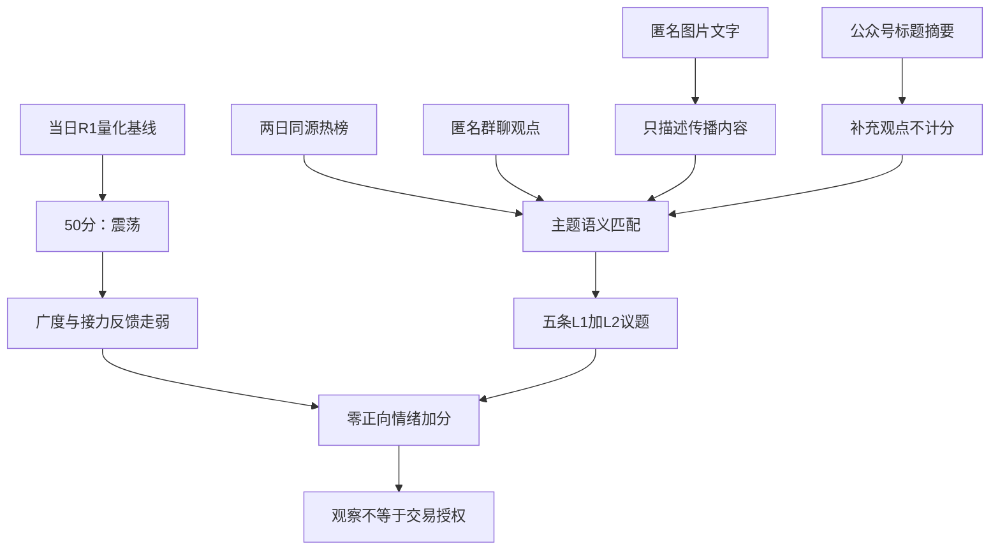

# 2026年11月13日 · 群聊情绪共振

> ⚠️ **数据源时间错位**：文件名是本次使用日，市场事实为2026-11-12已完成收盘；群聊采集含至次日凌晨的记录。不是2026-11-13盘中行情，也不是回放预测。
> **数据源新鲜度**：partial　**降级状态**：是　**置信度**：0.364（质量描述，不是胜率或交易门槛）

## 一句话结论
**情绪=震荡；50分不加分，五条传播共振均为观察，不能替代资金确认。**

## 🧭 详细分析

先认市场：当日R1基于最近完成收盘给出50分。5573只样本中4635只下跌，中位涨跌-1.61%；前日涨停全池85只的收盘反馈中位数-2.05%。37只封板及5板高度说明仍有局部赚钱效应，不能反推全面主升。市场正在奖励局部辨识度，而非普遍接力。

再认阶段：R1的35只炸板与37只封板同源，炸板率为48.61%。**情绪=震荡（高位震荡、主跌风险）**。XTick给36只炸板，与R1口径不同；其zbl字段20不当炸板率，不取平均。新的竞价、广度和涨停池收益到达后必须重评，不无限继承低温。

再认主题：AI应用、两岸、芯片、机器人、军工的热榜与群聊重合，是“在讨论什么”的双源证据；这些概念本身在最近收盘均下跌。排序只按传播证据可解释性，不是R2板块排序，不宣称五条主线。主线名称、1/3/5日持续性、逐主题封板率均待R2确认，不编造数值。明日预期按**分歧、待确认**处理。

最后定边界：本阶段只做**观察**，不生成个股买入/执行候选，不授予龙头资格。热榜中的名字仍保留为证据，未因缺数删研究来源。炸板率越35%时，R2/D1按纪律将逐票交易候选容量减半；top5议题不是执行候选，不因此删掉传播和反证。真实硬预算未知，不填正额度，也不继承旧零仓。今日计划尚未形成，in_today_plan未知。

## 🔎 双源共振主题

主题名采用标准概念；复合议题语义归并，不把多张概念榜或跨群转载当多个独立信源。下列“走强”问题均先辨别实际是否上涨。

### 1. AI应用 · L1+L2 · 观察

AI应用：8→9，-2.44%；短剧游戏：5→10，-3.01%；AI视频：14→20，-3.38%。热股蓝色光标双平台靠前，但应用概念整体下跌；热度不等于板块赚钱效应。

- **大资金意图**: 产业提效与入口迁移是参与者解释；没有资金账户证据，无法认定大资金已从硬件全面切换应用。
- **为什么走强**: 个别热股承接叙事，板块本身并未走强，不能以个股热度反推全线主升。
- **逻辑够不够硬**: 有热榜与长正文双源，但合作/模型数字未核，且短剧与AI视频跌幅反证同在；开盘若无扩散则否定全面回流假设。
- 语义边界：AI营销/视频/短剧属于应用侧，语义合并而非把三张概念榜算三条独立共识。
- 文本引用：group_02:data/raw/20261113/wechat_cli_5groups.jsonl:L87；group_02:data/raw/20261113/wechat_cli_5groups.jsonl:L115；group_03:data/raw/20261113/wechat_cli_5groups.jsonl:L183；group_05:data/raw/20261113/wechat_cli_5groups.jsonl:L316。

### 2. 海峡两岸 · L1+L2 · 观察

海峡两岸：前日榜外未知→4，-1.21%。概念新入本次top20的第4名，前日榜外名次未知；不能写成由某一精确名次跃升。

- **大资金意图**: 短线可能寻找区域事件与名称辨识度的合力，但不能证明机构配置或政策收入。
- **为什么走强**: 舆论在盘中从科技转向福建与两岸，概念仍下跌1.21%，属于局部联动而非整体上涨。
- **逻辑够不够硬**: 文本时间锚明确，热榜匹配明确；地缘新闻和事件受益待核，名称驱动短暂性构成反证。
- 语义边界：福建地域及两岸主题直接对应标准概念；名称联想另列，不把所有东字股硬归福建。
- 文本引用：group_02:data/raw/20261113/wechat_cli_5groups.jsonl:L84；group_02:data/raw/20261113/wechat_cli_5groups.jsonl:L93；group_02:data/raw/20261113/wechat_cli_5groups.jsonl:L105；group_02:data/raw/20261113/wechat_cli_5groups.jsonl:L106；group_02:data/raw/20261113/wechat_cli_5groups.jsonl:L109；group_03:data/raw/20261113/wechat_cli_5groups.jsonl:L199；group_03:data/raw/20261113/wechat_cli_5groups.jsonl:L201；group_03:data/raw/20261113/wechat_cli_5groups.jsonl:L202；group_05:data/raw/20261113/wechat_cli_5groups.jsonl:L338。

### 3. 芯片概念 · L1+L2 · 观察

芯片概念：13→14，-1.62%。板块排名13→14，热度持续但未加速；外部冲击存在正反两面。

- **大资金意图**: 国产替代为参与者主叙事，但美方约束也可能抑制需求；未用流量推断净买入。
- **为什么走强**: 国产算力局部反应与芯片概念整体下跌1.62%并存，不能称全板块走强。
- **逻辑够不够硬**: 卖方正文与热榜可交叉；DeepSeek参数、供应关系及英伟达高管变动均未在本阶段一手核验，不作为硬催化。
- 语义边界：国产GPU、昇腾及半导体自主可控属于芯片概念；股权映射不等于芯片主业。
- 文本引用：group_04:data/raw/20261113/wechat_cli_5groups.jsonl:L228；group_03:data/raw/20261113/wechat_cli_5groups.jsonl:L164；group_05:data/raw/20261113/wechat_cli_5groups.jsonl:L266；group_05:data/raw/20261113/wechat_cli_5groups.jsonl:L297；group_05:data/raw/20261113/wechat_cli_5groups.jsonl:L310；group_02:data/raw/20261113/wechat_cli_5groups.jsonl:L120；group_03:data/raw/20261113/wechat_cli_5groups.jsonl:L219。

### 4. 人形机器人 · L1+L2 · 观察

人形机器人：2→2，-3.15%；机器人概念：4→6，-2.42%。人形热度仍第2名但当日跌3.15%；产业信心和当日赚钱效应背离。

- **大资金意图**: 卖方逆势强化模型驱动逻辑；无法据此认定资金正在建仓或洗盘。
- **为什么走强**: 当前没有板块走强事实，只有热度未散与逆势看多；大跌后的反攻是待验证假设。
- **逻辑够不够硬**: 双源证明议题延续，不能证明订单；若新交易日核心与跟随仍无正反馈，则不成立全面修复。
- 语义边界：物理AI/本体/触觉/视觉的产业看多映射机器人；扑翼机器人推广不自动代表人形订单。
- 文本引用：group_01:data/raw/20261113/wechat_cli_5groups.jsonl:L8；group_04:data/raw/20261113/wechat_cli_5groups.jsonl:L239。

### 5. 军工 · L1+L2 · 观察

军工：前日榜外未知→11，-1.72%。军工进入本次top20第11名，前日精确排名未知；长城军工东财第7形成个股热度旁证。

- **大资金意图**: 参与者可能以地缘风险寻找事件弹性；实际资金方向未知，避免把防守标签静态化。
- **为什么走强**: 个股热度与事件讨论相互对应，但概念整体跌1.72%，不是已确认主升。
- **逻辑够不够硬**: 传播存在而地缘事实未核，核潜艇/核武器不是同一概念；须防止语义升级与多稿同源。
- 语义边界：船艇、军用线缆与地缘事件匹配军工；兵装重组第1名不冒充同一事件获证。
- 文本引用：group_02:data/raw/20261113/wechat_cli_5groups.jsonl:L103；group_03:data/raw/20261113/wechat_cli_5groups.jsonl:L197；group_03:data/raw/20261113/wechat_cli_5groups.jsonl:L209；group_05:data/raw/20261113/wechat_cli_5groups.jsonl:L329；group_05:data/raw/20261113/wechat_cli_5groups.jsonl:L330；group_05:data/raw/20261113/wechat_cli_5groups.jsonl:L342；group_05:data/raw/20261113/wechat_cli_5groups.jsonl:L344。

## 🗣️ KOL方向与去重

| 匿名来源/类别 | 直接表达与变化 | 如何消费 |
|---|---|---|
| group_01 · 盘中观点 | “今天开始稳步翻多”与“硬科技大概率还有一跌”同日并存；午间“全面大涨”预测随后转为“反弹阻力巨大” | 观察观点转弱；不把11月12日午后预测当今晨新预测 |
| group_02/03/05 · 同稿传播 | AI营销、零食、国产算力、名称联想跨群复制 | 合并同稿，同作者同文只算一份观点；不按出现群数认定背书 |
| group_04 · 卖方观点 | 国产AI链与机器人逆势看多，超节点/交换网络产业框架 | 作为可归因卖方观点，不当资金流或已兑现订单 |
| group_04 · 会议邀请 | 国产算力、AI应用与超节点会议推广 | 只证明议程，不另计独立看多证据 |

本人消息原文第13、345行排除；回复中的引用不作为新发言。全量17条语义摘要见R3 JSON的kol_summary。蓝色光标点评在三群同文转发，不是三份独立核验。7月零食开店报告在11月再传播，保留原事件时间，不包装成当夜新催化。

## 🖼️ 图片里在传播什么

唯一侧文件71条，68条OCR状态ok，其中42条非空、26条空文，另3条失败。42条中只2条质量recognized，其余40条非空仍为partial；低清片段保留原字与逐行confidence，不猜补。

| 定性传播主题 | 原文可见片段/边界 | 证据行 |
|---|---|---|
| 国产算力与存储 | “国产算力”“大替代时代”“昇腾950”“华为磁电存储 相关梳理”；低清公司名不校正，不由股权映射推定订单 | OCR L1、L2、L32、L35、L37、L39、L52 |
| 福建与名称联想 | “海峡两岸 祖国统一”“A股东字辈”“龙字辈，发酵！”及零售羊/九等梗 | OCR L13、L21、L29、L42、L43、L59 |
| 海缆项目 | 截图正文是鼓浪屿民生通信需求，不能扩大成跨海政治工程 | OCR L40 |
| 地缘与军工 | 无核原则/核潜艇片段与军用线缆、船艇映射；核动力不等于核武器 | OCR L3、L9、L18、L24、L58 |
| AI应用、脑机 | 营销与收购低清片段不补公司名；9项标准为立项，非已发布标准或收入兑现 | OCR L11、L62、L68 |
| 产能市值比较、冰雪文旅 | 比较表原文已说明不自动代表股票低估；主题合作图不证明业绩 | OCR L10、L15 |
| 未核高管变动说法 | 同事件图文、群内本人转述及转载不能当独立信源；只证明说法在流传 | OCR L46、L71；本人L345已排除 |

全部42条非空消费审计及质量/时间字段已进入R3 JSON，不要求D1打开原始图片文件。投资无关个人片段不展开；孤立错字/符号保留为无法可靠映射，不强造主题。脑机图片存在证券代码/名称可疑配对，仅保存原识别文字，不修正也不提票。

图片captured_at是采集，source_cached_at是缓存mtime。所有图片message_time与published_at仍为null；截图内印出的相对时间或文章时间不变成发言时间。相同图片、近似同稿和与聊天文本同事件均不增加独立信源、量化频次或情绪分；作者和转发者赞同均未知。完整研究图还可能是既有研究回流，不能自证。OCR失败仅降低图片覆盖，不判群聊安静，不新增交易门槛。

## 📰 公众号观点

95条标题/摘要来自14个有文章订阅号，18路抓取均成功，核心10路中9路有文章。只读现有标题和摘要，未宣称阅读全文。零文章订阅号不等于停更或看空。

| 分类 | 观点/标题层证据 | 限制 |
|---|---|---|
| 宏观与情绪 | 收评称超4600股下跌、热门题材调整；“筹码结构太乱”“跌太狠了”等标题显示谨慎表达 | 仅标题的文章不能推测完整仓位或未来方向 |
| 应用/机器人 | AI漫剧调整、模型/物理AI议题并存 | 产业乐观与当日收益负反馈并列，不给情绪加分 |
| 国产算力/存储 | 国产GPU、存储试商用与超节点议题 | 同底层事件转载不当新增独立信源 |
| 两岸/军工 | 纪念活动报道与晚间题材资讯 | 有报道不等于产业增量或全板块获益 |
| 海外冲击说法 | 多个媒体标题重复高管变动叙事 | R3未独立核验，不把转载数量当真实确认；不传播私人指控 |

公众号不参与L1/L2独立计数与50分计算；同题对应证据及宏观/情绪库存已在主JSON保留。

## 📋 出货警报检查范围

检查的是**同源连续两个已完成交易日末次快照都为top1**的霸榜代理，不是复合L4派发事实。热度不能证明派发。共44条“对象×来源”记录：34条实际比对后false，10条null/unknown，0条true。34条false不等于34只股票，跨源重复对象单列。

窗口A：2026-11-11至2026-11-12，同花顺热股/概念晚间末次快照。窗口B：同两日东财人气晚间末次快照。精确rank_time、观察时点、逐条证据引用及原因在JSON。前日概念仅top20，榜外不是0名；只有传播文本而无热榜覆盖的对象仍未知。

| 对象 | 类型 | 来源/窗口 | 前日→本日排名 | 结果 |
|---|---|---|---|---|
| 东方海洋（002086.SZ） | stock | THS/A | 6→1 | 🟢 checked / false |
| 东山精密（002384.SZ） | stock | THS/A | 7→2 | 🟢 checked / false |
| 日出东方（603366.SH） | stock | THS/A | 11→3 | 🟢 checked / false |
| 襄阳轴承（000678.SZ） | stock | THS/A | 3→4 | 🟢 checked / false |
| 蓝色光标（300058.SZ） | stock | THS/A | 未知→5 | 🟡 unknown / null |
| 文投控股（600715.SH） | stock | THS/A | 1→6 | 🟢 checked / false |
| 大东方（600327.SH） | stock | THS/A | 14→7 | 🟢 checked / false |
| 通富微电（002156.SZ） | stock | THS/A | 未知→8 | 🟡 unknown / null |
| 冰山冷热（000530.SZ） | stock | THS/A | 2→9 | 🟢 checked / false |
| 中际旭创（300308.SZ） | stock | THS/A | 10→10 | 🟢 checked / false |
| 东方新能（002310.SZ） | stock | THS/A | 5→11 | 🟢 checked / false |
| 龙江交通（601188.SH） | stock | THS/A | 16→12 | 🟢 checked / false |
| 先导基电（600641.SH） | stock | THS/A | 41→13 | 🟢 checked / false |
| 新易盛（300502.SZ） | stock | THS/A | 12→14 | 🟢 checked / false |
| 剑桥科技（603083.SH） | stock | THS/A | 18→15 | 🟢 checked / false |
| 阳光照明（600261.SH） | stock | THS/A | 4→16 | 🟢 checked / false |
| 宇树科技（688836.SH） | stock | THS/A | 13→17 | 🟢 checked / false |
| 锋龙股份（002931.SZ） | stock | THS/A | 39→18 | 🟢 checked / false |
| 澳洋健康（002172.SZ） | stock | THS/A | 68→19 | 🟢 checked / false |
| 慈文传媒（002343.SZ） | stock | THS/A | 22→20 | 🟢 checked / false |
| 兵装重组概念（886101.TI） | sector | THS/A | 未知→1 | 🟡 unknown / null |
| 人形机器人（886069.TI） | sector | THS/A | 2→2 | 🟢 checked / false |
| 商业航天（886078.TI） | sector | THS/A | 3→3 | 🟢 checked / false |
| 海峡两岸（885939.TI） | sector | THS/A | 未知→4 | 🟡 unknown / null |
| 共封装光学(CPO)（886033.TI） | sector | THS/A | 1→5 | 🟢 checked / false |
| 机器人概念（885517.TI） | sector | THS/A | 4→6 | 🟢 checked / false |
| 光伏概念（885531.TI） | sector | THS/A | 9→7 | 🟢 checked / false |
| 创新药（886015.TI） | sector | THS/A | 12→8 | 🟢 checked / false |
| AI应用（886108.TI） | sector | THS/A | 8→9 | 🟢 checked / false |
| 短剧游戏（886060.TI） | sector | THS/A | 5→10 | 🟢 checked / false |
| 军工（885700.TI） | sector | THS/A | 未知→11 | 🟡 unknown / null |
| 预制菜（885951.TI） | sector | THS/A | 未知→12 | 🟡 unknown / null |
| 黄金概念（885530.TI） | sector | THS/A | 未知→13 | 🟡 unknown / null |
| 芯片概念（885756.TI） | sector | THS/A | 13→14 | 🟢 checked / false |
| 冰雪产业（885825.TI） | sector | THS/A | 15→15 | 🟢 checked / false |
| 存储芯片（886042.TI） | sector | THS/A | 6→16 | 🟢 checked / false |
| 人工智能（885728.TI） | sector | THS/A | 10→17 | 🟢 checked / false |
| 英伟达概念（886048.TI） | sector | THS/A | 未知→18 | 🟡 unknown / null |
| 白酒概念（885525.TI） | sector | THS/A | 未知→19 | 🟡 unknown / null |
| AI视频（886068.TI） | sector | THS/A | 14→20 | 🟢 checked / false |
| 远东传动（002406.SZ） | stock | 文本/OCR，无榜单覆盖 | 未知→未知 | 🟡 unknown / null |
| 002086.SZ（002086.SZ） | stock | DC/B | 10→1 | 🟢 checked / false |
| 002384.SZ（002384.SZ） | stock | DC/B | 1→9 | 🟢 checked / false |
| 600715.SH（600715.SH） | stock | DC/B | 3→6 | 🟢 checked / false |

未检查成交激增、上影、逐票资金流、龙虎榜和负面新闻的复合L4；该扩展状态unknown。范围外对象、后续R2候选及其他盘中窗口不继承上述阴性，且本次没有为模式6补全而新增全市场扫描。R6按其原条件独立核定硬否决；空distribution_alert数组绝不是无风险证明。

## 🧾 关键证据

- R1当日产物：广度875涨/4635跌/63平；非ST收盘封板37、炸板35，炸板率48.61%；前日涨停池85/85匹配，中位反馈-2.05%。来源：R1_style.json的E_BREADTH、E_LIMIT、E_PREMIUM。
- 东方海洋同花顺6→1、东财10→1；东山精密东财1→9，文投控股同花顺1→6，均不满足同源连续两日top1。来源：本轮live MCP；保存于R3_live_hotlist_evidence.json。
- 先导基电同花顺41→13、锋龙股份39→18、澳洋健康68→19；新进top20不等于新进top100。来源：同花顺两日末次热股榜；跨源名次不混算。
- group_01从盘中看多转为承认反弹阻力；group_04卖方继续看多机器人，与板块收跌构成真实反证。来源：文本L19/L30/L239。
- 群聊与OCR中的研究海报、名称联想、存储试商用稿跨群重复；传播范围不是作者数量。来源：OCR L37/L39/L42/L64及对应文本。

## 数据源审计

| 源 | 日期 | 状态 | 记录数与覆盖 |
|---|---|:--:|---|
| 当日R1 | 2026-11-13 | 🟡 | 1份；自身degraded，核心量化事实有依据，有限采纳50，不用前日R1 |
| Tushare同花顺热股 | 2026-11-11 / 2026-11-12 | 🟢 | live各100条；当前保存50条，部分精确前日名次保存；diff不扩写未运输对象 |
| Tushare同花顺概念 | 2026-11-11 / 2026-11-12 | 🟢 | live各20条；榜外精确名次未知 |
| Tushare东财人气 | 2026-11-11 / 2026-11-12 | 🟢 | live各100条；3个核心对象完成独立窗口警报比对 |
| attention绑定文件 | 2026-11-13 | 🟡 | use_date为本日，signal_date为2026-11-12；1970持续人气、14跳升、56跨平台记录不直接充当今日实时或连续top1 |
| XTick情绪 | 2026-11-12 | 🟢 | 37涨停/5跌停/5板交叉相符；36炸板与R1差1，不混口径 |
| 群聊文本group_01 | 2026-11-12 | 🟢 | 33条；首条至末条均为该日 |
| 群聊文本group_02 | 2026-11-12 / 2026-11-13 | 🟢 | 89条；末条到次日凌晨 |
| 群聊文本group_03 | 2026-11-12 | 🟢 | 97条 |
| 群聊文本group_04 | 2026-11-12 | 🟢 | 23条 |
| 群聊文本group_05 | 2026-11-12 | 🟢 | 108条；五群合计350 |
| 匿名图片OCR | 2026-11-13 | 🟡 | 71张去重图；42非空、26空、3失败；事件/消息时点未知 |
| 公众号RSS | 2026-11-13 | 🟢 | 95篇标题摘要、18路成功、14路有文章；不算额外量化信源 |
| WeFlow | 2026-11-13 | 🔴 | 永久退场，未调用，兼容数组为空 |
| Hithink/新闻/画像补充 | 2026-11-13 | 🟡 | 本阶段未调用；不越权以基本面验证代替情绪研究 |

五群均低于代码默认单群limit=200，未见触顶，但原CLI分页元数据与客户端同步完整性未运输。来源采集始于今晨，未补抓至本报告生成时点；不能从最后一条消息或图片数量推断群聊沉默、热度降温。本日非周末/周一档，不消费attention_weekend。置信度按0.65×0.7×0.8=0.364计算，降级仅限证据质量，不新增全局禁买。

## ⚖️ 不确定性 / 反证

最重要的反证是热榜靠前的主题仍然下跌，说明有传播不等于有接力利润。AI应用虽有个别强热股，AI视频、短剧游戏的概念跌幅反而较大；机器人产业看多不能抵消当日弱反馈。军工与两岸事件、国产芯片传闻均存在未经核验环节，不肯定也不凭缺证直接宣判为假。

本报告没有首推票，因此逐票板型、龙头纪律通过数、RR、禁止清单均未授予。**买入理由**：不适用，无买入候选；**风险点**：热度与收益背离、同源重复及传言污染；**止损条件**：不设持仓价位，不越权覆盖原执行计划；**可验证假设**：下一交易时段新广度、涨停池正反馈与核心带动同时改善，才重评传播能否转成市场合力。这不是新增执行门槛，而是本研究假设的失效/重评条件。

R1市场建议适用至本日开盘，竞价和开盘新证据到达即由D1/P1重评。账户停买、有效硬预算含0、硬仓位上限、T+1和逐票hard_reject仍独立有效。辅助源缺失和本报告低质量置信度不能抬成全局停买理由。

## 🔗 与其他 R/D/E 的关系

- 依赖：data/research/20261113/R1_style.json、attention_signals.json、本日文本、唯一OCR侧文件与公众号RSS；本轮实时Tushare/XTick补证。
- 被消费：R2研究主线、R4核事实、R6独立反证、D1独立决策、E1复盘。D1消费R3主JSON中的图片摘要，不直接读取原始图片侧文件。
- 保留：CPO、商业航天/光伏、消费、存储等次级观察及脑机单源线索，详见主JSON；不因top5容量删除源。
- 非授权：不改变旧计划、预算、交易权限；本轮研究判断不等于买入许可。

## Sub-Agent 元数据

- skill: analyze_sentiment_resonance_v1
- artifact: data/research/20261113/R3_sentiment.json
- evidence: data/research/20261113/R3_live_hotlist_evidence.json
- 生成耗时: 567秒（本阶段首个取证工具起算，不含外部启动等待）
- model: gpt-6.1-sol
- method: llm_v1（语义理解，不按关键词频次打分）
- 资源与时点：正常盘前实跑；5000万仅观察性努力目标，usage_unknown不当0，不保证低于目标；08:30是交付目标，不是强杀或交易指令。
