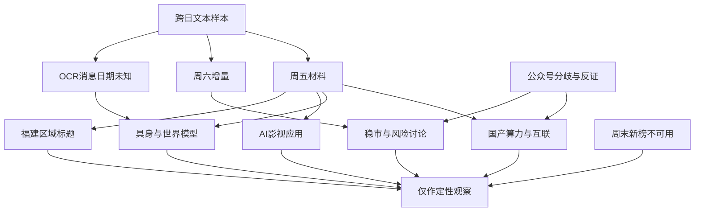

# 2026年11月14日 · 周末轻量群聊情绪

> 🟡 **定性文本研究，非交易日市场测量。** 含周五样本，不是纯周末报告；没有市场情绪分、价位推断或交易建议。

## 💡 一句话结论

**周五围绕国产算力扩散，周六可读增量偏稳市与风险讨论；尚不能确认周末形成新共识。**

## 🔎 方法与关键证据

精确窗口见 frontmatter，时区为亚洲/上海；manifest 声明回溯36小时，群聊起点为2026-11-13 06:02:16，上界取OCR采集的2026-11-14 18:02:24。各源采集时钟不齐，不能视作共同完整截止。

以下引用均在 `data/raw/20261114/`：**C**＝`wechat_cli_5groups.jsonl`，**P**＝`wechat_official_20.jsonl`，**O**＝`wechat_image_ocr_20261114.jsonl`；`L`为物理行号，非微信原生消息ID。

- 🟢 251条逐行解析，实际是包装后的消息字符串：周五237、周六14。120条文字、57条链接标题、68条图片，以及2条系统、2条未展开、1个文件、1条表情。
- 🟡 177条文字/标题经Unicode与空白归一后为124种内容，**仍不是124个有效或独立观点**。东吴稿在 `C:L22/L165` 为同稿改写；相同视频模型标题在 `C:L20/L92`、同一大桥标题在 `C:L19/L91/L164` 只算传播。机构署名也不等于底层事实已独立验证。
- 🟡 排除系统、纯会议宣传、个人荐股与其引用、自制研究图；不把个人转发当赞同。原始记录没有本人标识，无法声称身份级穷尽排除，故个人原创不进入本轮独立观点证据。

## 🧭 详细分析：五条讨论线索

这里的“为什么走强”只解释**叙事为何受关注**，不表示股价走强；以下不是板块强弱排序。

### 1. 国产算力、半导体与互联

周五中信、东吴、天风、开源署名稿均谈国产化、交付或交换网络（`C:L1/L22/L161/L150`），方向相近，但海外治理扰动是共同底层叙事，不算四次事实确认。
- **大资金意图**: 未知；卖方集中推介不能证明机构正在配置。
- **为什么走强**: 供应不确定性与国产供给预期叠加，产业叙事从芯片延伸至互联。
- **逻辑够不够硬**: 有署名产业论述，缺本轮公告、采购和资金核验；公众号亦有供应商合作未变的反证（`P:L16`）。

### 2. 华为具身智能、CloudRobo

周五群聊传播材料所称的2026-11-16发布节点（`C:L44/L114`）；匿名OCR可读到华为云与软通天枢、凌云光相关数采方案（`O:L39/L43`），仅补内容。
- **大资金意图**: 未知，生态网页不证明资金流向。
- **为什么走强**: 有具体发布日叙事，容易把算力与机器人场景串联。
- **逻辑够不够硬**: 事件日期和生态关系仍待原发布方核验；不能从伙伴名单推出上市公司订单。周六未见可读实质续证。

### 3. AI影视、视频生成与短剧

周五链接谈视频模型体验（`C:L20/L92`），公众号午报谈AI漫剧（`P:L3`）；会议邀请及其OCR海报（`C:L156-L159`、`O:L17`）不算观点。
- **大资金意图**: 未知；传播和会议密度不等于新增配置。
- **为什么走强**: 可视化产品体验强化应用落地想象。
- **逻辑够不够硬**: 现有证据能支持“在讨论”，不能证明商业回款或利润兑现；标题不冒充全文，周六未见新增实质观点。

### 4. 福建区域与厦金大桥

周五同一工程进展标题跨三个匿名群传播（`C:L19/L91/L164`），不是三个独立判断。
- **大资金意图**: 未知，区域标签不能解释资金选择。
- **为什么走强**: 工程节点为区域联想提供了传播锚。
- **逻辑够不够硬**: 只确认标题出现；通车预期、具体受益和盈利关联均未核。周六没有可读延续证据，不列为已确认周末主线。

### 5. 稳市诉求与外部估值风险

周六群聊出现稳市讲话链接（`C:L10`），公众号同时谈市场稳定机制与海外AI估值风险（`P:L10/L6`），呈现支持预期与风险担忧并存。
- **大资金意图**: 未知；讲话不能代替真实增量资金。
- **为什么走强**: 风险事件背景下，稳定机制更受关注。
- **逻辑够不够硬**: 可确认报道内容与传播方向，不能据此判断市场已修复，也不能把风险调查当必然下跌预测。

## 📰 公众号观点：与群聊分开

| 日期 | 观点侧重 | 保留的分歧与边界 |
|---|---|---|
| 2026-11-13 | 猫笔刀写低气压与耐心消耗（`P:L97`）；傅里叶的猫讨论CPO交付约束（`P:L99`） | 作者判断，不是本轮收盘测量；不照搬其操作措辞 |
| 2026-11-14 | 远川研究所讨论组织接续风险（`P:L98`）；证券时报报道供应链合作未变（`P:L16`） | 治理担忧与经营延续并存，不推出产业必然中断 |
| 2026-11-14 | 稳市机制、中美沟通与海外估值风险（`P:L10/L7/L6`） | 宏观与情绪线索，不强套某个板块 |

另有医保目录报道（`P:L13/L54`），属公众号补充而非群聊共识；两篇同事件报道不当双重确认。`P:L104/L105`为同号同题不同版本，不增加独立观点。

## 数据源审计

匿名群1—5按抓取配置顺序编号；表中计数是**原始记录**，不是有效观点。

| 源 | 日期 | 状态 | 周五 | 周六 | 覆盖说明 |
|---|---|:--:|---:|---:|---|
| 匿名群1 | 2026-11-13／2026-11-14 | 🟡 | 7 | 7 | 共14；最新消息日期为周六 |
| 匿名群2 | 2026-11-13／2026-11-14 | 🟡 | 67 | 5 | 共72；含1条系统消息 |
| 匿名群3 | 2026-11-13／2026-11-14 | 🟡 | 56 | 1 | 共57；有文件及图片缺口 |
| 匿名群4 | 2026-11-13 | 🟡 | 16 | 0 | 共16；周六零记录不等于沉默 |
| 匿名群5 | 2026-11-13／2026-11-14 | 🟡 | 91 | 1 | 共92；含1条系统消息 |
| 公众号及RSS镜像 | 2026-11-13／2026-11-14 | 🟡 | 75 | 30 | 18订阅、11有文、7为空；105条仅计一次 |
| 匿名图片OCR | 2026-11-14 | 🟡 | — | — | 47张去重图；无法按消息日期拆分 |
| 周末热榜 | 2026-11-14 | 🟡 | — | 0 | manifest四类新榜均0；正常不可用 |
| manifest | 2026-11-14 | 🟢 | — | — | 只用来源元数据，不继承其全局健康结论 |

公众号时间戳与展示日期逐条一致，105条均在报告窗口，未混入窗外旧文；但10条仅标题，95条有题外正文，其中4条明显截尾（`P:L11/L53/L93/L98`），**不宣称全文覆盖**。RSS与兼容文件逐字节相同，不累计为210篇。

OCR共42张处理成功，但19张空文本、39张标为部分识别、5张失败；实际仅23张非空，非空也不保证可用。只采用清晰可读片段，不归因发言人、不猜模糊股票或数字；`O:L25`自制研究图不纳入，`O:L45`含2025年旧材料不算新增事件。全部消息/发布时间为空，缓存mtime绝不充当消息时间。

## ⚠️ 不确定性 / 反证

- 群聊记录未触及代码单群200条上限，但没有尾页、分日补查或远端同步回执，故未认证取尽；周五和周六窗口长度不同，不计算“降温幅度”。
- **讨论集中度不等于市场情绪。** 海外人事、技术时点及匿名承诺截图均未独立核验；正文只描述材料叙事，不把传闻升级为事实。
- 周末新榜为 `not_available`，不因此降级；2026-11-11至2026-11-13持续榜不冒充周末榜，不构造L1+L2共振。降级只反映OCR、正文、身份及覆盖缺口。

## 🔗 与其他研究的关系及元数据

仅消费上述群聊、公众号、OCR和manifest；不消费交易侧数据。可供后续核验讨论线索，**不作为交易执行依据**。本次只生成人读周末md，未生成正式R3 JSON；市场情绪分与量化置信度均为 `null`。模型：gpt-6.1-sol。
