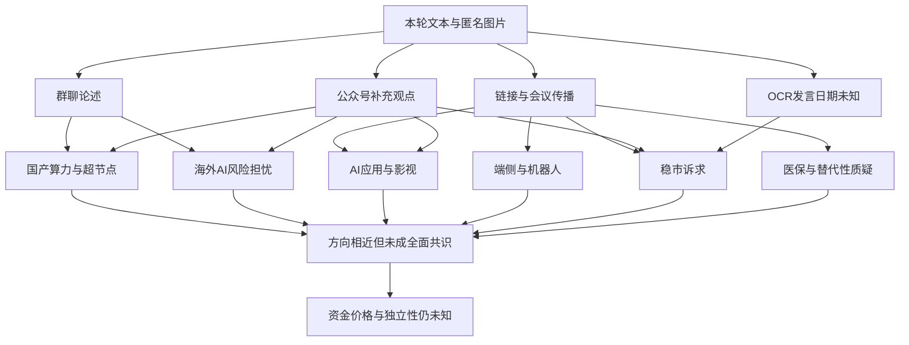

# 2026年11月15日 · 周末轻量群聊情绪

> 🟡 **仅研究文本偏向与传播，不测量真实市场情绪。** 本次不是周五以来的全周末汇总；不构造量化共振，不构成交易执行依据。

## 💡 一句话结论

**算力自主可控是可读论述重心；应用与具身偏材料传播，稳市诉求伴随风险担忧，尚无全面一致预期。**

## 🔎 有效窗口与统计口径

- **名义24小时**：2026-11-14 18:01至2026-11-15 18:01，精确到秒的边界见frontmatter；起点来自 `M:L45`，长度来自 `M:L5`。上界按起点加24小时保守确定，不以OCR采集时间替代群聊截止。
- **群聊30条全部在窗内**：2026-11-14有6条，2026-11-15有24条；最早 `C:L15`（2026-11-14 18:16），最新 `C:L17`（2026-11-15 17:55）。不把两天不等长的局部样本当作消息量升降。
- **公众号39篇全部在窗内**：按源字段 `update_time` 与 `update_time_str` 逐条互核，最早 `P:L17`（2026-11-14 18:05），最新 `P:L2`（2026-11-15 17:38）；两天分别10篇、29篇。本次窗前0、窗后0、时间缺失0；这只是源标注的发布/更新时间，不保证首发时刻。文章回述既往事件，不等于事件新发生。
- 两个公众号文件**逐字节一致**，是39篇的同一镜像，不累计为78篇。39个链接不同，也不等于39个独立观点；`P:L38/L39` 同号同题、长短两版归并为一条稳市讨论。
- OCR有3张去重图，2张非空，3张均为低清 `partial`。全部 `published_at/message_time=null`，因此**不纳入上述按发言日期的窗口条数**；仅证明本批缓存出现这些传播内容（`O:L1-L3`；`M:L75-L140`）。

**证据索引**（`L`为物理行号，不是微信原生消息ID）：

| 代号 | 原始文件，均相对项目根 |
|---|---|
| M | `data/raw/20261115/manifest.json` |
| C | `data/raw/20261115/wechat_cli_5groups.jsonl` |
| P | `data/raw/20261115/wechat_official_20.jsonl`；RSS镜像同一行号 |
| O | `data/raw/20261115/wechat_image_ocr_20261115.jsonl` |

群号 `group_01`—`group_05` 按manifest顺序，已与 `src/fetch/wechat_sources.py:L25-L31` 一致核对。数据批次约为2026-11-15 18:02：群聊文件、公众号文件的mtime仅作落盘线索，**不作发言或首发时间**；OCR明确 `captured_at` 为当日18:02（`M:L80`）。manifest的 `generated_at`（`M:L4`）是开始标记，不能冒充所有来源的完成时点。

### 文本、推广与独立性分开

| 类别 | 原始条数 | 行号及处理 |
|---|---:|---|
| 长正文/论述候选 | 5 | `C:L1/L4/L7/L8/L25`；包含转载、机构稿，不是5个独立作者 |
| 短反证回复 | 1 | `C:L30`；仅作对话分歧，身份与事实未核，不计独立观点 |
| 链接标题 | 11 | `C:L2/L11/L15/L17/L18/L21/L24/L26-L29`；只证明传播标题 |
| 会议宣传/邀请 | 4 | `C:L14/L20/L22/L23`；不作为参会者认同或新增配置 |
| 外链政治导读、关系询问 | 2 | `C:L10/L3`；不计产业独立判断 |
| 系统消息 | 3 | `C:L12/L13/L16`；排除 |
| 图片占位、视频未展开 | 4 | 图片 `C:L6/L9/L19`，视频 `C:L5`；不凭占位猜正文 |

去重后不凑“多人一致”：`C:L15/L17` 是同群同标题重复；`C:L20/L22` 是同一会议文案重复；`C:L1/L2` 为正文与链接同内容；`C:L21/L25` 为同一署名机构稿的标题/正文。可读非系统、非图片/视频共23条，精确正文去重后21种，**仍不是21个有效观点**。本样本没有精确同文跨群命中；语义相同的海外算力风险及其国产化推演仍按共同底层叙事处理，而非独立事实确认。

**本人排除边界**：原始快照没有self标识，也没有可核验的本人身份映射；不宣称已做身份级穷尽排除。本轮不把群内个人原创、个人引用或无法核身的文字计为独立KOL支持票；只保留匿名传播内容与分歧线索，避免将本人或其被引用观点回灌成共识。`C:L1/L3` 的个人推荐/关系问答不参与核心共识；`C:L30` 仅展示未核反证。

## 🧭 文本偏向与情绪浓度（定性）

| 维度 | 本次判断 | 因果与边界 |
|---|---|---|
| 文本方向 | **产业叙事偏国产化，宏观情绪偏谨慎** | `C:L4/L25` 给出国产算力、系统互联的正向叙事；`C:L8` 同时保留外部战略不确定性，`P:L30/L38` 则谈估值/融资风险与信任缺口 |
| 主题集中度 | **算力相关论述相对集中，其余分散** | 长正文 `C:L4/L7/L8/L25` 围绕海外AI与国产供给链；不是按关键词频次打分，也不代表五群都在独立表达同一判断 |
| 可确认的情绪浓度 | **谨慎中寻求结构性解释，非亢奋一致** | 正向国产化解释与海外风险、稳市诉求并存；推广/链接占有明显篇幅，无法据此评价全市场热度 |
| 新增发酵形态 | **从芯片延展到超节点互联，并尝试接上应用需求** | `C:L25` 将AI短剧的Tokens消耗、国产超节点、交换网络串联；同一篇推演不拆成多源验证 |
| 时间变化 | **可以确认周日继续传播，不能确认加速或降温** | 昨日报告窗口跨2026-11-13至2026-11-14，含周五；其国产算力/具身/影视观察只作历史旁证（`chzl_kg/投研交易/群聊情绪/20261114.md:L50-L69/L136-L140`），不并入本轮计数 |

## 🧩 Top主题与关键证据

以下顺序是**讨论线索组织顺序，不是板块强弱排序**；公众号只属观点补充，绝非L1量化热榜。

### T1. 国产算力、超节点与交换网络

**文本读法**：核心可读论述；正向替代预期与海外AI风险同在。

| 日期、来源类型与行号 | 短原文 |
|---|---|
| `C:L4` · 2026-11-15 · chat_text/group_01 | “国产GPU替代逻辑仍在持续强化” |
| `C:L25` · 2026-11-15 · seller_research/group_04 | “交换网络成为超节点关键” |
| `C:L8` · 2026-11-15 · forwarded_view/group_01 | “这个问题在短期内是没有答案的” |
| `P:L19` · 2026-11-15 · official_account/上海证券报 | “逐步降低对海外技术的依赖” |
| `P:L30` · 2026-11-14 · official_account/上海证券报 | “脆弱性正在资产估值与AI相关融资的交汇处累积” |

**独立性/反证**：相同海外事件是共同假设，并非几篇稿件多次证实。`P:L19`回述三季度持仓，只作历史配置观点，不能代表本周末新增资金。
- **大资金意图**: 未核真实资金和价格，不推断机构正在转配。
- **为什么走强**: 仅解释叙事关注度：外部供给担忧被转写为自主可控与系统互联机会，不表示价格已走强。
- **逻辑够不够硬**: 有机构论述，缺采购、交付与原发布方核实；`C:L8`的“不确定”及`P:L30`的融资风险保留，不能确认国产替代必然抵消全球需求冲击。

### T2. AI应用、影视与付费商业化

**文本读法**：群聊偏标题传播，公众号对商业化既有期待也有约束。

| 日期、来源类型与行号 | 短原文 |
|---|---|
| `C:L26` · 2026-11-15 · link_title/group_04 | “怎么看“AI电影”” |
| `P:L28` · 2026-11-15 · official_account/上海证券报 | “调用量增长并不意味着模型厂商获得同等比例的商业收入” |
| `P:L34` · 2026-11-14 · official_account/傅里叶的猫 | “每笔购买仍要单独授权” |

**独立性/反证**：`C:L26`没有可展开观点，不能当群内原创认同；`P:L28`直接提示调用与收入不同比例。
- **大资金意图**: 未核，不从影视标题或商业化报道推断资金选择。
- **为什么走强**: 叙事尝试由调用量转向持续付费；不代表盈利或价格已兑现。
- **逻辑够不够硬**: 商业化检验指标比单纯热词明确，但群内实质判断薄；产品发布与经营数据均未在本轮向原始发布方核验。

### T3. 端侧AI、物理AI与机器人

**文本读法**：群里以会议素材扩散，公众号补充灵巧手需求论述。

| 日期、来源类型与行号 | 短原文 |
|---|---|
| `C:L14` · 2026-11-15 · meeting_promotion/group_02 | “机器人+光” |
| `C:L20` · 2026-11-15 · meeting_invitation/group_04 | “苹果的端侧AI和物理AI” |
| `P:L1` · 2026-11-14 · official_account/财联社早知道 | “逐步转向用真机持续采集操作轨迹” |

**独立性/反证**：`C:L20/L22`同稿合并；`C:L14`是邀请兼推介。`O:L3`残片只作匿名辅助，不补齐模糊标题，不追加作者支持。
- **大资金意图**: 未核，会议推介不证明参会、认同或配置。
- **为什么走强**: 端侧/物理AI与机器人部件材料易相互串联；实际观察是宣传传播，不是市场强度。
- **逻辑够不够硬**: 有产业访谈，但访谈也提示销量不确定；邀请、OCR海报与文章不是同一企业订单的交叉确认（`P:L1`）。

### T4. 稳市诉求、量化与减持制度

**文本读法**：“盼头”与“信任不足”并存，不等于政策效果已兑现。

| 日期、来源类型与行号 | 短原文 |
|---|---|
| `C:L18` · 2026-11-14 · link_title/group_04 | “量化与减持，A股的两座大山” |
| `C:L27` · 2026-11-15 · link_title/group_05 | “A股终于有了盼头” |
| `O:L2` · 发言日期未知；采集2026-11-15 · image_ocr/group_01 | “低通滤波器” |
| `P:L20` · 2026-11-15 · official_account/上海证券报 | “过高频交易容易脱离基本面” |
| `P:L38` · 2026-11-15 · official_account/证金事 | “光喊话是拉不回信心的” |

**独立性/反证**：`O:L2`与`P:L20`叙述同一讲话，不作两个独立事件；`C:L27`与`P:L38/L39`同题不增加独立性。
- **大资金意图**: 未核，稳市讨论不等于增量资金已到位。
- **为什么走强**: 风险背景下，公平交易与长期资本诉求更容易形成情绪表达；未测价格反应。
- **逻辑够不够硬**: 有可读讲话报道，但制度研究不等于规则已落地；情绪作者对ETF等的归因未核，不能据此认定任何主体的交易意图。

### T5. 医保预期与产品替代性分歧

**文本读法**：弱线索：一个纳入目录标题，紧接一条质疑回复。

| 日期、来源类型与行号 | 短原文 |
|---|---|
| `C:L29` · 2026-11-15 · link_title/group_05 | “正式纳入国家医保目录” |
| `C:L30` · 2026-11-15 · personal_reply_unverified_identity/group_05 | “替代不了目前的白蛋白” |
| `P:L3` · 2026-11-15 · official_account/证券时报 | “新版医保药品目录公布” |

**独立性/反证**：`C:L30`是未核个人经验，不视为医学结论；`P:L3`的目录概述不能核实`C:L29`所称具体产品及其替代效果。
- **大资金意图**: 未核，不从目录标题推断资金流入。
- **为什么走强**: “纳入目录”提供传播锚，但样本立即出现替代性质疑；不代表市场形成一致预期。
- **逻辑够不够硬**: 仅足以确认存在分歧，具体目录条目、适应症与商业影响均未核；不作医疗判断。

## 📰 公众号：宏观与情绪，不并入量化热度

| 观点线索 | 带日期的短原文及出处 | 如何使用 |
|---|---|---|
| AI估值与融资风险 | 2026-11-14 · official_account · `P:L30`：“资产估值压力持续处于高位” | 报道转述的风险框架，不是本轮估值测量或必然下跌判断 |
| 稳市、公平与信任 | 2026-11-15 · official_account · `P:L3`：“研究评估量化交易、股份减持”；`P:L38`：“光喊话是拉不回信心的” | 同时保留政策期待与信任担忧；不把评论里的行情/资金数字当已核市场数据 |
| 汇率与外部利率 | 2026-11-15 · official_account · `P:L11/L26`同述外汇准备金调整；`P:L6`讨论海外通胀约束 | 同一宏观事项合并理解，仅描述文章关注什么，不验证政策或交易结果 |
| 内需的慢变量 | 2026-11-14 · official_account · `P:L35`：“投资于‘人’”主题，正文“中长期有望实现供、需的双向增长” | 宏观结构观点，不强行映射短线板块；正文截尾，不能声称全文覆盖 |
| 延后表达而非阴性结论 | 2026-11-14 · official_account · `P:L32`：“这个话题明天晚上聊吧” | 本文主体为生活话题；没有给出减持核验结果，不以作者沉默反推资金行为 |

海外人事、政治博弈与供应链材料（`C:L7/L8`、`P:L33/L37`）仅作为**未核叙事与风险关注**；不重述私人指控，不将人事变化、归因或传闻写成已确认事实。跨文本语义一致可以说明故事在流传，不能说明其真实。

## ⚖️ 一致性预期、反证与覆盖缺口

| 拟讨论的一致性 | 当前可支持到哪里 | 明确反证/未覆盖 |
|---|---|---|
| 外部供给风险会强化国产替代讨论 | `C:L4/L25`方向相近，`P:L19`补充同方向产业观点 | 共同底层假设未核；`C:L8/P:L30`保留全球AI与融资风险，不能推出受益确定性 |
| 应用增长会支撑算力 | `C:L25`把短剧与Tokens、互联相连 | 是机构推演；`P:L28`提示调用不等于收入，未核实际订单/回款 |
| 稳市表态能修复信任 | `C:L27`标题表达期待，`P:L20`提供讲话内容 | `P:L38/L39`仍质疑效果；没有政策实施或当期资金验证 |
| 多人多群形成强共识 | **未成立**：正文、标题、会议、OCR应分层 | 无身份级独立作者确认，重复稿已合并；不构造L1+L2强共振 |

- **覆盖不是取尽**：manifest显示5群抓取均ok、无错误（`M:L40-L74`），但原始文件没有尾页/同步完整性回执；`src/fetch/wechat_sources.py:L99`的单群上限为200，本次各群未触顶也不能证明无漏项。没有重抓或读取私有配置。
- **时间缺口**：群聊时间只到分钟；公众号是源标注发布/更新时间。OCR全为缓存时间基础且未知发言日，不用于证明周日新增。视频未展开、空OCR不是群聊“安静”。
- **正文缺口**：39篇都有非空content，但`P:L33/L35`分别为4012/4015字符且结尾截断；不称全量原文覆盖。`P:L37`长标题与正文重复，不按重复段落增加事件数。
- **源健康**：本日 `data/raw/20261115/mcp_health.json` 不存在，**仅说明未检测**，不推断MCP故障；本次不调用任何行情/交易源。
- **热榜边界**：manifest的2026-11-15四类热榜均为0（`M:L201-L205`），此前指针仍指向2026-11-13（`M:L167-L170`）。本次不消费量化热榜；`hotlist_status=not_available`，**没有新榜不构成降级**。

## 🗺️ 叙事关系图（非市场状态图）

**图表验收边界**：已核围栏与节点结构；当前没有可用 `mmdc`，未做实际SVG渲染验收，不将结构检查冒称渲染通过。

## 数据源审计

表内状态是**本报告使用质量**：🟢可用，🟡部分/未核；并非将抓取ok改写为抓取失败。表中日期不替代上文精确窗口。

| 源 | 日期 | 状态 | 原始计数与时间覆盖 |
|---|---|:--:|---|
| group_01 | 2026-11-14／2026-11-15 | 🟡 | 9条；周六3、周日6；`C:L1/L2/L3/L4/L5/L6/L7/L8/L9`；源抓取ok，身份/分页完整性未核 |
| group_02 | 2026-11-15 | 🟡 | 5条；周六0、周日5；`C:L10/L11/L12/L13/L14`；源抓取ok，身份/分页完整性未核 |
| group_03 | 2026-11-14／2026-11-15 | 🟡 | 3条；周六2、周日1；`C:L15/L16/L17`；源抓取ok，身份/分页完整性未核 |
| group_04 | 2026-11-14／2026-11-15 | 🟡 | 9条；周六1、周日8；`C:L18/L19/L20/L21/L22/L23/L24/L25/L26`；源抓取ok，身份/分页完整性未核 |
| group_05 | 2026-11-15 | 🟡 | 4条；周六0、周日4；`C:L27/L28/L29/L30`；源抓取ok，身份/分页完整性未核 |
| 公众号兼容文件 | 2026-11-14／2026-11-15 | 🟡 | 39篇，10个有文账号；窗口内39，窗外0；`P:L1-L39` |
| 公众号RSS镜像 | 2026-11-14／2026-11-15 | 🟡 | 39篇，与兼容文件字节一致，新增计数0；18订阅均抓取ok、10有文、8为空（`M:L18-L38`） |
| 匿名图片OCR | 2026-11-15 | 🟡 | 3张、2张非空、1张空；3张均低清partial；发言/发布时间全未知（`O:L1-L3`） |
| manifest | 2026-11-15 | 🟢 | 1份；只消费窗口、源状态及计数，不继承全局严重度为研究结论 |
| 量化热榜 | 2026-11-15 | 🟡 | not_available；不消费，不因周末无新榜降级（`M:L201-L205`） |
| MCP健康 | 2026-11-15 | 🟡 | 文件缺失，仅为未检测；未调用，不标DOWN |

## 🔗 与其他研究的关系及元数据

- 依赖：本轮manifest、群聊、公众号/RSS同镜像、匿名OCR；昨日人读报告只作窗口不可比的历史旁证。
- 消费边界：提供文本主题、支持/反证与后续核验线索；不替代R2排序、R4事件真实性、R7资金核验，不向交易侧授予权限。
- 本次只生成人读周末MD，未写正式R3 JSON、健康文件或其他研究产物。`confidence=null`，因为没有经本轮证据校准的置信模型；市场情绪分、量化共振均留空，不生成涨停、竞价或周期阶段判断。
- 降级只覆盖OCR、正文截尾、身份及分页未核，不覆盖“周末没有热榜”。模型：gpt-6.1-sol；技能：analyze_sentiment_resonance_v1。
