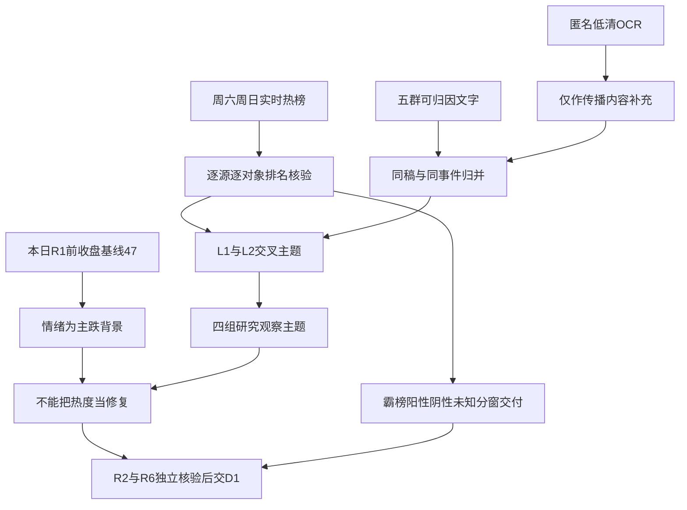

# 2026年11月16日 · 群聊情绪共振

> ⚠️ **数据源时间错位**：本日业务产物，市场基线实际为2026-11-13收盘；人气观察为2026-11-14至2026-11-15。不是周一盘中行情。
> 数据源新鲜度 partial · 降级 true · 置信度 0.364。真实生成时间见frontmatter；不是事后回放。

## 一句话结论
观察：47分主跌背景下，四组双源主题仍热，周末人气不能确认周一修复。

## 🧭 详细分析

先认市场：只读取本日R1，不读前一日R1。其47分有量化观测和规则依据，但原公式未含跌停及涨停池完整收盘反馈；因此接受为**降级描述基线**，不解释为市场中性。2026-11-13上涨765、下跌4748，中位涨幅-2.00%，昨日涨停池收盘中位-4.27%，说明资金奖励仍高度局部，不是普遍接力。**情绪=主跌背景**；今天是否修复仍未知。

再认传播：五群81条取自本轮运输文件，5群均返回成功；不把消息最晚日期当同步截止，不把少发文当冰点。可读内容集中在应用付费、国产GPU与超节点、机器人大脑、本体触觉及航天回收。文章摘录、卖方观点、短回复和会议邀请分开；CANN跨群同文、交换网络同文、重复会议各自合一簇。没有使用关键词频次给分。

再看热榜：本轮实时调用自然日榜，2026-11-16尚空，周末14日和15日均取得；同花顺和东财**各算各的排名**，不把两源最高名次拼成连续霸榜。周末凯撒文化、华胜天成的注意力抬升是真实榜单事实，但周末价格沿用前收盘，不存在周日新增涨停。原attention_signals实际信号日为13日，仅作前收盘基准；既有attention_weekend文件缺失，以本轮直取周末榜弥补而不伪造文件已读。

最后看权限：双源只说明人气与观点交叉。R3不裁决板块主线排序、个股龙头和RR，不设首推或执行池。**研究态度=观察；交易态度=不进（本阶段不授资格）**，不是全局禁买。无真实账户预算来源，预算保持未知；旧市场停买不无限继承，D1按竞价与开盘新证据重评。炸板率36.21%已触发缩量纪律，R3候选0→0，研究证据覆盖不删半；R2/D1实际交易候选需按纪律缩量。

## 🔎 双源主题：按证据强度编号，不是板块交易排序

周末持续人气底座：剔除榜单名称含ST对象后，同花顺两日top100交集85只、连续top20为14只；东财分别90只和15只。精确代码存入JSON的weekend_attention。两平台共用同一批公众注意力，不能把跨平台和跨日出现累加为独立观点或净买入次数。

| 观察主题 | L1周末依据 | L2有效依据 | 明确态度 |
|---|---|---|---|
| AI应用（含短剧/视频子题） | AI应用8、短剧2、AI视频15；凯撒文化13→1 | 群01应用摘录、群03/04卖方正文提及短剧Token | 观察，不将上位和子题重复计数 |
| 国产算力 | 芯片11、算力租赁13；华胜天成东财2→1 | 群01自主可控、群02/03 CANN同稿、群03/04网络同稿 | 观察，人事和管制传言待核 |
| 机器人概念 | 机器人6、人形7 | 群04具身大脑/本体/触觉观点、群02/03短句同事件 | 观察，不把模型叙事当量产 |
| 商业航天 | 概念4，顺灏99→49 | 群05卖方文字对上面级回收的解读 | 观察，同一发射事件不算多个独立催化 |

### 1. AI应用 · L1+L2 · 观察

- **大资金意图**: 只能提出风险资金寻找应用商业化兑现的假设；未读取本主题订单流，不能确认大资金净买入。
- **为什么走强**: 周末凯撒文化排名13→1、博纳影业71→10，体现注意力转移；周末无A股交易，价格字段沿用前收盘而非新增涨幅。
- **逻辑够不够硬**: L1排名与群聊报道传播交叉成立；chat12与RSS40同稿，商业化数据尚未公告核验；若盘后订单/收入不兑现或开盘接力负反馈，热度不能救逻辑。

### 2. 国产算力 · L1+L2 · 观察

- **大资金意图**: 自主可控与互联替代可能吸引主题交易资金，但供需、真实采购和资金行为仍需R2/R7证实。
- **为什么走强**: 华胜天成周末东财2→1、同花顺4→3，周五同花顺89→6，热度已从前收盘延续到周末；不等同周一继续封板。
- **逻辑够不够硬**: CANN同文25/44与网络同文45/60各计一簇，不因跨群算多票；出口限制、人事与Capex传言未核，采购延误和迁移成本是反证。

### 3. 机器人概念 · L1+L2 · 观察

- **大资金意图**: 模型通用化可能降低本体开发门槛只是产业假说；无法凭券商推广判机构实际加仓。
- **为什么走强**: 周末概念榜机器人6、人形7仍在榜，但所附前收盘跌幅分别-2.21%、-2.39%；只能说讨论热，不可写板块已走强。
- **逻辑够不够硬**: 有卖方正文和短对话与L1交叉，但多条公众号转述同一OpenAI事件非多项独立催化；如核心继续走弱或订单无法兑现则推翻回流假设。

### 4. 商业航天 · L1+L2 · 观察

- **大资金意图**: 事件可能激活高弹性主题注意力，未获实际资金数据，不能确认机构买入。
- **为什么走强**: 周末概念排名4持平，顺灏同花顺99→49但前收盘-4%；热度提升和价格走弱并存。
- **逻辑够不够硬**: 只有一条群聊卖方文本，RSS多篇属于同一事件转载；助推器失败削弱完全复用叙事，交R4核验事实后才能提高事件硬度。

## 🖼️ 匿名图片：有哪些内容在传播

7张去重图中6张正文非空、1张空正文；全部为低清partial。引擎返回ok不等于正文完整可读。两张跨群重复图不增加独立内容；采集端共9次资产出现去重为7张。以下摘录仅照实际OCR，不猜模糊字符、公司或数字单位。

| 匿名证据 | 可用片段及质量 | 本轮吸收结论 |
|---|---|---|
| 图01 / 群01 | 空正文 | 图片内容不可判断，不判群聊沉默 |
| 图02 / 群02、03 | `BANNMEOUD`、`NM95C0RMMCANN生动开期`，区域置信约0.30 | 保留片段，无法可靠归类，不补成CANN发布事实 |
| 图03 / 群01 | `AI深刻改变资本市场人机分工`、`低通滤波器`，区域置信0.30至1.00 | AI与市场制度讨论；与RSS32同报道合并，不增加KOL背书 |
| 图04 / 群04 | `颖响力（17）`、`光。超节点。没冷’三靈奏`，约0.30 | 算力策略会议传播；不擅改“没冷”，和文本会议邀请疑似同稿 |
| 图05 / 群02、03 | `ISCOM`、`S7600-32C`、`数据中心交換`，0.30至1.00 | 交换设备材料在传播，不证明采购和订单 |
| 图06 / 群02 | `99,938,567`，1.00 | 只是一串无单位数字，不认定鸿蒙用户数 |
| 图07 / 群04 | `专家解读 苹果AI瑞侧`，约0.30 | 苹果AI会议材料，和文字邀请疑似重复，不推技术进度 |

所有图片的published_at和message_time均未知。缓存mtime不是消息/原帖时间，截图里的日期乱码也不补写。发言人未知，不猜KOL背书或转发者认同；图片只进既有kol_summary与主题解释，不参加量化发言频次、评分或新交易门槛。D1消费R3摘要，不直接读取原始图片文件。

## 📰 公众号观点

公众号53条、18源均抓取成功但5源空，空源可能是未发文或历史未完成；不参与L1+L2计分。应用方面，RSS40既讲付费增长，也强调调用量不等于收入，是应用逻辑的重要反证；它与群01应用摘录是同篇，不能算第二个独立作者。机器人方面，RSS53强调通用大脑不替代触觉力控与真机数据，仿真成绩不等于真实量产。

宏观与情绪单列：RSS41《双轮》看好短剧、机器人回流；RSS46《下周看法》判断反弹退潮、弱势震荡。RSS42描述恐慌并反驳“国家队全部出货”，但ETF份额不能证明具体持有人行为；RSS51/52同题讨论量化与信任，不把情绪控诉当正式监管结论。RSS32与图03同一报道，低通滤波器仍是观点而非新执行规则。**没有据公众号制造一致看多或一致冰点。**

## 🛡️ distribution_alert_checks：范围、窗口、阴性与未知

规则：同一来源、同一对象、连续两日末次榜均为第一。交易日12→13和自然日14→15分列；16日盘前尚空单列未知。逐条对象、精确代码/板块ID、观察时点、窗口、来源、排名与证据定位均写在JSON的`hotlist_signals.distribution_alert_checks`中，绝不从空alert数组推阴性。本轮没有为模式6扩展全市场扫描。

| 对象 | 窗口 | 来源与排名 | 结果和边界 |
|---|---|---|---|
| 东方海洋 002086.SZ | 2026-11-12→2026-11-13 | 同花顺热股1→1 | true：该交易日窗口霸榜预警；未核近5日资金，不证明出货 |
| 猪肉 885573.TI | 2026-11-14→2026-11-15 | 同花顺概念1→3 | false：只排除周末窗口连续top1；13→14曾连续第一不在本轮这两组窗口内，不冒充全历史阴性 |
| 凯撒文化 002425.SZ | 2026-11-14→2026-11-15 | 同花顺热股13→1 | false：实际查两日，但不是两日霸榜；不得当无派发证明 |
| 华胜天成 600410.SH | 2026-11-14→2026-11-15 | 东财人气2→1 | false：实际查两日，不是两日霸榜；同花顺4→3亦非霸榜 |
| 任何已覆盖对象的当日连续窗 | 2026-11-15→2026-11-16 | 本日两榜均空 | null/unknown：不以前收盘或周末阴性补当日未知 |
| 榜外点名对象、缺前日概念条目 | 各自指定窗口 | 精确对象至少一日未返回 | null/unknown：不把榜外当确定非第一或无风险 |

逐条检查记录共275项（同票跨来源/窗口分别记项），其中true 1项、false 119项、unknown 155项；不是同数量的股票。股票对象47个，板块对象20个。

正文只列关键例，JSON逐条列表是完整已查范围。**false只是本规则、对象、来源与窗口的阴性，不是无出货结论。**其他成交量、上影、龙虎榜、负面公告式L4复合规则本轮未执行，保持未知。R6只能消费同窗精确对应结果；霸榜+近5日资金净流出硬否决仍须R6独立核定，R3不新增硬否决。

## 📌 关键证据

- R1本日生成，实际市场事实2026-11-13：非ST涨停37、跌停33、未封炸板21；炸板率21/(37+21)=36.21%，封板率63.79%。不是某个主题的封板率。
- XTick同日返回38涨停、34跌停、21炸板、4板，与R1差一家；原zbl=10.81分母不明，不混用。
- 群02与群03的CANN长文同稿，群03与群04的交换网络长文同稿；二者各为一份内容，群数只表传播范围。
- 群02“明天盘中破亿”与跨端适配观点是预测；图06无对象数字不能补证其兑现。
- 群05对白蛋白替代的短句反证被保留；医保链接标题没有被强凑正向共振。

## 数据源审计

| 源 | 日期 | 状态 | 数量、实际覆盖与缺口 |
|---|---|:--:|---|
| 本日R1 | 2026-11-16 | 🟡 | 1份，本日生成但degraded；市场观测为2026-11-13收盘 |
| 同花顺/东财MCP与同源SDK | 2026-11-12至2026-11-16 | 🟢 | 15个SDK查询；12组非空、3组本日空；13日同花顺缺rank43，缺对象不推阴性 |
| 周末自然日热榜 | 2026-11-14至2026-11-15 | 🟢 | 两日两平台及概念已直取；不是周五回落代理 |
| attention_signals | 2026-11-13 | 🟡 | 信号日13日，persistent1974、跳升16、跨平台62，仅前收盘底座 |
| attention_weekend文件 | 2026-11-16 | 🔴 | 文件缺失；本轮自然日热榜证据补足，不声称文件已读取 |
| wechat_cli_5groups | 2026-11-15至2026-11-16 | 🟡 | 81条、五匿名群；远端同步和尾页未独立验证，截止非R3生成时刻 |
| wechat_image_ocr | 2026-11-16 | 🟡 | 7图、6非空、1空；全partial低清；消息/原帖时间未知 |
| RSS公众号 | 2026-11-15 | 🟡 | 53条，18源抓取成功、5源空；含同稿与标题，不作量化共振 |
| XTick市场情绪 | 2026-11-13 | 🟢 | 1次本轮实时MCP；口径差保留 |
| manifest / mcp_health | 2026-11-16 | 🟡 | 已读；全局severity2含已退场服务，不机械全局禁买 |
| WeFlow | 2026-11-16 | 🔴 | 永久下线，未调用，兼容数组置空 |

| 匿名群 | 条数 | 文件内首末日期 | 覆盖边界 |
|---|---:|---|---|
| group_01 | 19 | 2026-11-15至2026-11-15 | 抓取端窗口起于2026-11-15，末页和同步完整性未独立验证 |
| group_02 | 23 | 2026-11-15至2026-11-16 | 抓取端窗口起于2026-11-15，末页和同步完整性未独立验证 |
| group_03 | 11 | 2026-11-15至2026-11-15 | 抓取端窗口起于2026-11-15，末页和同步完整性未独立验证 |
| group_04 | 19 | 2026-11-15至2026-11-15 | 抓取端窗口起于2026-11-15，末页和同步完整性未独立验证 |
| group_05 | 9 | 2026-11-15至2026-11-15 | 抓取端窗口起于2026-11-15，末页和同步完整性未独立验证 |

## ⚠️ 不确定性 / 反证

四个主题都只能标middle的研究观察，不能把传播热当新主线已确认。机器人与商业航天概念附带的前收盘收益仍负，直接反驳“有讨论就有资金”。AI应用摘录和卖方跨群广播存在相关性，匿名OCR绝非额外KOL。海外AI人事、政策与模型数字未由本轮一手核验，不做事实复述或资金推断。群聊仅为一天运输窗口，周六群聊未补齐，因此不计算两天群聊热度变化。正式共振产物降级交付，不宣称全源完整验收。

主线判定属于R2，本轮不声称主线已确认；持续性、主题封板率及周一加速/分歧/退潮预期均待交易事实，不填虚构1/3/5日。没有股票首推，故板型、龙头条款、RR、禁止项及首推票四段链不适用；若D1从证据对象升为候选必须重新逐票核验，不得把缺项视为已通过。

## 🔗 与其他 R/D/E 的关系

- 依赖：本日R1_style、attention_signals、manifest、mcp_health、五群文本、图片OCR、RSS与本轮实时L1证据。
- 被消费：R2作热度研究线索，R4核事件，R6读取逐对象分窗警报，D1形成独立计划，E1检验兑现。
- 本轮47分=本日R1基线47+调整0；没有校准过的共振加分映射，不按主题或图片数加分。5维反校验因缺杠杆外资等标准化输入未计算，差值未知。
- 置信度=0.65×0.70×0.80=0.364，只表达覆盖质量，不是胜率、交易门槛或新的预算限制。

## Sub-Agent 元数据

- skill: analyze_sentiment_resonance_v1
- artifact: data/research/20261116/R3_sentiment.json
- model: gpt-6.1-sol
- 执行模式: 本会话直接研究，未再次启动模型、Hermes CLI或delegate_task。
- Mermaid: 已以Mermaid 10.9.3及Chromium真实渲染SVG；部署阅读端版本未核，不声称集成验收通过。
- 资源使用: usage_unknown，不当0；努力目标与08:30目标仅observe_only，不冒充已完整计量。
