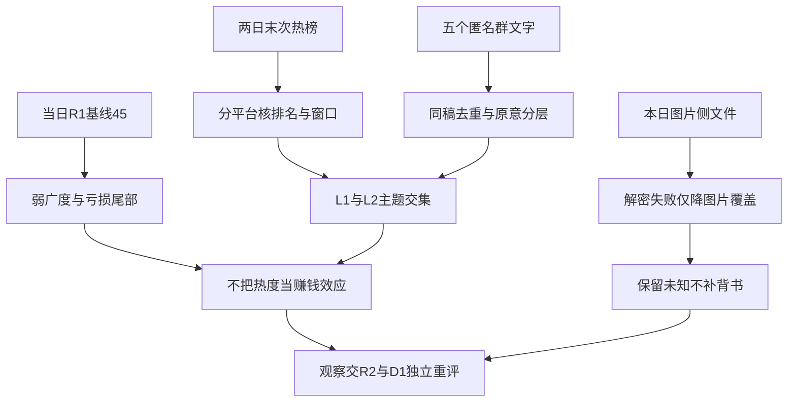

# 2026年11月17日 · 群聊情绪共振

> **数据源新鲜度**：partial　|　**降级状态**：true　|　**置信度**：0.364
> 业务日为11月17日；行情与末次热榜事实日为11月16日，比较日为11月13日。不是11月17日盘中榜，也没有借用昨日R1。

## 一句话结论
**观察：情绪45，短剧等四主题有叙事交集，但弱市与科技亏钱未证伪。**

## 🧭 详细分析

市场奖励的是局部承接，不是泛科技普涨。当日R1量化基线为45：上涨1136家、下跌4344家，非ST涨停32、跌停60，炸板16，炸板率33.33%；昨日涨停池收盘反馈均值+0.99%，中位数却为-1.45%。因此**情绪=震荡/主跌风险**，不能用正均值覆盖亏损尾部。炸板率未达35%，本轮不触发机械砍半。

热榜与价格不是一回事。同花顺CPO概念热度第4却跌6.40%，中际旭创东财第2却跌12.28%。高股息精选从14到1且涨1.03%，证明当期风险偏好在切换，不能把传统板块静态排除；但缺少对应直接群观点时只保留单源观察，不用公众号补凑L2。**R3不确认可交易主线、不做板块打分排序**；主线持续性与封板率须由R2核定，本轮不编1/3/5日持续性或明日加速结论。

五个匿名群实时补查至本轮截止，与晨抓199条逐时点/正文多重集合一致，并均取得空尾页；本机覆盖可核，远端同步完整性仍未知。长正文里大量是卖方转述、产品推广与跨群同稿；直接短句“传媒短剧开始活跃”保留，会议邀请、系统消息、本人及被引用本人观点不作为外部共识。没有第二个等长窗口，不宣称“群聊降温”或“隔夜热度增加”。

四个L1+L2主题是**注意力/叙事交集**，不等于四条正向资金主线。固态电池使用个股热榜concept映射而不是概念前20排名；机器人虽有应用落地讨论，板块价格仍弱。全部为**观察**；没有股票首推池或执行池，板型、龙头认定、RR和禁止清单均未核，不能借传播代码授予开仓资格。R2/R5仍应继续研究，不把缺数当全局停买。

## 🔎 双源主题（按证据呈现，非板块排名）

### 1. 短剧游戏 · L1+L2 · 观察

同花顺概念第3，涨跌-1.36%。短剧、AI漫剧与OTT大屏有内容消费关联，但OTT牌照不是短剧游戏同义词。媒体转载与直接短句支持叙事，跨群OTT同稿仅一簇。 **时效=middle（中段叙事，不代表行情主升）**。

- **大资金意图**: 存在从科技硬件向局部内容活口切换的假设；仅热榜与观点，不能认定机构加仓。
- **为什么走强**: 概念热榜3、文投东财1及吉视东财4与直接“短剧活跃”相互印证；概念仍跌1.36%，属局部承接而非板块普涨。
- **逻辑够不够硬**: 双源叙事成立，业绩与订单兑现没有在R3独立核证；核心失去承接且跟风扩散失败即削弱次日修复假设。

### 2. 冰雪产业 · L1+L2 · 观察

同花顺概念第7，涨跌+0.07%。冷链设备、冰雪消费及季节预期做上下游语义关联；仅属主题传播，不证明所有冷链公司都受益文旅。82/135同稿。 **时效=middle（中段叙事，不代表行情主升）**。

- **大资金意图**: 可能试探季节性消费窗口，但未核资金净流入，不能认定合力已形成。
- **为什么走强**: 概念热榜15至7、涨0.07%；冰山同花顺13至4且涨6.49%、龙江东财58至7，提供局部正向锚。
- **逻辑够不够硬**: 有季节窗口与两层证据，但商品需求和公司收益尚未核；生肖同省补涨不采纳，次日若核心与板块脱钩则降级。

### 3. 机器人概念 · L1+L2 · 观察

同花顺概念第8，涨跌-2.98%。消费跟拍、世界模型与护理应用合并为机器人落地叙事；人形与消费机器人分支不同，不以Beni推广直接证明人形订单。 **时效=middle（中段叙事，不代表行情主升）**。

- **大资金意图**: 叙事在寻找有真实场景的替代载体，但暂无本轮板块净流入证据。
- **为什么走强**: 概念热榜8、人形热榜5，世界模型和终端应用内容传播；机器人概念跌2.98%、人形跌3.84%，因此只是热度共振而非走势走强。
- **逻辑够不够硬**: L1与L2有交集，华为发布报道仅公众号补充不加共振层数；客户、订单、净买盘待证，弱价格是反证。

### 4. 固态电池 · L1+L2 · 观察

本轮概念前20未覆盖；用已在榜股票的concept字段映射。用同花顺热股concept字段中的固态电池及晚间产业化材料对齐；干法电极、材料与示范装车分层，不把钠电池概念整体当固态。 **时效=middle（中段叙事，不代表行情主升）**。

- **大资金意图**: 存在从高位题材转向产业化节点的试错假设，尚不证明持续配置。
- **为什么走强**: 固态电池未进本轮概念前20；紫竹同花顺50/东财42、领湃同花顺83/东财36，个股热榜映射支持L1，非板块排名确认。
- **逻辑够不够硬**: 实质调研转述但原始订单与论坛未核；没有概念级资金确认，不把2027装车预期折算为今日胜率。

## 💬 KOL与传播内容分层

| 内容 | 实际证据 | 态度与边界 |
|---|---|---|
| 风险偏好 | 匿名群01，11月16日：“易中天带头大跌，这种行情还是空仓观望舒服” | 观察；参与者态度不是账户停买 |
| 短剧与OTT | 匿名群05，11月16日：“传媒短剧开始活跃”；匿名群02/03有同稿大屏材料 | 观察；直接短句与转载分开 |
| 机器人落地 | 跟拍影像、CloudRobo及护理场景材料 | 观察；相关终端不等于人形机器人订单 |
| 新能源 | 匿名群05晚间固态电池技术进度；匿名群02晚间电网订单转述 | 观察；原始调研及招标数据待R4/R5核证 |
| 药物推广 | 砒霜治疗、CAR-T支付在三群传播 | 降级；两类疗法不合并，研发药不等于医保已上市药 |
| APEC与眼镜 | 同稿/同底层报道跨群复制，影像新品旧预告反复出现 | 观察；不把传播次数或“实锤”措辞当独立确认 |
| 生肖、同省、低价 | 澳柯玛、扬电等被拼贴名字补涨 | 拦截其推理；不是个股hard_reject，不据此扩成产业共识 |

同文及同底层事件已合并为10个解释簇，簇数不是独立作者数。无法核实原创作者时独立作者数保留未知；群数只表示传播范围。原文完整证据句柄见机读主产物，非微信原生ID。

## 🖼️ 图片文字侧文件：本轮能与不能说什么

唯一指定侧文件已逐条读取：**55条、55个资产族全部在解密阶段失败，错误均为uin_filenames_empty，实际识出的非空OCR正文为0**。因此本轮不能声称从图片看出任何主题，更不能猜发送人、KOL背书、模糊股票名或数字。文本里出现的主题只依据可读文本，不反向填进图片。

原始资产仅带采集时间与缓存mtime，消息时间、原帖发布时间均未知；缓存窗口不等于消息传播窗口。图片不增加独立来源或量化频次、不加减情绪分、不新增门槛。失败只限制图片覆盖，不能判定群聊沉默。D1消费已在本R3主产物归纳的结论，无需直接读原始图片文件。

## 🚦 distribution_alert_checks：范围、窗口与结果

本轮规则仅核**同一平台两个相邻交易日末次快照均为top1**，不是完整量价、龙虎榜、五日资金和新闻L4核验。观察窗口为11月13日至11月16日末次榜；覆盖现有两平台热股前20并集、文本明确代码及主题热榜锚、同花顺概念前20；没有为模式6新增全市场扫描，也没有借用随后R2最终候选。

**实际检查62个对象：股票42、板块20；true=0，false=38，null/unknown=24。** 全量逐对象、观察时点、来源、证据路径和结果均在R3_sentiment.json的hotlist_signals.distribution_alert_checks。

| 对象 | 两日窗口/来源 | 实查结果 | 解释 |
|---|---|---|---|
| 002242.SZ | 11月13日→16日；ths 5→1；dc 11→3 | false / checked | 已逐代码核对两日末次快照，未同时rank1；仅此条件阴性，不证明无派发 |
| 600715.SH | 11月13日→16日；ths 2→2；dc 2→1 | false / checked | 已逐代码核对两日末次快照，未同时rank1；仅此条件阴性，不证明无派发 |
| 300308.SZ | 11月13日→16日；ths 9→5；dc 6→2 | false / checked | 已逐代码核对两日末次快照，未同时rank1；仅此条件阴性，不证明无派发 |
| 000530.SZ | 11月13日→16日；ths 13→4；dc 23→15 | false / checked | 已逐代码核对两日末次快照，未同时rank1；仅此条件阴性，不证明无派发 |
| 000156.SZ | 11月13日→16日；ths ?→?；dc ?→12 | null / unknown | 至少一平台/日期缺精确对象覆盖，保留未知 |
| 301479.SZ | 11月13日→16日；ths ?→?；dc ?→? | null / unknown | 至少一平台/日期缺精确对象覆盖，保留未知 |
| 886060.TI | 11月13日→16日；ths概念 2→3 | false / checked | 已逐代码核对两日末次快照，未同时rank1；仅此条件阴性，不证明无派发 |
| 885825.TI | 11月13日→16日；ths概念 15→7 | false / checked | 已逐代码核对两日末次快照，未同时rank1；仅此条件阴性，不证明无派发 |

false是逐对象、逐平台实核排名后的窄条件阴性，**绝不等于无派发、无风险或R6豁免**。缺前日精确代码、缺页或未覆盖均为null/unknown；未检查范围仍未知。空alert数组不用于推阴性。九阳同花顺5→1、文投东财2→1，均不是同平台连续两日第一；不能把不同平台的名次拼成霸榜。

## 📈 热榜差分与注意力底座

两日同花顺热股99/100条、东财100/100条；概念各20条。逐平台排名上升至少10名共39条源内记录，不是去重后的独立股票或观点数。同花顺凯撒文化36→9、北纬科技53→12、果麦文化90→28；东财龙江交通58→7、共进股份87→9。涨排名不是资金净买入证明。

本日attention_signals完整读取，其use_trade_date为11月17日、signal_trade_date为11月16日；两平台与飙升榜、持续人气均为最近完成日底座。华数传媒等前日已取榜未覆盖者只标“新观察到前20、前日排名未知”，不能虚构前日101或当日新进全市场。11月13日同花顺缺rank43已披露。

## 📰 公众号观点（补充，不参与共振和情绪加分）

| 日期/来源 | 读取到的观点 | 解释 |
|---|---|---|
| 11月16日／财联社收评 | 科技硬件与高位人气亏钱，短剧、家电局部活跃 | 解释弱市活口；不是新增量化源 |
| 11月16日／股痴流沙河《切换》 | 偏防守，短剧找活口，机器人短期亏钱；新方向看固态、电网与消费 | 是作者观点，不照搬打法 |
| 11月16日／安静拆主线、盘口逻辑拆解 | 相对重视漫剧、端侧、物理AI，但科技止跌未确认 | 两文同署名执业作者，不算两个独立作者 |
| 11月16日／上海证券报 | 华为发布并开源世界模型 | 补充事件报道，不认定所有群内映射公司都获订单 |
| 11月16日／财闻私享 | OTT、固态、电网等热点材料串联 | 与群稿可能同底层，不重复计权 |

### 宏观与情绪

猫笔刀《又听到鬼哭狼嚎了》描述恐慌、避险与ETF托底；其中“官军”身份及买入规模是作者估算，未经R3核实。ymj0418描述个人降仓后的心态及短剧机器人轮动，属于自述而非资金事实。傅里叶的猫转载长期AI采购预测下修，新旧预测差不是已实现收入同比下滑。英伟达管理层相关标题和转述没有在R3做官方核证，不作为确定事实或执行依据。

本批82篇标题已审阅，选读10篇正文；同事件转载、跨群转发、同一署名作者不增加独立确认。公众号只作观点，WeFlow永久停用；共振最高仍为L1+L2。

## 🔗 关键证据

- 当日R1_style.json：情绪45与弱广度；其实际市场观测日为11月16日，状态degraded但必要量化公式可核。
- R3_hotlist_evidence.json：本轮在线重取两日六组榜单，同花顺与MCP交叉一致；同运输商不同接口不加独立源数。
- wechat_cli_5groups.jsonl：第86、64、180行支持短剧与OTT叙事，第82行支持冰雪，第59与108行同稿讨论世界模型，第199行讨论固态产业化。
- R3_chat_evidence.json：五群本机补查与晨抓完全一致，空尾页已核；远端同步完整性未知。
- XTick独立口径：涨停33、跌停63、炸板16，高度4；重算炸板率32.65%，不把原始zbl=5.26误认炸板率，也不与R1口径混算。

## 数据源审计

| 源 | 日期 | 状态 | 记录数/备注 |
|---|---|:--:|---|
| 当日R1_style | 2026-11-17 | 🟡 | 45分基线有效，行情事实为11月16日收盘 |
| Tushare同花顺热股 | 2026-11-13、2026-11-16 | 🟡 | 99/100；前日缺rank43，未知不补零 |
| Tushare东财人气 | 2026-11-13、2026-11-16 | 🟢 | 100/100；保持分平台计算 |
| 同花顺概念 | 2026-11-13、2026-11-16 | 🟢 | 各20；并非全市场概念扫描 |
| 本日新榜探针 | 2026-11-17 | 🟡 | ths_hot与dc_hot均0；盘前未形成新榜 |
| attention_signals | 2026-11-17 | 🟡 | 绑定使用日17、实际信号日16；非17日实时人气 |
| 五个匿名群 | 2026-11-17 | 🟢 | 199条；各27/58/54/10/50，尾页均空；远端同步未知 |
| 图片OCR侧文件 | 2026-11-17 | 🔴 | 55条解密失败，非空正文0；仅图片覆盖降级 |
| RSS公众号 | 2026-11-17 | 🟢 | 82篇标题、10篇正文；观点不参加量化共振 |
| XTick市场情绪 | 2026-11-16 | 🟢 | MCP在线；33/63/16，高度4，独立样本口径 |
| WeFlow | 2026-11-17 | 🔴 | 永久下线，未调用；兼容字段为空 |
| manifest / mcp_health | 2026-11-17 | 🟡 | severity=2含退场源；不继承为全局禁买 |

## ⚠️ 不确定性 / 反证

短剧也有高位兑现和板块均值为负的反证，机器人热度高但价格弱，固态概念级排名未覆盖，冰雪强的是少数股票而不是已验证整链盈利。群聊转发的产业进度、医保与供应链映射未经R3独立核证，不得把卖方宣传、标题、产品发布时间或相似公司标签当硬事实。

本轮情绪45不加减：热度或图片数都不能代替市场量化数据。五维交叉法缺杠杆外资与统一子分，score_5d及差值保留null，不造中性值。置信度按0.65×0.70×0.80=0.364，仅反映证据质量，不折算仓位。

## 🤝 与其他 R/D/E 的关系

- 依赖：本日R1_style.json、本日attention_signals.json、可读群文本、唯一图片文字侧文件及RSS；在线热榜和XTick补证。
- R2/R5：按四主题与观察代码继续筛选真实研究对象；本报告不判龙头、不生成逐票交易条件。
- R6：只消费同代码/同板块/同窗口checks；范围外unknown，五日资金条件及hard_reject由R6独立核定，空alert不豁免。
- D1：独立评估竞价与开盘后奖励、核心地位和逐票风险；不需要直接读取原始图片文件。市场观察态度不是用户/账户停买，不改真实零预算、硬上限、T+1、人工确认及已有保护。
- 适用窗口：本轮盘前至竞价形成新事实；新榜或核心与跟风反馈变化即重评，不无限继承旧no_trade。D1首次计划前in_today_plan未知。

## Sub-Agent 元数据

- skill: analyze_sentiment_resonance_v1@1.1
- artifact: data/research/20261117/R3_sentiment.json
- model: gpt-6.1-sol
- method: llm_v1；语义分析为本会话直接完成，未再启动任何模型会话
- 生成耗时：见JSON真实生成时间与run_context；未将pipeline启动时间伪称模型实际耗时
- usage: usage_unknown，known_total_tokens=null；努力目标与交付目标均observe_only
- 首推股票四段契约：本轮无首推票/执行票，不适用；不能为凑模板编造买点、止损或RR
