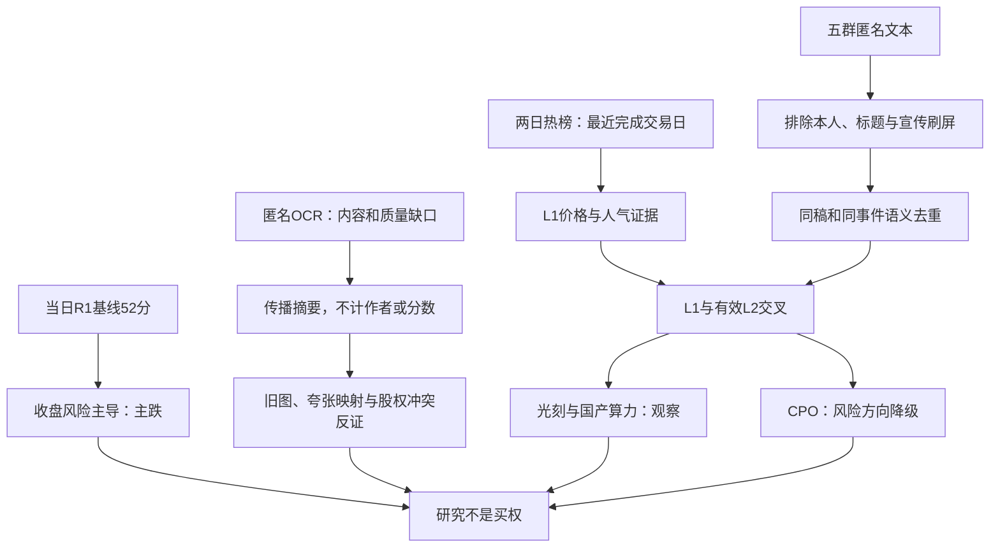

# 2026年11月18日 · 群聊情绪共振

> 🟡 数据源新鲜度：partial；降级：true；证据置信度：0.364。
> 本次是真实盘前研究，不是回放。使用日为2026-11-18，市场事实为2026-11-17收盘，热榜比较2026-11-16与2026-11-17末次榜单；不是今日实时人气或开盘预测已兑现。

## 🧭 一句话结论

观察国产替代双源共振；情绪=主跌，52分沿用当日R1；光模块降级，AI音乐仅作传播观察。

## 🔎 详细分析

先认市场：当日R1的规则分为52，但其广度为上涨1326、下跌4119，中位涨跌-1.312%；非ST口径37涨停、67跌停、20炸板，炸板率 `20/(37+20)=35.09%`。因此52分不能解释成市场已中性安全。市场奖励局部首板和少数承接，不奖励普遍高位接力；昨日涨停池收盘中位反馈-0.44985%，首板风格+1.0148%，二板以上风格-3.898%。这些均为R1本轮事实，不是今日成交结果。

再看传播和市场是否同向：国产替代在热榜与可归因文字中都有证据，但光刻与国产算力共用出口限制等底层事件，不能拆成多条互相独立的政策主线。3个主题是证据显著性清单，不是R2板块进攻排名，其中CPO是谨慎/风险方向共振；本轮不授任何股票龙头资格或开仓资格。

当前段位是主跌风险主导，今日修复尚未观测。既有纪律要求炸板率达到35%后候选输出减半，但不能削减来源覆盖。本R3没有具备板型、核心认定、盈亏比和禁止清单完整证据的提名候选，候选数 `0→0`；热榜对象、群内点名与图片传播仍完整纳入研究。研究观察对象不等于候选买单，也不把D1尚未形成的计划资格写成false。

计划内做：观察国产替代是否在竞价和开盘继续形成合力，向R2/R4/R5移交线索及反证。不做：把热门、海报、转发密度、榜首或52分当作资金确认。R1的20%仅是市场研究量级，不是账户预算；本轮预算来源未核仍为未知，不抬高额度，不继承旧市场性零仓为永久禁买。原有账户约束、T+1与R6硬否决权限均不变。

## 🧩 双源主题：按证据显著性排列，不作板块排名

| 主题 | L1已核事实 | 有效L2 | 态度 |
|---|---|---|---|
| 光刻机与光刻材料 | 光刻胶/光刻机概念第1/2，分别+2.83%/+2.78% | 匿名题材群设备论证、匿名核心群采购判断与财务投资纠偏 | 观察，L1+L2 |
| 国产算力 | 华胜天成同花顺8/东财2，+10%；有研新材6/3，+10.01% | 匿名机构群两份不同机构的算力供给/交换网络论证 | 观察，L1+L2 |
| 共封装光学(CPO) | 概念第3但-1.43%；中际旭创同花顺5/东财4且-3.90% | 匿名投研群偏等待右侧 | 降级，L1+L2风险共振，不是看涨 |

### 光刻机与光刻材料：市场有付钱，关联映射未必过关

- **大资金意图**: 可能交易供应限制之下的自主替代稀缺性；本轮未核资金持仓，不能将推断写成机构建仓事实。
- **为什么走强**: 概念排名与正涨幅同向，群内EUV设备与掩膜版采购判断形成语义对应；设备、材料同属一链，不能用三个名字包装成三条独立主线。
- **逻辑够不够硬**: 双源成立，但订单、ASML排期及参与公司实际敞口未独立核。群内已明确部分关联只是财务性投资，旧图亦显示非本日事件，必须留作R4/R5反证。

### 国产算力：机构论证有效，许可证不等于全面封禁

- **大资金意图**: 可能从海外GPU供应不确定性转向国内算力供给与系统交付；没有用本轮资金净流证明机构已进场。
- **为什么走强**: 个别核心热股价格与人气同步，机构文本分别论证稀缺供给和超节点交换网络；不同机构共享同一政策冲击，不重复计为两个政策源。
- **逻辑够不够硬**: 机构稿明确许可证管理而非全面禁止所有跨境调用，是对传播夸张的实质纠偏；CANN适配、代理资格、订单和交付仍须核实。名字对标与海思渠道延伸昇腾，不能替代业务披露。

### CPO：热度还在，收益与谨慎观点同向转弱

- **大资金意图**: 仅可确认持续讨论，不能据人气判派发，也不能将流量当买盘。
- **为什么走强**: 此处并未走强。板块和代表热股均为负收益，匿名投研群文字偏等待，与强势共识相反；该主题是风险共振。
- **逻辑够不够硬**: 热榜与谨慎观点方向相符，但晚间公众号同时有反驳做空的标题，说明叙事并非一致看空。价格、资金和公司事实仍须分开核实，不由R3接管技术分析。

## 💬 匿名KOL方向与重复传播

| 匿名来源 | 日期 | 观点短引文/摘要 | 证据位置与解释 |
|---|---|---|---|
| group_01 · 投研群 | 2026-11-17 | “安全起见可等右侧介入” | 群文本L9；保留短句，不以少于60字丢弃 |
| group_03 · 核心群 | 2026-11-17 | EUV空白掩膜版需求判断；“属于财务性投资”的关联纠偏见另一新闻群 | 群文本L128、L232；产业判断非订单审计 |
| group_04 · 机构群 | 2026-11-17 | “属于许可证管理，并非全面禁止所有跨境算力调用” | 群文本L210；不同于全面封锁的宣传措辞 |
| group_04 · 机构群 | 2026-11-17 | 交换网络由系统互连效率驱动 | 群文本L213；与上一稿不同产业论证，同一底层事件 |
| group_03 · 核心群 | 2026-11-17 | “把上午追的人都套在高位了” | 群文本L187；是参与者担忧，不代表全市场仓位 |

AI音乐、CANN点票、脆皮捏捏、光伏税率等存在同作者跨群广播及同稿改写。先按正文精确去重，再按同事件语义归簇；跨群出现只说明传播范围。AI音乐“参股/子公司”口径冲突未核，不能给股票业务事实背书。纯宣传、链接标题、会议/报告推送不直接计为有效独立KOL支持；独立观点作者总数未知，不以去重后消息数替代。本人L1及其引用观点排除，防止研究自产回流。

AI音乐虽可泛挂AI应用标签，但不能因此把AI应用第14、-2.30%的榜单与重复点票稿拼成正向独立共振；脆皮捏捏亦缺精确L1映射。机器人、商业航天、脑机接口、家电、光伏与资源回收均保留覆盖，不为凑top5强行入选。观察不附带买入许可。

## 🖼️ 图片文字：在吹什么，以及哪些不能当事实

已实际读取唯一侧文件全部61条：41条有非空OCR，18条返回空正文，2条失败。41条非空包括低清/局部片段，不要求逐字完整才消费；原始质量与逐行置信度已保存在主JSON。图片不猜发送人、不猜转发者赞同、不算独立KOL或量化发言频次。

| 匿名图片证据 | 在传播的内容 | 质量与反证处理 |
|---|---|---|
| group_02/03/05；图3、4、28、49、58 | CANN迁移、国产算力超节点、渠道商联想 | 图58仅有“东华软 / CANN / （002065”等局部，保留不补字；图4出现“2个月前”，不能当本日新落地 |
| group_02/03/05；图2、9、36、56、57 | AI音乐、二创/版权变现与点票海报 | 同版缩略图与文本并簇；图9写“参股…6.18%”，与群文“子公司”冲突，交R5核 |
| group_03；图1、16、22、29 | 脆皮捏捏爆单、次抛玩具、SEBS原料 | 同文章分页及文本转载合并，产品广告不是安全性或订单认证 |
| group_02/05；图25、38、51 | 全筑EUV、捷众部件、阳谷封装 | 图25明示2025-10-31；图51明示2023-11-02；图38写暂未形成大额收入，不包装成今日新突破 |
| group_05；图32 | 光伏反倾销税率修订 | 图内为2019—2020年度复审修订，不支持全部出口税费清零 |
| group_03/05；图33、54 | 太力产品在展厅展示 | 两图近同稿，展厅亮相不等于公司被钦点或KOL背书 |
| group_05；图18 | 再生资源回收发布会通知 | 只证传播通知，不能据此认定会后政策效果或资金入场 |
| 其余低清非空片段 | 模糊宏观、排行、光模块说法 | 逐条保留匿名引用、原质量与缺口；不猜公司名、数字、政策或会议真实性 |

采集日为2026-11-18；所有消息时间与原帖发布时间仍未知。缓存mtime只是文件缓存修改时间，不是传播发生时间；截图里的相对时间也不反推。图片失败只降低图片覆盖，不判群聊安静，不生成情绪分，不新增交易门槛。有用观点与反证已经进入R3主JSON的kol_summary和image_evidence，D1不新增读取原始图片文件的依赖。

## 🧪 连续霸榜警报：范围、阴性与未知

这里检查的是R3“两连续交易日末榜均top1”代理，不是横切技能的成交/长上影/资金/负面新闻多因子已证实派发。五日资金与完整派发核验均为unknown，R6依原条件独立核定，警报本身不硬否决、不扣情绪分。

范围限定：同花顺本期前20热股、前20概念，东财本期前20人气；另列7个实际读过但未完成霸榜核验的传播对象。没有接入当时尚不存在的R2最终候选，不新增全市场扫描。盘前2026-11-18概念榜实取为空，所以正式比较窗口是2026-11-16至2026-11-17末榜。

实际交付67条对象-平台检查：true 1条、false 46条、null/unknown 20条。阴性均有两日对象行与实际观察；未知包含缺前日行及未查对象。结果可逐条回到JSON的distribution_alert_checks。

九阳股份在同花顺是1→1，警报true；东财是3→1，仅该平台该窗口未连续榜首，结果false。二者不可互相抵消，最终兼容正例名单仍保留同花顺警报。任何false均不代表没有派发；缺前日该对象行、未检查或不在覆盖范围必须null/unknown，不能由空alert列表推阴性。

### 逐股票-平台检查

| 对象代码/名称 | 平台 | 两日末榜名次 | 结果 |
|---|---|---|---|
| 002242.SZ 九阳股份 | ths_hot:热股 | 1 → 1 | true / checked |
| 002086.SZ 东方海洋 | ths_hot:热股 | 3 → 2 | false / checked |
| 600261.SH 阳光照明 | ths_hot:热股 | 6 → 3 | false / checked |
| 000530.SZ 冰山冷热 | ths_hot:热股 | 4 → 4 | false / checked |
| 300308.SZ 中际旭创 | ths_hot:热股 | 5 → 5 | false / checked |
| 600206.SH 有研新材 | ths_hot:热股 | 44 → 6 | false / checked |
| 600715.SH 文投控股 | ths_hot:热股 | 2 → 7 | false / checked |
| 600410.SH 华胜天成 | ths_hot:热股 | 7 → 8 | false / checked |
| 601188.SH 龙江交通 | ths_hot:热股 | 11 → 9 | false / checked |
| 002187.SZ 广百股份 | ths_hot:热股 | 34 → 10 | false / checked |
| 002384.SZ 东山精密 | ths_hot:热股 | 10 → 11 | false / checked |
| 603366.SH 日出东方 | ths_hot:热股 | 8 → 12 | false / checked |
| 002425.SZ 凯撒文化 | ths_hot:热股 | 9 → 13 | false / checked |
| 688836.SH 宇树科技 | ths_hot:热股 | 17 → 14 | false / checked |
| 000533.SZ 顺钠股份 | ths_hot:热股 | 未知 → 15 | null / unknown |
| 002724.SZ 海洋王 | ths_hot:热股 | 21 → 16 | false / checked |
| 300502.SZ 新易盛 | ths_hot:热股 | 22 → 17 | false / checked |
| 600103.SH 青山纸业 | ths_hot:热股 | 75 → 18 | false / checked |
| 601929.SH 吉视传媒 | ths_hot:热股 | 15 → 19 | false / checked |
| 002148.SZ 北纬科技 | ths_hot:热股 | 12 → 20 | false / checked |
| 002242.SZ 九阳股份 | dc_hot:人气榜 | 3 → 1 | false / checked |
| 600410.SH 华胜天成 | dc_hot:人气榜 | 11 → 2 | false / checked |
| 600206.SH 有研新材 | dc_hot:人气榜 | 未知 → 3 | null / unknown |
| 300308.SZ 中际旭创 | dc_hot:人气榜 | 2 → 4 | false / checked |
| 600715.SH 文投控股 | dc_hot:人气榜 | 1 → 5 | false / checked |
| 002425.SZ 凯撒文化 | dc_hot:人气榜 | 5 → 6 | false / checked |
| 000530.SZ 冰山冷热 | dc_hot:人气榜 | 15 → 7 | false / checked |
| 000533.SZ 顺钠股份 | dc_hot:人气榜 | 14 → 8 | false / checked |
| 600261.SH 阳光照明 | dc_hot:人气榜 | 39 → 9 | false / checked |
| 002584.SZ 西陇科学 | dc_hot:人气榜 | 未知 → 10 | null / unknown |
| 002086.SZ 东方海洋 | dc_hot:人气榜 | 17 → 11 | false / checked |
| 600619.SH 海立股份 | dc_hot:人气榜 | 未知 → 12 | null / unknown |
| 002685.SZ 华东重机 | dc_hot:人气榜 | 19 → 13 | false / checked |
| 002959.SZ 小熊电器 | dc_hot:人气榜 | 25 → 14 | false / checked |
| 000521.SZ 长虹美菱 | dc_hot:人气榜 | 30 → 15 | false / checked |
| 603078.SH 江化微 | dc_hot:人气榜 | 未知 → 16 | null / unknown |
| 600467.SH 好当家 | dc_hot:人气榜 | 85 → 17 | false / checked |
| 600936.SH 北投科技 | dc_hot:人气榜 | 21 → 18 | false / checked |
| 688825.SH 长鑫科技 | dc_hot:人气榜 | 27 → 19 | false / checked |
| 300786.SZ 国林科技 | dc_hot:人气榜 | 未知 → 20 | null / unknown |
| 002065.SZ 东华软件 | bounded_hotlist_check_scope | 未知 → 未核 | null / unknown |
| 001298.SZ 好上好 | bounded_hotlist_check_scope | 未知 → 未核 | null / unknown |
| 002722.SZ 物产金轮 | bounded_hotlist_check_scope | 未知 → 未核 | null / unknown |
| 002522.SZ 浙江众成 | bounded_hotlist_check_scope | 未知 → 未核 | null / unknown |
| 603881.SH 数据港 | bounded_hotlist_check_scope | 未知 → 未核 | null / unknown |
| 920690.BJ 捷众科技 | bounded_hotlist_check_scope | 未知 → 未核 | null / unknown |
| 603030.SH 全筑股份 | bounded_hotlist_check_scope | 未知 → 未核 | null / unknown |

共同窗口：2026-11-16末榜至2026-11-17末榜；每条精确observed_at、请求/检查时点、引用路径均在主JSON。窗口外与其他平台结论不外推。

### 逐概念检查

| 对象代码/名称 | 平台 | 两日末榜名次 | 结果 |
|---|---|---|---|
| 885864.TI 光刻胶 | ths_hot:概念板块 | 未知 → 1 | null / unknown |
| 886054.TI 光刻机 | ths_hot:概念板块 | 未知 → 2 | null / unknown |
| 886033.TI 共封装光学(CPO) | ths_hot:概念板块 | 4 → 3 | false / checked |
| 886069.TI 人形机器人 | ths_hot:概念板块 | 5 → 4 | false / checked |
| 886060.TI 短剧游戏 | ths_hot:概念板块 | 3 → 5 | false / checked |
| 886078.TI 商业航天 | ths_hot:概念板块 | 10 → 6 | false / checked |
| 886042.TI 存储芯片 | ths_hot:概念板块 | 13 → 7 | false / checked |
| 885756.TI 芯片概念 | ths_hot:概念板块 | 20 → 8 | false / checked |
| 885893.TI 国家大基金持股 | ths_hot:概念板块 | 未知 → 9 | null / unknown |
| 885897.TI 中芯国际概念 | ths_hot:概念板块 | 未知 → 10 | null / unknown |
| 885825.TI 冰雪产业 | ths_hot:概念板块 | 7 → 11 | false / checked |
| 885517.TI 机器人概念 | ths_hot:概念板块 | 8 → 12 | false / checked |
| 886015.TI 创新药 | ths_hot:概念板块 | 9 → 13 | false / checked |
| 886108.TI AI应用 | ths_hot:概念板块 | 6 → 14 | false / checked |
| 885573.TI 猪肉 | ths_hot:概念板块 | 2 → 15 | false / checked |
| 886072.TI 高股息精选 | ths_hot:概念板块 | 1 → 16 | false / checked |
| 885543.TI 家用电器 | ths_hot:概念板块 | 未知 → 17 | null / unknown |
| 885959.TI PCB概念 | ths_hot:概念板块 | 18 → 18 | false / checked |
| 886009.TI 先进封装 | ths_hot:概念板块 | 未知 → 19 | null / unknown |
| 885699.TI ST板块 | ths_hot:概念板块 | 未知 → 20 | null / unknown |

共同窗口：2026-11-16末榜至2026-11-17末榜；每条精确observed_at、请求/检查时点、引用路径均在主JSON。窗口外与其他平台结论不外推。

## 📰 公众号观点（补充层，不参与打分）

本轮审阅86条标题/摘要，不声称86篇全文阅读。命中主题的内容包括国产算力、先进封装、华为算力拉升以及存储行情分化；公众号与群聊引用同一政策或公司事件时不增加独立量化源。

宏观与情绪单列：公开标题同时出现《反核》《扎完了》《能算冰点吗？》《又推倒重来了》，只据标题不能判作者究竟看多、见底还是讽刺。光模块一边有《光模块市场被媒体操控了吗？》，另一边有《罔顾事实做空光模块龙头，这份“报告”坏得很》，构成叙事争议的证据，不证明出货或业绩。收评摘要明确“高位人气股持续退潮”，午报修复与收评走弱必须分开，不将午报当收盘。公众号层不计L1+L2等级，也不调整52分。

## 📏 分数与置信度解释

情绪分 `52 = 当日R1基线52 + 共振调整0`。R1产物属于本日但状态degraded，实际量化依据可审，所以按用户指示消费并继承质量披露，不改取前一天文件，也不强改为complete。正向替代传播与负向光模块反馈并存，未验证今日资金合力，不机械为每条主题加分；OCR数量、公众号篇数和转发密度均为零分影响。

五维反向校验缺杠杆外资中位及维度归一化，score_5d与分差保留null，不填0或假装完成。置信度为证据质量 `0.65 × 0.7 × 0.8 = 0.364`，并非胜率或情绪强度。XTick返回37涨停、77跌停、19炸板；R1/Tushare为37/67/20，范围差异未明，不能混分子分母。XTick原生zbl=12.12的定义不等于本轮35.09%，不直接替换。

## 🔗 关键证据

- 当日R1：`data/research/20261118/R1_style.json`；市场事实截止2026-11-17收盘，52分、主跌与35.09%炸板口径均在内。
- 活取热榜：`data/research/20261118/R3_live_evidence.json`；保留精确代码、两日名次、榜单时点与请求时间。
- 群聊：本轮五群实时补查300条，与本日运输文件逐消息多重集合一致；各群均查空尾页，本机可访问分页覆盖通过，远端同步完整性未知。
- OCR：本日唯一文件61条全部检查，摘要与质量保存在R3主JSON；不能从文件日期推消息日期。

## 数据源审计

| 源 | 日期 | 状态 | 记录数与覆盖说明 |
|---|---|:--:|---|
| 当日R1 | 2026-11-18 | 🟡 | 本日生成、11月17日收盘事实、状态degraded |
| Tushare同花顺热股/概念 | 2026-11-16至2026-11-17 | 🟢 | 两日热股100/99、概念20/20；本期rank86缺行，不填补 |
| Tushare东财人气/飙升 | 2026-11-16至2026-11-17 | 🟢 | 每平台每天100条；同provider通道不是独立作者 |
| 2026-11-18概念榜 | 2026-11-18 | 🟡 | 活取0条；未冒充盘中实时 |
| attention_signals | 2026-11-18 | 🟡 | 使用日18/信号日17，声明滞后1日；persistent累计天数不是连续top1 |
| 五群文本 | 2026-11-18 | 🟢 | 本轮实时300条，与运输样本逐条一致；群名全部匿名 |
| group_01 · 投研群 | 2026-11-17 | 🟢 | 11条；首末08:52—23:36，含本人及系统消息已剔除 |
| group_02 · 题材群 | 2026-11-17 | 🟢 | 96条；首末08:45—23:46，非最后一条即查询截止 |
| group_03 · 核心群 | 2026-11-17 | 🟢 | 96条；首末08:52—23:46，图片/链接不推成直接观点 |
| group_04 · 机构群 | 2026-11-17 | 🟢 | 15条；首末08:50—19:09，不由最后消息早判沉默 |
| group_05 · 新闻群 | 2026-11-17 | 🟢 | 82条；首末09:10—23:45，跨群同稿并簇 |
| 图片文字 | 2026-11-18 | 🟡 | 61条：41非空、18空、2失败；消息/原帖时间未知 |
| XTick情绪 | 2026-11-17 | 🟡 | ISO日期重试成功；与Tushare口径差异保留，不混算 |
| 公众号RSS | 2026-11-18 | 🟢 | 86条标题摘要；全文未核，不计量化共振 |
| manifest / mcp_health | 2026-11-18 | 🟡 | 全局severity=2仅健康背景，不自动变禁买 |
| WeFlow | 2026-11-18 | 🔴 | 已永久退场；无调用，无历史快照回填，兼容字段为空 |

## ⚠️ 不确定性 / 反证

L1的高热度不等于接力胜率，CPO负收益正说明反向关系可能存在；九阳的同花顺连续榜首也只提示拥挤，不证明派发。光刻/算力同一事件链存在同源相关性，宣传中“独供”“唯一”“最低市值”“名字吉祥”不可升级核心地位。旧图日期、少量收入、参股/子公司冲突与许可证例外均作为真实反证保留，不因主题看多过滤。

远端微信同步状态、部分图片正文、全文政策、客户订单和五日资金均仍有缺口，只限制相应结论；不以辅助源质量差或单一provider缺失全局禁买。今日资金是否确认、主题持续1/3/5日及逐板块封板率均未由本R3核定，因此不凭空写“主线持续3日、封板率N%”。主线由R2确认，不能用本节主题排列代替。

## 🤝 与其他R/D/E的关系

- 依赖：当日R1_style、当日绑定attention_signals，以及本轮重取热榜、五群文本、唯一图片侧文件和RSS标题摘要。
- R2消费主题线索及单源缺口，但独立决定板块地位与主模板；R4核事件和日期，R5核真实业务敞口及逐票必要风险。
- R6只消费本轮明确覆盖的对象、平台和窗口；范围外仍unknown，禁止把无警报推阴性。硬否决仍只由R6按既有条件独立作出。
- D1/E1消费R3主产物；不增加D1读取原始图片的新依赖，不改变任何交易授权、账户硬预算、人工确认或保护。

## Sub-Agent 元数据

- skill：analyze_sentiment_resonance_v1
- artifact：data/research/20261118/R3_sentiment.json
- 活取证据：data/research/20261118/R3_live_evidence.json
- model：gpt-6.1-sol
- 方法：本会话独立语义判读；脚本仅做活数据取证、确定性去重、结构与渲染校验，没有另起模型会话。
- 状态：degraded；结构校验与图形真实渲染单独记录，不把数据缺口包装成完整通过。
- 用量：usage_unknown，未计量不当0；5000万token是观察型努力目标，不是硬限或已使用量。
