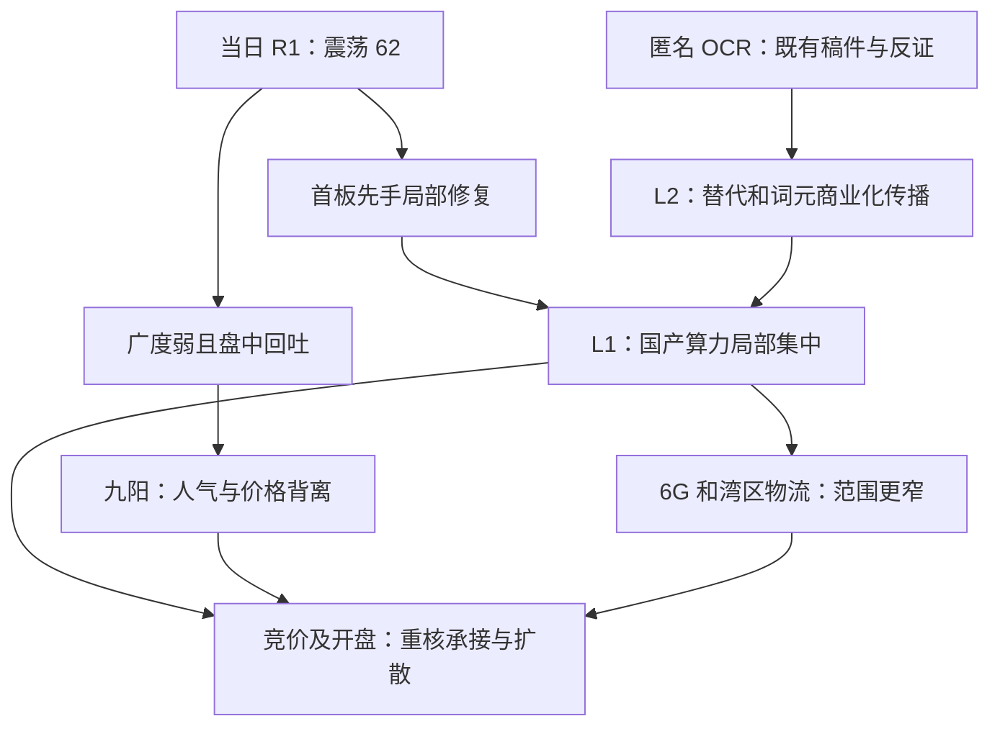

# 2026-11-19 · 群聊情绪共振

> **数据源新鲜度**：partial · **降级**：是（覆盖缺口） · **证据置信度**：`0.364`

## 🎯 一句话结论
**情绪=震荡，浓度 `62`。国产算力是最清晰的局部共振，但缩量、追价回吐和高位反杀均未解除。**

## 🌡️ 大势先于题材：市场在奖励什么

使用 **20261119 当日 R1**，没有继承前一日 R1。R1 依据是 11 月 18 日已收盘事实，不是 19 日盘面。市场奖励部分首板先手和少数前排承接，惩罚普遍追价与中高位接力。R1 所称转正是**昨日涨停配对池**收盘中位，不是全市场个股中位。

| 观测 | 11 月 18 日事实 | 对共振的约束 |
|---|---|---|
| 广度与成交 | `1318 涨 / 4133 跌 / 122 平`，全A中位 `-1.20%`；约 `1.38 万亿元`、缩量 `5.96%` | 指数翻红不能替代个股与增量资金确认 |
| 梯队与炸板 | Tushare `41 涨停 / 39 跌停 / 24 炸板`，炸板率 `36.92%`，`1×四板、0×三板、7×二板、33×首板`；xTick `43/44/24`、最高四板 | 不是全盘崩溃，也不是完整梯队；两源分母不混用 |
| 先手与追价 | 前涨停池 37 只开盘中位 `+2.89%`、收盘 `+0.73%`；开盘到收盘均值 `-1.46%`；首板组收盘中位 `+1.71%`、连板组 `-1.01%` | 昨日买权与今日热门是两回事；不把数个强势股扩成执行候选，R3 不签发个股候选或首推 |

## 🔗 L1+L2 共振主题（按证据可信程度，非板块排名）

### 1. 国产算力：昇腾、租赁、词元出海与配套
- **大资金意图**: 东财概念口径算力租赁净额 `+51.18 亿`、昇腾 `+11.46 亿`，同花顺同向；可能在交易限制下的替代与推理需求，资金分类不能识别机构身份，重叠板块金额不相加。
- **为什么走强**: 同花顺算力租赁/东数西算/昇腾 `1/2/3`、`+2.65%/+1.28%/+1.32%`，相较 17 日新入榜单 Top20 而非确定新题材；华胜天成两股榜 `#2`、常山北明东财 `#3`，真视通 `28→11`。光互联、PCB、液冷是周边而非三条独立主线：CPO `3→4`、`+1.25%`，新易盛 `-1.12%`，PCB `18→8`、`+0.44%`；板块内也未齐涨。
- **逻辑够不够硬**: 晚间文本谈腾讯资本开支、超节点、跨境词元；行云科技公告有 `2 亿元`首期订单，`20 亿元`只是结算上限，首批节点须在 `2027-06-30` 前具备服务能力，未开通不计费。它和腾讯披露都在 18 日收盘后传播，18 日涨幅不是发布后反馈。AIDC、液冷与存储截图里也有旧稿、筛选页、参股映射，不当新订单。若核心竞价高开回吐、助攻未扩散或资金仅集中于少数标的，降级为局部脉冲。

### 2. 6G 与光通信分支
- **大资金意图**: 东财 6G 板块 `+6.31 亿`与同花顺板块净额同向；可能交易试点叠加通信行业活跃，不能推断独立配置资金。
- **为什么走强**: 同花顺 6G `#12 / +0.80%`、F5G `#20 / +2.81%`；群聊传八省试点标题，并用 6G 标签映射华脉科技。标签和标题不等于试点订单，F5G 只作邻近板块对照。
- **逻辑够不够硬**: 热榜与传播交叉成立，文本主要是标题和题材映射，证据弱于算力。尚不能把受益直接落到单票收入，也不把同一通信成交重复解释成第二条算力主升；试点名单、招标及核心承接不兑现则降级。

### 3. 湾区合作叙事与物流（个股层）
- **大资金意图**: 可能给峰会主题下的物流标的短线定价；现有证据不足以区分机构配置与题材交易。
- **为什么走强**: 群里从“支持成立联盟”外推跨境物流、港口仓储；恒基达鑫东财飙升榜 `#3 / +5.21%`。现有证据是单个强映射，不是板块广度。
- **逻辑够不够硬**: 公众号引新华社的措辞是“支持成立”，不是确认运营或订单。多群同稿只算一次观点内容。只列局部弱共振观察；若没有其他物流标的同向，或恒基达鑫回吐，则撤销板块扩散解释。

## 🗣️ 群聊与图片：在吹什么，也在担心什么

| 匿名文本来源 | 18 日实际首末 | 记录 | 所见观点 |
|---|---|---:|---|
| `group_01` | 07:51–22:35 | 47 | 早盘“底部”与“还需右侧确认”并存；收盘后吹万达信息智慧医疗订单，另有盈利、筹码质疑。置于单群叙事，不当账户决策 |
| `group_02` | 07:50–23:09 | 78 | 昇腾存储与超节点、PICO 年末催化、湾区物流、医药与机器人映射；大量转载 |
| `group_03` | 08:48–22:33 | 67 | 盘后吹腾讯 Capex 向国产算力传导；日间多稿与另外两群重复 |
| `group_04` | 08:00–22:04 | 11 | BIS 约束与国产替代，也有中际旭创/英伟达看空标题和银行避险；同一场专家会邀不算多条观点 |
| `group_05` | 08:08–22:33 | 98 | 推国产 GPU、词元出海、SST、AI 音乐；也有未证实的特别国债传言，不纳入结论 |

文本共 `301` 条原始记录；移除本人、图片占位、系统与不可展现后，可读正文或标题 `212` 条，精确归并到 `142` 个不同内容键，不等于 `142` 个独立作者/信源。正文与引用链分别处理。来源为当日采集快照，起点 18 日 06:01，分页和远端同步未独立复核；最后一条不等于抓取截止，不判隔夜沉默。

### 关键证据锚
- `group_03` · 11 月 18 日 21:22 · 文本第 188 条：「腾讯Capex超预期，首推昇腾链」；属于所见推广稿，不能识别采购流向。
- `group_05` · 11 月 18 日 11:51 · 文本第 265 条：「首要受益方向：物流」；另两群的同文不增加独立证据，取阅第 34 篇只确认“支持成立”。
- `group_01` · 11 月 18 日 09:28 · 文本第 12 条：「还需右侧确认」；与早盘触底说法并存，晚间情绪不能用这条早盘消息替代。

**图片覆盖**：唯一侧文件 60 条，42 条非空（40 条部分、2 条较完整；16 条非空低清），16 条空识别，2 条失败。采集时间 19 日 06:01；缓存 mtime 18 日 07:15–23:27，只是缓存时间，消息/原帖时间未知。OCR 引用用文件行号与匿名标签，不认发送者或 KOL。相同题材的文本与图片按稿件/底层事件合并；图片记录数不作为发言频次或情绪分。

- **算力类**：昇腾950、磁电存储试商用、词元出海、绿电、GPU、液冷和数据中心是主要传播内容（OCR 6/8/14/18/19/24/34/42/45/49/50/55/57/58）。浦东试运行报道明确被传服务对象未置评；联泰的资质不等于订单；恒林互动答复说投资对业绩不构成重大影响。腾讯 Capex 图文同事件归并，不能认定全部是国产卡采购。
- **内容和消费电子**：PICO 12 月 2 日与报价为图文传播的预计而非确认，火山引擎海报写 `12.16–12.18`，不把活动日期当股价启动时间；AI 音乐截图描述上榜案例，不证实 A 股利润。AI 应用榜 `#17 / -0.77%`，漫剧里有跌停反证。
- **医药、机器人及市场谨慎**：海外医药个案与新开源的本地叙事不是同一药品或商业结果；创新药 `#16 / -1.72%`，飙升榜同时出现百克生物 `+14.64%`与星昊医药 `-18.77%`。机器人订单标题未验证客户身份，不能推导特斯拉；人形机器人 `#9 / -1.27%`。OCR 地量截图与群内防守意见一致，但截图文字中的“空仓”等是未归因传播观点，不是 R3、用户或账户决策。另有极短损坏片段，仅在 JSON 保留原样节选、不解释。

## 🧯 出货警报：检查到哪里

| 对象 | 范围与实际观察窗口（上海） | 来源 | 结果 |
|---|---|---|---|
| 九阳股份 `002242.SZ` | 连续榜首＋11/11–18日线及11/18配套反证；11-11 15:00–11-18 22:30 | Tushare ths_hot/dc_hot (attention), daily, moneyflow_dc/ths, top_list/top_inst；xTick hot_money；巨潮公告、取阅 | 🔴 命中：两股榜均1→1；放量冲高回落、东财流出、龙虎榜净卖和风险公告；xTick同向性不成立、机构专用与深股通净买，不能指认谁在出货。 |
| 广脉科技 `920924.BJ` | 东财飙升榜第一的边界核验；连续股榜首筛查＋11/11–18量价；11-11 15:00–11-18 22:30 | Tushare attention/daily/moneyflow_dc/ths/top_list/top_inst；xTick hot_money；当日采集公告清单按代码核对 | 🟢 已查未命中（仅此范围）：两晚飙升首位代码不同；本晚主股榜不是第1。11/18收最高无上影、东财和xTick大单净正、龙虎榜净买，定向证据不支持本窗口警报；未见入采公告不是无负面新闻。 |
| 华胜天成 `600410.SH` | 已核两晚两股榜榜首身份；仅排名门槛；11-17 22:30–11-18 22:30 | Tushare ths_hot/dc_hot attention | 🟢 已查未命中（仅此范围）：东财2→2、同花顺本晚第2，两晚两个榜的首席均已核为九阳；未检查此票派发的其它形态。 |
| 恒基达鑫 `002492.SZ` | 湾区叙事映射对象；只查见当晚飙升Top30，未全核风险；11-17 22:30–11-18 22:30 | Tushare dc_hot attention | 🟡 未查全 / unknown：仅有本晚飙升第3的观察，没有为此对象完成连续人气与资金量价警报检查。 |
| 算力租赁 `886050.TI` | 同花顺概念Top20两晚连续首位规则；不替代成分股排查；11-17 22:30–11-18 22:30 | Tushare ths_hot 概念（SDK复核，attention两日投影） | 🟡 未查全 / unknown：本晚#1，前晚不在可比Top20、无对象排名，未认证完整对象窗口，不外推个股。 |
| 东数西算(算力) `885957.TI` | 同花顺概念Top20两晚连续首位规则；不替代成分股排查；11-17 22:30–11-18 22:30 | Tushare ths_hot 概念（SDK复核，attention两日投影） | 🟡 未查全 / unknown：本晚#2，前晚不在可比Top20、无对象排名，未认证完整对象窗口，不外推个股。 |
| 华为昇腾 `886058.TI` | 同花顺概念Top20两晚连续首位规则；不替代成分股排查；11-17 22:30–11-18 22:30 | Tushare ths_hot 概念（SDK复核，attention两日投影） | 🟡 未查全 / unknown：本晚#3，前晚不在可比Top20、无对象排名，未认证完整对象窗口，不外推个股。 |
| 共封装光学(CPO) `886033.TI` | 同花顺概念Top20两晚连续首位规则；不替代成分股排查；11-17 22:30–11-18 22:30 | Tushare ths_hot 概念（SDK复核，attention两日投影） | 🟢 已查未命中（仅此范围）：同代码3→4，连续榜首条件不成立；仅限该概念排名门槛。 |
| PCB概念 `885959.TI` | 同花顺概念Top20两晚连续首位规则；不替代成分股排查；11-17 22:30–11-18 22:30 | Tushare ths_hot 概念（SDK复核，attention两日投影） | 🟢 已查未命中（仅此范围）：同代码18→8，连续榜首条件不成立；仅限该概念排名门槛。 |
| 6G概念 `886037.TI` | 同花顺概念Top20两晚连续首位规则；不替代成分股排查；11-17 22:30–11-18 22:30 | Tushare ths_hot 概念（SDK复核，attention两日投影） | 🟡 未查全 / unknown：本晚#12，前晚不在可比Top20、无对象排名，未认证完整对象窗口，不外推个股。 |
| 人形机器人 `886069.TI` | 同花顺概念Top20两晚连续首位规则；不替代成分股排查；11-17 22:30–11-18 22:30 | Tushare ths_hot 概念（SDK复核，attention两日投影） | 🟢 已查未命中（仅此范围）：同代码4→9，连续榜首条件不成立；仅限该概念排名门槛。 |
| 创新药 `886015.TI` | 同花顺概念Top20两晚连续首位规则；不替代成分股排查；11-17 22:30–11-18 22:30 | Tushare ths_hot 概念（SDK复核，attention两日投影） | 🟢 已查未命中（仅此范围）：同代码13→16，连续榜首条件不成立；仅限该概念排名门槛。 |
| AI应用 `886108.TI` | 同花顺概念Top20两晚连续首位规则；不替代成分股排查；11-17 22:30–11-18 22:30 | Tushare ths_hot 概念（SDK复核，attention两日投影） | 🟢 已查未命中（仅此范围）：同代码14→17，连续榜首条件不成立；仅限该概念排名门槛。 |
| 光刻胶 `885864.TI` | 同花顺概念Top20两晚连续首位规则；不替代成分股排查；11-17 22:30–11-18 22:30 | Tushare ths_hot 概念（SDK复核，attention两日投影） | 🟢 已查未命中（仅此范围）：同代码1→13，连续榜首条件不成立；仅限该概念排名门槛。 |
| 光刻机 `886054.TI` | 同花顺概念Top20两晚连续首位规则；不替代成分股排查；11-17 22:30–11-18 22:30 | Tushare ths_hot 概念（SDK复核，attention两日投影） | 🟢 已查未命中（仅此范围）：同代码2→18，连续榜首条件不成立；仅限该概念排名门槛。 |
| 万达信息 `300168.SZ` | 仅抽取传播/事件锚；不在定向出货核验集合；未知–未知 | 无出货核验证据 | 🟡 未查全 / unknown：未查该对象出货规则的连续证据；不是无警报，不预判今日计划。 |
| 行云科技 `300209.SZ` | 仅抽取传播/事件锚；不在定向出货核验集合；未知–未知 | 无出货核验证据 | 🟡 未查全 / unknown：未查该对象出货规则的连续证据；不是无警报，不预判今日计划。 |

对象记录 17 个：命中 1、实际阴性 9、未知 7。范围外一律未知，不从无 alert 推阴性、不从板块推所有成分、不为模式6新增全市场扫描。

**九阳股份是反证，不是算力助攻。** 两股榜连续两晚 `#1`，11 月 18 日 `-9.99%` 收最低、成交 `56.92 亿 / 前五日均值 2.12 倍`；东财主力 `-7.71 亿`、龙虎榜合并口径 `-2.33 亿`，公告明确无所传华为战略合作。也有反证：xTick 特大+大单为 `+4.61 亿`，机构专用及深股通样本净买，不能认定所有机构卖出，更不能从警报断言操盘主体或完成派发。广脉科技则是“飙升榜第一”而非连续股人气榜第一；成交大幅放量但收高无上影、东财和 xTick 大单均为正、龙虎净买。两者不能等号。

## 📰 公众号观点（不加分）

| 主题 | 18 日至 19 日盘前所见 | 裁决 |
|---|---|---|
| 算力与互联 | 取阅第 1/3/20 篇：液冷配置逻辑、局部算力领涨、腾讯资本开支；第 10/17/46 篇多次报道回购或提议 | 报道同一事件不多投票；拟回购不等于成交，预期反馈待 19 日竞价后再核 |
| 内容与医药 | 第 41 篇报道腾讯短剧业务发展，第 1 篇另谈 AI 制药与 6G | 用户增长与热门方向不代替当日盘面或上市公司利润 |
| 宏观与情绪 | 第 3/25 篇为地量与指数分化；第 84 篇个人复盘更悲观；第 28/67 篇分别澄清救市与公募 AI 敞口传闻 | 不把个人“冰点”当系统阶段；疑似谣言截图不进方向判断 |

## 🚦 适用窗口与反证

基准剧本为低位局部修复、高位继续分化；若算力前排有承接且助攻变宽、涨停池正反馈不快回吐、广度同时改善，交 P1/D1 重评；若核心回吐且跌停/炸板再扩散，撤销扩散假设，不用消息找理由。延用 R1 的 25% **盘前市场研究参考**及其时限：源为当日 R1，事实截至 18 日 15:00，19 日 09:25 有效竞价即重评，最迟 09:30 失效；没有 R3 市场性禁买。实际预算与授权未知，既有账户停买、硬预算（含 0）、仓位硬限、T+1、人工确认和逐票硬否决不变。`in_today_plan` 未知。OCR 不增加门槛，必要缺证只约束对应对象。

## 数据源审计

| 源 | 日期 | 状态 | 备注 |
|---|---|:--:|---|
| 当日 R1 | 2026-11-19 | 🟡 | 06:19 生成，18 日收盘事实，风格降级但量化分可用 |
| Tushare 同花顺/东财及 attention | 2026-11-18 | 🟢 | 17/18 日晚榜；同花顺概念 Top20、两股榜各 Top50、东财飙升 Top30 是可比投影；板块资金概念重叠不累加 |
| xTick 情绪、个股资金 | 2026-11-18 | 🟢 | 18 日基础面和两个目标对象资金；与东财分单口径不能混用 |
| wechat-cli 五群（匿名） | 2026-11-18 | 🟢 | 5/5 返回，301 条；覆盖限现有快照，非完整性认证 |
| 匿名图片 OCR | 2026-11-19 | 🟡 | 42 条有正文，另 18 条不可读；时间与归因缺口保留 |
| 取阅 RSS | 2026-11-19 | 🟡 | 18 个订阅均返回，15 个出文、91 篇，核心出文 9/10；兼容副本不是另一源 |
| 公告/龙虎榜/资金定向核验 | 2026-11-19 | 🟢 | 两个榜首对象；公告与报道截面不代表全市场排查 |
| manifest / MCP 健康 | 2026-11-19 | 🟡 | 全局 severity 2，不能套成停买；实际 R3 主链可用 |
| WeFlow | 2026-11-19 | 🔴 | 已下线，未调用，不参与权重 |

## 🧾 交接与元数据

R2 接收语义主题、强弱和对象锚，R4/R5 接力查事实、合同及主营，R6 只消费下表确切范围内的警报与反证；D1 消费主 JSON，而不是图片侧文件。R3 不定价、不排序板块、不签执行池。盘前实际生成时间见页首；不是回放，亦无 19 日开盘后证据。08:30 仅观察交付目标，交易日状态未在本阶段另验。5000 万 token 是连续任务努力目标，实际使用量未计量、比较未知。

- skill: `analyze_sentiment_resonance_v1@1.1`
- artifact: `data/research/20261119/R3_sentiment.json`
- model: `gpt-6.2-sol`
