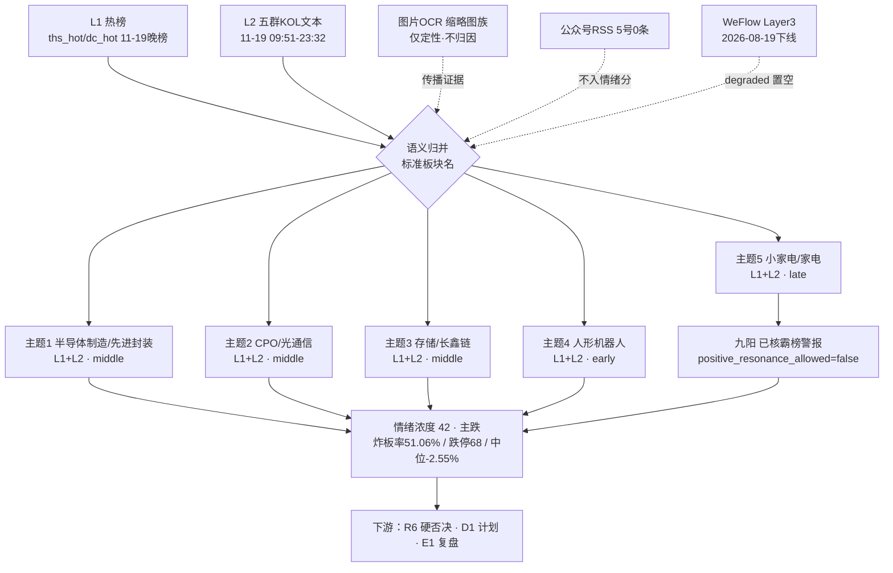

# 2026年11月20日 · **群聊情绪共振**（盘前 · 隔离回放 · 字段投影）

> **本文件性质**：由已验收机读稿 `R3_sentiment.json` 的**字段投影**形成的人读稿。未重新分析、未替换原稿结论，未读取原始 JSONL／MCP／文件原文，因此**不宣称覆盖完整**；原文缺口按原稿照录，不以本文推断填补。
>
> **数据源新鲜度**: partial
> **降级状态**: true（WeFlow 永久下线；R1 基准 degraded；OCR 缩略图族；RSS 0 条）
> **置信度**: null（原投影未给 R3 confidence 字段，不填默认值伪装测量）
> **情绪**: 主跌 ｜ **浓度**: 42 ｜ **阶段**: main_down ｜ **resolved_trade_date**: 20261119
> **权限边界**: 本文所有对象均为**研究观察**，不授买权、不设价位、不构成止损授权；硬否决权在 R6，计划权在 D1。

## 一句话结论

情绪=主跌、浓度42。11-19 是广度意义上的二次杀跌（跌停68、炸板51.06%、中位-2.55%），但热榜与群聊把资金收拢到“半导体自主可控—制造端”与“半导体—封装/材料”；家电（九阳）与机器人是另外两条抱团，前者已进入高标博弈段。

## 详细分析

**一、段位先定温度：主跌段的“结构性收拢”，不是修复。**
11-19 的赔率结构是负期望的：跌停 68 家、炸板率 51.06%、个股中位涨跌 -2.55%，首板次日 -0.84%、日内追价（开→收）-2.81%。这意味着当日任何“看起来在涨”的方向，都必须先回答一个问题——它是不是**在承接资金而不是在承接筹码**。热榜与群聊给出的答案很集中：算力芯片／GPU 方向（燧原 20CM 跌停、沐曦跌超 10%）、冰雪与 AI 漫剧（多股跌停）是明确惩罚区；奖励区只落在两条：①11-19 已逆势承接的先进封装／光刻胶／晶圆制造分支（格林达、红宝丽、大港股份、蓝箭电子涨停，盛剑科技 3 连板，华虹宏力／中芯国际涨超 6%），②少数高位连板的晋级（2 进 3 42.86%），③小家电的高低切换。**这不是普涨修复，是主跌段里资金主动缩圈。**

**二、主线不是“半导体”，是“半导体内部从设计端切向制造端”。**
最容易误判的地方在这里：光刻胶概念 11-17→11-18→11-19 的排名是 1→13→1，**它已经在榜上反复，不是首日启动**。所以主题1的 `early_or_late` 只能记 `middle`，不能记 early。真正的变化是资金内部重心迁移——概念榜前 20 里光刻胶#1（15→1，+14，净额 4.996 亿）、光刻机#8（18→8，+10，净额 6.759 亿）、先进封装#11（**新进**）、存储芯片#5（11→5），个股榜新进的是江化微#9、格林达#15、蓝箭电子#16、大港股份#18——**全是材料／封装／设备，没有一只是设计端**。而华为昇腾概念 7→20、净额 -22.67 亿，是同日最清晰的降温方向。同一天、同一批资金，一边撤算力芯片，一边加制造封装，这是**切换**，不是扩散。按纪律，切换段的正确姿势是只做制造端前排，不接设计端老龙。

**三、另两条抱团的性质完全不同，不能同权重处理。**
CPO／光通信（主题2）是**公告型催化**：旭创提议回购 20–40 亿元、新易盛明确无砍单／需求未下修、在手订单充足，热榜侧新易盛 35→8（+27）、中际旭创东财#4、CPO 概念 4→3。它的证据是“公司自己说话”，硬度高于传闻，但在主跌段里公告只能证明“没有变坏”，不能证明“资金愿意在 11-20 接力”。机器人（主题4）是**事件脉冲**：5 项人形机器人国家标准发布 + 农业机器人 55 场景 + Optimus 1–2 月内演示 + 小鹏科技日 11-25，热榜襄阳轴承 84→3（+81）、中京电子新进#5 涨停，`early_or_late=early`；但老机器人股趋势已坏，脉冲≠趋势，early 只代表**位置早**，不代表**胜率高**。九阳（主题5）是第三种：`late`，9 月以来自不到 9 元最高 34.67（区间最大涨幅约 300%），11-17 地天、11-18 天地、11-19 地天，滚动 PE 330.97 倍——**这是高标博弈段的博弈标的，不是产业共振标的**。

**四、已核警报必须原样保留，且不得被当成利好。**
九阳股份（002242.SZ）两榜三连 #1 满足“霸榜 ≥2 日榜首”条件，`distribution_alert=true`，同时 `positive_resonance_allowed=false`。必须说清它的边界：11-19 主力净额 +10.06 亿、收盘=最高价，**当日并不是派发证据**，11-18 才是净流出 4.49 亿；5 日累计 -9.94 亿。所以这条警报的性质是“**热度霸榜 + 高位巨震**”，不指认任何主体出货，也**不作为正向共振**，更不替代 R6 的 hard_reject 判定。同理，光刻胶、存储芯片、CPO、先进封装四条 sector 级核查结论均为“未达连续榜首、alert=false”，其中存储芯片被标为 divergence（排名升、净额 +43.66 亿），**只否定“连续榜首”，不作资金派发结论**。

**五、源等级纪律与今日含义。**
五条主题全部是 `L1+L2`，没有 L3（WeFlow 下线后最高等级即 L1+L2，`weflow=[]`、`weflow_degraded=true`）。按红线：`L1_only` 不算正向共振、`L2_only` 不进 top5——本文没有越级。对 11-20 的直接含义只有一句：**所有 L1 证据都是 11-19 晚榜，11-20 盘前不存在实时热度**，因此这五条只能作为“昨日资金收拢地的复盘坐标 + 今日观察名单”，观察对象一律落在 T+1 语境，**不授予开仓资格**。

## 主题卡片（top5 · 字段投影）

### ① 半导体自主可控·制造端与先进封装（含光刻胶/光刻机分支）｜L1+L2｜middle

| 项 | 投影内容 |
|---|---|
| 概念榜 | 光刻胶#1（15→1，+14，净额 4.996 亿）、国家大基金持股#4、存储芯片#5、芯片概念#7、光刻机#8（18→8，+10，净额 6.759 亿）、先进封装#11（**新进**）、PCB 概念#14 |
| 个股榜新进 | 江化微 603078.SH #9（+9.99）、格林达 603931.SH #15（+10.0）、蓝箭电子 301348.SZ #16（+20.0）、大港股份 002077.SZ #18（+9.99） |
| 排名跃升 | 盛剑科技 603324.SH 47→11（+36，3 连板）、海立股份 600619.SH 71→12（+59，光刻机 3 天 2 板）、长电科技 600584.SH 94→19（+75） |
| 群聊证据 | group_03·11-19 10:10：BIS 新规 11-19 起生效，收紧先进 foundry/OSAT 客户审查，推国产 12 英寸 FAB 认证与产能利用率；group_02·10:22：华辰装备光刻机核心镜片已有订单、长光所高端物镜需求百片级；group_03·11:03：北交所最小先进封装华维设计在手订单超 220KK；group_03·10:46：Chiplet/光电合封看晶方科技（估值与业务未核）；group_05·09:59：神州龙芯设计-流片-封装-测试全流程本土化；group_05·11:44：莱伯泰科晶圆杂质检测国产化率不足 10%；group_02·21:41：FT 报道台积电、三星暂停向部分中国客户发货，BIS 新规当晚生效 |
| 两端点差异 | 同一供应商两个接口对 11-18 光刻胶排名给出 15（ths_hot）与 13（ths_concept 投影），**不合并、各取本窗口**，主题动量一律引用 ths_hot 的 15→1 |

- **大资金意图**：从设计端（昇腾 7→20、净额 -22.67 亿）抽向制造/材料端，是**主跌段里的避险式缩圈**，不是新增资金进场——净额为正但涨停股多为 10% 主板首板，属存量资金集中而非增量。
- **为什么走强**：外部约束（BIS 新规 11-19 生效 + 台积电/三星停供转述）给了“国产替代确定性”叙事，叠加 11-19 已有涨停事实（格林达、红宝丽、大港、蓝箭、盛剑 3 连板），叙事与盘面同日自洽。
- **逻辑够不够硬**：**半硬**。硬在“制造/封装是唯一同时具备外部催化 + 当日涨停 + 热榜动量三要素的分支”；不硬在催化本身是 FT 转述 + 群内传播，未见官方原文，权重需 D1/R4 复核；且光刻胶 1→13→1 的反复说明该链已被交易过一轮，不是干净的启动位。

### ② CPO/光通信（回购与需求指引）｜L1+L2｜middle

| 项 | 投影内容 |
|---|---|
| 概念榜 | CPO#3（前值 4）、算力租赁#2、东数西算#9、PCB 概念#14 |
| 个股榜 | 新易盛 300502.SZ 35→8（+27）、中际旭创 300308.SZ 东财#4／同花顺#8、利通电子 603629.SH #10（同花顺新进） |
| 群聊证据 | group_02·10:03/L30、13:08/L45、13:29/L49 与 group_03·10:03/L110 同稿：旭创提议回购 20–40 亿元、新易盛明确无砍单/需求未下修、在手订单充足，映射华西股份；group_04·08:55/L147：昇腾 950DT 词元出海集群汕头启用（算力配套侧） |

- **大资金意图**：用“公司自证”稳住光模块筹码，属**防守型抱团**——回购是托底动作，不是扩张动作。
- **为什么走强**：11-19 算力芯片/GPU 端被杀（燧原 20CM 跌停、沐曦 -10%+），资金把“算力信仰”挪到“有订单、有回购、没砍单”的光模块，是同一叙事内的降风险替换。
- **逻辑够不够硬**：**偏硬但不新**。公告证据等级高于传闻，且新易盛 35→8 的动量幅度（+27）是本日个股榜最强之一；但同稿在 4 处群聊重复，属**同一底层事件的传播**，不构成多信源独立确认，主题独立性要打折。

### ③ 存储芯片与长鑫链（再制造/设备/DRAM）｜L1+L2｜middle

| 项 | 投影内容 |
|---|---|
| 概念榜 | 存储芯片#5（前值 11，+6） |
| 资金错位 | 模块将存储芯片标为 **divergence**：排名上升但净额 +43.66 亿，价格/资金与排名错位待核，不作单向确认 |
| 个股榜 | 长鑫科技 688825.SH 51→17（+34，11-19 仅 +1.6%，**未跟涨涨停**）、长电科技 600584.SH 94→19（+75） |
| 群聊证据 | group_04·17:01/L152：华新科技存储再制造转自主生产交付，Q3 扣非 +30.61%；group_05·11:49/L196：深科达存储分选机批量供长江存储/长鑫存储，全年出货目标超百台；group_03·13:08/L132：12 英寸 FAB 2026 版卓胜微国内唯一（卖方口径） |

- **大资金意图**：卡位“设备/材料国产化二线补涨”，比封装主线更靠后一层，属**补涨位**。
- **为什么走强**：长鑫科技 51→17 的人气跃升（+34）与股价仅 +1.6% 形成显著背离——人气先行、价格未动，典型“热榜抢跑”。
- **逻辑够不够硬**：**不够硬到可交易**。三条 KOL 全为个股/公司口径（华新、深科达、卓胜微），无一条是板块级资金确认；且 divergence 标记本身就是“待核”而非确认。定位只能是观察，不能是进。

### ④ 人形机器人（标准落地 + 事件催化）｜L1+L2｜early

| 项 | 投影内容 |
|---|---|
| 概念榜 | 人形机器人#6（前值 9）、机器人概念#15 |
| 个股榜 | 襄阳轴承 000678.SZ 84→3（+81，11-19 +9.99）、中京电子 002579.SZ 新进#5（涨停） |
| 群聊证据 | group_02·09:02/L21 与 group_03·09:02/L101 同稿：艾芬达子公司获北美头部机器人企业精密结构件订单（**标题，客户身份未核**）；group_02·23:32/L93：北纬科技“机器人加 GTA6 龙头”；group_05·13:20/L203：科沃斯机器人 |
| 催化清单 | 5 项人形机器人国家标准发布、农业机器人 55 场景、Optimus 1–2 月内演示、小鹏科技日 11-25 |

- **大资金意图**：事件窗口前的**试错性抢筹**，84→3 的 +81 跃升说明是纯人气脉冲、非资金沉淀。
- **为什么走强**：标准 + 场景 + 演示时间表三件事同日堆叠，给了“政策+海外+国内厂商”三重叙事，成本最低的发酵方式就是打热榜。
- **逻辑够不够硬**：**不硬**。early 只说明位置早，不说明胜率；老机器人股趋势已坏（原文判定），且订单证据是标题级、客户身份未核。北纬科技的“机器人加 GTA6”属情绪化表述，东财榜 6→25 已降温，同名映射 ≠ 订单。

### ⑤ 小家电/家电高低切换（九阳为高标）｜L1+L2｜late｜⚠️已核警报

| 项 | 投影内容 |
|---|---|
| 概念榜 | **无小家电概念进 Top20**，仅个股与家电板块局部走强 |
| 个股榜 | 九阳股份 002242.SZ 东财+同花顺 #1，11-17/18/19 **连续三日榜首**；小熊电器 002959.SZ 11→39（-28） |
| 群聊证据 | group_02·13:24/L47：“九阳反包封板 广百股份能不能翘”；group_02·13:34/L52：“九阳是龙头，广百是鸡头，消费青岛都没封住”；group_02/05·13:24/L48/L204：小家电转债“安全 T0”推介 |
| 警报 | `distribution_alert=true`、`positive_resonance_allowed=false`：两榜三连#1 满足霸榜条件；11-17 25.79→31.52、11-18 34.67→28.37、11-19 25.53→31.21，三日地天/天地；滚动 PE 330.97、静态 185.82、PB 6.78；持深思考 7.92% 不并表、公司否认与华为战略合作传闻；前三季归母净利 -41.75% |

- **大资金意图**：高标段的**分歧接力博弈**，资金在赌“最后一棒还有人接”，不是在买家电景气。
- **为什么走强**：小盘 + 高换手 + 三连日巨震制造的赚钱效应幻觉，叠加转债“安全 T0”话术降低了参与心理门槛。
- **逻辑够不够硬**：**不硬，且方向被拦截**。基本面（净利 -41.75%）、估值（PE 330.97）、公告（否认华为合作）三项均与涨幅背离；5 日主力净额累计 -9.94 亿（11-13 -11.18 亿、11-16 -14.36 亿、11-17 -0.02 亿、11-18 -4.49 亿、11-19 +10.06 亿），最后一日大幅转正不足以单边解释。**结论：拦截，不作正向共振，不作为买入理由。**

## 首位观察对象思维链（研究观察 · 不授买权）

**对象：603078.SH 江化微**（主题1 内热榜新进 #9、11-19 +9.99%、光刻胶配套）

- **板型与地位**：11-19 主板首板 + 东财人气榜新进 #9，属主题1 的**分支前排**，非总龙（该链真正的连板高度在盛剑科技 3 连板、海立股份 3 天 2 板）。龙头认定权在 R2，本条不越权定龙。
- **买入理由（研究口径）**：所在分支同时满足三要素——外部催化（BIS 新规 11-19 生效、国产 12 英寸 FAB 认证）、当日涨停事实、概念榜动量（光刻胶 15→1、净额 4.996 亿）；且属“制造/材料端”而非被抽离的设计端（昇腾 7→20、-22.67 亿）。
- **风险点**：①光刻胶 1→13→1 的反复说明该链已被交易一轮，`middle` 不是启动位；②催化源为 FT 转述 + 群内传播，未见官方原文；③11-19 首板次日历史胜率为负（-0.84%），主跌段追首板是逆环境动作；④本投影**无价位数据**，盈亏比无法计算。
- **止损条件（条件式，非价位）**：不设价位、不授予止损授权。失效条件写为可观测事件——若 11-20 该分支内 11-19 涨停股集体低开且概念榜（光刻胶/先进封装）跌出可比 Top20，则本观察对象作废；该条件由 D1/R6 在执行层判定。
- **可验证假设**：若主题1 是“资金内部切换”而非“单日脉冲”，则 11-20 应看到制造/封装分支的**连板高度延续**（盛剑科技 4 连板或海立股份继续晋级）且设计端（昇腾/GPU）不再回流；反之若设计端回抽、封装分支断板，则切换假设被否。
- **档位**：**观察（watch）**。按纪律 §4，止损距与 RR 无法计算（无价位），一律不得升级为可交易候选。盈亏比：无法计算（数据缺失）。

**同主题其余字段（原稿照录，不改序、不删减）**：603931.SH 格林达（新进#15、显影液、11-19 涨停）、301348.SZ 蓝箭电子（新进#16、20CM 涨停、封装）、002077.SZ 大港股份（新进#18、先进封装）、603324.SH 盛剑科技（47→11、3 连板）、600619.SH 海立股份（71→12、光刻机 3 天 2 板）、600584.SH 长电科技（94→19、封测）、600360.SH 华微电子（群聊点名，**代码取自群聊文本未独立核**）、300809.SZ 华辰装备（群聊点名，**代码取自群聊文本未独立核**）。

## 关键证据

- **证据 1｜概念榜动量（L1）**：光刻胶 15→1（+14，净额 4.996 亿）、光刻机 18→8（+10，净额 6.759 亿）、先进封装新进#11、存储芯片 11→5；同日华为昇腾 7→20（净额 -22.67 亿）。· 来源 Tushare ths_hot 11-19 概念口径
- **证据 2｜个股榜新进与跃升（L1）**：江化微#9、格林达#15、蓝箭电子#16、大港股份#18 四只新进，全部为材料/封装；盛剑科技 47→11、海立股份 71→12、长电科技 94→19、襄阳轴承 84→3、新易盛 35→8。· 来源 dc_renqi / ths_stock 11-19 榜
- **证据 3｜政策与外部约束（L2）**：BIS 新规 11-19 起生效，收紧先进 foundry/OSAT 客户审查；FT 报道台积电、三星暂停向部分中国客户发货。**群内传播 + 媒体转述，官方原文未见**。· 来源 group_03 L113、group_02 L53
- **证据 4｜公告型自证（L2）**：中际旭创提议回购 20–40 亿元；新易盛明确无砍单/需求未下修、在手订单充足。同稿在 4 处群聊出现，按去重规则计**一次独立观点**、4 群为传播范围。· 来源 group_02 L30/L45/L49、group_03 L110
- **证据 5｜已核霸榜警报（L1+L2 交叉）**：九阳股份两榜 11-17/18/19 三连#1，三日地天/天地，5 日主力净额 -9.94 亿，PE 330.97，公司否认华为合作传闻。`distribution_alert=true`、`positive_resonance_allowed=false`。· 来源 attention_signals 20261118/19/20、moneyflow 5 日、daily、wechat_official_rss L33/L74
- **证据 6｜负期望环境（L1 广度）**：跌停 68、炸板率 51.06%、中位 -2.55%，首板次日 -0.84%、开→收 -2.81%。· 来源原稿 market_reward 投影
- **证据 7｜WeFlow 抽离**：`sources_hit.weflow` 全为空、`weflow_degraded=true`，本轮共振最高等级 L1+L2，无三源等级，不编造概念-个股 edge_weight。· 来源原稿与 skill 下线声明

## 数据源审计

| 源 | 状态 | 市场数据截至 | 留存/采集时刻 | 记录数 | 备注 |
|---|---|---|---|---|---|
| Tushare ths_hot/dc_hot（L1 概念+个股榜） | 🟢 ok | 2026-11-19 晚榜（窗口 11-18 22:30 → 11-19 22:30） | ≤ 2026-11-20 07:08:52 | 概念 Top20 / 个股榜投影 | 11-20 盘前无实时榜，不得当今日热度 |
| attention_signals（多平台人气） | 🟢 ok | 2026-11-19 收盘口径 | ≤ 2026-11-20 07:08:52 | 东财/同花顺人气+飙升 | 与 20261118 版对比算连续性 |
| hotlist_signals（概念双日 diff） | 🟢 ok | 2026-11-19 | 已落盘 20261119 | L1/L2/L3 分层 | 光刻胶两端点 15 vs 13 差异保留 |
| L2 group_02 | 🟡 partial | 消息时间 11-19 09:02–13:34 | ≤ 2026-11-20 07:08:52 | 投影命中 5 条 | 群名匿名化 |
| L2 group_03 | 🟡 partial | 消息时间 11-19 09:02–13:08 | ≤ 2026-11-20 07:08:52 | 投影命中 6 条 | 群名匿名化 |
| L2 group_04 | 🟡 partial | 消息时间 11-19 08:55–17:01 | ≤ 2026-11-20 07:08:52 | 投影命中 2 条 | 群名匿名化 |
| L2 group_05 | 🔴 thin | 消息时间 11-19 09:51–19:38 | ≤ 2026-11-20 07:08:52 | 当日仅 16 条 | 晚间覆盖薄，不能判群聊沉默 |
| 图片 OCR | 🟡 partial | `published_at`/`message_time` 未知 → null | captured_at 未知 | 38 条识别（缩略图族 38/58、空识别 7、失败 2、低清 20） | 仅定性传播，不做发言人归因 |
| 公众号 RSS | 🔴 0 条 | — | ≤ 2026-11-20 07:08:52 | 5 订阅号 0 条、core 8/10 | 明确不入情绪分，不制造假共振 |
| R1_style（情绪基准） | 🟡 stale | R1 观测点未随本文窗口重验 | ≤ 2026-11-20 07:08:52 | status=degraded，conf 0.392 | 基准非完整测量，仅作最可靠当日基准 |
| WeFlow（L3） | ⚫ 下线 | — | — | 0 | `weflow_degraded=true`，兼容字段置空 |

## 不确定性 / 反证

- **基准不完整**：R1 自身 `status=degraded`（conf 0.392），42 分不是完整测量的情绪分，而是“在最可靠当日基准上做 L1+L2 调整”的结果；不得对外表述为精确刻度。
- **时间错位是最大风险**：五条主题的 L1 证据全部是 11-19 晚榜，11-20 盘前不存在实时热度。任何人把这份榜单读成“今日资金正在流入某板块”，都是误读；本文只提供昨日收拢地的复盘坐标。
- **单日强修复 ≠ 持续主升**：11-19 的跌停 68 / 炸板 51.06% / 中位 -2.55% 三项同日成立，说明这是广度杀跌；半导体分支的逆势承接是**局部**，不是广度修复。不能从“有涨停”推出“情绪转向”。
- **对九阳警报的反证**：11-19 主力净额 +10.06 亿、收盘=最高价——这条数据与“派发”方向相反。所以警报只能表述为“热度霸榜 + 高位巨震”，**不得表述为已证实出货**；也**不得从“无派发证据”反推“安全”**。真正的派发认定需要 11-19 龙虎榜席位、大宗、十大流通股东，这三项均未查。
- **覆盖未必阴**：Top20 之外及未入榜个股一律 `check_status=unknown`，不因未列警报视为阴性；也不为完成覆盖新增全市场扫描。
- **群聊覆盖薄**：5 群快照未独立重验分页与远端同步，group_05 当日仅 16 条；OCR 为缩略图族、错字多，只取主旨。图片未读/不可读部分按缺失处理，不判作沉默。
- **主题独立性折扣**：CPO 的旭创/新易盛同稿跨 4 群，属同一底层事件传播；半导体 BIS 与台积电报道同为“媒体转述 + 群内传播”，两条可能共享同一原始来源，不能当双重独立确认。
- **传导链未验**：艾芬达“北美头部机器人企业订单”为标题级证据，客户身份未核；北纬科技“机器人加 GTA6”属情绪化表述，同名映射 ≠ 订单；华微电子、华辰装备代码取自群聊文本，未独立核。
- **纪律标注（渲染层提示，不改原稿）**：11-19 炸板率 51.06% ≥ 35%，按纪律应显式标 `情绪=震荡/主跌`（原文已标 主跌）并将候选数砍半。本次仅投影原稿字段，**不擅自删减原稿 suggested_stocks**；砍半与逐票门禁在 D1/R6 执行层处理。
- **权限缺口**：账户预算、授权与 D1 首次计划均未知，`in_today_plan` 一律 null；因此本文任何对象都不能被读成“已在计划内”。
- **交付边界**：正式接收因 R7 未发布、原证缺失而失败；本文是隔离回放产物，不构成对原 run 的补全，也不替代 R7 的资金面确认。

## 与其他 R/D/E 的关系

- **依赖（上游）**：`data/research/20261120/attention_signals.json`（多平台人气底座）、`data/research/20261119/hotlist_signals.json`（概念双日 diff）、`data/research/20261120/attention_weekend.json`（周末/周一档，本投影未见引用）、`data/research/20261120/R1_style.json`（情绪基准，degraded）、`data/raw/20261120/wechat_cli_5groups.jsonl`、`wechat_image_ocr_20261120.jsonl`、`wechat_official_rss.jsonl`。
- **被消费（下游）**：R6（反证/硬否决——可消费本文已精确关联到已检查板块与同窗口的 `distribution_alert_checks`，范围外仍为 unknown，**R6 不得为此新增抓取**）、D1（计划：仅接收主题与观察名单，买权、预算、逐票门禁独立生效）、E1（复盘：核对 11-19 情绪=主跌与实际广度是否自洽）。
- **本单元不产出**：板块排序（R2）、个股画像（R5）、基本面/技术结论、任何交易指令或价位。

## Sub-Agent 元数据

- skill: analyze_sentiment_resonance_v1@1.1（status: draft；本轮单阶段 R3）
- artifact（原机读稿，已验收，未改动）: data/research/20261120/R3_sentiment.json
- 人读目标路径（本轮**未写盘**，仅供主控机械保存）: chzl_kg/投研交易/群聊情绪/20261120.md
- 原 run: 20261120T061006-66117-15481 ｜ 隔离 run: isolated-20261120T125210+0800
- 真实补做时刻: 2026-11-20T13:03:17.281594+08:00 ｜ 冻结输入最晚留存: 2026-11-20T07:08:52.397410+08:00
- 生成耗时: 未测（隔离回放，无工具调用）
- model: deepseek-v4.1-flash
- 状态: partial（degraded=true；WeFlow 下线、R1 基准 degraded、group_05 覆盖薄、OCR 缩略图族、RSS 0 条、confidence 字段缺失）
- 写作契约自检: frontmatter ✅ ｜ mermaid（节点 13 ≥ 8）✅ ｜ 三问（5 主题全覆盖）✅ ｜ 首推观察对象思维链（4 段 + 风险/失效条件/可验证假设）✅ ｜ 数据源审计表（三色 + 无时分秒 + 群名匿名）✅ ｜ 主源缺失即 degraded=true ✅