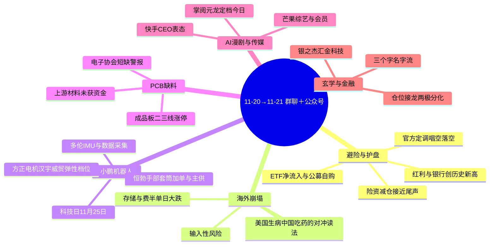

# 2026年11月21日 · **周末轻量群聊情绪**

> 🟡 **只读文本偏向与传播，不测量真实市场情绪，不给任何交易结论。** 窗口是「上周五开盘前 → 周六傍晚」共 36 小时，不是全周末汇总；周末无新热榜，不构造量化共振，不生成正式 R3 JSON。
> **口径**：情绪判断只用群聊＋公众号两源；周五已收盘的盘面事实引用公众号《每日收评》原文（`P:L4`），不冒充盘中观察。

## 💡 一句话结论

**周五盘中群内已从"抄底"转向"等崩完再说"，周六新增的只有避险与护盘两条叙事；小鹏机器人是唯一被逐票点名的一致性预期，而群内自己就点破了"周末大家都吹反转了"。**

## 🔎 有效窗口与统计口径

- **36 小时窗口**：11-20 06:01 → 11-21 18:00（`M`：`lookback_hours=36`，`lookback_reason` 载明"距上次成功抓取 36.0h，上次 2026-11-20 06:03"）。所以本次覆盖**上周五整个交易日＋周六**。
- **群聊 190 条全部在窗内**：11-20 共 174 条、11-21 共 18 条。最早 `C:L62`（11-20 08:00，摩天轮群仓位接龙），最晚 `C:L126`（11-21 17:49）。190 条逐条带 `[YYYY-MM-DD HH:MM]` 前缀，无缺时间戳。
- **群分布（按物理行区间）**：group_01 金投会 61 条（`C:L1–L61`）、group_02 摩天轮 42 条（`C:L62–L103`）、group_03 专注核心 23 条（`C:L104–L126`）、group_04 陆家嘴 6 条（`C:L127–L132`）、group_05 一手盘中 58 条（`C:L133–L190`）。manifest 报 5 群全 ok、errors 为空。
- **公众号 104 篇全部在窗内**：最早 `P:L86`（11-20 06:52），最新 `P:L1`（11-21 17:47）；周五 77 篇、周六 27 篇。19 个订阅源全部返回、13 个有文、6 个本窗无文（`M:sources.wechat_official_rss.empty_feeds`）。**证券时报 44 篇＋上海证券报 36 篇＝80 篇（占 77%）**，其余 11 个账号合计 24 篇。
- **两文件互为镜像**：`wechat_official_20.jsonl` 与 `wechat_official_rss.jsonl` 同为 383,306 字节，只计一次，不做 208 篇的重复计数。
- **周末无新热榜**：`attention_weekend.json` 中 20261121 四类榜单（东财人气/飙升、同花顺热股/概念）采集量全为 0，仅 20261118–1120 有值；`hotlist_status=not_available`，**没有新榜不构成降级**。

**证据索引**（`L` 为物理行号，不是微信原生消息 ID）：

| 代号 | 原始文件（相对项目根） |
|---|---|
| M | `data/raw/20261121/manifest.json` |
| C | `data/raw/20261121/wechat_cli_5groups.jsonl`（190 行） |
| P | `data/raw/20261121/wechat_official_20.jsonl`（104 行；RSS 镜像同行号） |
| O | `data/raw/20261121/wechat_image_ocr_20261121.jsonl`（26 行） |

### 三类内容必须分开（否则会把转发当共识）

| 类别 | 条数（约） | 行号与处理 |
|---|---:|---|
| 可读论述/判断 | 约 30 | `C:L3`（右侧确认）、`C:L4`（黄金坑）、`C:L7`（触底反弹）、`C:L43`（上上策空仓）、`C:L49`（等再暴跌）、`C:L52`（活下来才是寿星）、`C:L56`（继续出清）、`C:L102`（美国生病中国吃药）、`C:L106`（险资长文）、`C:L132`（险资尾声）；含机构稿与转载，不是 30 个独立作者 |
| 券商推介/吹票长文（带股票名与"实锤"字样） | 约 25 | 小鹏分支：`C:L78`（恒勃手部套筒）、`C:L164`（申万汽车恒勃）、`C:L112`（慈星电子皮肤）、`C:L83/L114/L167/L181`（多伦同稿 3 群）、`C:L81`（丰立）、`C:L170/L173`（弹性档位）、`C:L172`（威贸） |
| 链接标题、仓位接龙、图片占位、系统消息 | 约 100 | 接龙：`C:L62/L63`（摩天轮）、`C:L133/L134/L135`（一手盘中）；系统撤回：`C:L40`、`C:L100`；图片占位 20 余条 |

- **重复识别**：`C:L83/L114/L167/L181` 是同一篇"多伦科技"稿件跨 3 群反复出现；`C:L88` 与 `C:L117` 是同一红包文案两次粘贴。多伦稿件的配图在 3 群各出现一次（`C:L84/L115/L168/L182` 均为 `[图片]` 占位、local_id 各不相同），**本次 OCR 全失败，无法做图像级去重**，因此不声称它们是同一张图。以上只算**一篇底层内容**的传播广度，不是多源确认。
- **本人排除边界**：快照无 self 标识、无身份映射，不宣称已做身份级穷尽排除；不把群内原创或引用计为独立支持票。昵称"me"的发言（`C:L27`、`C:L187`）已剔出观点统计。
- **图片腿完全不可用**：61 个候选文件归并为 26 张唯一图（38 个 family 全覆盖、12 次重复出现），OCR 25 张 `error`、1 张 `ok` 但正文长度为 0，thumbnail-only 23 张。所以本报告**无法判断图片在传什么**；这不等于群里没在传，也不等于群聊沉默（`O` 全部 `published_at/message_time=null`，`captured_at=2026-11-21T18:01:37+08:00` 仅说明采集时刻）。

## 🧭 文本偏向与情绪浓度（定性）

| 维度 | 本次判断 | 因果与边界 |
|---|---|---|
| 文本方向 | **周五盘中由"抄底"转向"等出清"，周六转为"护盘＋避险"** | 09:33–10:19 还在谈"右侧确认""黄金坑预计下周或12月中旬前"（`C:L3/L4`）；14:51 变成"上上策空仓，中策微仓博反弹"（`C:L43`）；15:32 与次日 10:36 变成"再来个暴跌应该就快了""打底快来了，继续暴跌出清中"（`C:L49/L56`） |
| 主题集中度 | **小鹏机器人单点最密集，其余分散** | 机器人分支具名吹票 10 余条、跨 3 群；PCB、AI漫剧、玄学名字流各 1–3 条 |
| 可确认的情绪浓度 | **谨慎为主，但仓位分歧极大，不是一致悲观** | 两个群各一次仓位接龙：`C:L133` 里既有 0.5 成、1 成，也有 10 成并注明"可以再转入一倍现金"；`C:L62` 里既有 0%、也有"梭哈"。同一时点两极并存 |
| 新增发酵形态 | **"险资减仓接近尾声"是本窗口第一个成形的多头逻辑** | `C:L106`（专注核心，专家交流长文）与 `C:L132`（陆家嘴，"终于听到一些好消息了"＋转文）来自两个不同群、内容相近但非同一稿件；这是唯一"跨群独立提及"的正面线索 |
| 时间变化 | **能确认周六仍在谈，不能确认加速或降温** | 周五 174 条 vs 周六 18 条，**两天长度不同**，量级不可比；周六新增以复盘与宏观观点为主 |

## 🧩 Top 主题与关键证据

以下顺序是**讨论线索组织顺序，不是板块强弱排序**。

### T1. 险资减仓接近尾声＋ETF/平准护盘：本窗口唯一成形的多头叙事

**文本读法**：两个不同群独立出现相近判断，但一份是专家交流转述、一份是"内部交流"标题，均无原始出处。

| 日期/类型/行号 | 短原文 |
|---|---|
| `C:L106` · 2026-11-20 · chat_text/group_03 | "现在减仓基本做完了…我们手上流动性有点多，等着看有没有机会补仓" |
| `C:L132` · 2026-11-21 · link_title/group_04 | "内部交流：险资减仓接近尾声，但还有个问题没解决" |
| `C:L59` · 2026-11-21 · link_title/group_01 | "宽基ETF买了7555亿" |
| `C:L61` · 2026-11-21 · link_title/group_01 | "昨日ETF资金整体净流入899亿元 创2025年4月8日以来最高纪录" |
| `P:L67` · 2026-11-20 · 上海证券报 | "真金白银入市，公募机构自购" |
| `P:L60` · 2026-11-20 · 上海证券报 | "增量资金在路上！30只ETF已上报" |

**独立性/反证**：`C:L106` 与 `C:L132` 是两条不同转述，但底层可能同源（同一场险资交流），**不构成两套独立证据**；`C:L59/L61` 的 7555 亿与 899 亿只出现在链接标题里，**未核原始出处**，本次不引用为已核资金数据。官媒侧只能确认"公募自购""30 只 ETF 上报"这两个程序性事实。
- **大资金意图**: 未核。险资"手握流动性等信号"是转述的谈话，不是成交数据；ETF 净流入数字未溯源。
- **为什么走强**: 未核价格反应。周五上证 50 尾盘拉红（`P:L4` 收评）只说明当天有托底资金，**不能倒推周末叙事已被资金认可**。
- **逻辑够不够硬**: 中等偏软。"减仓做完"是可验证的前置条件，但**"等信号"不是"要买入"**；且这条逻辑若成立，利好的首先是被减仓的大票与宽基，不是群里在吹的小票。

### T2. 海外AI硬件崩塌：从"输入性风险"到"科技大踩踏"

**文本读法**：周六公众号形成压倒性单向叙事，群内同步转发，情绪明确偏负。

| 日期/类型/行号 | 短原文 |
|---|---|
| `P:L103` · 2026-11-21 · 贩财局 | "史无前例的科技大踩踏"（附纳指、费半、英伟达等跌幅） |
| `P:L18` · 2026-11-21 · 证券时报 | "利空突袭！英伟达，重挫超14%" |
| `P:L1` · 2026-11-21 · 李大霄 | "美股的输入性风险不得不防" |
| `C:L57` · 2026-11-21 · link_title/group_01 | "深夜，美股全线大跌！英伟达暴跌14%…存储股齐跌" |
| `P:L94` · 2026-11-20 · 调研先知 | "十年来最激进的对冲基金科技抛售" |

**独立性/反证**：`P:L103/L18/L1` 三家转述同一组美股收盘数据，**底层是一个事实、一次验证**。触发因素（SEC 对英伟达会计操作的调查）源自匿名消息源报道，**公司未置评、监管未确认**，本次按"报道"处理，不写成已立案。反证：`P:L9`（11-21 15:21"盘后突变！集体拉升，两则利好消息传来"）提示同日存在对冲性消息，本次未读全文，不据此削弱利空。
- **大资金意图**: 未核。不推断外资或机构已决定减配 A 股算力链。
- **为什么走强**: 不适用（利空方向）。周五 A 股半导体链已先跌（`P:L4`：通富微电跌停、海光/沐曦重挫），但周五夜盘跌幅更大，**未交易部分仍存在**。
- **逻辑够不够硬**: 事实硬、传导软；且这条叙事对国产替代是双向的——群里同日存在"美国生病不能让中国吃药"（`C:L102`）的对冲读法。

### T3. 小鹏机器人（11/25 科技日）：唯一被逐票点名的一致性预期

**文本读法**：密集、逐票、带"实锤/正宗/主供"字样，跨 3 群重复；这是最典型的"卖方＋群聊共振"，也最需要警惕提前透支。

| 日期/类型/行号 | 短原文 |
|---|---|
| `C:L75/L107/L155` · 2026-11-20 · link_title ×3群 | "小鹏科技日定档 11 月 25 日" |
| `C:L164` · 2026-11-20 · seller_research/group_05 | "恒勃股份…在 T 内的主供地位将越来越明确"（申万汽车署名） |
| `C:L78` · 2026-11-20 · seller_research/group_02 | "手部套筒已批量供应并获得加单，身体套筒重启PEEK方案" |
| `C:L83/L114/L167/L181` · 2026-11-20 · seller_research ×3群 | "多伦科技…参股子公司北云科技实锤供货小鹏机器人IMU" |
| `C:L170/L173` · 2026-11-20 · chat_text/group_05 | "小鹏机器人：10cm方正电机、20cm汉宇集团、30cm威贸电子" |
| `C:L150` · 2026-11-20 · chat_text/group_05 | "小鹏机器人 23日展示 方正电机" |

**独立性/反证**：恒勃与多伦各一篇署名研报转述，属"卖方观点"而非公司公告；`C:L150` 说"23 日展示"，与三处链接标题"科技日 11 月 25 日"**直接冲突**，本次不裁断，标待核。同一票在 3 群出现只算传播广度。
- **大资金意图**: 未核。"实锤"是研报用语，不是订单或供货协议原文。
- **为什么走强**: 周五已局部异动（`P:L4`：克来机电、长华集团涨停），说明资金在提前做，**不是周末才发现**。
- **逻辑够不够硬**: 中等偏软。日期明确（11/25 周二）、研报有署名；但群内已把 10cm/20cm/30cm 三个弹性档位全部点完，**更像兑现前的最后一轮传播**。

### T4. PCB 缺料：成品板已在涨停，上游材料还在讨论

**文本读法**：周五盘中已发酵，周末主要经公众号和盘前纪要向"上游材料"延伸。

| 日期/类型/行号 | 短原文 |
|---|---|
| `P:L7` · 2026-11-20 · 盘前纪要 | "全球PCB短缺危机正在蔓延…至少持续到2027年上半年"（附 M10/电子布/树脂/铜箔/CCL 名单） |
| `P:L4` · 2026-11-20 · 财联社早知道收评 | "PCB概念逆势活跃，中京电子2连板，澳弘电子、超声电子涨停，满坤科技20CM涨停" |
| `P:L5` · 2026-11-20 · 财联社早知道午报 | "PCB概念股同步回暖，满坤、骏亚、东晶、澳弘、超声涨停" |

**独立性/反证**：短缺警报来自"全球电子协会"报告、经盘前纪要转述，**本次未读原报告**；收评本身给出关键反证——"今日率先反弹的标的以市值偏小的二三线厂商为主…基本面支撑力度偏弱，行情延续性仍有待观察"，即官媒已把当日 PCB 定性为资金短期轮动。
- **大资金意图**: 未核；可确认的是资金**选了小市值成品板**而非上游材料（周五上游材料普遍大跌，见消息面报告）。
- **为什么走强**: 供给缺口＋AI 服务器高端板需求（`P:L5/L4` 均引用机构供需测算），逻辑自洽。
- **逻辑够不够硬**: 产业逻辑偏硬（交期与价格是实物证据），但**当日被买的是弹性不是基本面**。

### T5. AI 漫剧/传媒：定档日就是今天，已无时间差

| 日期/类型/行号 | 短原文 |
|---|---|
| `C:L80/L85/L109/L116` · 2026-11-20 · link_title ×3群 | "掌阅AI漫剧《元龙》定档11月21日" |
| `P:L5` · 2026-11-20 · 午报 | "AI漫剧概念震荡回升，龙版传媒、华媒控股涨停，果麦文化涨超15%"；快手CEO表态 AI 短剧 |
| `C:L113` · 2026-11-20 · seller_research/group_03 | "芒果超媒…证券部确认爆款综艺对会员增量有帮助" |
| `C:L94/L119/L184` · 2026-11-20 · link ×3群 | "引力传媒两项红果短剧案例入选…"（同一篇公众号链接反复贴） |

**独立性/反证**：`C:L94/L119/L184` 是同一链接在 3 群各贴一次，只算一次；`C:L113` 是自称"证券部确认"的转述，无公告。
- **大资金意图**: 未核。
- **为什么走强**: 周五已有涨停梯队（龙版/华媒/风语筑），资金已做过一轮。
- **逻辑够不够硬**: 偏软。催化是"内容上线"不是收入；定档日（11/21）在本报告写作时就是今天，**周末已无时间差**。

## 📰 公众号：宏观与情绪（单列，不并入热度）

| 观点线索 | 带日期的短原文及出处 | 如何使用 |
|---|---|---|
| 输入性风险 | 2026-11-21 `P:L1` 李大霄"美股的输入性风险不得不防"；2026-11-20 `P:L2`"中国股市相对具备韧性" | 同一作者两日口径从"韧性"转向"防风险"，只作情绪刻度 |
| 官方定调对冲 | 2026-11-21 `P:L54` 转人民日报"唱空中国经济者终会落空" | 官方表态；不等于资金行为，也不构成买入理由 |
| 谣言治理 | 2026-11-20 `P:L31` 两部门公布4起编造传播虚假信息典型案例；`P:L73` 华泰证券辟谣"建议清仓"传闻 | 说明本窗口存在大量未证实传言在传播，包括群里那些"内部交流" |
| 红利拥挤度 | 2026-11-20 `P:L4` 收评"红利板块…短期交易拥挤度持续抬升…存在一定补跌调整的潜在风险" | 官媒自己提示抱团风险，比"银行创新高"更重要 |
| 港股调整 | 2026-11-21 `P:L58`"恒生科技指数，大调整"；11-20 `P:L22`"港股，重大调整" | 同一事项两次传播，不重复计为两条催化 |
| 回购潮 | 2026-11-20 `P:L21`"今夜回购潮！多家A股公司公告：全部注销"；`P:L27`"603986 已回购超13亿元，将全部注销" | 资本行动事实；金额与用途以公告原文为准 |

## ⚖️ 一致性预期、反证与覆盖缺口

| 拟讨论的一致性 | 当前能支持到哪里 | 明确反证/未覆盖 |
|---|---|---|
| **周末一致看反转/抄底** | 群内自己指出"明天可能要大反弹，周末大家都吹反转了"（`C:L66`，系引用@所有人原文）与"周末大家都吹反转了"（`C:L67`） | 这句话本身是**反身性警报**：当群内开始点破"别人都在吹"，一致预期已成形；且同日 `C:L43` 给出"上上策空仓"的相反结论 |
| 险资减仓结束→资金回流 | `C:L106`、`C:L132` 两处提及（可能同源） | "等信号"≠"要买"；ETF 规模数字未溯源 |
| 小鹏机器人 11/25 会炒 | 三处链接标题同一日期＋两篇署名研报 | 群内已把弹性档位点完；"23日展示"与"25日科技日"冲突未裁断；缺公司公告 |
| 美股崩→A股算力链继续跌 | 周五 A 股半导体链已跌，海外跌幅更大 | 周五已部分交易；存在 `C:L102` 的对冲读法 |
| 多人多群形成强共识 | **未成立**：长文、标题、接龙、图片须分层 | 图片腿 0 可读；仓位接龙两极分化；无身份级独立作者确认 |

注：`C:L66`、`C:L67` 即摩天轮群"真能大反弹吗"与"周末大家都吹反转了"两条，属**未核个人表述**，只作情绪读数，不作事实。

- **覆盖不是取尽**：manifest 报 5 群 ok、errors 空，但原始文件无尾页/同步完整性回执；单群上限 200 未触顶也不能证明无漏项。
- **时间缺口**：群聊精确到分钟；公众号是源标注的发布/更新时间，不保证首发；OCR 全部 `published_at=null`，缓存 mtime 只说明落盘时间。
- **正文缺口**：`news_cls`/`news_major` 的 content 在源头即被截到百余字（本报告不依赖它们做情绪判断）；公众号正文约 4,000 字会截尾，未逐篇读全。
- **源健康**：`data/raw/20261121/mcp_health.json` 不存在，仅说明**未检测**，不推断 MCP 故障。

## 🗺️ 叙事关系图（非市场状态图）

**图表验收边界**：已核围栏与节点结构；本机无 `mmdc`，未做 SVG 渲染验收，不将结构检查冒称渲染通过。

## 数据源审计

表内状态是**本报告使用质量**：🟢可用，🟡部分/未核；不是把"抓取 ok"改写成"抓取失败"。

| 源 | 日期 | 状态 | 原始计数与覆盖 |
|---|---|---|:--:|
| group_01 金投会 | 11-20／11-21 | 🟡 | 61 条（54/7），`C:L1–L61`；源 ok，身份/分页完整性未核 |
| group_02 摩天轮 | 11-20／11-21 | 🟡 | 42 条（38/4），`C:L62–L103`；含两次同题仓位接龙，只算一次传播 |
| group_03 专注核心 | 11-20／11-21 | 🟡 | 23 条（22/1），`C:L104–L126`；含险资专家交流长文（转述） |
| group_04 陆家嘴 | 11-20／11-21 | 🟡 | 6 条（4/2），`C:L127–L132`；量最少，不代表该群观点弱 |
| group_05 一手盘中 | 11-20／11-21 | 🟡 | 58 条（54/4），`C:L133–L190`；吹票密度最高 |
| 公众号兼容文件 | 11-20（77）／11-21（27） | 🟡 | 104 篇；13 账号有文；6 订阅本窗无文；正文约 4,000 字截尾 |
| 公众号 RSS 镜像 | 同上 | 🟡 | 与兼容文件字节一致，新增计数 0 |
| 匿名图片 OCR | 11-21 采集 | 🔴 | 61 文件→26 唯一图；25 error、1 ok 但正文为空；**可读文本 0** |
| manifest | 11-21 | 🟢 | 1 份；只消费窗口与源状态，`global_severity=0` 不替代逐源审核 |
| 周末热榜 | — | 🟡 | not_available；不消费，不因周末无榜降级 |
| MCP 健康 | 11-21 | 🟡 | 文件缺失＝未检测；本次未调用任何行情/交易源 |

## 🔗 与其他研究的关系及元数据

- **依赖**：本轮 manifest、5 群群聊、公众号/RSS（同镜像）、匿名 OCR（不可用）。
- **消费边界**：提供文本主题、支持/反证与待核线索；不替代 R2 板块排序、R4 事件真实性、R7 资金核验，不向交易侧授予权限。
- **本次不写**：正式 `data/research/20261121/R3_sentiment.json`、mcp_health、任何交易参数。`confidence`、`sentiment_score`、`resonance_level` 全部为 null，因为没有经本轮证据校准的量化基准；不生成涨停家数、竞价、情绪周期阶段等交易日字段。
- **降级范围**：图片腿 0 可读、正文截尾、身份与分页未核、mcp_health 未检测；**"周末没有新热榜"不在降级范围内**。
- 技能：`analyze_sentiment_resonance_v1`；模型：deepseek-v4.1-flash。
