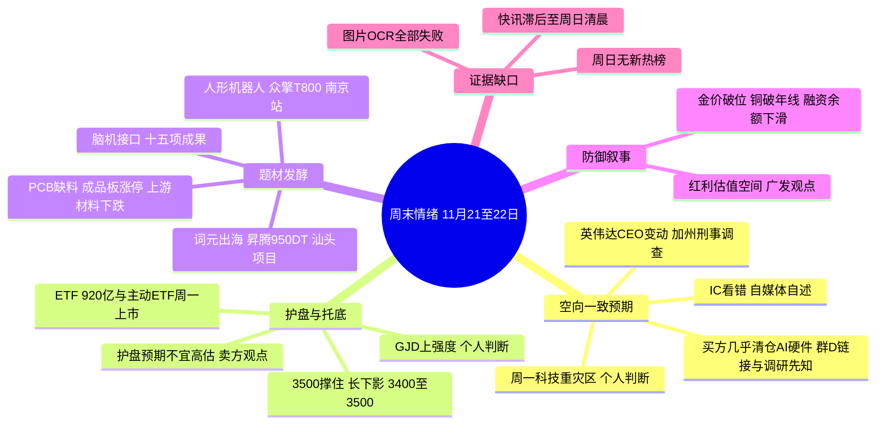

# 2026年11月22日 · **周末轻量群聊情绪**

> 🟡 **只读文本偏向与传播，不测量真实市场情绪，不给任何交易结论。**
> **窗口**：11-21 18:04 → 11-22 18:04（24小时增量）。这不是「周五收盘至今」的全周末汇总——周五整日与周六前半段已由 `chzl_kg/投研交易/群聊情绪/20261121.md` 覆盖，本文只引用其已核收盘事实作背景，不重复计为新增。
> **口径**：情绪判断只用「群聊＋公众号」两源；热榜为 11/20 收盘口径（周日无新榜），量化情绪分**不计算**（无有效基准，不填默认50）。

## 💡 一句话结论

**周末群里没有出现新的多头共识；成形的一致性预期只有一条——「周一科技继续杀、等国家队护盘」，而卖方在同一窗口自己写了「护盘预期不宜高估」，这两句是直接冲突的。** 唯一还在发酵的题材是人形机器人（众擎 T800 格斗赛），但承载它的票周五是跌的。

## 🔎 有效窗口与统计口径

- **24 小时增量**：`M` 载明 `lookback_hours=24`、`lookback_reason="距上次成功抓取 23.9h（上次 2026-11-21 18:04）"`。本文覆盖**周六傍晚到周日晚**。
- **群聊 57 条全在窗内**：最早 `C` 11-21 20:17（群D），最晚 11-22 17:56（群C）。逐条带 `[YYYY-MM-DD HH:MM]` 前缀，无缺时间戳。
- **内容形态**：可读文字 32 条 / 链接标题 15 条 / 图片占位 6 条 / 系统消息 3 条 / 小程序 1 条。**链接+图片+系统占 44%**，说明这两天的群聊以「转发＋占位」为主，不是盘中交易讨论。
- **群分布（匿名）**：群A（游资投研）28 条、群B（题材基本面）11 条、群C（核心票）4 条、群D（机构风向）11 条、群E（盘中新闻）3 条。manifest 报 5 群全 ok、errors 为空。
- **量级不可比**：昨日报告是 36h/190 条，本次是 24h/57 条。**窗口长度不同，篇数下降不是降温证据**，只能说明形态变了（周六以复盘为主，周日以研报推送＋宏观闲聊为主）。
- **公众号 30 篇全在窗内**：19 个源可达，7 个有文——证券时报 15、上海证券报 9、证金事 2、财联社早知道 1、猫笔刀 1、调研先知 1、李大霄 1；其余 12 个源本窗 0 篇（含**盘前纪要**，周日不发文属正常）。两文件同字节互为镜像，**只计 30 篇**。
- **热榜口径**：`H` 的 20261121 四类榜单有值（人气100/飙升100/热股100/概念20），**20261122 四类全为 0**；`attention_signals.json` 绑定 `signal_trade_date=20261120`。所以本文所有「板块涨跌幅」都是**周五收盘口径**，不是周日新数据。
- **图片腿完全不可用**：8 个候选文件归并 5 张唯一图（1 张跨两群重复），OCR 5/5 失败（`vision_batch_timeout`），可读文本 0。所以**无法判断图片在传什么**；这不等于群里没在传，不等于群聊沉默。

**证据索引**（按「文件代号 + 时间戳」可 grep 回溯）：

| 代号 | 原始文件（相对项目根） |
|---|---|
| M | `data/raw/20261122/manifest.json` |
| C | `data/raw/20261122/wechat_cli_5groups.jsonl`（57 行） |
| P | `data/raw/20261122/wechat_official_20.jsonl`（30 行；RSS 镜像同内容） |
| R | `data/raw/20261122/rss_fetch_status.json`（逐源 items_in_window） |
| H | `data/research/20261122/attention_weekend.json` |
| N | `data/raw/20261122/news_cls.jsonl` |
| A | `data/raw/20261122/anns_window.jsonl` |
| D | Tushare `daily_basic`/`daily` trade_date=20261120（MCP 实测调用） |

## 🗺️ 周末情绪传导图

## 🧭 文本偏向与情绪浓度（定性）

| 维度 | 本次判断 | 因果与边界 |
|---|---|---|
| 文本方向 | **空向一致 + 期待外部护盘** | 群A 09:51「周一科技估计重灾区」、09:54「周一gjd上强度」、13:07「下周指数周线估计出现底部 3400-3500之间收出长下影」。这是**同一个人连发的完整剧本**，不是多人共识 |
| 主题集中度 | **低**（题材线索只有一条成稿推送） | 群A 28 条里约 10 条来自同一人 Z 的宏观讨论；群D 11 条**全部**是券商研报/会议推送或链接（其中 1 条是同一篇研报的清单＋链接），**0 条独立买卖判断** |
| 方向冲突 | **存在，且是卖方自己写出来的** | 群B 12:01 王维钢「护盘预期不宜高估」vs 群A 09:54「gjd上强度」——同一个周末，同一件事，两种读法 |
| 可确认的情绪浓度 | **无法量化**，只能确认「叙事从交易转向宏观」 | 无 R1 基准可用（周日无 R1）、无新热榜、无盘中观察；按契约**不填默认 50** |
| 仓位/资金接龙 | **本窗没有** | 昨日报告里两群各有一次仓位接龙，今天是 0；不能据此说仓位一致，只能说没人报仓位 |
| 新增发酵形态 | **「国产 AI 当自强」在机构群里被连续推** | 群D 20:48 华西刘泽晶（昇腾950DT汕头词元出海）→ 17:28（次日）国联民生「丢掉幻想，正视现实：再谈国产AI当自强」；两篇不同券商、不同日期、同方向 |

## 🧩 Top 主题与共振（双源口径，WeFlow 已下线）

**共振等级只认 L1（热榜）+ L2（可归因群聊文字）同时命中。** 本轮只有 2 个主题达标，其余明确排除，**不为凑满 5 个而凑数**（`resonance_top_themes_count=2`，`sparse_themes=true`）。

### T1 · AI算力/光模块/存储/CPO —— 负向共振（L1+L2）· `early_or_late: late`

| 维度 | 证据 |
|---|---|
| L1 热榜（11/20口径） | CPO 概念 rank 5（**-5.27%**）、算力租赁 rank 7（**-5.56%**）、芯片 rank 12（**-5.99%**）、存储芯片 rank 13（**-6.61%**）、东数西算 rank 16（**-5.57%**）——热度仍在榜，价格全线阴跌（`H`） |
| L2 群聊 | 群A 09:51「周一科技估计重灾区」；群D 11:40 链接「上海陆家嘴调研：机构几乎清仓AI硬件，有基金现金仓位高达70%」；群A 22:46「6月底我一直说硬科技要远离」、23:11「不少硬科技利润不错，照常跌70%」 |
| 公众号（不算共振，只作背景） | `P` 调研先知 13:43 全文；`P` 证券时报 15:09「纳指一周 -10%，2020年以来最大周跌幅」；`P` 猫笔刀 22:19「我看错了，代价是一年白滚」 |

**独立性判定**：群D 11:40 的链接标题与 `P` 调研先知 13:43 的正文**极可能是同一份路演记录的两次转写**（标题不同，但「清仓AI硬件」「现金仓位70%」两个数据点一致），本文按**一篇独立内容**计；且原文未署名具体买方机构，属**二手路演转述**。群A 那几句是个人判断，与稿件不同源但不构成机构验证。

- **大资金意图**: 未核。能确认的只有「一篇未署名路演转述说仓位接近零」和「ETF 行业主题份额在流出」，**不能把转述当成已发生的清仓凭证**。
- **为什么走强**: 不适用（负向）。价格反应是**周五已经跌出来的**（费半 -10.73%、存储股 -13~16%，见 20261121 报告），本周窗口没有新的 A 股价格证据。
- **逻辑够不够硬**: 事实部分硬（美股跌幅、CEO 变动报道、加州调查），**传导部分软**——同一窗口存在反向读法：群D 连推「国产AI当自强」，且周五国产算力局部走强（真视通 4 板）。利空与国产替代必须并列交下游。

### T2 · 人形机器人（众擎 T800 / 小鹏 11-25）—— 方向矛盾（L1+L2）· `early_or_late: middle`

| 维度 | 证据 |
|---|---|
| L1 热榜（11/20口径） | 机器人概念 rank 9（**-5.21%**）、人形机器人 rank 10（**-5.44%**）；周冠军个股里 中京电子/骏亚科技 涨停但在工业属性上属 PCB（`H`） |
| L2 群聊 | 群B 16:40 与群C 16:40 **同稿**：URKL 城市巡回挑战赛南京站，众擎 T800 对阵，南京机甲「紫金麒麟」夺冠；点名 多伦科技(603528) 控股江苏擎安机器人、中鼎股份(000887) 众擎谐波减速器定点 |
| 热度延续 | `H.weekend_persistent` 24 只跨日连续在榜，含 中京电子/真视通/盛剑科技/中际旭创/新易盛/华胜天成（跨日热度≠资金） |

**独立性判定**：群里那段推送在 2 个群出现但**是同一篇稿件**（含同一张配图），只算**一篇传播**；赛事本身另有同花顺 11-22 07:24 报道（`N`）可作事实腿。**个股映射仅来自这一篇推送，无公司公告、无研报署名**。

- **大资金意图**: 未核。不知道谁在买；可查的是**周五机器人板块整体 -5.2%**，资金没有为这条叙事付钱。
- **为什么走强**: 未核。周五与这条叙事直接相关的票是跌的——多伦科技 -2.42%、中鼎股份 -5.47%（`D`）；机器人板块当日只有克来机电、长华集团涨停（20261121 报告已核）。
- **逻辑够不够硬**: 中等偏软。赛事是真实的、时间明确（11-21），但「控股江苏擎安/谐波定点」是**推送号自带的映射**，既无公告也无研报署名；「能跑能跳→抗冲击高可靠」是产业叙事，不是订单。

### 🧠 群内唯一个股线索的思维链（研究口径，非交易四段）

> 按周末纪律，四段锚点改写为「逻辑支点 / 风险点 / 证伪条件 / 可验证假设」，**不含价格条件与仓位**。R3 不做个股画像（那是 R5），这里只评估**传播证据本身**够不够撑起一个题材。

#### 多伦科技 603528 · 众擎 T800（流通市值 39.8 亿，周五 -2.42%）
- **逻辑支点**（替代「买入理由」）：群B 与群C 在 16:40 推送同一篇稿（同图），内容指向其控股江苏擎安机器人、绑定众擎 T800；赛事本身有同花顺独立报道（`N` 07:24）可作事实腿。**传播广度 2 群，独立内容 1 篇。**
- **风险点**：无公司公告、无署名研报、无控股比例；发稿账号是资讯推送号而非交易者，**推送≠看好**；周五 -2.42% 说明周一之前资金没认。
- **证伪条件**（研究口径）：若周一该票无独立量能（研究口径：不能强于机器人板块），则「资金在做这条分支」假设不成立；若推送内容被公司澄清或后续证实为旧闻，则线索归零。
- **可验证假设**：若 11-25 小鹏科技日或众擎侧出现官方供应商名单，且名单含该公司，则「设备商绑定」从推送升级为可核事实。

### 明确排除在共振之外的三条（红线4：单源不算共振）

| 主题 | 实际命中 | 为什么不算共振 |
|---|---|---|
| 高股息/红利 | L1「高股息精选」rank 4（-1.51%）（`H`）；群D 17:46 广发刘晨明「红利贵不贵？还有多少估值空间」+ 进门财经路演链接 | L2 只有**卖方会议邀请+研报链接**，属推广/传播证据，**不是可归因的独立判断** → `L1_only` |
| 黄金/有色 | L1「黄金概念」rank 3（-4.31%）（`H`）；群E 07:49 链接「金价给A股吹了集结号」；`P` 证金事 07:22 长文 | 群里只有**链接标题**，正文是公众号（公众号按契约不计入共振） → `L1_only` |
| 国产算力/词元出海 | L1「东数西算(算力)」rank 16（-5.57%）；群D 20:48 华西稿、17:28 国联民生稿 | 两条都是**券商研报推送**，同一方向不同署名但仍属卖方推广 → 不计独立观点，`L1_only` |

## 📌 关键证据（逐条可回溯）

- **证据1**：群A 09:51「周一科技估计重灾区」→ 09:54「周一gjd上强度」→ 09:55「如果3500撑住的话修复最多一年」→ 10:49「震荡筑底大半年/个人感觉哈」→ 13:07「3400-3500之间收出长下影」。**同一人 5 条自述，前面三条是判断，后面两条自己降级为感觉**（`C`·群A）。
- **证据2**：群A 22:42–23:16 游资W 与 群主 的对谈：「涨多了就会跌，历史规律」「房地产基建泡沫、互联网泡沫、口罩泡沫、ai泡沫…只相信跌多了就买」；群主「硬科技利润不错，照常跌70%」；技术T「主力在顶部交换了筹码就结束了，下一轮要几个月或两三年或十年」。**这是本窗最完整的空方逻辑链，但全部无数据支撑**（`C`·群A）。
- **证据3**：群B 12:01 王维钢（君晟）：「市场震荡迷茫，硬科技海外链承压，把握中小盘阿尔法机会。短期筹码主导定价，**护盘预期不宜高估**；科技主线大跌后，情绪修复尚需时日」（`C`·群B）。**与群A「gjd上强度」直接冲突，必须并列保留。**
- **证据4**：群D 11:40 链接「上海陆家嘴调研：机构几乎清仓AI硬件，有基金现金仓位高达70%」（与下条公众号正文数据点一致，按一篇计）；`P` 调研先知 13:43 正文给出量化口径：2027 年 AI capex 1.3–1.4 万亿美元、2028 年定价已假设走平或下滑、10GW 新增推理算力需 700–800 亿美元/GW 收入即约 8000 亿美元 vs Anthropic 收入预期不到 2000 亿（缺口 6000 亿）、SK海力士远期 PE 约 2 倍、CPO 商业化或推迟到 2027H2–2028、晶圆键合良率约 50%（`P`/`C`·群D，**同一底层稿件，计一篇**）。
- **证据5**：URKL 南京站众擎 T800（11-21）+ 多伦科技/中鼎股份映射，群B/群C 同稿（`C`）+ 同花顺赛事报道（`N` 07:24）。**群内 2 处=1 篇传播**。
- **证据6**：`P` 上海证券报 17:46 核出的增量资金事实——11-20 股票型 ETF 净流入 **920.66 亿元**（历史单日第三高，仅次于 2024-10-08、2025-04-08），9-28 以来累计 **7664.01 亿元**。这与昨日群里只在**链接标题**里出现的「899 亿/7555 亿」口径**不同**（`N` iFinD 口径：ETF 整体 899.25 亿、股票型 919.14 亿、宽基 923.63 亿）。**三个数字并列，不合并成一个。**
- **证据7**：`P` 证金事 07:22「金价 3502.73 反弹、上证 3500.88 回升，两个市场在 3500 会师」+「铜 11-18 跌破年线，20 年里 4 次，除 2006 年外三次都进熊市」+「融资余额从 7 月初 3 万亿往 2 万亿掉，每天午后急跌多半是券商强平」。**这是作者自己的历史类比与推断，不是成交数据**；融资余额数字未被交易所口径交叉核。
- **证据8**：`P` 财联社早知道 11-21 21:01 的机器人仿真数据长文（苹果 HALO 在宇树 G1 上零样本迁移 91%；点名 索辰科技/光轮智能/奥比中光/汉威科技/凌云光/利亚德/诺亦腾）——**但正文引用的专家会是 11 月 11 日那场，属旧文迟到，不是本周末新催化**（`P` 时间锚在正文里）。
- **证据9**：`P` 证券时报 11-22 17:44 荣盛发展 002146 收盘 0.96 元再触发面值退市风险、11-22 晚间披露风险提示公告（**6 名董监高 11-18 起的增持计划已买入 331.77 万股/300.49 万元，仍在 0.96**）。
- **证据10**：`P` 证券时报 11-22 17:23 天孚通信 300394 拟在南昌投建高速光器件项目、CPO 配套产品已进入批量交付（2027 起提量）、Q3 归母 8.79 亿 +55.30%。**属公告转述，PDF 原文未核**（`A` 本周日仅 2 条投资者关系记录，公告索引滞后）。

## 📊 公众号观点分布（只作观点，不计共振）

| 源 | 本窗篇数 | 内容形态 | 情绪指向 |
|---|:--:|---|---|
| 证券时报 | 15 | 公告转述/监管/宏观 | 中性偏空（退市风险、加息变数、军采暂停） |
| 上海证券报 | 9 | 数据核查/产业研判 | 中性偏多（ETF 920 亿、PCB 预警、固态电池、下周新股） |
| 证金事 | 2 | 个人复盘（同稿两版） | 空（金价/铜/强平） |
| 调研先知 | 1 | 买方路演转述 | 空（AI硬件仓位接近零） |
| 财联社早知道 | 1 | 专家会议整理 | 中性（机器人仿真，旧文迟到） |
| 猫笔刀 | 1 | 个人随笔 | 空（自认看错） |
| 李大霄 | 1 | 非市场题材 | 无指向 |

**读法**：官媒（证券时报/上证报）落在「事实与数据」层，自媒体（调研先知/证金事/猫笔刀）落在「情绪与教训」层。**两层的方向不一致**——官媒给出的增量资金数字是这几周最大的多头硬数据，自媒体给的是最悲观的叙事。这个反差本身就是周末的信息结构。

## ⚠️ 不确定性 / 反证

1. **共振样本太少**：只有 2 个主题达标，其中一个方向是「负」。用 2 个样本说「市场在聊什么」很容易过拟合；`sparse_themes=true` 是诚实标注，不是遗漏。
2. **单人剧本被误读为共识的风险**：群A 的「周一科技重灾区 + GJD 上强度 + 3400-3500 长下影」全部来自一个人，且他后面自己写了「个人感觉哈」。如果下游把它当群体判断，就是错的。
3. **热度≠资金**：机器人概念在榜第 9，但板块 -5.21%；PCB 概念在榜第 2，但概念 -4.85%——上榜说明「被讨论」，两天里它一直是**被讨论着往下走**。
4. **图片腿全盲**：5 张唯一图 0 可读，其中 1 张 752×686 也不是低清。周末群里的图很可能正是信息密度最高的部分（截图/持仓/研报图），本次**完全缺失**。
5. **快讯滞后 9 小时**：`news_cls` 到 11-22 08:58 就断了，周日下午的事件只能靠公众号与公告补，**不保证覆盖完整**。
6. **数据源自身的反向证据**：`P` 调研先知 同篇里也写了「2027 年 2–3 月云厂集中披露业绩前，涨也只能定义成反弹，不能判定趋势反转」——**它自己也没说这是趋势底**；`P` 上证报 里富国/汇添富总经理喊「估值回落至历史均值以下」，那是**卖方立场**，不是成交。
7. **利益与身份**：群D 的 8/11 条是券商研报推送（华西/开源/国金/国联民生/广发），存在推介动机；「国产AI当自强」连推两篇，是同一立场的连续强化，不是独立验证。

## 🔗 与其他 R/D/E 的关系

- **依赖（上游）**：`data/raw/20261122/*`（群聊、公众号、快讯、公告）、`data/research/20261122/attention_weekend.json`、`attention_signals.json`、Tushare `daily_basic/daily`（20261120）、`hithink-market-query`（概念前 10）。
- **前序衔接**：`chzl_kg/投研交易/群聊情绪/20261121.md`（周五整日+周六前半段，已被本文引用为背景，不重复计新增）。
- **被消费（下游）**：R2 主线研判、R4 消息面（`chzl_kg/投研交易/消息面/20261122.md`）、D1 周一预案、R6 反证。
- **不生产的**：正式 `R3_sentiment.json`（非交易日档只出人读 md）、情绪分、板块强弱排序、个股画像。

## 🧾 Sub-Agent 元数据

- skill: `analyze_sentiment_resonance_v1@1.1`（周末轻量模式）
- artifact: `chzl_kg/投研交易/群聊情绪/20261122.md`（机读 JSON 未生成，`formal_R3_json_generated=false`）
- 数据窗口: 2026-11-21 18:04 → 2026-11-22 18:04（24h）
- 生成时刻: 2026-11-22T19:30:00+08:00
- method: 人工+LLM 语义归并（无 WeFlow）
