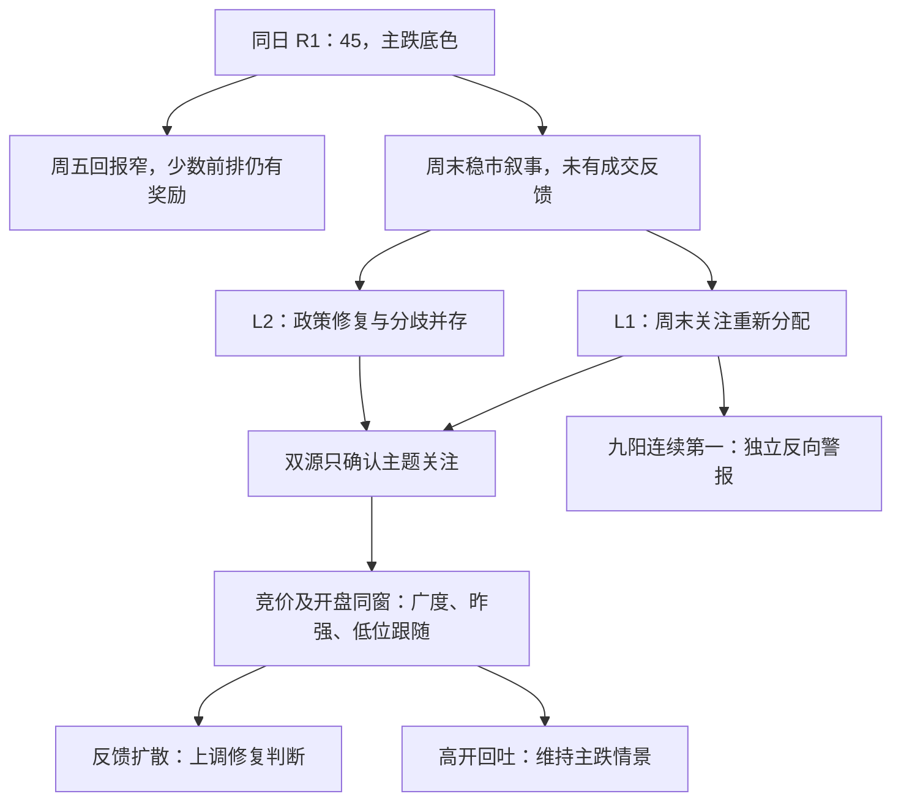

# 2026-11-23 · 群聊情绪与热度

> **数据源新鲜度：partial｜置信度：0.364**。本日盘前研判，不是回放。11-20 的收盘和周末人气榜不代表 11-23 的成交。

## 一句话结论

**情绪 45/100，主跌底色未变。四条双源主题仅确认关注，稳市预期尚未兑现为接力。**

## 📉 先看市场奖励，再看周末预期

| 观察 | 可核事实 | 不作的推断 |
|---|---|---|
| 上一交易日市场 | 同轮 R1：`313 涨 / 5236 跌`，个股中位 `−5.08%`；11-19 涨停池 23 只在 11-20 的收盘中位也是 `−5.08%`，首板仅 `1/18` 晋级 | 两个四板、炸板率从 `51.06%` 回落至 `20%`，只说明少数前排仍有反馈；触板池缩小且三板断档，不等于扩散 |
| XTick 独立口径 | 11-20 `30 涨停 / 61 跌停 / 9 炸板`，高度 4；与 R1 广度、梯队方向一致。XTick 原炸板率字段为 `0`，不采用；以本源计数推算约 `23.08%`，不与 R1 分母混用 | 不把上一交易日或盘前回查时间写成今日盘口 |
| 周末新增 | 融资保证金下限 `100%→80%`，**11-30** 才生效；创业板做市为征求意见，另有降费。非新增资金确认。金属与科技两边均有反证 | “近4000亿”是理论测算，不是 11-23 已入场；自报护盘和仓位不当交易事实 |

首选情景是**稳市提高反抽可能性，但承接先集中于权重和少数前排**。竞价到齐先看上证50/沪深300相对强弱及昨强开盘反馈；开盘后若红盘广度与同池反馈同步抬升、跌停/炸板收敛并出现低位跟随，才上调为扩散；若高开回吐、权重失去承接且中证1000仍弱，则回到普弱情景。R1 本轮的盘前不新增敞口意见是研究判断，**09:25 数据到齐重评、最迟 09:30 失效**；不是全天停买、账户预算或既有权限。

## 🔎 双源主题（证据可读性顺序，不是主线或买入排序）

| 主题 | L1：同花顺 11-19→20→21→22 排名 | L2：匿名文字与边界 |
|---|---|---|
| 人形机器人／机器人概念 | 人形 `6→6→10→11`；广义 `15→8→9→6`；周五分别 `−5.44% / −5.21%` | 11-22 16:40，G02/G03同稿传播南京机器人赛事、抗冲击可靠性，点名多伦科技及中鼎股份为映射，不是新增订单核验。21:50起，G02/G03/G05传播另一个多伦“对标 Reality View”稿，属于车路仿真叙事，不当赛事的另一佐证。 |
| AI应用 | `17→15→11→5`，周五 `−4.86%`；短剧游戏周末 `20→17` | 11-22 12:01，G02传播“AI剧、游戏及港股互联网”策略摘要，主张硬件承压时看中小盘阿尔法；明确提醒护盘不宜高估。 |
| 国产算力观察 | 算力租赁 `2→7→7→4`，东数西算 `9→19→16→14`；周五 `−5.56% / −5.57%` | 11-22 17:28，G04传播“国产AI当自强”及模算协同报告目录；旧报告集中转载不算新确认。G04另有硬件减仓路演标题与AI巨头财报乐观标题，方向相反。 |
| 冰雪产业 | `18→17→榜外→榜外`，周五 `−4.52%`；冰山冷热东财人气 `28→2→4→2` | 11-22 20:55–20:57，G02/G03/G05冷空气同标题；G03 21:43 仅一条“冰雪发财”。气象传播与单票活跃存在，不等于整个板块有订单或承接。 |

### 人形机器人／机器人概念
- **大资金意图**: 没有证据证明机构加仓；东财行业“机器人”周五净额 `−3.25亿元`，更像弱市中的题材关注。
- **为什么走强**: 走强的是广义概念排名；赛事传播提供时间锚，人形细分排名反而回落，两个点名票的核心地位未核成。
- **逻辑够不够硬**: 榜与群聊可交叉，订单、交付及周一承接未核成。若只有单票冲高、同伴不跟，不能上调合力判断。

### AI应用
- **大资金意图**: 从硬件转向应用是群内策略设想，不是换仓回执。
- **为什么走强**: 周末排名从 11 到 5，短剧也较周六回升，但周五板块仍跌、应用没有统一核心，筹码未知。
- **逻辑够不够硬**: 两源都关注，但群内是策略摘要，未见对应订单或业绩锚。周一若不能兑现为应用核心与跟随同向，仍只是叙事。

### 国产算力观察
- **大资金意图**: 海外依赖风险提高了国产替代的讨论度；不能从目录转载反推资金买入。CPO周日降到第 7，也不与国产芯片或租赁合并成一个买盘。
- **为什么走强**: 算力租赁从第 7 回到第 4，属于弱价格背景下的排名修复；G04 的多空材料均有，筹码改善未知。
- **逻辑够不够硬**: R4 独立核到远程访问许可边界是事实，受益仍是条件分支。没有交付、业绩或当日资金确认；若容量与低位同伴不同向，不上调。

### 冰雪产业
- **大资金意图**: 局部活跃可核，非机构意图。冰山冷热周五东财主力 `+8.93亿元`、XTick超大+大约 `+8.79亿元`，均为代理；换手 `42.64%` 提醒筹码交换快。
- **为什么走强**: 龙头地位未定；冰山冷热周五 `+10.03%`、人气跃升 26 位，但概念下跌且周末掉出概念前20。降温是讨论催化，不是销售验证。
- **逻辑够不够硬**: 只够列为局部修复备选；若仅单票高开、板块缺跟随或回吐，则撤销扩散假设。保留“业绩遇冷、估值发烫”的要闻标题作为待核反证，不凭标题确定估值。

## 💬 五群与公众号：传播不是独立背书

| 匿名群 | 11-22 / 11-23 条数 | 可读方向 / 分歧 |
|---|---:|---|
| G01 | 30 / 0 | 科技承压、政策或稳市；有低吸自报与金属抄底提议，同群反问期货仍弱。自报不核为成交。 |
| G02 | 21 / 0 | 应用/游戏策略、机器人赛事及车路仿真映射，夹杂邀请和剪报。 |
| G03 | 13 / 1 | 同稿机器人和车路仿真；冷空气、冰雪短评。11-23 唯一记录为图片占位。 |
| G04 | 7 / 0 | 国产模算协同、AI硬件多空标题与红利估值路演；标题不代表转发者认同。 |
| G05 | 34 / 3 | 不再看空的反抽主张；12条同句回执不是12个独立观点，另有转载国产替代/具身智能、车路仿真与气象。 |

文字固定查询窗口 11-22 06:01 至 11-23 06:01（分钟展示）；实际首末 11-22 07:49 至 11-23 03:53，五群按窗口首查、尾页、分日多重集合一致；不代表云端全同步。共 `109` 条，含 `26` 个图片占位和 `6` 条系统记录；不拿两段不等长日窗比较热度。稳市长文是群聊与 RSS 同稿，买方路演和黄金标题与 RSS 存同稿/同一报道线索，不作独立确认。人群观点有从害怕科技继续跌到期待反抽的分歧；没有足够时间序列证明双峰接力。

### 公众号观点（不计共振、不加分）
- **宏观与情绪**：RSS 第6、11、35篇确认稳市叙事及施行时间，第45篇仍提示外围科技弱。不把多篇政策报道拆成多次独立利好。
- **机器人／国产算力**：RSS 第3篇谈国产芯片训练及家用机器人预期，均非今天订单；第49篇买方路演样本偏弱，第50篇指出租金上涨与 Token 单价下降并存。
- **PCB／光通信**：RSS 第40篇有供给紧张与提前采购后订单回落双面，第15篇为天孚通信拟扩产。PCB 同花顺 `14→2→2→1`，R7东财行业印制电路板 `+20.39亿元`、行业涨跌 `−0.10%` 与同花顺概念 `−4.85%` 口径不同；五群没有足以判独立的 PCB 同向观点，不进入双源。中京电子周五强、周末东财第一，只列热榜对照。
- **金属／红利**：华友钴业回购方案与金属期货仍弱的群内质疑并存，不能由回购外推全板块触底。红利估值是路演问题，不是普遍风险偏好回升。

### 🖼️ 图片侧文件

逐条读取本日唯一侧文件：`17` 个唯一图像记录，全部 `vision_batch_timeout`；没有实际识出的非空正文，也没有可保留的低清文字片段。`7` 条唯一记录标为低分辨率，清单另有 `12` 个仅缩略图资产族（口径不同）。已枚举五群，`45` 个候选文件、`26` 个资产族、`9` 次重复出现；G04 目录内未枚举候选并不证明无图片或无讨论。缓存窗口 11-22 06:01 至 11-23 06:01，仅 **mtime**；消息及原帖时间均未知。不认发送人、不补字、不凭图数打分，不引入交易闸门。D1 仅消费 R3 归纳与缺口。

## ⚠️ 出货警报检查范围

| 已查对象 | 窗口 / 来源 | 结果及边界 |
|---|---|---|
| 九阳股份 `002242.SZ` | 11-19/20 两个完成交易日；同花顺热股、东财人气；XTick 11-13至20日K、19/20大单，Tushare同花顺/东财 11-16至20资金及龙虎榜 | **true：连续第一触发预警**。周五跌 `7.21%`，收盘离高点 `2.12元`，XTick 超大+大由 `+6.38` 到 `−6.31亿元`；Tushare 两资金口径五日合计均负。成交仅为前五日平均成交额的 `1.04倍`，不足以认作激增；11-19 机构席位有买有卖，11-20 未返回该票席位。不是出货事实，也不替 R6 下硬否决。 |
| 已明确映射的 15 个概念与冰山冷热、中京电子、华胜天成 | 同窗口，同花顺概念榜以及东财人气/同花顺个股榜 | `false` 只表示**实际检查的两个已完成交易日**没有连续第一；不证明无派发。猪肉周五新到第一，PCB周日第一属非交易时段，两者不作正向加分。 |
| 群里点名但无可核连续窗口的个股、其他范围、11-23 当日 | 当日四榜盘前回查无返回，当日价格未形成 | `null / unknown`，不从无 alert 数组推阴性。未为模式6新增全市场扫描。 |

## 🧭 不确定性 / 反证

`45 = 同日 R1 基线 45 + 共振净调整 0`：本轮四条是真实的「关注共振」，但没有证明同向的当日资金与扩散；不因流行度升温加分，也不把九阳单票和 OCR 缺失机械扣成全市场分。五维反校验的融资与实际北向同窗输入未齐，不填伪分。没有执行推荐；主题点名是原叙事对象，不是首推、买点或画像。`in_today_plan`、硬预算与用户停买状态在本阶段未知；有效硬预算（含0）、停买、仓位硬上限、T+1、人工确认和逐票硬否决均原样保留。必要缺证只限制对应对象，不能因辅助源缺失清掉观察对象。

## 数据源审计

| 源 | 日期 | 状态 | 备注 |
|---|---|:--:|---|
| 同日 R1_style | 2026-11-23 | 🟡 | 同轮基线 45；行情事实 11-20，非前一日 R1 文件 |
| Tushare ths_hot / dc_hot + attention_signals | 2026-11-23 | 🟡 | 11-19/20 完成交易日；11-21/22 自然日有榜，23 日盘前四榜空。11-22 18:04 旧快照空已被本轮实查补足 |
| XTick emotion / kline / hot_money | 2026-11-20 | 🟢 | 情绪字段冲突明示；九阳K线/资金定向核验 |
| Tushare moneyflow_ths / moneyflow_dc / top_inst、R7已有资金与龙虎榜 | 2026-11-20 | 🟢 | 逐票/板块反证，不当作完整资金面或一致口径 |
| wechat-cli 5群 | 2026-11-23 | 🟢 | 109 条，本机分页与分日内容已核，匿名 |
| 取阅 RSS | 2026-11-22 | 🟢 | 19订阅，14有文，55篇非空；兼容副本不复计 |
| wechat_image_ocr | 2026-11-23 | 🔴 | 17条失败、可读覆盖缺失，非零图片或零舆情 |
| manifest / mcp_health | 2026-11-23 | 🟢 | 仅来源健康；抓取全局 severity=2，不作交易闸门 |
| WeFlow | 2026-11-23 | 🔴 | 已下线，未调用；无 L3 |
| R4 / 新闻及公告切片 | 2026-11-23 | 🟡 | 实施日与真反证；标题和有限公告窗口不是全量阴性检查 |

## 🔗 交接

R2 消费主题及反证、不把顺序当主线排序；R6 只消费精确关联的出货警报范围并独立核验原有条件；D1 重评有效窗口内的市场意见，不直接读取图片原始侧文件。本阶段未修改执行授权或保护。

## Sub-Agent 元数据

- skill: `analyze_sentiment_resonance_v1@1.1`
- artifact: `data/research/20261123/R3_sentiment.json`
- 正常盘前目标 08:30 仅观察；连续任务努力目标 5000 万 token 非硬限，实际使用量未知。
