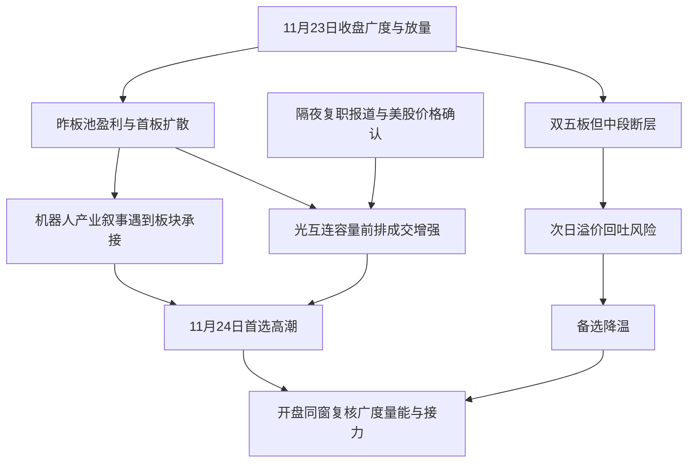

# 2026-11-24 · 群聊情绪共振

## 🧭 一句话结论

市场奖励科技前排与广谱接力；机器人共振最清晰，外盘强化光互连，首选「高潮」，备选「降温」。

## 🌡️ 大势与阶段：事实、先验、目标日分开

- **事实**：使用本批 `20261124/R1_style.json`，不读前一日 R1。原生六态事实日 `11/23`，阶段「高潮」；来源 `lianban:qingxu`，11/24 06:05 绑定，页面版别未知，原生保留同批日页收盘佐证（R3 未独立核该日页）。11/24 盘中估计缺失；原生开盘溢价字段仍空，下述 R1 同池补核不回填。情绪分 `88` 和「主线扩散型」是 11/23 盘口描述，不是 11/24 实况。
- **先验**：从「高潮」出发，页面依六态显示修复 `1%`、升温 `3%`、高潮 `36%`、降温 `33%`、退潮 `15%`、冰点 `11%`。页面取整合计 99%，不归一、不补余量，宽样本分母与精确转移矩阵未核。另列**同景**：页面上证年线下方、高潮第 1 天，`n=96`，首位高潮 `33%`、次位降温 `30%`；次日上证均值 +0.12%、上涨 54%、温度均变动 −33.1°。37 例同环境子样本的追加筛选未核，不计第二张票。
- **市场奖励**：11/23 沪深成交 `1.553 万亿元`、较前一交易日 `+9.19%`；涨跌平 `4658/783/129`，中位涨幅 `+2.41%`。Tushare 涨停 146、跌停 3、未封 24/170；XTick 同事实日口径另为 151、7、25/176，不混分母。11/20 涨停池 28/28 配对，11/23 开盘溢价中位 `+0.29%`，收盘收益中位 `+9.99%`，`26/28` 收红、`16/28` 晋级。主要是日内接力回报，不是开盘就有同等溢价。
- **目标日判断**：11/24 首选「高潮」、不同备选「降温」，保持基础排序但不报后验概率。盘中群转「回归」标题不能当官宣时点；晚间报道转录董事会复职，11/23 22:04 英伟达盘前超 +30%，22:30 纳指 +7.19%，11/24 05:00 报道收盘英伟达 +31.31%、纳指 +6.52%、标普 +4.74%、道指 +3.01%，05:03 报道费半 +14%。治理事件后有价格认可，叠加国内已兑现的广度、量能和前板奖励；不倒因果、不当新增订单或政策落地。外盘全体涨跌广度和同口径成交量、公司 IR 原件未核。05:43 芯片出口限制仍有议员推进表态，不是生效法案。
- **最强反证及改判**：双五板之间缺四板、仅一只三板、130 只首板；因此隔夜强开更容易先挤压溢价，不能只看指数。30 日最大同向簇累计 −15.64%，机器人东财代理 5 日累积仍净流出，纳指从高开回吐部分涨幅。09:25 初看，09:30–10:00 以同窗成交量、红盘广度、昨涨停池开盘溢价后收益、双高标及前排助攻交叉复核；若高开后广度与昨板收益快速收缩、量价背离且前排承接失真/未回封扩散，改判「降温」；若增量成交伴随广度、接力和核心承接，维持首选。预测有效至首个有效复核或最迟 10:00，不自动续用。

## 🔎 主题共振：只标情绪与传播，不定主线或交易名单

榜单事实日 `11/23`，比较 `11/20` 同榜；均非 11/24 实时榜。公众号仅补充，跨群同稿只算传播。以下个股是主题映射的观察锚，不是首推、执行池或买卖价位。

### 1 · 人形机器人／具身智能｜L1+L2

- **大资金意图**: 本体与零部件同涨，符合资金先回到有容量和辨识度的科技前排；东财人形机器人单日 +74.85 亿、5 日 −108.69 亿，不能称持续加仓。
- **为什么走强**: 同花顺人形机器人 6→1/+5.91%，机器人概念 8→2；凡拓 32→6、福莱44→7；宇树+20%、量46.77亿元，首位只作风险核验。
- **逻辑够不够硬**: 量价与多份不同视角文本共振。标准研制不等于采购，FSD迭代不等于A股订单；凡拓异动披露前三季亏损、福莱柔性传感业务占比低（11/23 同花顺热股解释转述旧公告），北纬题材标签与当日解释分裂。
- **观察与证伪**: 本体回吐且零件/二板无助攻则降为局部反弹；不把长园、N华晟或到访故事升格。

### 2 · CPO／光互连与PCB｜L1+L2

- **大资金意图**: 容量股承接有量化支持：东财与XTick大单代理同向，新易盛 +22.94/+22.14 亿、中际 +22.23/+13.03 亿；不据订单桶推账户身份或持仓。
- **为什么走强**: CPO 3→4但涨4.54%，PCB 2→5但涨4.61%；新易盛+9.92%、中际旭创+6.10%，成交205.61/227.67亿元。
- **逻辑够不够硬**: 群议题、前排收盘与隔夜价格反应有不同信息价值。真正复职及回购是A股收盘后可见增量，不解释已完成的涨幅；回购/资本开支不能外推给所有晶振、材料映射。
- **观察与证伪**: 若隔夜高开但核心成交没有持续对价、PCB中段与光通信宽度收缩，降级，保留已核个体差异。

### 3 · 光刻胶／国产替代｜L1+L2

- **大资金意图**: 材料在供给风险传播中获部分回流；光刻机东财概念同时净流出 1.12 亿，说明设备与材料资金不同向。
- **为什么走强**: 光刻胶 5→7但 +4.16%，东财同名概念 +4.25%、净流入4.25亿元；10:36快讯曾报板块走弱；不以收盘上涨抹掉盘中分歧。
- **逻辑够不够硬**: 群稿重叠最多，外部限制未核为正式措施；盛剑五板只是接力高度，监管工作函和非光刻胶业务澄清是真反证，不能以它证明核心业务。
- **观察与证伪**: 先核措施原文、适用范围、材料前排承接和正宗验证；上游补涨无法代替。

### 4 · AI应用／短剧游戏｜L1+L2

- **大资金意图**: 午后漫剧扩散主要交易内容与流动性反馈；东财AI应用 +16.03 亿但5日 −112.84 亿，未见中期资金翻多。
- **为什么走强**: AI应用 15→8/+3.51%；短剧游戏 12→13/+5.44%，AI视频新进#18；慈文 37→16、浙文#9。
- **逻辑够不够硬**: 市场确认偏漫剧，群内关注偏应用功能与IP衍生，双源成立在应用上位主题，不等价于AI医疗共振。浙文称无AI短剧；慈文内测还没有相关收入。
- **观察与证伪**: 开盘若只剩两只孤立强票或医疗无独立价格响应，拆分子线，不用上位主题给医疗股结论。

### 5 · 算力租赁／国产算力｜L1+L2

- **大资金意图**: 有接力资金但东财概念当日仅+3.39亿、5日−10.38亿；华胜天成人气6→9但跌3.87%，东财/XTick代理 −3.88/−5.93亿，不是普遍强。
- **为什么走强**: 同花顺算力租赁 7→10/+2.48%，弱于机器人；东财人气真视通11→6、华东重机30→10，真视通连续5板。
- **逻辑够不够硬**: 真视通高度、蜂助手合同与群叙事互证范围不同；合同是服务器销售，不代表租赁收入，且 A 股尚无公告后反应。
- **观察与证伪**: 接力与容量确认分开；核心独强但跟随弱，不视为同强。

## 💬 匿名群观点与图片

| 群 | 原始条数；23 日 / 24 日 | 实际消息首末 | 主要表达或转载（非 KOL 认证） |
|---|---:|---|---|
| group_01 | 109；107 / 2 | 11/23 08:04 – 11/24 00:53 | 盘前制度托底与券商观测有争论；09:27 偏算力/光模块，11:15 点名凡拓；晚间转复职。 |
| group_02 | 90；88 / 2 | 11/23 07:42 – 11/24 00:48 | FSD 世界模型/合成数据、灵巧手估值、光刻胶国产化、海外算力外溢；多为推广表达。 |
| group_03 | 66；63 / 3 | 11/23 08:44 – 11/24 00:48 | 转 FSD、芯碁微装先进封装、长园映射和光刻胶；多项与其他群同稿。 |
| group_04 | 21；21 / 0 | 11/23 09:41 – 22:58 | 物理 AI 转述与 T 链核心观察多于短炒补涨；次日会议邀约不当证据。 |
| group_05 | 96；96 / 0 | 11/23 07:04 – 22:04 | 推艾森后道光刻胶、医疗 AI、光互连和文旅映射；对光刻胶转文有人追问原文和日期。 |

用 `wechat-cli` 按 `11/23 06:01–11/24 06:01` 补核：五群原始多重集合一致，尾页均 0，分日拼接一致；只证明本机可访问窗口，不保证远端全量同步。系统、纯表情、会议推广、不可展开占位不当观点；本人/引用不用于外部共识，无法认证身份的材料只写匿名观点或传播。不能把 24 日盘前截窗和 23 日完整白天比成“降温”。

**图片只补定性**：本日唯一侧文件共 70 张去重图记录，69 条 `vision_batch_timeout`，1 条识出非空正文。第 53 行 `group_03`、135×180、`partial`，6 个识别区中 5 个低置信。定性上只能确认画面出现“方正电机是”，并有含“关节”字样的低置信碎片，无法判定在吹哪种供货、绑定谁或有什么订单，不能当公司映射确认；未补字。OCR 原样：`OIBEM原点` / `小期科技日翅` / `方正电机是` / `\BIRO` / `N瞧/深度缘定关节` / `供煎商`。采集 11/24 06:01，缓存 mtime 11/23 09:42 仅供审计，消息/原帖时间未知；不连接到同时间段某条文本或作者，不把可能的同图、同稿、文本转载计为独立来源，不计发言频次及情绪分。图片失败不外推群沉默或交易限制。

## 📰 公众号观点：独立展示，不增加共振票数

- 机器人：财联社收评（RSS #4）给出本体、零件与二板助攻，并提示前期套牢筹码；同一盘口复述不作第二份价量证据。
- 光互连：RSS #70 报道 CPO 午前 V 形反弹，#46 转中际旭创 20–40 亿元拟回购，方案不是执行，回购报道在收盘后；#84 为硬件估值观点，不是产业事实。
- AI 应用：RSS #27 记录 AI 漫剧午后拉升，#2 讨论医疗模型开源；不同子线，不把模型开源等同收入或把游戏会议等同漫剧支持。
- 光刻胶 / 国产算力：RSS #52 的盛剑澄清、#53 的蜂助手合同条件，分别作风险与补充，不给群稿背书。宏观方面，RSS #23 记两融下限调整 11/30 生效，不是 11/24 已投放增量；#80、#83 的独立盘面复盘都不主张一根阳线确立反转。

## 🚦 distribution_alert_checks · 逐对象与未查范围

榜单实查范围：`11/20→11/23` 两个已完成交易日。逐个比较同花顺热股、东财人气/飙升（个股三榜分别）、同花顺概念（板块）；观察时窗为两日各榜 `22:30–22:39` 晚间快照，来源 Tushare 全返回榜并核本批人气锚点。`false` 只指未命中同榜连续两日第 1，不代表无出货；选择集以共振主题及其榜单对象和风险前排为限。

| 对象 | 结果 | 核验及反证 |
|---|---|---|
| 宇树科技-W、北纬科技、德林海 | 连续首位 `false`；同日多条件警报 `unknown` | 分别为 11/23 东财人气/同花顺热股/东财飙升首位，三者均非两日同源首位；成交为此前5日均值 1.60×/1.05×/3.27×，收盘均等于最高，东财和XTick当日大单代理均正。宇树和北纬龙虎榜合计正但有分歧；德林海子公司应收款诉讼已受理未开庭，不等于减持，龙虎榜无可配行不判阴性。 |
| 人形机器人、机器人概念、CPO、PCB、光刻胶、AI应用等榜单概念 | 连续首位 `false`（逐条见 JSON） | 人形机器人是概念首位 6→1；第1本身不加分，只以量价、助攻及不重合文本判断。 |
| 其余已核对象，含真视通、华胜天成、盛剑科技 | 连续首位 `false`（逐票见 JSON） | 真视通与盛剑为连续五板，不等于热榜霸榜；华胜天成量价/流向走弱，盛剑澄清和监管函继续传 R6，不能被 `false` 覆盖。 |
| 仅传播未完成配对对象（含方正电机）／范围外／目标日实时 | `null` / unknown | 没有专项核验，不凭空告警数组判阴性，不为模式6补做全市场扫描。 |

本表不替代既有 R6 规则及逐票硬否决，不把单一热度当派发或正向买点。

## ⚠️ 不确定性与交接

未将单源热度或孤立买卖标签升格：财神庙/文旅 IP、麦角硫因、PLA 涨价仍是传播或单事件观察；医疗 AI 只入应用主题的待核分支，AI 漫剧走势不能替它作确认。资金口径非账户意图；高关注却走弱的华胜天成是算力传播反证，不能把同题材映射自动当核心。商业航天是上榜观察，未核相应独立群方向；银行的高关注伴下跌也非正向共振。

R3 给 R2 板块合力、R6 逐对象反证与 D1 盘前剧本；D1 从 R3 主产物取 OCR 结论，无需读取原图侧文件。`in_today_plan`、真实账户有效硬预算均未知，既有停买、硬预算（含 0）、仓位硬上限、T+1、人工确认、R6 逐票 hard_reject 与交易授权不变。R1 的市场性意见按初次有效盘中复核重评，不继承旧零仓，也未抬出正预算。阶段/热度/图片只作研究。

## 数据源审计

| 源 | 日期 | 状态 | 备注 |
|---|---|:--:|---|
| R1_style | 2026-11-23 | 🟡 | 本日同批，事实日11/23；不读前一日R1 |
| lianban:qingxu | 2026-11-23 | 🟡 | 原样继承，版别未知且无目标日盘中估计 |
| wechat_cli_5groups | 2026-11-24 | 🟢 | 五匿名群，分页及分日核验，正文/标题区分、跨群同稿归并 |
| wechat_image_ocr | 2026-11-24 | 🟡 | 1条非空低清、69条超时；事实时点未知，仅定性 |
| wechat_official_rss | 2026-11-24 | 🟡 | 19/19订阅回报；16有文章，核心覆盖9/10；20兼容文件相同，三记未启用 |
| attention_signals | 2026-11-23 | 🟢 | 目标日绑定11/23: persistent/surge/cross_platform只作为人气辅助 |
| tushare_hotlists | 2026-11-23 | 🟢 | 11/20及11/23四榜；每期320行，逐榜分别差分；不作11/24实时 |
| xtick | 2026-11-23 | 🟢 | 情绪同事实日复核；个股资金另为北纬及德林海；首次日期格式错，ISO格式重试成功。此处时点为情绪响应源更新时间 |
| targeted_daily_and_moneyflow | 2026-11-23 | 🟢 | 仅三只首位日线、两只资金及梯队点核；不新增全市场出货扫描 |
| R7_capital_flow | 2026-11-23 | 🟡 | 东财概念和标的资金代理、龙虎榜，重叠板块不相加；未消费账户 |
| news_cls | 2026-11-24 | 🟢 | 定向筛读事件时序、收盘及反证；多稿不重复 |
| news_major | 2026-11-24 | 🟢 | 定向交叉行情报道 |
| anns_window | 2026-11-24 | 🟡 | 定向公告索引及德林海原件；盛剑和凡拓另核同批R4 |
| R4_news | 2026-11-24 | 🟡 | 个股澄清/回购等公告证据，同一底层不重复 |
| mcp_health / manifest | 2026-11-24 | 🟡 | 另读同目录mcp_health.json；global_severity=2不是行情 |
| WeFlow | 2026-11-24 | ⚪ | 已下线，不调用不回填 |

## 📎 运行元数据

- `analyze_sentiment_resonance_v1@1.1` · `data/research/20261124/R3_sentiment.json`。实际盘前研究，不回放；行情截止 11/23 收盘，快讯与本轮只读取证时点另记于 JSON。08:30 为观察性交付目标，不是资料事实时刻。
- 用量未计量，不作 0 或低于目标的保证。5000 万 token 为连续任务努力目标，不是硬限或日额度。

- Mermaid 11.4.0 SVG 渲染通过。
