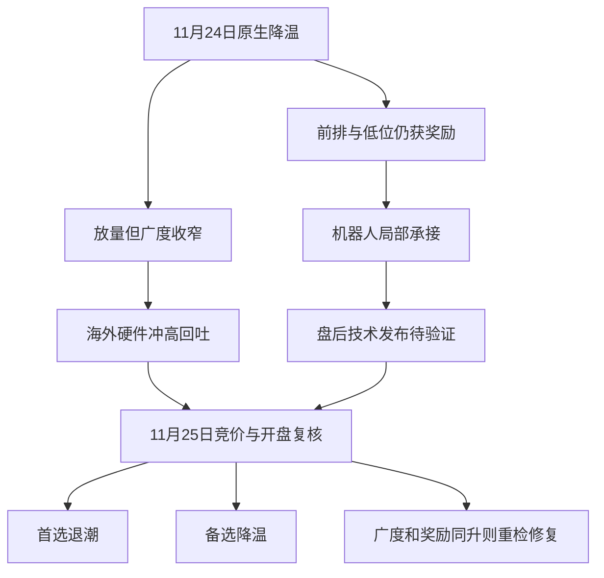

# 2026年11月25日 · 群聊情绪共振

## 🧭 一句话结论
**事实日降温；25日首选退潮、备选降温。机器人仍有局部接力，硬件高开后普遍承接不足。**

## 📉 详细分析：先看市场奖励，再看题材
11月24日沪深成交 `16,548.62亿`（前交易日 `15,526.63亿`），全A上涨 `1,952/5,576`、下跌 `3,498`，上涨占比由 `83.63%` 降到 `35.01%`，个股中位 `−0.67%`。创业板高开 `+3.88%` 转收 `−0.05%`。Tushare `55涨停/2跌停/68未回封`，炸板 `68/123=55.28%`；xTick `64/4/73` 同报高度 `4`，不混用分子分母。11月23日涨停池在24日开盘中位 `+3.72%`，开到收中位 `0%`；`109/146` 收红、`30` 续板。奖励先手与局部前排，而不是普遍高开追价。R1震荡分化、证据风险标记 **情绪=震荡**；继承市场情绪分 `65`，不把它当新阶段或目标日实测，不做未校准的双源/图片加分。

| 项 | 已核与缺口 |
|---|---|
| 原生事实 | `lianban_six_v1`，11月24日 **降温**；绑定 as-of 11月25日 06:06；源页原版时态未知，另有同批收盘页，仅证事实日；11月25日盘中缺失，不拿回退指标当实况。 |
| 基础转移 | 原页降温行：修复 `11%`、升温 `16%`、高潮 `17%`、降温 `17%`、退潮 `31%`、冰点 `7%`。显示合计 `99%`，分母与精确行未核，不归一也不补余量。 |
| 同景（单列） | 上证收盘在250日线下、降温第1天；公开页首 `82` 例、退潮 `28` 次为基础首位（显示 `34%`）。绑定快照另列高潮 `17%`；该筛选下的完整精确行和次位未独立核。同期上证次日均值 `+0.12%`、涨 `58%` 是指数历史统计，不是阶段后验。 |
| R3独立预测（11/25） | **退潮 / 降温**。保持基础首位：复职快讯后A股高开回吐，放量却不扩广度，旧双5板失守，机器人封板 `67→19`，隔夜半导体回跌。最强反证：仅2跌停、二板 `13→25`，昨停池仍109收红；若核心及低位接力延续、亏损面不扩，改判降温；若广度和奖励持续同向改善，重检修复。 |

隔夜以收盘快报与R7逐票窗交叉：标普、纳指走弱而道指走强；NVDA `−5.86%`，成交量约为上一交易日 `0.49倍`；SOXX `−8.27%`（ETF代理，非费半精确收盘）。11月24日晚WorldGPT、工业富联股东回报、南亚新材覆铜板扩产均在A股现金盘后可见，不能用白天收盘倒因；央行是拟操作、非确认净投放，贴现率纪要非当夜加息。25日发布后A股价量与广度尚未观测。

## 🔗 L1＋L2：实际成立的四条主题
以下为共振强弱，不代R2定主线排名。正文中的“观察”均非首推、不是买点；方案、保护价、盈亏比及逐票禁令未在本阶段裁决。

### 1. 人形机器人 / 具身数据 · L1+L2
- **热榜及盘面**：连板网同口径机器人67→19；长华3板，福莱等低位接力；独立于概念#1警报，同花顺宽机器人#2、减速器#20；东财人形+1.58%、主力代理+8.90亿元。
- **匿名群在吹什么**：传播从本体和赛前预期向训练场、数采、触觉扩散；小鹏WorldGPT 20:14已见媒体援引厂商，跨群同稿不算独立观点。 证据：group_01 G9、group_02 G77、group_03 G162、group_03 G186、group_03 G238、group_03 G241、group_04 G275、group_05 G391；公众号补充 `W1、W30、W66`（不计共振）。
- **大资金意图**: 可能以低位分支接力和数据/部件扩展换手；未证机构身份，不把大单等于机构。
- **为什么走强**: 同日赛道多株封板且有三板，凡拓+16.64%但未封；盘中领涨并不意味着盘后WorldGPT消息已经被验证。
- **逻辑够不够硬**: 主题存在独立价量与匿名观点支持；WorldGPT是技术发布，订单、赛程原件、参股利润弹性未核。
- **反证与改判**：67→19由广转窄；长华公告收入有限、丝杠无定点，凡拓收低于盘中高、东江放量2.84倍但收仅+1.97%。天安供应链夸张外推不认。 竞价/首个可比时段看长华/福莱等核心和多分支能否一起承接；若仅高开后掉队，取消强接力假设。
- **观察对象（非首推）**：605018长华集团、605488福莱新材、301313凡拓数创、603725天安新材、002672东江环保。

### 2. PCB / 海外算力硬件 · L1+L2
- **热榜及盘面**：同花顺PCB#5→7，CPO#4→4；中京4板，富联东财人气新进截面#3，东山#36→10；独立于微信群的成交确认机会和反证。
- **匿名群在吹什么**：复职叙事锚定服务器、光模块、PCB、液冷，同时有硬件难收复的反向声音。 证据：group_01 G10、group_01 G14、group_01 G15、group_04 G252、group_04 G255、group_04 G263、group_04 G274、group_05 G289；公众号补充 `W4、W19、W69、W73`（不计共振）。
- **大资金意图**: 可能在服务器/PCB容量与少数高度之间分配，而非整个达链再配置；不同大单口径不等于席位。
- **为什么走强**: 中京4板；富联收+6.97%、量额2.56倍，东山收+1.72%低于开盘，中际与新易盛红转弱。
- **逻辑够不够硬**: 海外复职报道→11/24高开回落是已见价格路径；富联盘后分红及南亚扩产不能倒因解释白天行情，也不等于订单。
- **反证与改判**：隔夜NVDA −5.86%、SOXX −8.27%，NVDA成交量为前一交易日约0.49倍；中际东财/ xTick 主力代理约+11.77/−20.84亿元，结论不取单源。 只观察核心承接与光模块同向性；若中京高度与容量不能互证或高开放量走弱，降低正向评价。
- **观察对象（非首推）**：002579中京电子、601138工业富联、002384东山精密、300308中际旭创、300502新易盛。

### 3. 半导体设备 / 国产算力 · L1+L2
- **热榜及盘面**：同花顺芯片#15、光刻胶#6、存储#17；连板网芯片9→4；东财半导体+1.08%/净代理+10.73亿元，存储、光刻胶净代理分别−8.54/−4.91亿元。
- **匿名群在吹什么**：传播国产替代、先进封装、功率Fab、MED；以同稿聚类，不能把磁电试商用映射到单票订单。 证据：group_02 G56、group_02 G67、group_02 G102、group_03 G151、group_03 G184、group_03 G183、group_04 G269、group_05 G382；公众号补充 `W1、W58、W64`（不计共振）。
- **大资金意图**: 可能偏国产算力核心而非所有设备/存储补涨；资金方向仅供应商代理。
- **为什么走强**: 寒武纪收+6.03%，R7双口径主力代理约+10.82/+14.49亿元；中电鑫龙高点7.39、收6.91，跟风与核心奖励不同。
- **逻辑够不够硬**: 国产替代是主题共振非新增合同；海外供给收紧可能反过来限制流片和交付，功率全面涨价及行业外延未核。
- **反证与改判**：光刻胶与存储热榜升/在榜不等于净买；盘面回落下，旧材料中试、一词映射都不继承强势。 复核板块资金和核心是否有同向扩散，公告有出货/订单时间锚再加证。
- **观察对象（非首推）**：688256寒武纪、002298中电鑫龙。

### 4. AI应用 / 短剧游戏 · L1+L2
- **热榜及盘面**：同花顺AI应用#8→13、短剧#13→14；连板网AI应用17→4；东财文投#21→5、尾盘封板，但AI应用资金−12.92亿元。
- **匿名群在吹什么**：传播豆包购物灰测、营销映射、互动影游、AI剧集扶持；不同主题共享题材溢价，未核单股收入。 证据：group_01 G11、group_02 G85、group_03 G190、group_04 G265、group_05 G285、group_05 G310、group_05 G324、group_05 G385；公众号补充 `W4`（不计共振）。
- **大资金意图**: 可能仅个股尾盘套利而非配置扩张；未证是某类资金席位。
- **为什么走强**: 文投收+10.18%、额1.88倍，但纵横通信触及11.04收10.30，吉宏收盘低于开盘；板块有热度无普遍承接。
- **逻辑够不够硬**: 双源只确认注意力重叠，灰测非规模收入，多个转发不是多个订单或作者背书。
- **反证与改判**：热度下滑、资金负、核心尾盘封与多数映射回吐是更强反证。 若板块广度、回封、早盘有效成交及可核商业化进展不同向，维持支线不升级。
- **观察对象（非首推）**：600715文投控股、688078龙软科技、603602纵横通信、002803吉宏股份。

## 🗣️ 五群定性摘要与覆盖
实际快照 `397` 条是原始记录数，不是观点数。以下全为11月24日；抽取行号关联匿名组，非微信原生ID；同文、同链接和底层事件归并（如小鹏发布期待、SANA-Robot、磁电存储、训练场与天安电子皮肤跨群转载）。本人发言及可识别本人引用不入证；链接标题不推全文、不推赞同或背书。未新分页或核远端同步，不能判沉默。

| 匿名源 | 观察首末 | 原始记录 | 方向及有效窗口 |
|---|---|---:|---|
| group_01 | 08:04–21:13 | 54 | 盘前短句预期普涨转分歧，机器人和算力看核心承接，AI漫剧当支线；盘中有硬件走强反馈，16:59认为阻力未突破。未核到晚间明确次日长文，非认证发言者身份。 11/24历史；11/25只作待验证对照 |
| group_02 | 08:57–23:21 | 96 | 盘后传播训练场参股映射、世界模型和电子皮肤；“涨50倍”是夸张比较。盘中另推磁电试商用、功率Fab涨价和具身发布预期；消费转发麦角硫因合规。 到11/25盘面验证；订单与政策兑现另核 |
| group_03 | 08:51–22:45 | 101 | 期待25日下午小鹏机器人；转发口径与02/05重叠。另有供给限制双向解读（国产替代与流片/交付压力）及封装树脂仅中试、未见订单的具体边界。 11/25盘中/相关发布；中试转量产按公告重评 |
| group_04 | 07:31–22:27 | 24 | 早盘卖方稿看海外算力订单预期，午后转发国产算力超节点观点；晚间同一窗口有“AI硬件很难涨回去”的标题及机器人本体/部件推广。转发/自署不认证投资人或流向。 11/25开盘首次可比盘面；卖方中期假设非当日事实 |
| group_05 | 07:27–23:57 | 122 | 盘中传播小鹏机器人标识、磁电存储、先进封装、豆包购物和AI剧集；问“能10cm首板吗”属博弈意愿非订单。盘后世界模型与跨年零售类比并存，弱逻辑不升级。 11/25首个现金盘窗；个体产品/订单另核 |

**图片侧文件实读**：`67` 条均 `vision_batch_timeout`，包含 `52` 条低清资产；无成功非空OCR正文，也无可保留的低清文字片段。匿名覆盖 `group_01/02/03/04/05` 对应引用 `6/26/34/0/20`（跨群含同图、不可相加）；只知道缓存选窗 11月24日 06:02 至25日 06:02，缓存mtime不是原帖/消息时点；不猜作者或背书，不能判断图片里在吹什么。只降图片覆盖，不据图数给分或设门槛；D1读R3摘要而非图片原始输入。

## 📰 公众号观点（只补充）
- **宏观与情绪**：午报说逾3100股飘红而收评称全天高开低走；收盘广度另用R1成交口径。盘后有做多配置观点与资本开支见顶观点，对照而非投票。公开市场操作仍待净额及价格验证。
- **题材**：具身数据/人形盘中强势、PCB前排、存储供需与出口限制均有独立编辑角度；同一事实跨稿不重复计数。该腿不影响情绪分。

## ⚠️ 出货警报核查（distribution_alert_checks）
只看两日已完成榜面（11月23日晚至24日晚），实际 `checked 30` 项，`unknown 13` 项，未作全市场扫描。东财人气 Top50 / 飙升 Top30、同花顺热股 Top50 / 概念 Top20；切片未覆盖和25日目标窗一律未知，不从空警报数组推阴性。

| 对象（精确代码） | 时间／来源 | 已查结果及解释 |
|---|---|---|
| 人形机器人 `886069.TI` | 11/23、11/24：同花顺概念 | `true`：连续 #1，反向警报，不当正向证据。独立价格/封板和宽机器人榜才支持主题；板块资金代理+8.90亿、封板收窄，未证真实派发。 |
| 九阳股份 `002242.SZ` | 11/23、11/24：东财人气 `2→1`，同花顺热股两日榜首已比对 | `false`：当晚双榜第一但未连续两日同榜第一。定向11/17–24复核额为前5日均 `0.27倍`、收最高、同花顺与东财资金符号相反、龙虎榜净买约2.21亿；不是“已查没有派发”。 |
| ST中路 `600818.SH` | 11/23、11/24：东财飙升等榜首及定向日线、资金/席位 | `false`：最新仅飙升#1、非连续；额约 `2.09倍`，仍收最高，双口径资金分歧；不吸收ST进正向票样本。 |
| 其他实际命中榜面的股 / 已查概念 | 11/23–24：两日同类型静态截面 | 逐对象与榜首代码见JSON，已查未连续才为 `false`。不等于无负面公告或资金风险。 |
| 盘前目标日 / 其余未覆盖对象 | 未查25日榜或窗口不可核，查不到为缺口 | `null/unknown`；仅以精确对象、同窗口向R6交接；不把板块告警直接算给所有成分股。 |

## 🔍 关键证据及边界
- 四张截面（11/23→24）：东财人气 Top50进/出切片 25/25；东财飙升 Top30进/出切片 30/30；同花顺热股 Top50进/出切片 34/34；同花顺概念 Top20进/出切片 3/3。飙升榜日换样强，绝对排名变动只在两日同榜可比；持久在榜只是注意力，不是资金。
- 群聊本批只见11月24日，不用截图数或重复稿推独立观点；单源主题与价量已反证的题材不凑第五条。
- 逐票资金只在已核对象引用。匿名群的交易计划、收益自报与卖方话术不认证，既不赋权也不减权。
- 11月25日开盘查承接应先看市场奖励和真实反证，再比较核心与板块合力。无目标日行情不把受影响对象缺证变成全局停买，不继承旧市场性零仓。
- 用户或账户的有效零交易预算、硬仓位上限、停买、T+1、人工确认、逐票hard_reject及现有交易授权和保护照常；本阶段未核其源，额度、in_today_plan均未知。

## 数据源审计

| 源 | 日期 | 状态 | 备注 |
|---|---|:---:|---|
| R1 当批基线 | 2026-11-24 | 🟢 | 当日绑定、无前日R1替代；风格震荡分化，65仅事实日，原生绑定逐字段透传。 |
| 五群原始文本 | 2026-11-24 | 🟡 | 5群快照；目标时段未单独重新分页；重点群晚间本人外部方向未核。 |
| 图片OCR（匿名） | 2026-11-25 | 🔴 | 67条vision_batch_timeout，52条低清，实读0正文、0片段；缓存时间不是消息时间。 |
| 取阅RSS | 2026-11-24 | 🟢 | 19 feed正常，16有正文，3空；兼容文件内容相同，只读作一源、无重新计票。 |
| Tushare 两日榜单 | 2026-11-24 | 🟢 | 11/23仅前一同口径榜面；11/24信号绑定11/25使用，非11/25实时。 |
| Tushare 定向日线及资金席位 | 2026-11-24 | 🟢 | 23个定向日线对象；逐票资金/席位详细复核仅九阳、ST中路；交易日历11/25开市。 |
| xTick 情绪 / 定向资金 | 2026-11-24 | 🟡 | 收涨停64/跌停4/炸板73/高度4； zbl分母未核。九阳定向空响应，用实取Tushare两口径不猜。R7嵌入资金仅指定例。 |
| 连板网公开批次 | 2026-11-24 | 🟡 | 公开复盘/矩阵局部可见；同景卡片与阶段取整行，未核精确行、会员明细及原版时态。 |
| 快讯选读 | 2026-11-25 | 🟡 | 仅指定快讯行时间和宏观/外盘，对应行情非新增确认。 |
| 公告索引与R4原件交叉 | 2026-11-25 | 🟡 | 对九阳/ST中路范围仅标题索引；主题引用R4局部原件，纠正其光模块一条摘要的个股对调。 |
| R7已落盘辅助交叉 | 2026-11-24 | 🟡 | 同口径板块净额和指定对象资金/外盘；不把资金代理当机构实盘。 |
| 采集manifest | 2026-11-25 | 🟢 | 批次、名单覆盖及OCR取样边界；不是全窗核验。 |
| MCP健康 | 2026-11-25 | 🟢 | 上下游缺数局部处理，未变更交易。 |
| WeFlow | 2026-11-25 | 🟡 | 已下线，不调用、无历史快照回填、保留空兼容字段。 |

## 🔀 下游交接
- R2/D1读主题、阶段与改判条件；R6仅消费逐对象同窗已查结果与真实反证；不直接交D1读取原始图片文件。
- 研究与交易分层，不增删候选权或改开仓权限；资金/账户未知不是0或正额度。

## 🧾 Sub-Agent 元数据
- skill: `analyze_sentiment_resonance_v1@1.1` · artifact: `data/research/20261125/R3_sentiment.json`
- 知识截止及实际生成：11月25日 `06:35`（上海）；真实盘前，不是回放，未使用25日竞价/盘中。启动 `06:10`，`08:30`为观察目标，外部交付状态待外部记录。
- 连续努力目标 5,000 万 token（非硬限/每日补充），真实用量未知、不当0，也不承诺低于目标。
