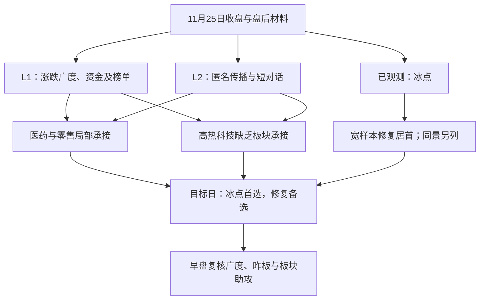

# 2026-11-26 · 群聊情绪与热度

> 盘前使用日为 **11/26**，国内实盘事实截至 **11/25 收盘**；不是目标日的收盘或盘中报告。情绪浓度 **59** 继承同批 R1，不用于判阶段或定仓。覆盖部分降级，证据置信度 `0.364`（0.65×0.7×0.8）。

## 🧭 一句话结论

**医药、零售有局部承接；科技高热不等于扩散。11/26首选冰点，备选修复。**

## 📉 大势与市场奖励

| 证据 | 11/25已观测 | 如何解读 |
|---|---|---|
| 广度与量能 | 涨 `586`／跌 `4,926`／平 `61`；中位跌 `3.77%`；`1,860`只跌超5%；沪深 `13,829.27亿元`、缩量 `16.43%` | 亏钱效应突出，存量资金没有扩散；xTick核对广度同值。 |
| 板价与梯队 | Tushare涨停/跌停/未回封 `51/43/30`，`30/81=37.04%`；xTick `57/44/37`，各自口径；最高5板，14:54才首封；1进2为5/25、2进3为6/25 | 存量少数可接力，但最高标不能解释午前已出现的35个首板。 |
| 昨板反馈 | 11/24涨停55/55匹配，11/25开盘均值 `+2.05%`、收盘中位数 `−4.47%`、开盘到收盘中位数 `−4.67%`、14只续板；前一日炸板池中位 `−6.13%` | 不把高开当兑现，尾盘指数再跌；仍保留相对强方向。 |
| 隔夜增量 | PCE报道核心同比互相冲突；消息后美股跌幅收窄但收盘标普 `−0.25%`、纳指综合 `−0.62%`、道指 `+0.33%`；同窗量能、广度和官源核心同比未核 | 窄幅止跌是修复反证，不足以确认全面风险偏好改善。戴尔积压订单强、后续盘前媒体却报一度跌7.2%；小鹏晚间计划没有已观测的A股后续反应。 |

### 原生阶段与目标日剧本

- **观测**：`lianban_six_v1`，11/25 **冰点**，源报连续6个交易日。`lianban:qingxu`，11/26 06:06绑定，页面版本未定（收盘/盘中估计未能区分），有内嵌收盘旁证但不升级页面版本；11/26盘中估计缺。
- **宽样本展示行**：修复 `53%`、升温 `2%`、高潮 `12%`、降温 `·`、退潮 `4%`、冰点 `26%`。显示合计 `97%`，不补差、不归一，分母与精确转移未核。
- **同景另列**：冰点连续 `≥4天`，分母 `5`，首位冰点 `60%`，另显示高潮 `20%`；不是精确第6天，年线下是页面环境标题，是否联合筛选未核。
- **独立首选冰点，备选修复**。收盘广度、缩量、尾跌和昨板大面积回吐支持偏离宽样本修复首位；最强反证是宽样本的修复先验、炸板率回落、14只续板与防守板块的实际承接。
- **改判**：早盘同窗广度、昨板红盘与溢价兑现同时改善，量价和板块助攻扩散、跌停/未回封风险缓和，可改首选修复；可参照既有的广度55%及昨板红盘率60%反向探测，不增加交易门槛。阶段不授买权、不定仓。

## 🔗 L1+L2 双源共振

热榜与群聊交集不等于资金认可。仅以局部有价格验证者作正向研究观察；机器人榜首拥挤另列，不参与正向。

### 1 · 医药（抗流感/医药商业）
- **观察结论**：观察防御兑现；群文主吹麦角硫因，不是流感同一个催化。共振在医药/健康消费方向及拓新交集，不给新原料独立板块认证。
- **L1**：同花顺流感#4 +0.58%、青蒿素#5 +1.42%，东财口径流感+0.43%/大单+8.75亿元、医药商业+0.74%/+2.55亿元；东财飙升#2亨迪药业+19.98%、#4康芝药业+20.05%、#9拓新药业+20.02%。
- **L2**：11/25，群02 10:29 G121、群03 10:32 G196、群05 10:22 G313、群05 20:32 G362、群05 20:33 G363。
- **大资金意图**: 偏向风险缓释和弹性集中是解释；分单不等于机构身份。
- **为什么走强**: 药股在普跌日逆势，且板块和多股价格同向；创新药虽16→2仍跌0.80%，不能泛化为全医药。
- **逻辑够不够硬**: 群02/03/05政策稿归一，RSS产业方传播补充，基于未直核批文与标的实益保留反证；若流感前排开后回吐、板块正向扩散消失，降级。
- 公众号旁证 `W3`：医药商业、流感及零售逆势；芯片、锂电承压。
- 公众号旁证 `W5`：产业方传播新食品原料获批，不能推出每家公司的收入。
- 公众号旁证 `W6`：午间复盘，报金新农与克来机电晋级四板。

### 2 · 零售（杭州本地消费）
- **观察结论**：观察区域内局部防守；不是大消费普涨。
- **L1**：杭州解百同花顺热股#42 +10.01%，国芳集团#27 +10.03%；东财一般零售+0.35%/大单+4.93亿元，新零售−0.59%/+11.22亿元。
- **L2**：11/25，群02 09:32 G110、群02 13:31 G159、群02 22:59 G174、群05 09:33 G270、群05 09:56 G289。
- **大资金意图**: 相对抗跌提供短线承接线索，不能从板块净额认定机构增配。
- **为什么走强**: 群传播祈福客流、首店和本地零售，杭州解百收盘强但概念整体仍负；已榜前排与跟风不能混算。
- **逻辑够不够硬**: 重开与首店是可核的事件线索，客流转销售未核；看杭州核心与非杭州助攻能否同步、昨板反馈是否兑现。
- 公众号旁证 `W3`：医药商业、流感及零售逆势；芯片、锂电承压。
- 公众号旁证 `W6`：午间复盘，报金新农与克来机电晋级四板。

### 3 · 共封装光学(CPO)
- **观察结论**：仅核心局部承接，降级观察；不把流出板块写作普涨。
- **L1**：同花顺 CPO #3 −5.58%、PCB #11 −6.00%；天孚21→6/+7.65%、中京#4/+10.00%、青山18→7/+9.88%；中际#15 −1.92%。R7东财CPO −61.58亿元；天孚东财大单+10.86亿元/xTick +12.99亿元，成交117.16亿元。
- **L2**：11/25，群04 10:03 G254、群04 10:16 G255、群04 15:52 G258、群04 21:33 G261、群05 09:50 G285。
- **大资金意图**: 资金可能主要聚集有容量的少数前排，不能用分单识别操盘主体。
- **为什么走强**: 天孚与中京逆板块走强，表现好于多数同行；戴尔订单为需求端，NPO下单为群传未核，会议是通知不是兑现。
- **逻辑够不够硬**: 天孚双资金口径同号是实证，板块与大票分歧是最强反证；看中际/新易盛与板块资金是否跟，天孚独强不改市场判断。
- 公众号旁证 `W61`：戴尔订单报道，和群内同一财报源归并。

### 4 · 猪肉（农业辨识度）
- **观察结论**：观察存量高辨识度，名称补涨不视为板块合力。
- **L1**：同花顺猪肉#7 −0.98%，金新农新进热股Top20至#19 +10.11%；东财猪肉−1.61%/大单+1.45亿元；R7金新农龙虎榜单日净买0.54亿元，换手22.57%。
- **L2**：11/25，群02 20:00 G170、群03 10:34 G199、群03 20:00 G248、群05 09:31 G269、群05 11:13 G325。
- **大资金意图**: 偏弱市里辨识度集中是解释，席位净买不代表持续增持。
- **为什么走强**: 午间复盘记录金新农四板；群内扩散新农字辈及猪饲料映射，但行业价格与高标背离。
- **逻辑够不够硬**: 已有真实板价和龙虎榜净买，尚无独立证据证实名称篮子共享产业催化；若四板溢价回吐、猪肉广度不跟，降级。
- 公众号旁证 `W6`：午间复盘，报金新农与克来机电晋级四板。

### 5 · AI应用（线下入口）
- **观察结论**：传播与市场关注相交，但价格、资金不确认；反向观察，不入正向加分。
- **L1**：AI应用同花顺#16 −3.46%、短剧游戏#15 −3.44%；东财AI应用−3.77%/大单−28.25亿元，文投控股热股#11仍−9.87%。
- **L2**：11/25，群02 09:00 G107、群02 12:52 G149、群02 13:00 G155、群03 13:00 G229、群03 13:02 G232。
- **大资金意图**: 暂无资金主动配置证据，可能仅交易产品试点和流量叙事。
- **为什么走强**: 豆包购物灰测、豆糕门店硬件和短剧大屏叙事有入口逻辑；名单把试点外推成供应商受益，未核。
- **逻辑够不够硬**: 豆糕同文同底稿，短剧春晚属传闻；唯有板块广度、前排和资金复核同向才提升观察级别。
- 公众号旁证 `W1`：传播智能眼镜、世界模型和航展前瞻，不等于板块兑现。

### 题材中的个股观察标尺（无首推、无执行池）

这些标尺不作交易建议。RR、逐票硬否决及计划归属未核，不发明止损位；以下是可证伪的研究条件。

| 对象 | 板型/相对地位 | 风险与证据缺口 | 可验证假设 |
|---|---|---|---|
| `301089.SZ` 拓新药业 | 飙升#9、+20.02%；确切板型及封板顺序未核；健康消费报道与实盘弹性相交，不作全医药核心 | 医学/食品叙事错配；监管及RR未核 | 若早盘明显回吐且同向医药股不确认，即撤销共振观察假设 |
| `600814.SH` 杭州解百 | 同花顺热股#42、收+10.01%；封板顺序未核；杭州本地零售代表个股，跨板块总龙未核 | 区域客流不等同订单；零售整体有负口径 | 若杭州零售前排不能同步有承接，观察假设失效 |
| `300394.SZ` 天孚通信 | 热股21→6，+7.65%；非按涨停板认定；同方向容量承接证据相对强，大单双源同号；总龙未核 | CPO板块大单净出、中际收负；NPO未核 | 若实盘核心回吐且板块助攻不改善，不升级 |
| `002579.SZ` 中京电子 | 热股#4、+10.00%；封板型与梯队未核；只是PCB/CPO板价相对强标尺，核心资格未核 | PCB跌6%，供应链关系及RR未核 | 若核心与后排均失反馈，即撤销扩散假设 |
| `002548.SZ` 金新农 | 午间报道四连板，收+10.11%；农业存量高辨识度；没有行业全面承接 | 22.57%高换手，名称跟风难支撑广度 | 若四板后溢价无法保住且低位无助攻，观察假设失效 |

## 🗣️ 群聊在传播什么

| 来源 | 观点与传播边界 |
|---|---|
| 群01（11/25） | 盘中“市场自发寻底”、去杠杆及盘后ETF托盘说并存；22:26说已接近市场底，22:27反驳速度，属匿名对话，不是KOL背书。 |
| 群02（11/25） | 戴尔算力、麦角硫因及新农字辈是传播线；20:50转小鹏量产计划，不当作群员原创或A股订单。 |
| 群03（11/25） | 饲料补涨、国产EDA、仿生产品、华友左侧估值并存；同文跨群合并，估值不验证。 |
| 群04（11/25） | 看多MPO/DFAU的材料及11/26 07:30会议预告；两次邀请是同一场，不把会议未开写成结论。 |
| 群05（11/25） | 人工智能存储、NPO订单传闻、字辈与摘帽博弈；晚间仍见福瑞达被套抱怨，反证追涨普遍能赚钱。 |

| 补充话题 | 判定 |
|---|---|
| 人形机器人 · 反向共振/霸榜预警 | 小鹏IRON硬件量产计划、仿生交互产品、绕线设备及触觉供应链传播；小鹏报道在收盘后，国内实际反应待查；硬件目标约2027年1月，发布月份报道冲突，不填定值。人形机器人同花顺连续#1但跌5.77%，东财概念跌6.02%、大单−78.82亿元；提前单点拉升不可当板块反转。不同产品的营销订单口径不混用。北纬科技热股#10仍跌9.99%，榜上关注不代表正向。 |
| 商业航天/航展 · 事件线索与价格背离 | 12月航展预热、参展映射和并购需求线索，不验证在手订单；同花顺概念#9 −4.76%，东财−4.83%/大单−44.58亿元。保留观察；不是新的市场主线。 |
| 自主可控与固态电池 · 传播有、兑现未核 | 韬EDA国产工具链、温冷存储和固态电池标准是不同主题。东财半导体−7.97%/大单−126.22亿元、固态电池−5.67%/−56.64亿元；标准与试商用不能外推具体上市公司收入。 |
| 冰雪、摘帽与谐音 · 单股/标签叙事 | 冰山冷热#3 +9.54%，但同花顺冰雪产业#20 −2.22%，东财冰雪经济−1.94%/−2.67亿元；名家汇等摘帽及谐音股只作传播例，不把摘帽写成无风险、名称不等于主线。 |
| 麦角硫因 · 子主题独立榜未核 | 传播说法为获批新食品原料、食品/康养/美容用途扩张。产业方RSS同底层政策归并；拓新有盘面反应，不代表整个子主题合力，产能、收入与政策逐股映射未核。 |
| 宽基尾盘放量与托底 · 观点冲突 | N1712及RSS W55支持若干宽基成交放大；未核买方或净申购、上证尾30分钟仍跌0.43%，不支持已普遍止跌。群传融资出清、赎回、国家队买卖均未证实。 |

- 365条为原始记录，不是独立发言。排除自身11条，拆掉引用尾部，先做原始行去重后再语义合并。例如同份麦角硫因稿、豆糕稿和小鹏稿跨群出现只说明传播；MPO两则邀请仅一场。同条新农稿不按群数增加信源。标题只能证明传播。
- 采集起点为11/25 06:01；逐群上界和分页未核，任何最后发言时间都不是查询截止。

| 群 | 原始条数 | 11/25样本首末 |
|---|---:|---|
| 群01 | 103 | 08:34—23:18 |
| 群02 | 71 | 07:05—22:59 |
| 群03 | 78 | 08:10—20:50 |
| 群04 | 10 | 08:25—21:33 |
| 群05 | 103 | 06:50—21:31 |

### 图片文字覆盖

读完本日唯一 OCR 侧文件：`67` 条，`55` 条低清，全部 `vision_batch_timeout`，可用正文 `0`。匿名资产引用覆盖 `group_01` 至 `group_05`（不把它们自行与聊天标签配对）。11/25 06:50—23:18只是缓存修改时窗，采集点为11/26 06:02；消息与原帖时间未知。没有可概括的图中文字，不借图数估计情绪、发言频次、KOL背书或事实真假。

## 📰 公众号观点

取阅RSS合计86篇、14个有稿来源，与兼容镜像是同一份。主题旁证已列在上文，宏观与情绪重点：科技龙头估值洼地的论述（W37）与盘后“痛苦时间”（W75）、历史类比（W76）并存；标题不替代原作者策略。W55的尾盘量只能讨论成交，不能确认买方或全市场托底。不计入共振级别和情绪分。

## 🚩 热榜与出货警报核查

两日定点比较：同花顺热股Top50/概念Top20，东财飙升Top30；11/25东财人气榜缺失。天孚 `21→6`、青山 `18→7`、好当家 `33→17`、龙版 `43→20`；流感在当前概念切片列第4。榜单差集只覆盖所列切片，不外推全榜。警报指连续两日榜首，并非资金真实派发。

| 已检查范围/对象 | 窗口 / 来源 | 结果 |
|---|---|---|
| 九阳股份（002242.SZ） | 11/24—11/25；Tushare ths_hot 同花顺收盘后同口径两日定点榜；xTick单股K线/大单；R7龙虎榜；公告标题窗 | `true` · 已核预警。同花顺连续两日第一，R3提示命中；11/25收在高点，5日量比约1.09（较11/24跳升并不等于较5日激增），大单口径当日及近5日合计净流入；日榜净买0.633亿元、存在单席净卖、另有第二次风险提示标题。未验证实际派发，也未见同口径近5日净流出。 |
| 人形机器人（886069.TI） | 11/24—11/25；Tushare ths_hot 同花顺收盘后同口径两日定点榜；R7 Tushare moneyflow_ind_dc 行业/概念 | `true` · 已核预警。连续两日概念榜第一，11/25同花顺板块−5.77%、东财概念大单−78.82亿元；是拥挤与撤资警报，板块不能替代个股核验。 |
| 新赣江（920367.BJ） | 11/24—11/25；Tushare dc_hot 东财飙升榜两日定点；不是人气榜；xTick单股K线/大单；龙虎榜及公告标题窗口 | `false` · 该口径未命中。11/24飙升榜第一为ST中路，11/25为新赣江，连续第一未命中（仅此榜/窗口）。但成交为前5日均值5.46倍、上影占日内振幅47.8%，大单当日+0.0705亿元，已查R7当日日榜和本批公告标题未匹配，不等于无公告或无派发；保留单日量价反证。 |
| 天孚通信（300394.SZ） | 11/24—11/25；Tushare ths_hot 同花顺收盘后同口径两日定点榜 | `false` · 该口径未命中。本期实核排名非第一，故本连续窗口不满足同花顺连续第一；仅是规则阴性，不核验实际出货或其他平台。 |
| 中京电子（002579.SZ） | 11/24—11/25；Tushare ths_hot 同花顺收盘后同口径两日定点榜 | `false` · 该口径未命中。本期实核排名非第一，故本连续窗口不满足同花顺连续第一；仅是规则阴性，不核验实际出货或其他平台。 |
| 金新农（002548.SZ） | 11/24—11/25；Tushare ths_hot 同花顺收盘后同口径两日定点榜 | `false` · 该口径未命中。本期实核排名非第一，故本连续窗口不满足同花顺连续第一；仅是规则阴性，不核验实际出货或其他平台。 |
| 冰山冷热（000530.SZ） | 11/24—11/25；Tushare ths_hot 同花顺收盘后同口径两日定点榜 | `false` · 该口径未命中。本期实核排名非第一，故本连续窗口不满足同花顺连续第一；仅是规则阴性，不核验实际出货或其他平台。 |
| 杭州解百（600814.SH） | 11/24—11/25；Tushare ths_hot 同花顺收盘后同口径两日定点榜 | `false` · 该口径未命中。本期实核排名非第一，故本连续窗口不满足同花顺连续第一；仅是规则阴性，不核验实际出货或其他平台。 |
| 青山纸业（600103.SH） | 11/24—11/25；Tushare ths_hot 同花顺收盘后同口径两日定点榜 | `false` · 该口径未命中。本期实核排名非第一，故本连续窗口不满足同花顺连续第一；仅是规则阴性，不核验实际出货或其他平台。 |
| 北纬科技（002148.SZ） | 11/24—11/25；Tushare ths_hot 同花顺收盘后同口径两日定点榜 | `false` · 该口径未命中。本期实核排名非第一，故本连续窗口不满足同花顺连续第一；仅是规则阴性，不核验实际出货或其他平台。 |
| 创新药（886015.TI） | 11/24—11/25；Tushare ths_hot 同花顺收盘后同口径两日定点榜 | `false` · 该口径未命中。本期实核排名非第一，故本连续窗口不满足同花顺连续第一；仅是规则阴性，不核验实际出货或其他平台。 |
| 共封装光学(CPO)（886033.TI） | 11/24—11/25；Tushare ths_hot 同花顺收盘后同口径两日定点榜 | `false` · 该口径未命中。本期实核排名非第一，故本连续窗口不满足同花顺连续第一；仅是规则阴性，不核验实际出货或其他平台。 |
| 流感（885879.TI） | 11/24—11/25；Tushare ths_hot 同花顺收盘后同口径两日定点榜 | `false` · 该口径未命中。本期实核排名非第一，故本连续窗口不满足同花顺连续第一；仅是规则阴性，不核验实际出货或其他平台。 |
| 猪肉（885573.TI） | 11/24—11/25；Tushare ths_hot 同花顺收盘后同口径两日定点榜 | `false` · 该口径未命中。本期实核排名非第一，故本连续窗口不满足同花顺连续第一；仅是规则阴性，不核验实际出货或其他平台。 |
| AI应用（886108.TI） | 11/24—11/25；Tushare ths_hot 同花顺收盘后同口径两日定点榜 | `false` · 该口径未命中。本期实核排名非第一，故本连续窗口不满足同花顺连续第一；仅是规则阴性，不核验实际出货或其他平台。 |
| 商业航天（886078.TI） | 11/24—11/25；Tushare ths_hot 同花顺收盘后同口径两日定点榜 | `false` · 该口径未命中。本期实核排名非第一，故本连续窗口不满足同花顺连续第一；仅是规则阴性，不核验实际出货或其他平台。 |
| 九阳股份（002242.SZ） | 11/24—11/25；Tushare dc_hot 东财人气榜 | `null` · 未核。11/24东财人气榜第一；11/25批次人与直取均无返回，不将缺榜当未命中。 |
| 拓新药业（301089.SZ） | 11/24—11/25；Tushare dc_hot 东财飙升榜两日定点；不是人气榜 | `false` · 该口径未命中。11/25飙升榜第9，已核非第一；仅此榜，不外推同花顺未覆盖部分或东财人气榜。 |
| 抗衰/麦角硫因（未映射标准板块）（无精确代码） | 11/24—11/25；无有效映射 | `null` · 未核。传播主题≠独立榜单对象；不能拿流感或创新药代替。 |

未列对象、窗口外和缺源均未知，不凭空数组做阴性，未为模式6追加全市场扫描。11/26公告日期的九阳风险提示另作盘前标题旁证，不将它回填为11/25盘中已知。

## ⚖️ 不确定性 / 反证

风险意见基于11/25收盘事实，适用R3落盘到首次有效早盘复核或10:00（孰早）。只认为昨日市场没有普遍接力补偿，不新增停买或零仓决定；R1同批0%是有期限的研究建议，不是账户预算。最迟10:00失效，届时无证也不无限延展。真实用户/账户停买、硬预算（含0）、硬仓限、T+1、人工确认和逐票硬否决不变；预算或计划归属未知不填0或false。

## 数据源审计

| 源 | 日期 | 状态 | 备注 |
|---|---|:--:|---|
| R1 同批市场证据 | 2026-11-25 | 🟢 | 5573条/对象 · 仅本轮；日线/广度双主源、Tushare尾段和隔日反馈；风格分不译阶段。 |
| 连板网原生阶段（经R1绑定） | 2026-11-25 | 🟡 | 1条/对象 · 页面版本unknown、目标日盘中缺；与R1同源，不二次增加确认。 |
| 双日同花顺定点榜（Tushare） | 2026-11-25 | 🟡 | 70条/对象 · 11/25留存热股Top50、概念Top20，11/24相同切片作历史差集；补取热股空但留存完整切片可用。 |
| 东财定点榜（Tushare） | 2026-11-25 | 🟡 | 30条/对象 · 飙升Top30，25日人气榜空且直取复核仍空；不能判个股掉榜。 |
| 东财行业/概念资金与龙虎榜（R7） | 2026-11-25 | 🟢 | 同轮已有数据，择主题及榜首核对；大单是供应商归类，不推身份。 |
| xTick 市场及券样 | 2026-11-25 | 🟡 | 2条/对象 · 广度、指数及板高消费同轮；两股定向补量价资金，不作全市场扫描；初次紧凑日期格式失败，ISO重试成功。 |
| wechat-cli五匿名群 | 2026-11-25 | 🟡 | 365条/对象 · manifest五群可访问，暂无独立分页/远端同步验证；本人11条及引用不作外部观点。 |
| 图片文字侧文件 | 2026-11-26 | 🔴 | 67条/对象 · 67张OCR超时，55低清，0可用正文；仅图片腿降级。 |
| 取阅RSS与兼容镜像 | 2026-11-26 | 🟢 | 86条/对象 · 19订阅，14有稿，11/25 06:51至11/26 00:40；镜像字节相同不另计；只取标题摘要。 |
| 快讯与要闻标题 | 2026-11-26 | 🟡 | 2887条/对象 · 另核news_major 800标题；核心PCE同比冲突、缺同窗成交量和官源原文。 |
| 海外收盘快照 | 2026-11-25 | 🟡 | 交易所当地日；美股收盘后个股同窗反应不足。 |
| 交易所公告标题窗 | 2026-11-26 | 🟢 | 2491条/对象 · 定向查九阳、新赣江；九阳第2次风险提示，仅确认标题与公告日期。 |
| 抓取清单与健康探针 | 2026-11-26 | 🟢 | 批次severity=2。 |
| iWenCai辅助查询 | 2026-11-26 | 🟡 | 同批R1无配置凭证；不拿问财/基本面和大宗缺证取消实际观察。 |
| WeFlow | 2026-11-26 | 🔴 | 已下线；未访问、不回填，不参与打分。 |

## 🔄 与其他 R/D/E 的关系

消费当日 R1 基线及本轮已有 R7 资金和 R4 披露反应旁证（同源不重复）。D1消费 R3 既有摘要，不读取原始图像侧文件；R6仅消费绑定窗口可核警报，不以热度单独硬否决。

## 🧾 元数据

- 北京时间：pipeline实际启动 06:10；本轮证据截止 2026-11-26 06:31；产物生成 2026-11-26 06:31。正常盘前目标 08:30（R1日历已核开市）；交付结果由外部记录，非回放。
- 资源用量未知；5000万token为连续工作量观察目标、非硬限或日重置，不能声称为0或保证低于目标。
- 机读产物：`data/research/20261126/R3_sentiment.json`。
