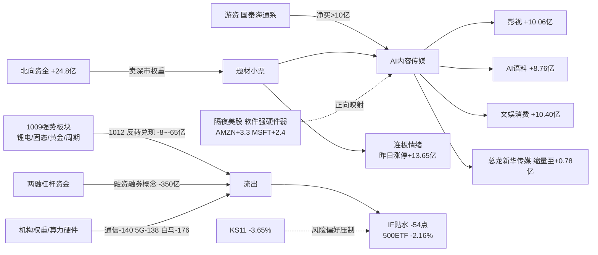

# 2026年10月13日(周二) · **资金面**

> **数据源新鲜度**: partial(A股 T-1=20261012 收盘为最新交易日; 美股滞后至 1009)
> **降级状态**: degraded=true(severity=2 · vibe 批量降级 · 美股滞后)
> **置信度**: 0.57

## 一句话结论

💡 **高低切换的一天**: 1009 霸榜的锂电/固态/黄金/周期 1012 被资金全线抛弃, 钱抱团进 AI内容传媒+连板情绪; 但两融标的 -350亿、IF 贴水 -54 点、总龙缩量, 高位震荡期只做核心, 不碰中位。

## 详细分析

### 1. 北向: 连续 5 日净买入, 托底未撤但边际放缓 🌊

北向 20261012 净买入 **+24.80 亿**(沪股通 +11.75/深股通 +13.06), 5 日均 24.85 亿、20 日均 25.86 亿。近 5 日分别为 21.29 / 20.79 / 27.72 / 29.67 / 24.80 亿——**每天 20-30 亿的稳定托底资金没有撤**, 但 1012 较 1009 的 29.67 亿回落约 16%, 且低于 10/20 日均值, 属"温和托底而非进攻加仓"。结构上深股通当日主力净流出概念榜 -183 亿(权重股调仓), 北向的深股通席位却在龙虎榜净买 4.3 亿——**北向在卖深市权重、买深市题材**, 与内资抱团方向一致。

### 2. 主力: 指数/杠杆资金大逃亡 vs 题材小票抱团 ⚔️

1012 概念资金流呈现极端撕裂: 流入端全是**情绪标签和内容线**(昨日涨停 +13.65、文娱消费 +10.40、影视概念 +10.06、知识产权 +9.86、AI语料 +8.76), 单日规模都只有 8-14 亿; 流出端却是**百亿级的宽基/杠杆篮子**(融资融券 -350.49、富时罗素 -252.60、MSCI中国 -231.56、深股通 -183.09、2026中报预增 -176.02、通信技术 -140.60、5G概念 -137.55)。

这不是简单的板块轮动, 而是三件事同时发生:
- 📉 **两融去杠杆**: 融资融券概念单日 -350 亿为全场最大流出, 杠杆资金在高位主动降风险;
- 📉 **权重/硬科技被抛弃**: 通信 -140 亿、5G -138 亿、中报预增(白马集合) -176 亿, 资金从机构重仓的算力硬件和业绩线撤出;
- 📈 **小票题材抱团**: 流入体量仅为流出的 1/20, 说明这是**缩量抱团**而非增量行情——这正是情绪周期 `high_chop(高位震荡)` 的资金画像。

### 3. 主线资金切换: 1009 的强势板块 1012 几乎全数反转 🔄

昨日(1009)主力流入前十在 1012 的表现是本报告最锋利的一张表: 固态电池 +48.15 → **-48.11**、锂矿 +43.50 → -8.38、黄金 +33.96 → -15.26、锂电池 +31.97 → **-65.00**、周期 +32.78 → -39.00、小金属 +27.21 → -38.18。10 个板块里 **8 个翻负**, 仅 AI 应用(+29.91→+5.88, 大幅衰减但仍为正)和麒麟电池(+26.42→+7.69)维持净流入。

**大资金意图**: 1009 的锂电/资源是"节后避险+涨价叙事"的一次性补涨, 1012 立刻获利兑现, 资金不承认其主线地位; 连续两日获资金加仓的只有 **AI 内容链**。
**为什么走强**: 影视概念 5 日累计 +22.06 亿、知识产权 +15.70、AI语料 +18.74, 叠加 R4 的 PineDrama/微信短剧催化与 9 板总龙新华传媒的情绪锚, 是当下唯一有高度、有宽度、有叙事的方向。
**逻辑够不够硬**: 中等偏强但有瑕疵——AI 应用 1012 净流入从 29.91 亿缩到 5.88 亿(-80%), 总龙新华传媒主力净额从 1009 的 +15.7 亿缩到 1012 的 +0.78 亿, 中军芒果超媒 1012 转负 -0.06 亿。**板块还在, 但内部已开始高低切**, 1013 需要前排继续超预期才能续命。

### 4. 龙虎榜: 77 票上榜, 24 只诱多警报; 传媒内部多空对杀 🐯

1012 龙虎榜 77 只上榜(tushare 口径), 其中 **24 只触发诱多模式**(涨停净卖出/换手异常净卖出/机构净卖/席位对倒)。最典型:
- 🔴 **时代万恒**: 涨停 +10.03% 但席位净卖 -2.18 亿, 机构专用净卖+申万桐乡席位对倒, 四模式全中;
- 🔴 **九阳股份**: 涨停 +9.98% 净卖 -2.06 亿, 机构净卖+东财山南席位对倒, 换手 4060 万手派发;
- 🔴 **新华文轩(601811, R2 候选!)**: 涨停 +10.00% 但 3 日累计榜净卖 -3982 万, 触发"涨停净卖出+沪股通专用对倒"——**R2 AI内容线的龙三候选被资金在板上派发, 1013 必须降级处理**;
- 🟡 欢瑞世纪: 涨停板净卖 -2728 万, 传媒后排跟风票的板上分歧。

净买入端则是传媒霸榜: 莱美药业 +3.21 亿(20cm, 医药/无传媒)、天顺风能 +2.50 亿、吉视传媒 +1.85 亿、掌阅科技 +1.54 亿、博纳影业 +0.86 亿、龙版传媒 +0.83 亿。eastmoney 全市场榜 83 条 appearances 中传媒/影视/出版占 11 席, **板块在龙虎榜维度的宽度全场第一, 但内部分化(总龙缩量、龙三派发、20cm/低位掌阅博纳受捧)正是高低切的证据**。

游资席位: 国泰海通总部净买 4.62 亿(25 票, 广撒网)、南京太平南路 +3.46 亿、深圳海岸城 +2.90 亿; 北向两席位(沪股通 +5.99 亿/深股通 +4.30 亿)是最大单一买方。3 日协同 209 组, 但多数集中在 000678 襄阳轴承/002285 世联行等**跌停票的连续接盘**, 属下跌中继协同而非做多协同, 不构成跟随信号。

### 5. ETF/期货: 贴水 -54 点, 对冲盘明确谨慎 📉

ETF: 500ETF -2.16%、创业板 ETF -2.64%、科创50 -2.27% 均大跌, 仅上证50 +0.45% 收红——**大盘价值抗跌、中小成长杀跌**, 与杠杆资金撤离方向一致。IF 主力对沪深300 贴水 **-54.38 点**, 深度贴水说明期货对冲盘愿意付出高昂成本做空套保, 是机构对短期指数的谨慎投票。期现背离环境下, 即使题材票抱团, 仓位上限也应受压。

### 6. 隔夜美股(数据滞后至 1009): 软件强硬件弱, 与 A 股同构 🌎

⚠️ 美股数据仅到 **20261009(周四)**, 1010/1012 美盘 tushare 与快照均未发布, 本节信号需打折。
半导体组均值 -0.41%(中性): AMD -2.03%、INTC -2.22%、TSM -1.02% 走弱, 唯 GLW(康宁) +2.52% 独强(光通信/光纤)。大型科技组均值 +1.21%: AMZN +3.29%、MSFT +2.38%、TSLA +2.05%、GOOGL +0.97%, **软件/云/应用明显强于芯片硬件**, 与 A 股 1012 "AI内容强、算力硬件弱"完全同构, 对短剧/AI应用/AI语料情绪面有正向映射; AAPL -1.11% 则对果链消费电子轻微压制。外围风险点: 韩国 KS11 1012 暴跌 -3.65%, 亚太风险偏好受损, 恒生仅 +0.25%。

## 资金流转拓扑

## 首推资金验证标的 · 掌阅科技(603533.SH)

> 本节为资金面证据, 非买入建议; 最终进/不进由 D1 结合 R1/R2/R6 裁决。

- **买入理由(资金面)**: 1012 龙虎榜净买 +1.54 亿(全市场第 4), 上榜理由"3 日涨幅偏离 20%", 成交额 29.69 亿充分换手; eastmoney 主力 1012 净流入 **+2.33 亿**、超大单 **+3.41 亿**, 5 日序列 +1.43/+0.17/-0.28/+1.35/+2.33 呈**末端加速**; 近 5 日累计涨幅 +30.14%(LHB 前十追踪), 是 AI 内容线中低位(相对 9 板总龙)、有成交容量、资金逐日加强的 20cm 以下弹性核心。
- **风险点**: 板块处于 high_chop, AI 应用整体净流入 1012 已衰减 80%; 掌阅 5 日 +30% 后隔日接力要求高, 一旦总龙新华传媒断板, 弹性票补跌最快; 超大单与大单 1012 背离(超大 +3.41 亿 vs 大单 -1.08 亿), 纯靠顶层级资金撑。
- **止损条件(资金面)**: 盘中主力净额转负且跌破 1012 涨停启动位; 或龙虎榜次日(1013)现身"涨停净卖出+机构净卖"模式; 硬止损参考 -5~-8%。
- **可验证假设**: 1013 竞价影视/AI语料概念继续位列主力流入前 10; 掌阅竞价不大幅低开(>-2%), 开盘 30 分钟主力净额维持正值; 新华传媒封单不出现恐慌性撤单。

## 关键证据

- 证据 1: 1009 流入前十板块 1012 有 8 个翻负, 固态电池 +48→-48、锂电池 -65 亿, 主线切换被资金日线确认 · 来源 tushare.moneyflow_ind_dc
- 证据 2: 融资融券概念 -350.49 亿 + IF 贴水 -54.38 点 + 500ETF -2.16%, 杠杆/对冲资金双谨慎 · 来源 tushare moneyflow/fut_daily/fund_daily
- 证据 3: 新华文轩涨停但 3 日榜净卖 -3982 万触发诱多模式; 总龙新华传媒主力净额 15.7→0.78 亿急剧缩量 · 来源 tushare top_list/top_inst + eastmoney fund_flow
- 证据 4: 北向连续 5 日净买入(20-30 亿/日), 1012 +24.8 亿未撤 · 来源 tushare.moneyflow_hsgt
- 证据 5: 美股 1009 软件组 +1.21% vs 半导体 -0.41%, 与 A 股内容强硬件弱同构(数据滞后) · 来源 overseas_snapshot.json

## 数据源审计

| 源 | 状态 | 抓取日期 | 记录数 | 备注 |
|---|---|---|---|---|
| tushare.moneyflow_hsgt | 🟢 ok | 2026-10-13 | 20 |  |
| tushare.moneyflow_ind_dc | 🟢 ok | 2026-10-13 | 10 |  |
| tushare.top_list | 🟢 ok | 2026-10-13 | 77 |  |
| tushare.top_inst | 🟢 ok | 2026-10-13 | 829 |  |
| tushare.daily | 🟢 ok | 2026-10-13 | 10 |  |
| tushare.fund_daily | 🟢 ok | 2026-10-13 | 5 |  |
| tushare.fut_daily | 🟢 ok | 2026-10-13 | 1 |  |
| tushare.us_daily | 🟠 stale | 2026-10-13 | 14 | 最新仅 20261009, 1010/1012 美盘未发布 |
| overseas_snapshot.json | 🟠 stale | 2026-10-13 | 12 |  |
| vibe-trading | 🟡 partial | 2026-10-13 | 15 | fund_flow 13/15 ok; block_trades/margin 批量 proxy 降级; 601811/002115 fund_flow proxy error |

## 不确定性 / 反证

1. **美股滞后 1-2 个交易日**是本节最大盲区: 若 1010/1012 美盘半导体或软件方向逆转, 1013 开盘映射会失真, 已在 JSON 标 `overseas_stale=true`。
2. **vibe-trading 硬约束未完全满足**: block_trades/margin 逐票批量降级(MCP proxy), fund_flow 13/15 成功, 已标 `vibe_trading_degraded=true`, confidence 衰减至 0.57。
3. 反证我自己的"高低切"叙事: 若 1013 新华传媒反包缩量加速且掌阅/博纳继续超预期, 则高低切判断过早、板块仍处主升; 反之若总龙低开闷杀, 则 1012 的传媒流入是**最后一个抱团日**, 1013 应直接降维。盘中以总龙封单和 AI 应用概念排名验证。
4. 跷跷板检出 19 对(5 日 -0.5)但多与"地摊经济"标签相关且当日无方向反转, 信号质量低, 不作为配置依据。

## 与其他 R/D/E 的关系

- 依赖: `data/raw/20261013/manifest.json`、`mcp_health.json`、`overseas_snapshot.json`、R2(20261012) 候选池(用于资金交叉)
- 被消费: D1(canghai-plan) — staleness=ok 正常消费但 degraded 建议仓位上限保守; R6 反证 — 新华文轩诱多证据可直接引用; P1 竞价校准 — 掌阅/新华传媒竞价资金验证
- 特别提示 R2/R5: **新华文轩(601811) 1012 触发涨停净卖出+北向对倒, 建议在今日 R2 候选中降级或标注资金瑕疵**

## Sub-Agent 元数据

- skill: analyze_capital_flow_v1@1.3
- artifact: data/research/20261013/R7_capital_flow.json (+ R7_capital_flow_20261012.json 日期版)
- batch: premarket_full · resolved_trade_date: 20261012 · staleness: ok
- model: ark-code-latest
