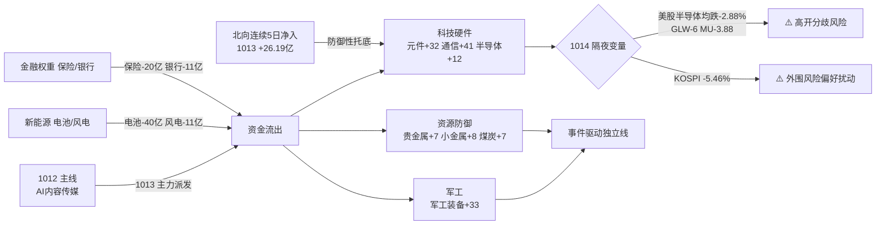

# 2026年10月14日 周二 · **资金面 R7**

> **数据源新鲜度**: partial ｜ **降级**: true ｜ **置信度**: 0.55 ｜ **情绪周期**: 高位震荡(0.52)
> **数据归属日**: 20261013(T-1收盘) ｜ staleness=**ok**(trading_gap=0)

## 一句话结论

💸 **AI内容抱团 1013 全线派发,资金切向科技硬件(元件/PCB/半导体)+军工;隔夜美股半导体均跌+韩国崩-5.46%,今日硬件链防高开分歧,高位震荡只做弱转强不追中。**

---

## 资金轮动全景

---

## 一、北向资金 — 连续净入但转防御

| 交易日 | 净买(亿) | 沪股通 | 深股通 |
|---|---|---|---|
| 1013 | **+26.19** | +12.28 | +13.91 |
| 1012 | +24.80 | +11.75 | +13.06 |
| 1009 | +29.67 | +14.17 | +15.51 |
| 1008 | +27.72 | +13.45 | +14.26 |
| 0930 | +20.79 | +10.13 | +10.67 |

- **5日均 +25.83亿,连续5个交易日全部净入**,对指数构成温和托底。
- 但单日规模从 1009 的 29.67亿回落至 26.19亿,且 1013 权重(保险/银行)走弱——北向买的是**科技成长(深股通>沪股通)**而非权重,属结构性调仓,不是全面进攻信号。

> **大资金意图**: 托而不举。高位震荡期外资维持净流入防止指数破位,但把仓位从防御权重挪向成长,与内资切硬件方向一致。

---

## 二、主力行业资金(THS口径 · 20261013)

**净流入前排** 🔵

| 排名 | 行业 | 净额(亿) | 涨跌% | 领涨 |
|---|---|---|---|---|
| 1 | 通信设备 | **+41** | +1.45 | 华脉科技 |
| 2 | 军工装备 | **+33** | +3.24 | 国科军工 |
| 3 | 元件 | **+32** | +5.03 | 迅捷兴 |
| 4 | 半导体 | +12 | +0.01 | 粤芯半导体 |
| 5 | 光学光电子 | +10 | +1.18 | 光智科技 |
| 6 | 小金属 | +8 | +0.54 | 华阳新材 |
| 7 | 贵金属/煤炭/港口 | 各+7 | — | 四川黄金/广汇能源 |

**净流出前排** 🔴

| 排名 | 行业 | 净额(亿) | 涨跌% |
|---|---|---|---|
| 1 | 电池 | **-40** | -2.70 |
| 2 | 保险 | -20 | -3.12 |
| 3 | 风电设备 | -11 | -2.57 |
| 4 | 银行 | -11 | -1.01 |
| 5 | 电力 | -9 | -0.61 |
| 6 | 房地产 | -8 | -0.16 |

> **为什么走强**: 元件/PCB 受粤芯半导体上市 **+223%** 情绪引爆,元件板块 +5.03% 涨幅第一,迅捷兴/金百泽/中京电子/澳弘电子/骏亚科技密集涨停;军工受事件催化(国科军工+12%);资金在 AI内容退潮后寻找新硬件载体。
> **逻辑够不够硬**: ⚠️ **待验证**。元件板块 1013 是"新股情绪+超跌反弹"双击,但隔夜美股半导体/PCB 集体调整(GLW-6%),今日高开若封板率不足即转分歧,**不是确定性主升,是高切低试探**。

---

## 三、昨日龙虎榜前十 · 5日追踪(核心打脸证据)

对 1012 龙虎榜净买入前十追踪到 1013 主力资金:

| 股票 | 1012榜净买(亿) | 1012主力 | **1013主力** | 超大单1013 | 判定 |
|---|---|---|---|---|---|
| 莱美药业 | 3.21 | +2.35 | **-1.87** | -0.83 | 🔴反转出货 |
| 天顺风能 | 2.50 | +3.83 | **-2.33** | -1.43 | 🔴反转出货 |
| 吉视传媒 | 1.85 | +2.44 | **-0.71** | -0.84 | 🔴反转出货 |
| 掌阅科技 | 1.54 | +2.33 | -0.12 | -0.39 | ⚪缩量 |
| 新华都 | 1.18 | +2.89 | **-1.67** | -1.14 | 🔴反转出货 |
| 上海洗霸 | 1.02 | +0.49 | -0.46 | -0.32 | ⚪转弱 |
| 金安国纪 | 0.90 | -2.36 | +0.04 | +0.20 | ⚪企稳 |
| 金溢科技 | 0.88 | +0.26 | +0.34 | +0.30 | 🟢弱净入 |
| **东百集团** | 0.87 | +1.55 | **+1.52** | **+2.05** | 🟢**连续确认** |
| 博纳影业 | 0.86 | +1.77 | **-1.67** | -1.05 | 🔴反转出货 |

**结论**: 10只里 **8只次日主力转净出**,打板隔日无溢价,典型高位震荡"一日游"。唯一资金连续2日确认的是 **东百集团(商业零售,超大单+2.05亿)** 独立线;金安国纪(覆铜板/PCB)1013 在板块加持下企稳,与硬件切换方向一致。

---

## 四、龙虎榜诱多 / 出货识别(lhb_bull_trap · 9只)

| 股票 | 涨跌% | 换手% | 龙虎净额(万) | 机构净额(万) | 诱多模式 |
|---|---|---|---|---|---|
| 大金重工 | -10.0 | 13.9 | **-23568** | +1978 | 跌停出货·板块退潮·游资砸盘 |
| 电科思仪 | +4.9 | 34.6 | -8187 | **-9137** | 次新高换手·机构最大卖出 |
| 托伦斯 | +5.2 | 34.7 | -7649 | -8034 | 次新高换手·机构出货 |
| 继峰股份 | -9.9 | 4.0 | -11869 | -5598 | 机构出货·缩量跌停 |
| 中京电子 | +10.0 | 14.1 | -936 | -5610 | **涨停机构兑现·封板净卖** |
| 农心科技 | +10.0 | 19.2 | -3625 | -5233 | **涨停机构借势出货** |
| 博纳影业 | -3.5 | 28.4 | -9490 | +2367 | 高位高换手派发·主线退潮 |
| 新华文轩 | -8.1 | 7.4 | -937 | -2682 | **出版总龙破位·机构连续净卖** |
| 国恩股份 | -10.0 | 4.5 | -1191 | -4266 | 机构出货·缩量跌停 |

🚨 **重点诱多信号**:
- **涨停板机构出货**: 农心科技、中京电子涨停但机构分别净卖 -5233/-5610万,封板是给机构出货用的,**次日不接力**。
- **AI内容主线龙头确认走弱**: 新华文轩 -8.09% + 机构净卖 + 主力连续2日净出;博纳 28%换手派发。**昨日主线今日不碰反弹**。
- **次新+高换手+机构卖**: 电科思仪/托伦斯 35%换手机构砸盘,军工/科技外壳下是出货。

---

## 五、候选池资金校验(R2 未就绪 · 沿用昨日AI内容5+关键5)

| 股票 | 1012主力 | 1013主力 | 超大单 | 判定 |
|---|---|---|---|---|
| 新华传媒(总龙) | +0.78 | 数据缺 | — | ⚪1012已缩量(15.7→0.78亿),抱团松动 |
| 中文在线 | +0.18 | **-0.74** | +0.27 | 🔴高位派发 |
| 芒果超媒(中军) | -0.06 | +0.12 | -0.04 | ⚪死水 |
| 新华文轩 | -0.43 | **-0.69** | -0.27 | 🔴连续流出 |
| 三维通信 | +0.20 | -0.03 | 0.00 | ⚪死水 |
| **东百集团** | +1.55 | **+1.52** | **+2.05** | 🟢唯一连续确认 |
| 金溢科技 | +0.26 | +0.34 | +0.30 | 🟢弱净入 |
| 博纳影业 | +1.77 | **-1.67** | -1.05 | 🔴高位派发 |
| 掌阅科技 | +2.33 | -0.12 | -0.39 | ⚪转弱 |
| 吉视传媒 | +2.44 | -0.71 | -0.84 | 🔴转弱 |

**资金面态度(五档明确)**:
- 昨日AI内容传媒 5 候选 → **全部降级/拦截**,不进 execution。总龙缩量、中军死水、补涨派发。
- **东百集团 → 进观察(商业零售独立线)**,但需 R2 确认是否有板块效应,单票不成主线。
- 硬件方向(元件/PCB)**不在昨日候选池**,待今日 R2 产出后,只取**弱转强/分歧回封的低位龙头**,不追高中位次新。

---

## 六、隔夜美股核心个股(外部传导)

**美盘 20261012(周一)收盘** · 来源 overseas_snapshot.json

| 半导体/硬件 | 涨跌% | | 大科技 | 涨跌% |
|---|---|---|---|---|
| GLW(康宁) | **-6.00** | | META | **+3.38** |
| MU(美光) | -3.88 | | AAPL | +1.29 |
| AMD | -2.28 | | MSFT | +1.14 |
| TSM(台积电) | -1.98 | | GOOGL | +0.30 |
| AVGO(博通) | -1.88 | | AMZN | -1.11 |
| NVDA | -1.29 | | TSLA | -1.22 |

- **半导体组均跌 -2.88%**;大科技组 +0.63%(META/AAPL 拉动)。指数: 纳指 -0.44% / 标普 -0.06% / 道指 +0.38%;恒生 1013 +0.31%。
- 🚨 **韩国 KOSPI 1013 暴跌 -5.46%** — 外围风险偏好最大扰动源。

**对 A股映射**:

| A股链 | 方向 | 依据 |
|---|---|---|
| PCB/覆铜板/元件 | 🔴**显著承压** | GLW-6%(A股元件1013已逆势高潮,警惕高开低走) |
| 存储/HBM | 🔴承压 | MU-3.88 |
| 算力芯片 | 🔴承压 | AMD-2.28/NVDA-1.29 |
| CPO/光模块 | 🔴承压 | AVGO-1.88 |
| 半导体代工 | 🔴承压 | TSM-1.98 |
| AI应用/内容软件 | 🟢边际提振 | META+3.38(但A股该板块已派发,反弹偏出货) |

> **核心判断**: 1013 A股硬件链是"抢跑美股下跌"的逆浪,1014 开盘面临美股负反馈。**若元件/PCB 高开不能快速封板,即为兑现点而非追入点**。

---

## 七、板块跷跷板(4对 · 今日已确认)

| 流出方 | 流入方 | 确认 |
|---|---|---|
| AI内容/传媒 | 科技硬件(元件/PCB/半导体) | ✅ |
| 锂电/新能源(电池/风电) | 军工装备 | ✅ |
| 金融权重(保险/银行) | 科技成长(元件/通信) | ✅ |
| 光伏/新能源设备 | 贵金属/资源品 | ✅ |

市场在**快速轮动而非缩量防守**,但没有任何一条新主线取得封板率确认——这正是高位震荡的资金特征: 钱在找新方向,但不愿在任何一条线上锁仓过夜。

---

## 关键证据

- 📌 北向连续5日净入(5日均+25.83亿),但 1013 深股通>沪股通,买成长不买权重 · 来源 tushare.moneyflow_hsgt
- 📌 1012 LHB净买top10 中 8只 1013主力转净出,打板隔日无溢价 · 来源 vibe.get_fund_flow(eastmoney)
- 📌 AI内容主线派发: 博纳-1.67/中文在线-0.74/新华文轩-0.69亿主力净出,新华文轩机构净卖-2682万 · 来源 eastmoney+tushare.top_inst
- 📌 资金切硬件: 元件+32/通信设备+41/军工装备+33亿,粤芯半导体+223% · 来源 tushare.moneyflow_ind_ths/top_list
- 📌 隔夜美股半导体均跌-2.88%(GLW-6/MU-3.88),KOSPI -5.46% · 来源 overseas_snapshot.json

## 数据源审计

| 源 | 状态 | 记录数 | 备注 |
|---|---|---|---|
| tushare 北向hsgt | 🟢 ok | 18 | 已到1013 |
| tushare THS行业资金 | 🟢 ok | 90 | 替代DC概念口径 |
| tushare 龙虎榜top_list | 🟢 ok | 62 | 1013全市场 |
| tushare 机构席位top_inst | 🟢 ok | 670 | 机构/北向席位 |
| vibe fund_flow | 🟡 partial | 14/15 | 新华传媒1013未更新 |
| overseas_snapshot | 🟢 ok | 13 | 美股止步1012 |
| moneyflow_ind_dc概念 | 🔴 error | - | THS行业替代 |
| ETF/期指基差 | ⚪ skip | - | 期货代码映射缺 |
| block_trades/margin | ⚪ skip | - | 本批未逐票调 |
| 游资营业部明细 | ⚪ skip | - | 超大单口径替代 |

## 不确定性 / 反证

1. **硬件链可能是真主线而非一日游**: 若 1014 元件/PCB 在美股负反馈下仍高开高走封板,则"高切低"升级为新主线,本报告"防高开分歧"偏保守——需竞价后 P1 用封板率校准。
2. THS行业口径替代概念口径,**昨日涨停/最近多板等情绪概念资金流无法直接追踪**,用个股合成可能低估情绪资金总量。
3. 北向 tushare 数据 18-19点更新,盘前看到的 1013 为终稿,可靠;但无法反映 1014 盘中实时。
4. 东百集团虽资金连续确认,但**单票无板块效应证据**,不可仅凭资金流推为主线,需 R2 补板块共振。

## 与其他 R/D/E 的关系

- **依赖**: data/raw/20261014/manifest.json · mcp_health.json · overseas_snapshot.json · emotion_cycle.json · 昨日 R7/R2 artifact
- **被消费**: R2(主线取舍,AI内容降级/硬件待验证) · R5(候选画像) · R6(诱多名单作反证输入) · D1(仓位上限 staleness=ok 不衰减;高位震荡压仓)
- **特别提示 D1**: 高位震荡(0.52)+打板隔日无溢价+隔夜硬件负反馈,**仓位维持防御,硬件只做弱转强首板/分歧回封,禁止追高中位次新与AI内容反弹**。

## Sub-Agent 元数据

- skill: analyze_capital_flow_v1@1.3
- artifact: data/research/20261014/R7_capital_flow_20261014.json(+ R7_capital_flow.json soft link)
- 生成耗时: 约 12 分钟
- model: ark-code-latest
- confidence: 0.55 = 0.74 × 0.9 × 0.83
