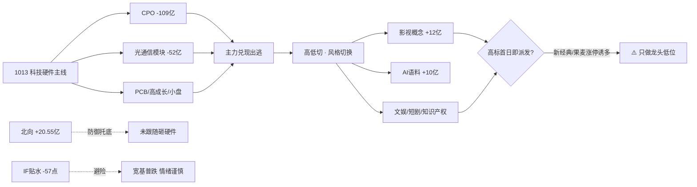

# 2026年10月15日（周四） · 资金面

> **数据源新鲜度**: partial（A股 T-1 完整 · 美股缺一晚 · vibe-trading 缺席）
> **降级状态**: true
> **置信度**: 0.66
> **数据归属交易日**: 20261014（周三收盘，T-1） · staleness = **ok**

## 一句话结论

💸 **科技硬件（CPO/光模块/PCB）一日游遭百亿级抛售，资金高切低扑向 AI内容/传媒，但影视高标首日即现涨停派发——高位震荡里的高低切，只做龙头低位，不追高换手板。**

## 详细分析

### 1️⃣ 北向：连续托底，但力道递减 🟢

北向资金 20261014 净买入 **+20.55 亿**（沪股通 +9.88 / 深股通 +10.66），近 **5 个交易日全部净流入**，5 日均 +25.79 亿、20 日均 +25.51 亿。外资态度仍是温和托底，但单日规模已从 1009 的 29.67 亿一路回落到 20 亿出头，且在内资砸盘科技硬件当日并未跟随流出，属于**防御性配置型买入，而非进攻性加仓**。

### 2️⃣ 主力板块：硬件 → 应用的剧烈高低切 🔴🟢

1014 主力资金的核心叙事是**一日切换**。1013 领涨的科技硬件链在 1014 被集体兑现：

| 板块（1013 流入 top） | 1013 净额 | 1014 净额 | 1014 涨跌 |
|---|---:|---:|---:|
| CPO概念 | +17.49亿 | **−109.02亿** | −3.19% |
| 光通信模块 | +35.32亿 | **−52.32亿** | −1.84% |
| 高成长股 | +23.43亿 | −44.15亿 | −2.13% |
| 小盘成长 | +26.49亿 | −17.25亿 | −1.90% |
| 军工 | +14.58亿 | −14.67亿 | −1.65% |
| PCB | +19.05亿 | −8.67亿 | −1.59% |
| 航母概念 | +12.84亿 | +1.44亿 | −0.30% |

T2 流入 top10 中 **9/10 在次日反转为净流出**，仅航母概念小幅延续——硬件链是典型的**情绪冲高后夺路而逃**。

资金切向了另一端——**AI内容/传媒**（当日主力净流入榜）：

| 排名 | 板块 | 净流入 | 涨跌 | 5日累计 | 5日态度 |
|---:|---|---:|---:|---:|---|
| 1 | 影视概念 | +12.09亿 | — | +31.06亿 | 偏强净入·有波动 |
| 2 | 文娱消费 | +11.02亿 | — | +29.98亿 | 🟢 加速流入 |
| 3 | AI语料 | +10.18亿 | — | +30.18亿 | 🟢 加速流入 |
| 4 | 知识产权 | +8.94亿 | — | +20.38亿 | 🟢 加速流入 |
| 6 | 快手概念 | — | — | +12.28亿 | 🟢 加速流入 |
| 7 | 短剧互动游戏 | — | — | +27.65亿 | 🟢 加速流入 |

### 3️⃣ 资金切换流向图

### 4️⃣ 龙虎榜诱多：AI内容高标 + 硬件退潮双重派发 ⚠️

1014 全市场龙虎榜 73 只，收紧规则后命中诱多 **30 只（去重）**，高度集中在**影视传媒**与**高位硬件**两条线：

| 代码 | 名称 | 涨跌 | 换手 | 龙虎净额 | 机构净额 | 诱多模式 |
|---|---|---:|---:|---:|---:|---|
| 301132 | 满坤科技(PCB) | +18.3% | 21.7% | **−4.50亿** | −2.20亿 | 高换手大额派发·机构净卖·中金对倒 |
| 603096 | 新经典(影视) | +10.0% | 22.0% | −0.85亿 | −0.30亿 | 涨停板净卖·机构净卖·高盛对倒 |
| 600408 | 安泰集团 | +10.0% | 29.1% | −1.28亿 | 0 | 涨停净卖·高换手·国泰海通对倒 |
| 000892 | 欢瑞世纪(影视) | −0.2% | 29.6% | −1.08亿 | −0.39亿 | 高换手派发·机构净卖·东财山南对倒 |
| 301052 | 果麦文化(影视) | +14.5% | **46.3%** | −0.15亿 | −0.24亿 | 极端换手·机构净卖·拉萨对倒 |
| 001318 | 阳光乳业 | +10.0% | 14.2% | −0.19亿 | −0.73亿 | 涨停净卖·机构大额净卖·绍兴对倒 |

**昨日前十 5 日追踪**（龙虎榜净买额 top，去重）：

| 代码 | 名称 | 净买 | 5日累计 | 解读 |
|---|---|---:|---:|---|
| 300299 | 富春股份 | +2.04亿 | **+28.84%** | 🟢 净买+强势，AI内容接力 |
| 605287 | 德才股份 | +1.64亿 | +30.78% | 🟢 强势接力 |
| 002029 | 七匹狼 | +1.56亿 | +19.28% | 消费，资金承接 |
| 601579 | 会稽山 | +2.12亿 | **−15.20%** | 🔴 下跌中接货，疑似被动承接 |
| 301689 | 电科思仪 | +1.47亿 | **−12.42%** | 🔴 高位回落中净买，非进攻 |

### 5️⃣ 游资席位与 ETF/期货

- **净买居前席位**：东方证券杭州龙井路（+3.26亿/3票）、国泰海通总部（+2.74亿/20票，广撒网）、华鑫上海陆家嘴（+2.05亿/6票）、国信浙江互联网（+1.53亿/17票）。
- **3日协同**：近 3 交易日同席位多次上榜同一票共 200 条（机读 JSON 存 top30），游资在 AI内容/消费题材上反复滚动。
- **宽基 ETF 普跌**：科创50 −3.25%、创业板 −2.79%、中证500 −1.18%、沪深300 −1.17%、上证50 −0.86%。
- **IF 期现基差 −57.08 点（深贴水）**：对冲盘避险情绪浓，与宽基普跌互证，**高位震荡偏谨慎**。

### 6️⃣ 隔夜美股（证据权重下调 · 缺一晚） 🟡

> ⚠️ 盘前 tushare 美股仅可得至 **20261013（美东周一）**，缺 1014 美盘；以下为**落后一晚**的证据，不作强方向结论。

- 半导体组均值约 **+0.17%（分化，非系统性杀跌）**：**MU −3.62%（存储独跌）** vs AMD +1.90% / NVDA +0.97% / AVGO +0.73%（算力芯片偏强）。
- 大型科技偏暖：**META +2.63%（AI应用/广告领涨）**、MSFT +0.43%、GOOGL +0.30%；TSLA −0.74%。
- 指数：SPX −0.02%、纳指 −0.15%、道指 −0.35%（基本平盘）。USDCNH 6.6937。

**外部传导（谨慎）**：META 领涨 AI应用，与 A股 1014 资金切向 AI内容/传媒**方向共振**；但 NVDA/AVGO 上涨未能阻止 A股 CPO/光模块百亿流出，呈**内外背离**，说明 A股硬件是自身筹码兑现，不宜拿美股算力上涨去抢 A股硬件反抽。MU 独跌对存储链有轻微压制。

## 关键证据

- 证据 1: CPO概念单日主力净流出 −109.02亿、光通信模块 −52.32亿，T2 流入 top10 有 9 个次日反转 · 来源 tushare.moneyflow_ind_dc
- 证据 2: 影视/文娱/AI语料/知识产权/短剧 5日「加速流入」，5日累计均 +20~31亿 · 来源 moneyflow_ind_dc
- 证据 3: 满坤科技龙虎榜净卖 −4.50亿（机构 −2.20亿）、新经典涨停净卖 −0.85亿、果麦文化 46%极端换手 · 来源 top_list+top_inst
- 证据 4: 北向连续5日净流入，1014 +20.55亿但规模递减 · 来源 moneyflow_hsgt
- 证据 5: IF 期现基差 −57.08 点深贴水 + 宽基 ETF 全线下跌 · 来源 fut_daily/fund_daily
- 证据 6: 美股 META +2.63% 领涨 AI应用、MU −3.62% 独跌（数据落后一晚） · 来源 overseas_snapshot

## 数据源审计

| 源 | 状态 | 抓取时间 | 记录数 | 备注 |
|---|---|---|---|---|
| 北向 moneyflow_hsgt | 🟢 ok | 10-15 07:40 | 20 | T-1 完整 |
| 板块 moneyflow_ind_dc | 🟢 ok | 10-15 07:40 | 10日 | 概念口径 |
| 龙虎榜 top_list | 🟢 ok | 10-15 07:40 | 73 | 同票多行已去重 |
| 席位 top_inst | 🟢 ok | 10-15 07:40 | 3日 | 诱多规则收紧 v2 |
| ETF/期货 | 🟢 ok | 10-15 07:40 | 6 | amount 口径异常取方向 |
| 隔夜美股 | 🟡 stale | 10-15 06:03 | 12 | 仅至 1013，缺一晚 |
| vibe-trading | 🔴 error | — | 0 | 大宗/两融/期权全缺 |
| weflow / qmt | 🔴 down | — | — | 不影响 R7 主口径 |

## 不确定性 / 反证

- **美股缺一晚是最大盲点**：若 1014 美盘半导体/AI应用方向反转，今日 A股 AI内容的共振逻辑可能被削弱，开盘需以竞价与外盘期货修正。
- **影视高标「加速流入」与「涨停派发」并存**：板块层面资金确实在进，但领涨个股（新经典/果麦/欢瑞）已遭机构和游资净卖，说明**进的是板块β、出的是拥挤高标**——这既是高低切机会，也是接力末端警报，不能因板块净流入就追 40%+ 换手板。
- **龙虎榜净买 ≠ 看多**：会稽山、电科思仪在 5 日下跌中仍获净买，更像被动承接，规则无法区分主动锁仓与下跌接货。
- vibe-trading 的大宗交易折价、两融余额、期权隐波三条独立证据面缺席，**无法确认主力是否已通过大宗/两融提前布局或撤离**，置信度封顶 0.66。

## 与其他 R/D/E 的关系

- **依赖**: data/raw/20261015/{manifest,mcp_health,overseas_snapshot}.json；data/research/20261015/emotion_cycle.json（高位震荡 0.75）
- **被消费**: R2（主线板块排序，硬件→应用切换）、R5（个股画像资金约束）、R6（满坤/新经典/果麦等诱多票复核 hard_reject）、D1（仓位与主线模板选择）

## Sub-Agent 元数据

- skill: analyze_capital_flow_v1@1.3
- artifact: data/research/20261015/R7_capital_flow.json（+ 日期副本 R7_capital_flow_20261014.json）
- 生成耗时: 约 120 秒（含 10 日板块 + 3 日席位拉取）
- model: ark-code-latest
