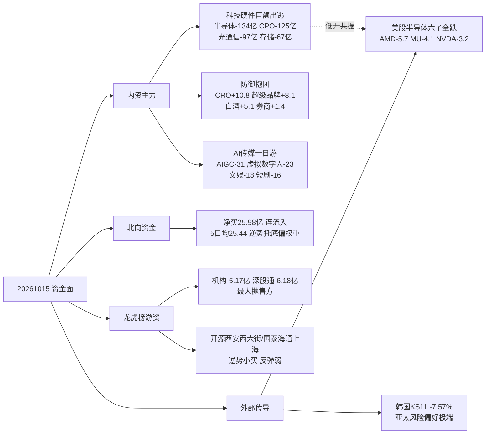

# 2026年10月16日 周五 · 资金面

> **数据源新鲜度**: partial（A股 T-1 完整 · 美股最近一完整美盘 · vibe-trading 缺）
> **降级状态**: true（vibe-trading 大宗/两融/期权隐波缺失，走 Tushare 主路）
> **置信度**: 0.70

## 一句话结论

🟥 **科技硬件踩踏 + AI传媒一日游，资金极致避险抱团白酒/CRO/超级品牌/券商；隔夜美股半导体六子全线深跌，今日 CPO/存储/半导体低开无悬念，只做防御低位核心，禁止抢硬件反抽。**

## 资金全景（四维）

## 详细分析

**① 主线退潮确认 —— T-1 流入 top10 板块 10/10 反手流出。** 1014 还在领涨的 AI 内容/传媒（影视、文娱、AI语料、短剧、快手、AIGC、虚拟数字人），1015 无一幸免全部转为净流出，比前一交易日（9/10 反转）更极端。高切低已经演变成**无差别杀跌 + 防御抱团**，这是主线退潮、情绪从「高位震荡」向「主跌」滑落的资金特征，不是普通分歧。

**② 科技硬件内外共振，今日开盘承压最硬。** A股 1015 半导体概念 -134亿、CPO -125亿、光通信模块 -97亿、存储 -67亿、PCB -65亿；隔夜（1014美东）美股半导体六子**系统性全线深跌**：AMD -5.73%、GLW -5.15%、MU -4.1%、TSM -3.4%、NVDA -3.16%、AVGO -3.1%，无一分化幸免。叠加韩国 KOSPI 1015 崩盘 -7.57%，亚太风险偏好极端。**今日 A股 CPO/存储/半导体/PCB 低开是大概率，禁止左侧抄硬件、禁止抢反抽。**

**③ 资金唯一去处是防御。** 全市场概念板块仅 CRO（+10.8亿）、超级品牌（+8.1亿）、酿酒概念（+5.7亿）、白酒（+5.1亿）、券商（+1.4亿）逆势净流入。5日窗口跷跷板显示茅指数/超级品牌/CRO 与 PCB/AIGC/半导体/通信/存储负相关 -0.8～-0.999，且 1015 当日全部完成方向反转确认。这是恐慌式避险，不是新进攻主线——**只可做防御主线的低位核心，不追高、不碰中位跟风。**

**④ 北向托底、内资出货，结构背离。** 北向 1015 逆势净买 25.98亿（较 1014 的 20.55亿小幅回升），连续净流入未断，5日均 25.44亿；但龙虎榜口径机构专用净卖 -5.17亿、深股通净卖 -6.18亿，为当日最大抛售方。外资整体托底偏权重/防御，内资机构夺路而逃——托底不等于进攻。

**⑤ 期货贴水连续加深。** IF 主力 - 沪深300 = -73.4 点深贴水（1014 为 -57 点），连续两日深贴水且扩大，对冲盘避险情绪加剧；宽基 ETF 普跌（500ETF -3.17%、创业板 -2.94%、300ETF -1.21%）。期现背离与板块、外资证据互证。

## 关键证据

- 证据 1: T-1(1014)流入 top10 板块 **10/15 全部转净流出**（flip 10/10） · 来源 tushare.moneyflow_ind_dc
- 证据 2: 1015 科技硬件净流出 半导体-134 / CPO-125 / 光通信-97 / 存储-67 / PCB-65 亿 · 来源 moneyflow_ind_dc
- 证据 3: 隔夜美股半导体六子均值 **-4.11%** 全线跌（AMD-5.73/MU-4.1/GLW-5.15） · 来源 overseas_snapshot(tushare.us_daily)
- 证据 4: 韩国 KOSPI 1015 **-7.57%** · 来源 index_global
- 证据 5: 北向净买 25.98亿连流入，机构龙虎榜 -5.17亿 / 深股通 -6.18亿 · 来源 moneyflow_hsgt / top_inst
- 证据 6: IF 深贴水 -73.4 点（连续两日扩大） · 来源 fut_daily/index_daily
- 证据 7: 防御逆势 CRO+10.8 / 超级品牌+8.1 / 白酒+5.1 / 券商+1.4 亿 · 来源 moneyflow_ind_dc

## 龙虎榜诱多识别（净卖出真派发，12 只）

| 代码 | 名称 | 涨跌% | 换手% | 龙虎净额(万) | 机构净额(万) | 命中模式 |
|---|---|---|---|---|---|---|
| 000823.SZ | 超声电子 | 5.38 | 35.96 | -23742.9 | -19128.5 | 高换手派发·机构净卖·席位对倒 |
| 002552.SZ | 宝鼎科技 | 2.03 | 13.30 | -21233.5 | -22312.6 | 机构席位净卖 |
| 603598.SH | 引力传媒 | -6.71 | 23.62 | -15688.1 | 0 | 高换手派发·席位对倒 |
| 002741.SZ | 光华科技 | -10.01 | 9.35 | -12667.7 | -16306.9 | 跌停·机构净卖 |
| 301520.SZ | 万邦医药 | 8.66 | 46.63 | -11301.0 | -14373.4 | 高换手派发·机构净卖 |
| 000048.SZ | 京基智农 | -10.0 | 4.08 | -6352.1 | -8252.8 | 跌停·机构净卖 |
| 002866.SZ | 传艺科技 | 1.19 | 26.76 | -4417.3 | -3357.6 | 高换手派发·机构净卖 |
| 301052.SZ | 果麦文化 | 3.85 | 45.60 | -2953.0 | -3740.1 | 传媒高标·机构净卖 |
| 600241.SH | 时代万恒 | 5.90 | 33.34 | -2918.2 | 0 | 高换手·席位对倒 |
| 301041.SZ | 金百泽 | 5.26 | 30.99 | -1954.6 | -5169.6 | PCB·高换手·机构净卖 |
| 000530.SZ | 冰山冷热 | 10.0 | 41.05 | -1394.2 | -2490.8 | 涨停高换手派发 |
| 603096.SH | 新经典 | 0.78 | 28.71 | -544.0 | 0 | 影视高标连续派发 |

> **诱多集中度**: 科技硬件高位（超声电子/宝鼎/光华/金百泽）+ AI传媒余孽（引力传媒/果麦/新经典）。**今日追高此类高换手高标 = 接机构出货，R6 请复核。**

## 昨日前十 · 5日追踪（龙虎榜净买）

| 名称 | 代码 | 1015涨跌% | 净买(亿) | 5日累计% | 性质 |
|---|---|---|---|---|---|
| 远东股份 | 600869.SH | 6.79 | 2.64 | +5.67 | 振幅板反包 |
| 华林证券 | 002945.SZ | 10.01 | 1.93 | +8.99 | 🟢 券商首板·防御 |
| 百花医药 | 600721.SH | 10.05 | 1.91 | -4.44 | CRO低位反包 |
| 金禄电子 | 301282.SZ | 20.0 | 1.21 | +30.0 | 🔴 PCB超跌20cm·追高险 |
| 内蒙新华 | 603230.SH | 10.0 | 1.14 | +9.17 | 出版防御首板 |
| 向日葵 | 300111.SZ | 20.06 | 1.08 | +8.8 | 20cm反抽 |
| 欢瑞世纪 | 000892.SZ | 6.24 | 1.08 | +12.37 | 影视高换手38%·分歧 |
| 航天南湖 | 688552.SH | 7.39 | 1.04 | +24.74 | 军工3日异动 |
| 雪人集团 | 002639.SZ | 1.12 | 0.99 | +9.79 | 高换手接力 |
| 联亚药业 | 301569.SZ | +401.7 | 1.37 | 新股 | 无涨跌幅新股，不参与 |

## 推理深度三问（资金主线对象）

**对象一：半导体/CPO/存储（杀跌主线）**
- **大资金意图**: 内外资共振减仓，机构龙虎榜大额出货，属趋势性避险非洗盘。
- **为什么走弱**: 美股半导体六子系统性暴跌 + 韩国崩盘 + 前期硬件高位拥挤，三杀。
- **逻辑够不够硬（继续跌）**: 硬。外部催化未消化、IF深贴水、板块连续大额流出，**今日不抢反抽**。

**对象二：白酒/CRO/超级品牌（避险抱团）**
- **大资金意图**: 防御性配置，赚避险钱而非成长钱，持续性取决于科技何时止跌。
- **为什么走强**: 科技抽血反转后的低波红利/消费抱团 + 北向权重托底。
- **逻辑够不够硬**: 中等。是「跷跷板另一端」，科技一旦超跌反弹防御会回吐——**只做低位核心首板/低吸，不追高、不给大仓位**。

**对象三：券商（华林证券首板）**
- **大资金意图**: 大跌日护盘 + 低位弹性试错，净买1.93亿封板。
- **为什么走强**: 指数深跌后护盘预期，券商是情绪反转期权。
- **逻辑够不够硬**: 偏弱（单日、跟风未起），**观察能否连板带动指数，不连板即隔日走**。

## 数据源审计

| 源 | 状态 | 抓取时间 | 记录数 | 备注 |
|---|---|---|---|---|
| 北向 moneyflow_hsgt | 🟢 ok | 06:35 | 20 | 至1015，连流入 |
| 板块 moneyflow_ind_dc | 🟢 ok | 06:35 | 508 | 概念板块5日 |
| 龙虎榜 top_list | 🟢 ok | 06:35 | 62 | 1015 |
| top_inst(3日) | 🟢 ok | 06:35 | 2090 | 协同/诱多 |
| 美股 us_daily/index_global | 🟢 ok | 06:03 | 15 | 至1014美东，fresh |
| fund/fut/index | 🟢 ok | 06:35 | 7 | IF贴水-73.4 |
| vibe-trading | 🔴 error | — | — | 大宗/两融/期权隐波缺 |
| weflow / qmt | 🔴 error | — | — | 隧道离线 / 502 |
| 期货商品段 | ⚪ skipped | 06:03 | — | 代码待映射 |

## 不确定性 / 反证

1. **美股一日暴跌是否为情绪错杀**：若今夜美股半导体反弹，A股硬件可能高开反抽——但本 skill 只对 1016 开盘前证据负责，**开盘前不预判反抽，等盘中资金确认**。
2. **防御抱团的持续性**：白酒/CRO 是被动避险，若科技快速企稳，防御资金会回吐，仓位不可重。
3. **北向口径**：moneyflow_hsgt 为整体北向，无法拆细分板块；「托底偏权重」是结合龙虎榜机构卖出的推断，非直接持仓数据。
4. **vibe-trading 缺失**：大宗折价、两融杠杆、期权隐波三条独立证据面全缺，置信度因此压在 0.70 而非更高。
5. **金禄电子 5日+30% + 20cm**：虽获龙虎榜净买，但属硬件超跌高标，在外部半导体利空下追高盈亏比极差。

## 与其他 R/D/E 的关系

- **依赖**: `data/raw/20261016/manifest.json`、`mcp_health.json`、`overseas_snapshot.json`；`data/research/20261016/emotion_cycle.json`
- **被消费**: D1(main_decision_v1)、R6(devil_advocate)、P1/P2 修订、E1 复盘
- **给 D1 的硬约束**: 仓位宜守不宜攻；硬件方向不抢反抽；防御只做低位核心；IF 贴水+美股+韩国三重风险偏空。
- **给 R6 的复核名单**: 超声电子/宝鼎科技/光华科技/引力传媒/果麦文化/新经典/万邦医药/金百泽。

## Sub-Agent 元数据

- skill: analyze_capital_flow_v1@1.3
- artifact: data/research/20261016/R7_capital_flow_20261016.json（+ R7_capital_flow.json 副本）
- resolved_trade_date: 20261015 · staleness_status: ok
- 生成耗时: 约 23 分钟（含 MCP 拉取）
- model: ark-code-latest
