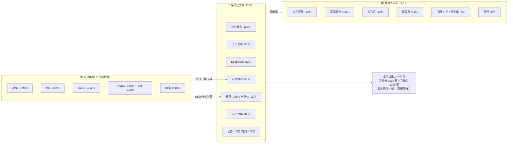

# 2026年10月19日（周一） · 资金面

> **数据源新鲜度**: partial（主源 T-1 新鲜，北向/vibe/ETF 三维度降级）
> **降级状态**: true
> **置信度**: 0.72
> **数据归属交易日**: 2026-10-16（周五，T-1）· staleness = ok（周一用上周五数据为最新可得）

## 一句话结论

🚨 **炸板率 44.5% + 主力净流出 341 亿 + 隔夜美股半导体崩盘的高位震荡日**：资金正从科技/高位传媒往**军工、央企国改、白酒、贵金属**做高低切，今日压仓位、砍候选、科技链开盘拦截、涨停诱多名单全规避。

## 资金流向总图

## 时序资金流：三个关键时间序列

**① 全市场资金（T-1）**：主力净流出 **-341 亿**，超大单仅 **+2 亿**（大资金按兵不动），净流出 3030 家 > 净流入 2186 家。增量只集中在四条线（军工/国改/白酒/贵金属），典型存量博弈 + 高低切。

**② 北向（成交额口径，净买入已停止披露）**：T 日成交 22.5 亿，较 T-1 的 26.0 亿**缩量 13%**，近 6 日次低。外资在周五美股科技下跌前已收缩交投，观望。⚠️ 不可把成交额当净买入解读。

**③ 板块轮动时序**：上周五盘面已经是「指数军工 +5.61% 独强、科技全线净流出」的防御结构，而隔夜美股半导体暴跌与 A 股科技链流出方向**完全一致**——今日科技低开不是意外，是内外资同向。

## 隔夜美股核心个股 → A股传导

| 指数/个股 | 收盘涨跌 | 映射 A 股 |
|---|---|---|
| 纳指 IXIC | **-2.15%** | 成长/科技整体风险偏好压制 |
| 费城半导体链 AMD | **-5.95%** | 半导体设备/算力 |
| 美光 MU | **-5.63%** | 存储（长鑫科技/江波龙/兆易）直接承压 |
| 博通 AVGO | **-4.52%** / 康宁 GLW -4.64% | CPO/光模块/光器件（中际旭创/天孚/新易盛）|
| 英伟达 NVDA -1.43% / 台积电 TSM -2.28% | — | AI 算力/代工链 |
| META -3.72% / GOOGL -2.47% | — | AI 应用/AIGC |
| 苹果 AAPL | **+0.43%**（唯一红盘）| 消费电子链相对抗跌，无强对冲 |

**传导结论**：上周五 A 股元件（-24亿）、半导体（-23亿）、华为概念（-124亿）、天孚通信（个股 -5.2亿）已抢先流出，**内外资方向一致 = 科技链低开概率大**。中际旭创/拓荆/长鑫的逆势流入资金今日面临隔夜利空直接考验，竞价不放量企稳就降级。

## 昨日主力净流入前十 · 5日追踪（核心表）

| 代码 | 名称 | 行业 | T日主力净额 | 5日累计 | 5日涨跌 | 资金性质判定 |
|---|---|---|---:|---:|---:|---|
| 300308 | 中际旭创 | CPO | **+9.22亿** | **+30.3亿** | -13.6% | 🟡越跌越买，超大单分歧，隔夜利空考验 |
| 600519 | 贵州茅台 | 白酒 | +5.14亿 | **+33.1亿** | +5.2% | 🟢避险抱团，连续5日净流入 |
| 688072 | 拓荆科技 | 半导体设备 | +4.65亿 | +7.5亿 | +7.6% | 🟢量价资齐强，但受板块拖累 |
| 688825 | 长鑫科技 | 存储 | +4.60亿 | **-33.9亿** | -11.7% | 🔴5日流出后首日回流，MU隔夜压制 |
| 002714 | 牧原股份 | 养殖 | +3.93亿 | +2.3亿 | -0.1% | ⚪防御切换，单日回流 |
| 601899 | 紫金矿业 | 铜/贵金属 | +3.37亿 | +8.9亿 | -2.9% | 🟢贵金属+8亿，避险受益 |
| 000100 | TCL科技 | 面板 | +3.28亿 | -2.9亿 | -2.2% | ⚪超跌反抽，趋势仍弱 |
| 000725 | 京东方A | 面板 | +3.17亿 | **-23.8亿** | -6.7% | 🔴重流出后弱反抽 |
| 300747 | 锐科激光 | 军工激光 | +3.16亿 | +4.7亿 | **+16.4%** | 🟢低位军工补涨真金 |
| 300699 | 光威复材 | 碳纤维/军工材料 | +2.89亿 | +2.3亿 | +5.1% | 🟢T日+9.45%，军工高低切受益 |

**推理深度三问（对 top 资金对象）**：

- **中际旭创（300308）**
  - **大资金意图**：5 日主力 +30.3 亿、股价却 -13.6%，机构/大资金在 CPO 总龙上**逆势左侧吸筹**；但超大单 10/14 单日 -14.8 亿、10/15 -11.9 亿，T 日才转 +2.9 亿，内部并非一致。
  - **为什么走强（资金流入）**：CPO 景气逻辑未破坏，股价先跌出性价比，资金接下跌中的龙头而非杂毛。
  - **逻辑够不够硬**：景气硬，但**隔夜 MU/AVGO/GLW 集体崩盘直接打脸光模块/存储情绪**，今日竞价是试金石——低开高走放量才验证，低开低走则左侧资金被套，降级。

- **贵州茅台（600519）**
  - **大资金意图**：连续 5 日净流入累计 33 亿、股价 +5.2%，教科书式**避险抱团核心资产**。
  - **为什么走强**：高位科技分歧 + 炸板率 44.5%，资金躲进确定性。
  - **逻辑够不够硬**：防御逻辑硬，但日波动低、无涨停基因，**不进进攻池**，只做情绪防御锚。

- **锐科激光 / 光威复材（军工低位）**
  - **大资金意图**：总龙长城军工涨停却被净流出 3.7 亿，资金转头买低位激光/碳纤维材料，**板块内部高低切**。
  - **为什么走强**：兵装重组 + 军民融合概念 +16 亿，低位补涨有板块效应。
  - **逻辑够不够硬**：相对硬（量价资齐），但需今日竞价确认军工主线延续，且只能按「低位补涨」模板小仓试错，不能当总龙做。

## 🚨 龙虎榜诱多识别（今日重点风险）

> 判定口径：涨停/高位 + moneyflow 主力净流出 + 龙虎榜净卖/机构卖，三重背离即标记。

| 代码 | 名称 | 板型 | 主力T日 | 5日累计 | 龙虎榜/机构 | 判定 |
|---|---|---|---:|---:|---|---|
| 600418 | **江淮汽车** | 涨停+9.98% | **-6.63亿** | -7.7亿 | 全市场流出第一 | 🔴涨停诱多·头号，借板出货 |
| 601606 | **长城军工** | 涨停·兵装总龙 | -3.66亿 | -4.1亿 | 封单2.07亿但资金流出 | 🔴龙头被出货，高低切信号 |
| 003029 | **吉大正元** | 2连板 | -1.60亿 | -3.6亿 | 龙虎榜净卖1.15亿(净率-14.7%) | 🔴双卖板上派发 |
| 000887 | 中鼎股份 | 涨停尾盘回封 | -2.26亿 | -5.0亿 | 龙虎榜净买1.5亿/机构-0.07亿 | 🔴游资接老资金货 |
| 600699 | 均胜电子 | 涨停(开板4次) | -1.87亿 | -4.2亿 | 龙虎榜+0.4亿 | 🔴烂板诱多 |
| 600825 | **新华传媒** | 11连板总龙 | -1.55亿 | **-10.7亿** | 传媒板块-34亿 | 🔴总龙见顶预警，只做情绪锚 |
| 002343 | 慈文传媒 | 5板后炸板+4.71% | +0.19亿 | -6.9亿 | 换手48%天量，机构+0.24亿 | 🔴天量炸板不博反包 |
| 300045 | 华力创通 | 20cm涨停 | -2.14亿 | -4.4亿 | 龙虎榜+1.07亿/机构+0.36亿 | 🟡分歧，机构不排斥，低开承接才可低吸 |
| 300581 | 晨曦航空 | 20cm涨停 | -2.43亿 | -2.5亿 | 机构中性+0.03亿 | ⚪观察 |

**首推风险票思维链（以江淮汽车为反面教材）**：
- **买入（追板）理由**：整车龙头涨停、机器人/车企题材。
- **风险点**：涨停当日主力净流出 6.63 亿（全市场第一）、5 日 -7.7 亿，前期 -8.6% 大阴后反抽板，板上是出货不是抢筹。
- **止损条件**：若已持有，今日竞价低开或封单撤离即走，不格局。
- **可验证假设**：今日竞价封单金额较周五明显缩水 / 开盘 15 分钟主力资金继续净流出 → 出货确认，拦截正确。

**左侧接货（非右侧，观察不追）**：瑞芯微跌停机构专用净买 1.60 亿（主力仍 -3.2 亿）；药明康德 -6.6% 放天量 123 亿、龙虎榜净买 14.4 亿但**无机构专用席位**（游资/北向抄底）；复旦微电 +14.6% 炸板主力 +2.7 亿（半导体唯一正反馈，隔夜承压）。

## 板块跷跷板

1. **AI/科技 → 军工**（强）：华为 -124/AI -93/DeepSeek -87/芯片 -68 亿流出，军民融合 +16/大飞机 +13 亿承接。
2. **高位传媒 → 央企国改/高股息**（强）：传媒 -34 亿、总龙 11 板滞涨，国改 +19/高股息 +12/中特估 +10 亿。
3. **成长 → 白酒/贵金属/银行**（中）：电池 -21/医疗 -14 流出，茅台 5 日 +33 亿、贵金属 +8、银行 +5。

## 数据源审计

| 源 | 状态 | 数据归属 | 记录数 | 备注 |
|---|---|---|---|---|
| tushare 个股资金流 moneyflow | 🟢 ok | 10/16 | 5577 | MCP超限改本地token，全市场 |
| tushare 行业资金流 | 🟢 ok | 10/16 | 90 | THS行业 |
| tushare 概念资金流 | 🟢 ok | 10/16 | 386 | THS概念 |
| tushare 龙虎榜 top_list/top_inst | 🟢 ok | 10/16 | 61 | 机构席位去重聚合 |
| tushare 涨跌停 limit_list_d | 🟢 ok | 10/16 | U61/D10/Z50 | 炸板率44.5% |
| tushare 北向 hsgt | 🟡 ok(口径受限) | 10/16 | 18日 | 仅成交额，无净买入 |
| overseas_snapshot 美股 | 🟢 ok | 10/16美股 | 18 | 商品期货缺 |
| vibe-trading 四工具 | 🔴 error | — | 0 | profile无MCP，降级 |
| ETF/期货/期权 | ⚪ stale | — | 0 | 维度缺 |

## 不确定性 / 反证

1. **北向无净买入口径**，外资真实多空无法直接验证，仅能用成交额缩量推断观望，结论弱于有净额时。
2. **美股映射是概率不是因果**：A 股科技 10/16 已提前流出，也可能低开后利空出尽；中际旭创 5 日 +30 亿的左侧资金若被证伪（低开低走），说明大资金也会短线被套，不能神化。
3. **军工高低切可能一日游**：总龙长城军工被出货意味着板块进入分歧段，低位补涨（锐科/光威）若今日无板块续涨，同样闷杀，只能小仓试错。
4. **vibe-trading 大宗/两融交叉面缺失**，无法确认主力流出是否伴随大宗折价派发或融资盘撤退，诱多结论基于 moneyflow+龙虎榜两源，置信度上限 0.72。

## 与其他 R/D/E 的关系

- **依赖**：`data/raw/20261019/manifest.json`、`mcp_health.json`、`overseas_snapshot.json`；交叉 `emotion_cycle.json`（高位震荡 0.75 一致）。
- **被消费**：R2（主线/候选资金约束 C1-C6）、R5（个股画像取 top10/诱多/左侧）、R6（反证可用诱多名单）、D1（仓位压一档+科技拦截+诱多规避）。
- **对 D1 的一句话**：炸板 44.5% + 主力 -341 亿 + 美股半导体崩盘的高位震荡日，压仓位砍候选；科技链开盘拦截，军工只做低位补涨不追被出货总龙，涨停诱多名单全规避，防御资金只做锚不进攻。

## Sub-Agent 元数据

- skill: analyze_capital_flow_v1@1.3
- artifact: data/research/20261019/R7_capital_flow_20261019.json（+ R7_capital_flow.json 兼容副本）
- 生成耗时: 约 8 分钟（含 MCP 超限改本地源）
- model: ark-code-latest
